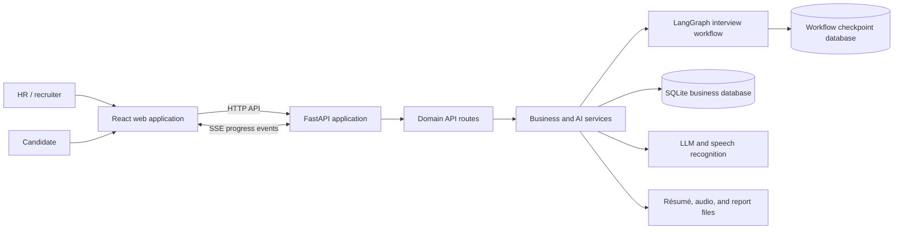

This page introduces the AI-powered recruitment interview system: what it does, how its major parts fit together, and where a new developer can go next. It is an orientation guide, not a setup tutorial or a detailed design specification. **You are currently here: [Overview](1-overview).** [Quick Start](2-quick-start) is the next step for getting the application running. Sources: [README.md](README.md#L6-L17)

## What the system does

The application connects several recruitment activities into one workflow: manage positions and candidates, prepare interview questions using candidate and role information, let candidates complete online voice interviews, and produce an interview evaluation report. It also includes automated workflow processing and Server-Sent Events (SSE) for interview progress updates. Sources: [README.md](README.md#L8-L17)

| Capability | What it means at a glance |
|---|---|
| Recruitment management | HR users manage positions, candidates, and interviews. |
| Interview preparation | The system generates questions based on a candidate’s résumé and position requirements. |
| Voice interview | Candidates record spoken answers in the browser; audio is transcribed using Whisper. |
| Evaluation report | The system analyzes interview performance and generates a report. |
| Progress updates | SSE delivers interview status changes to connected clients. |

Sources: [README.md](README.md#L8-L17)

## Architecture at a glance

The diagram shows the main user-facing and server-side components and the broad flow between them. The frontend is a React application; the backend exposes a FastAPI API and registers domain routes for authentication, positions, candidates, interviews, candidate access, and events. The README identifies LangGraph as the workflow orchestrator and SQLite as the MVP database. Sources: [README.md](README.md#L21-L39), [backend/app/main.py](backend/app/main.py#L230-L249), [backend/app/api/router.py](backend/app/api/router.py#L6-L18), [frontend/src/main.tsx](frontend/src/main.tsx#L1-L15)



The frontend entry point mounts the application providers and router. The backend entry point initializes application services, registers the API router, and exposes a health-check endpoint. In the deployment configuration, Docker Compose defines an API service and an Nginx service; Nginx serves the frontend build and proxies requests. Sources: [frontend/src/main.tsx](frontend/src/main.tsx#L1-L15), [backend/app/main.py](backend/app/main.py#L230-L249), [docker-compose.yml](docker-compose.yml#L1-L18), [docker-compose.yml](docker-compose.yml#L40-L68)

## Project map

Use this simplified tree to orient yourself before diving into implementation details. `backend/app` contains the API, domain models, services, and interview workflow; `frontend/src` contains the browser application, pages, reusable components, and API client modules. Sources: [README.md](README.md#L62-L80), [backend/app/main.py](backend/app/main.py#L230-L249)

```text
smart_interview_ai/
├── README.md
├── backend/
│   ├── app/
│   │   ├── api/          # HTTP route modules
│   │   ├── models/       # Database models
│   │   ├── schemas/      # Request/response data structures
│   │   ├── services/     # Business and AI services
│   │   ├── workers/      # Background scheduling
│   │   └── workflow/     # Interview workflow implementation
│   └── tests/            # Backend tests
├── frontend/
│   └── src/
│       ├── api/           # API client modules
│       ├── components/    # Shared and feature UI components
│       ├── hooks/         # Reusable hooks
│       ├── pages/         # Application pages
│       └── routes.tsx     # Route configuration
├── docs/                  # Project documentation and diagrams
├── docker-compose.yml
└── nginx/                 # Reverse-proxy configuration
```

The browser routes distinguish public pages from HR pages protected by an authentication guard. The backend combines its route modules in one API router. These are useful starting points when tracing a user action from a page to a server endpoint. Sources: [frontend/src/routes.tsx](frontend/src/routes.tsx#L18-L44), [backend/app/api/router.py](backend/app/api/router.py#L6-L18)

## How to continue

For a beginner-friendly path, start by running the application, then learn the user workflow and find the code areas that implement it. Move from the broad architecture into the specific backend, frontend, or operational topics that match your task.

1. [Quick Start](2-quick-start) — run the project locally.
2. [Recruitment Workflow and User Roles](3-recruitment-workflow-and-user-roles) — understand the people and process the system supports.
3. [Repository Map and Recommended Reading Paths](4-repository-map-and-recommended-reading-paths) — choose a code-reading path.
4. [Local Configuration and Environment Variables](5-local-configuration-and-environment-variables) — understand local settings.
5. [System Architecture and Component Boundaries](6-system-architecture-and-component-boundaries) — explore the system’s major components.

After that, follow the area closest to your work: backend and data topics begin with [Recruitment Domain Model and Data Relationships](7-recruitment-domain-model-and-data-relationships) and [Service Layer, Repositories, and Database Sessions](17-service-layer-repositories-and-database-sessions); frontend topics begin with [React Application Entry, Routing, and Page Responsibilities](22-react-application-entry-routing-and-page-responsibilities); operations topics begin with [Docker Compose, Nginx, and SSE-Aware Deployment](30-docker-compose-nginx-and-sse-aware-deployment). Sources: [README.md](README.md#L6-L17), [README.md](README.md#L62-L80), [frontend/src/routes.tsx](frontend/src/routes.tsx#L18-L44)

## Scope and caveats

This overview describes the repository’s documented purpose and visible component structure. It does not explain environment setup, configuration values, API contracts, detailed workflow transitions, or production operations; those subjects have dedicated pages in the catalog. Sources: [README.md](README.md#L6-L17), [backend/app/api/router.py](backend/app/api/router.py#L6-L18)