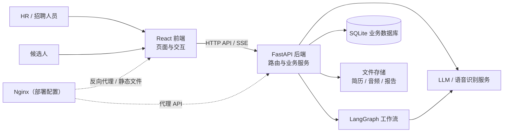

本页介绍星浩 AI 智能招聘面试系统的定位、主要组成和阅读路线，帮助刚接触项目的开发者先建立整体认识。这里聚焦系统全貌；具体业务流程、环境配置、模块实现与部署细节，请沿目录中的对应页面继续阅读。Sources: [README.md](README.md#L6-L20)

## 项目解决什么问题

系统面向企业 HR 和技术招聘官，将岗位与候选人管理、个性化面试问题生成、在线语音面试和自动评估报告串联起来。它结合大语言模型生成问题和分析面试表现，并使用语音识别处理候选人的语音回答；HR 可通过系统管理招聘对象和面试进展。Sources: [README.md](README.md#L10-L20)

| 能力 | 系统用途 | 实现组成（概览） |
|---|---|---|
| 招聘管理 | 管理岗位、候选人与面试 | 前端页面、后端 API 与业务服务 |
| 智能出题 | 根据简历和岗位要求生成问题 | 后端工作流、LLM 服务与提示词模板 |
| 在线语音面试 | 让候选人通过网页录音答题 | 前端录音组件、后端音频与语音识别服务 |
| 自动评估 | 分析面试表现并生成报告 | LLM 服务、报告模板与 PDF 渲染 |
| 实时进度 | 推送面试状态变化 | SSE 服务与前端事件订阅 |

以上能力与模块名称来自仓库说明及代码目录；此表用于建立概览，不表示每项能力的完整调用顺序。Sources: [README.md](README.md#L12-L20), [README.md](README.md#L80-L109), [main.py](backend/app/main.py#L189-L199)

## 系统由哪些部分组成

从架构上看，项目由浏览器中的 React 前端、提供 API 和业务处理的 FastAPI 后端，以及用于持久化的数据库和文件存储组成。后端目录进一步划分为 API、模型、服务、工作流和提示词等模块；前端则包含页面、组件、API 客户端、认证状态与 SSE Hook。生产部署配置还定义了 Nginx 与 API 两个 Compose 服务。Sources: [README.md](README.md#L64-L109), [docker-compose.yml](docker-compose.yml#L9-L18), [docker-compose.yml](docker-compose.yml#L49-L63)



图中前后端、工作流、AI 服务及存储模块可由仓库目录与 README 的能力说明验证；Nginx 的反向代理和静态文件职责由项目说明及 Compose 注释声明。图示表达系统组成关系，不代表逐项请求的精确时序。Sources: [README.md](README.md#L12-L20), [README.md](README.md#L80-L109), [docker-compose.yml](docker-compose.yml#L49-L63)

## 项目目录地图

阅读代码时，可以先按“入口与配置 → 业务模块 → 前端功能 → 部署与文档”的顺序定位文件。下图突出主要目录，省略测试、依赖锁文件和其他辅助内容。Sources: [README.md](README.md#L64-L125)

```text
smart_interview_ai/
├── backend/
│   ├── app/
│   │   ├── main.py          # FastAPI 应用入口与生命周期
│   │   ├── api/             # HTTP 路由
│   │   ├── models/          # 数据模型
│   │   ├── schemas/         # 请求、响应与数据结构
│   │   ├── services/        # 业务及 AI 相关服务
│   │   ├── workflow/        # 面试工作流
│   │   ├── prompts/         # 提示词模板
│   │   └── workers/         # 后台任务
│   └── tests/               # 后端测试
├── frontend/
│   └── src/
│       ├── pages/           # 页面
│       ├── components/      # 业务与 UI 组件
│       ├── api/             # 前端 API 客户端
│       ├── contexts/        # 全局认证状态
│       └── hooks/           # 可复用逻辑（含 SSE）
├── nginx/                   # Nginx 配置
├── docs/                    # 项目说明与配套资料
├── docker-compose.yml       # 容器编排配置
└── .env.example             # 环境变量模板
```

## 技术栈速览

| 层次 | 主要技术 | 在项目中的角色 |
|---|---|---|
| 后端 API | Python、FastAPI、Pydantic | 提供 HTTP 接口及数据校验 |
| 业务与持久化 | SQLAlchemy、SQLite | 管理业务数据 |
| 工作流与 AI | LangGraph、LLM、Whisper | 编排面试处理、生成问题与识别语音 |
| 前端 | React、TypeScript、Vite | 提供 HR 与候选人使用的网页应用 |
| 部署 | Docker Compose、Nginx | 编排 API 服务并提供代理与静态文件服务 |

该表是技术栈摘要；依赖版本和具体配置以 README、依赖文件及部署配置为准。Sources: [README.md](README.md#L21-L61)

## 建议阅读顺序

当前页面是目录中的 Overview，是项目总览入口。初次阅读可先了解业务目标，再按环境准备、架构与功能实现逐步深入：

1. 先建立业务认识：[系统业务流程与核心价值](3-xi-tong-ye-wu-liu-cheng-yu-he-xin-jie-zhi)，再了解不同用户的使用方式：[HR、候选人与开发运维人员的使用路径](4-hr-hou-xuan-ren-yu-kai-fa-yun-wei-ren-yuan-de-shi-yong-lu-jing)。
2. 准备运行环境：[Quick Start](2-quick-start)，然后查看[本地环境配置与服务启动](5-ben-di-huan-jing-pei-zhi-yu-fu-wu-qi-dong)及[环境变量、模型服务与语音识别配置](6-huan-jing-bian-liang-mo-xing-fu-wu-yu-yu-yin-shi-bie-pei-zhi)。
3. 认识整体代码职责：[前后端分层架构与模块职责](8-qian-hou-duan-fen-ceng-jia-gou-yu-mo-kuai-zhi-ze)，之后按工作方向深入后端 API、智能面试工作流或前端实现。
4. 准备参与开发时，补读[运行测试、代码检查与类型校验](7-yun-xing-ce-shi-dai-ma-jian-cha-yu-lei-xing-xiao-yan)，并根据需要查看运行维护与质量保障部分。

以上链接对应当前文档目录中的后续页面；阅读顺序是入门建议，不要求一次读完全部专题。Sources: [README.md](README.md#L193-L200)

## 本页范围

本页仅提供系统定位、架构轮廓、目录地图和建议阅读路线。启动命令、环境变量、API 契约、数据模型、鉴权、工作流细节和生产部署均属于专门页面的主题，可从上方目录链接继续查看。Sources: [README.md](README.md#L133-L191), [README.md](README.md#L195-L200)