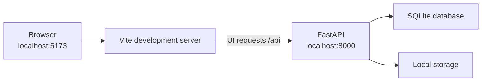

This page gets the project running locally: start the FastAPI backend and React frontend, then open the application and API documentation. It covers the minimum setup and first-run checks; deeper configuration and architecture topics are covered in [Local Configuration and Environment Variables](5-local-configuration-and-environment-variables) and [System Architecture and Component Boundaries](6-system-architecture-and-component-boundaries). Sources: [README.md](README.md#L1-L4)

## What you will run

The local development setup uses two processes. The Vite development server serves the frontend on port `5173` and proxies `/api` requests to the FastAPI server on port `8000`; the backend initializes its database and storage directories when it starts. Sources: [vite.config.ts](frontend/vite.config.ts#L10-L29), [main.py](backend/app/main.py#L34-L87)



The frontend and backend are developed independently. Start the backend in one terminal and the frontend in another; keep both running while using the local application. Sources: [README.md](README.md#L119-L152), [vite.config.ts](frontend/vite.config.ts#L10-L29)

## Prerequisites

| Requirement | Version or note |
|---|---|
| Python | `>=3.11,<3.13` |
| Backend package manager | `uv` |
| Node.js | Required to run the frontend; a specific version is not declared in the inspected project files |
| Frontend package manager | `npm` or `pnpm` |

The backend dependency declaration requires Python 3.11 or later but below 3.13, and the frontend README instructions support either npm or pnpm. Sources: [pyproject.toml](backend/pyproject.toml#L1-L5), [README.md](README.md#L119-L152)

## Start the backend

1. Open a terminal at the repository root and change into `backend`.
2. Install dependencies with `uv sync`.
3. Initialize the database with the command below.
4. Run the development server.

```bash
cd backend
uv sync
uv run python -c "from app.database import init_db; init_db()"
uv run uvicorn app.main:app --host 0.0.0.0 --port 8000 --reload
```

`init_db()` creates the configured SQLite database directory when needed and creates tables for the registered models. The application also calls database initialization during startup, so the explicit initialization command makes the setup step visible rather than replacing the server’s startup behavior. Sources: [README.md](README.md#L119-L137), [database.py](backend/app/database.py#L72-L95), [main.py](backend/app/main.py#L34-L57)

On first startup, the backend attempts to create a default HR account with username `admin` and password `123456` if that username does not already exist. Treat these as development defaults, not production credentials. Sources: [main.py](backend/app/main.py#L46-L64)

## Start the frontend

In a second terminal, from the repository root:

```bash
cd frontend
npm install
npm run dev
```

Alternatively, use `pnpm install` followed by `pnpm dev`. Vite is configured for port `5173` and uses a development proxy to forward `/api` requests to `http://localhost:8000`. Sources: [README.md](README.md#L139-L152), [package.json](frontend/package.json#L1-L12), [vite.config.ts](frontend/vite.config.ts#L10-L29)

Open **http://localhost:5173** in your browser. For direct backend API exploration, open **http://localhost:8000/docs**; the backend also exposes ReDoc at **http://localhost:8000/redoc**. Sources: [README.md](README.md#L135-L152)

## Verify the setup

| Check | Expected result |
|---|---|
| Frontend page | The application loads at `http://localhost:5173`. |
| API documentation | Swagger UI loads at `http://localhost:8000/docs`. |
| Frontend API calls | Requests under `/api` are proxied to the backend on port `8000`. |

These checks correspond to the configured Vite port and proxy, and the backend’s documented API routes. Sources: [vite.config.ts](frontend/vite.config.ts#L10-L29), [README.md](README.md#L135-L152), [main.py](backend/app/main.py#L124-L140)

## Common startup issues

| Symptom | What to check |
|---|---|
| Backend dependency installation fails | Confirm that the selected Python version satisfies `>=3.11,<3.13`. |
| Frontend cannot reach API routes | Confirm the backend is running on port `8000`; Vite’s proxy target is `http://localhost:8000`. |
| Vite reports that port `5173` is occupied | Stop the process using the port. Vite is configured with `strictPort: true`, so it does not silently switch to another port. |
| Speech transcription is unavailable | The backend attempts to load Whisper during startup, but failures are logged without blocking startup; the backend Docker image includes FFmpeg. |

Sources: [pyproject.toml](backend/pyproject.toml#L1-L5), [vite.config.ts](frontend/vite.config.ts#L10-L29), [main.py](backend/app/main.py#L72-L94), [Dockerfile](backend/Dockerfile#L30-L42)

## Optional: Docker Compose

For the containerized setup, prepare a `.env` file from `.env.example`, configure the LLM credentials and other required deployment settings, then build the frontend and start Compose:

```bash
# From the repository root
cp .env.example .env

# Build the frontend distribution
cd frontend
pnpm install
pnpm build
cd ..

# Start the API and Nginx services
docker compose up -d
docker compose logs -f api
```

Compose runs an API service and an Nginx service; Nginx serves the mounted `frontend/dist` directory and waits for the API health check. The frontend build step is required because Compose mounts that directory as the static site root. On Windows PowerShell, use `Copy-Item .env.example .env` instead of `cp`. Sources: [README.md](README.md#L154-L170), [docker-compose.yml](docker-compose.yml#L7-L68), [package.json](frontend/package.json#L5-L12)

## Project structure at a glance

```text
smart_interview_ai/
├── backend/
│   ├── app/             # FastAPI application, services, workflows, models
│   ├── tests/           # Backend tests
│   └── pyproject.toml   # Python dependencies and tooling
├── frontend/
│   ├── src/             # React application source
│   └── package.json     # Frontend scripts and dependencies
├── nginx/               # Reverse proxy configuration
├── docker-compose.yml   # Container orchestration
└── .env.example         # Environment variable template
```

This map highlights the entry points needed for local startup: backend dependencies and application code live under `backend`, while frontend scripts and source live under `frontend`. Sources: [README.md](README.md#L38-L94)

## Where to go next

Follow this sequence to move from running the project to understanding it:

1. [Overview](1-overview) — establish the system’s purpose and scope.
2. [Recruitment Workflow and User Roles](3-recruitment-workflow-and-user-roles) — learn the product flow and who uses it.
3. [Repository Map and Recommended Reading Paths](4-repository-map-and-recommended-reading-paths) — choose a code-reading path.
4. [Local Configuration and Environment Variables](5-local-configuration-and-environment-variables) — understand settings and credentials.
5. [System Architecture and Component Boundaries](6-system-architecture-and-component-boundaries) — examine how the main components connect.