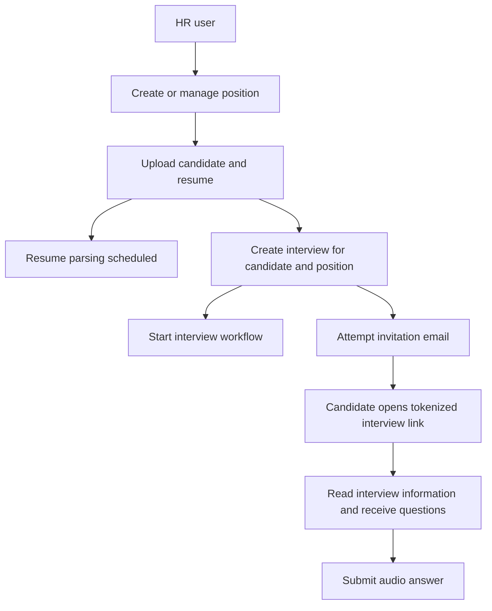

This onboarding page explains the recruitment workflow visible in the repository and the responsibilities of its two user-facing roles: HR users and candidates. The workflow connects a position to candidates and interviews; HR manages those records, while a candidate uses an interview-specific URL token to access and take an interview. This page is the current position in the onboarding path: [Recruitment Workflow and User Roles](3-recruitment-workflow-and-user-roles). Sources: [interview.py](backend/app/models/interview.py#L1-L11) [deps.py](backend/app/deps.py#L27-L32) [candidate_portal.py](backend/app/api/candidate_portal.py#L1-L8)

## The workflow at a glance

The main path is **create a position → add a candidate to that position → create an interview → candidate opens the interview link and submits answers**. Interview creation also starts the interview workflow and attempts to send an invitation email. These steps are implemented across separate API and service modules rather than in one single workflow handler. Sources: [positions.py](backend/app/api/positions.py#L51-L67) [candidates.py](backend/app/api/candidates.py#L58-L114) [interviews.py](backend/app/api/interviews.py#L62-L96)

**How to read this diagram:** the HR actions use authenticated management APIs. The candidate-facing portal uses the interview token in the URL instead of an HR login token. Resume parsing and workflow execution are triggered asynchronously in the shown API paths; the diagram does not imply that parsing must finish before an interview can be created. Sources: [positions.py](backend/app/api/positions.py#L26-L35) [candidates.py](backend/app/api/candidates.py#L101-L107) [interviews.py](backend/app/api/interviews.py#L79-L88) [candidate_portal.py](backend/app/api/candidate_portal.py#L40-L61)

## Roles and access boundaries

| Role | How the role is identified | Main responsibilities |
|---|---|---|
| HR user | Bearer access token resolved to an active user | Manage positions, candidates, and interviews; view interview records and download reports |
| Candidate | Interview-specific URL token resolved to an interview | View interview information, retrieve questions, submit audio answers, and change voice-reading preference |

HR API handlers depend on `get_current_user`, which reads a Bearer token, checks it as an access token, loads the corresponding user, and rejects missing, invalid, or inactive accounts. The candidate portal instead depends on `get_current_candidate`, which looks up an interview by its URL token; it does not require the candidate to authenticate as an HR user. Sources: [deps.py](backend/app/deps.py#L27-L68) [deps.py](backend/app/deps.py#L84-L102)

The `User` model includes an `is_admin` field, but the inspected position, candidate, and interview handlers use the general current-user dependency. These routes therefore establish an authenticated HR-user boundary; the code shown here does not demonstrate separate admin-only permissions for those operations. Sources: [user.py](backend/app/models/user.py#L16-L28) [positions.py](backend/app/api/positions.py#L29-L35) [candidates.py](backend/app/api/candidates.py#L36-L45) [interviews.py](backend/app/api/interviews.py#L32-L43)

## HR: manage positions and candidates

A position records the role name, requirements, responsibilities, hiring quantity, status, and optional recruiter name. Position status values are `0` (not started), `1` (in progress), and `2` (completed). When HR creates a position without specifying a recruiter, the API uses the authenticated user’s username. Sources: [position.py](backend/app/models/position.py#L15-L41) [positions.py](backend/app/api/positions.py#L51-L67)

HR adds a candidate by submitting a name, email address, position ID, and resume file. The candidate service checks that the position exists and records who uploaded the candidate. The API accepts PDF or DOCX files based on their file signature, enforces a 50 MB size limit, and schedules resume parsing after creating the candidate. Sources: [candidates.py](backend/app/api/candidates.py#L58-L107) [candidate_service.py](backend/app/services/candidate_service.py#L55-L105)

Position deletion is guarded: the service refuses to delete a position that still has candidates or interviews associated with it. This makes the position a practical organizing unit for the recruitment records, not merely a free-standing label. Sources: [position_service.py](backend/app/services/position_service.py#L127-L155)

## HR: create and follow an interview

An interview connects a candidate and a position and may include an interviewer and scheduled start time. If no start time is supplied, the service uses the current time; creating the record also generates a candidate URL token and a workflow thread identifier. The API then starts the workflow and attempts to send an invitation email, with email delivery treated as best-effort. Sources: [interview.py](backend/app/models/interview.py#L24-L71) [interview.py](backend/app/models/interview.py#L134-L158) [interview_service.py](backend/app/services/interview_service.py#L73-L130) [interviews.py](backend/app/api/interviews.py#L62-L96)

Interview status values are `0` (not started), `1` (questions ready), `2` (in progress), `3` (finished), and `4` (report generated). The service validates status changes made through interview updates against an explicit transition map; for example, status `4` is terminal in that map. Treat these values as workflow states rather than a hiring decision: the model stores the pass/fail result separately in `is_passed`. Sources: [interview.py](backend/app/models/interview.py#L40-L55) [interview_service.py](backend/app/services/interview_service.py#L132-L180)

## Candidate: enter and complete an interview

When a candidate requests interview information using the token, the portal loads the associated candidate and position details. If the interview is still at status `0`, this request changes it to status `1`. If no questions exist and the question count is unset, the handler also triggers the interview workflow. Sources: [candidate_portal.py](backend/app/api/candidate_portal.py#L40-L70)

The candidate can request the next question and submit an audio answer for a question belonging to that interview. The handler rejects a question that does not belong to the interview and rejects a second answer for an already answered question. After saving the audio and updating progress, it schedules transcription work in the background. Sources: [candidate_portal.py](backend/app/api/candidate_portal.py#L91-L105) [candidate_portal.py](backend/app/api/candidate_portal.py#L108-L158)

## Practical reading path

Start here to understand who acts at each stage, then follow the implementation detail in the next onboarding pages. [Repository Map and Recommended Reading Paths](4-repository-map-and-recommended-reading-paths) helps locate the relevant modules; [Authentication, Authorization, and Candidate Access](9-authentication-authorization-and-candidate-access) explains the access boundaries in depth; and [Interview Workflow State and Lifecycle](10-interview-workflow-state-and-lifecycle) focuses on interview statuses and transitions. Sources: [positions.py](backend/app/api/positions.py#L26-L67) [deps.py](backend/app/deps.py#L27-L102) [interview.py](backend/app/models/interview.py#L40-L55)