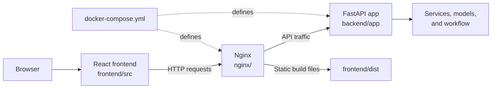

This page maps the repository and provides practical reading routes for developers joining the project. Its focus is **where to look and in what order**; detailed subsystem behavior, configuration, and operational procedures belong to the linked deep-dive pages. **Current position:** Get Started → Onboarding → [Repository Map and Recommended Reading Paths](4-repository-map-and-recommended-reading-paths). Sources: [README.md](README.md#L62-L107), [docs/README.md](docs/README.md#L82-L97)

## Repository at a Glance

The repository has three primary application areas: a **FastAPI backend** under `backend/`, a **React and TypeScript frontend** under `frontend/`, and **deployment configuration** at the root and in `nginx/`. The root README also describes `docs/` as implementation-oriented reference material, while `docs/README.md` serves as its navigation index. Sources: [README.md](README.md#L62-L123), [docs/README.md](docs/README.md#L1-L7)

```text
smart_interview_ai/
├── README.md                    # Project introduction and top-level map
├── .env.example                 # Environment-variable template
├── docker-compose.yml           # API and Nginx services
├── backend/
│   ├── app/
│   │   ├── api/                 # HTTP API
│   │   ├── core/                # Shared application infrastructure
│   │   ├── models/              # Data models and repositories
│   │   ├── schemas/             # Request/response schemas
│   │   ├── services/            # Business and AI services
│   │   ├── workflow/            # LangGraph workflow
│   │   ├── workers/             # Background scheduling
│   │   ├── prompts/             # Prompt templates
│   │   ├── templates/           # Report templates
│   │   ├── config.py
│   │   ├── database.py
│   │   ├── deps.py
│   │   └── main.py              # FastAPI entry point and lifespan
│   ├── tests/                   # Backend tests
│   ├── scripts/                 # Maintenance scripts
│   ├── storage/                 # Runtime file storage
│   └── pyproject.toml           # Python dependencies and tool settings
├── frontend/
│   ├── src/
│   │   ├── api/                 # API client modules
│   │   ├── components/          # Shared and domain UI
│   │   ├── contexts/            # Application contexts
│   │   ├── hooks/               # Reusable hooks
│   │   ├── pages/               # Route-level pages
│   │   ├── types/               # TypeScript types
│   │   ├── App.tsx
│   │   ├── main.tsx             # React mount point
│   │   └── routes.tsx           # Route configuration
│   └── package.json             # Scripts and JavaScript dependencies
├── nginx/                       # Reverse-proxy configuration and SSL notes
└── docs/                        # Documentation, diagrams, and sample resumes
```

This tree is a navigation aid, not a claim that every nested module is shown. The README gives the repository’s fuller architectural inventory, and the checked-in source confirms the backend entry point and frontend mount point. Sources: [README.md](README.md#L71-L107), [backend/app/main.py](backend/app/main.py#L129-L200), [frontend/src/main.tsx](frontend/src/main.tsx#L1-L15)

## How the Main Areas Connect

At a high level, the browser application is served through the deployment setup and communicates with the FastAPI API. The Compose file defines an `api` service and an `nginx` service; Nginx serves the frontend build output and proxies requests, while the frontend entry point mounts the React app and router. The backend entry point creates the FastAPI application and registers the API router. Sources: [docker-compose.yml](docker-compose.yml#L9-L19), [docker-compose.yml](docker-compose.yml#L49-L63), [backend/app/main.py](backend/app/main.py#L129-L137), [backend/app/main.py](backend/app/main.py#L189-L192), [frontend/src/main.tsx](frontend/src/main.tsx#L1-L15)



The diagram summarizes boundaries visible in the repository; it is not a full runtime sequence. For component responsibilities and request behavior, continue with [System Architecture and Component Boundaries](6-system-architecture-and-component-boundaries) and [API Contracts, Validation, and Error Handling](8-api-contracts-validation-and-error-handling). Sources: [docker-compose.yml](docker-compose.yml#L9-L19), [docker-compose.yml](docker-compose.yml#L49-L63), [backend/app/main.py](backend/app/main.py#L189-L200), [frontend/src/main.tsx](frontend/src/main.tsx#L1-L15)

## Recommended Reading Paths

### New contributors

Start with [Overview](1-overview) and [Quick Start](2-quick-start), then read [Recruitment Workflow and User Roles](3-recruitment-workflow-and-user-roles) to understand the product context. Use this page to orient yourself in the codebase, then follow [Local Configuration and Environment Variables](5-local-configuration-and-environment-variables) before working locally. The repository’s existing documentation index also positions requirements and architecture material before role-specific implementation references. Sources: [docs/README.md](docs/README.md#L82-L97), [README.md](README.md#L131-L185)

### Backend developers

From this map, inspect `backend/app/main.py` to locate application setup and route registration, then use the backend folders as entry points: `api/` for HTTP routes, `schemas/` for data contracts, `models/` for persistence abstractions, `services/` for business logic, and `workflow/` for orchestration. The project’s Python configuration and test locations are in `backend/pyproject.toml` and `backend/tests/`. Continue with [Service Layer, Repositories, and Database Sessions](17-service-layer-repositories-and-database-sessions), [Interview Workflow State and Lifecycle](10-interview-workflow-state-and-lifecycle), and [Backend Test Strategy and Workflow Test Doubles](28-backend-test-strategy-and-workflow-test-doubles). Sources: [README.md](README.md#L78-L91), [backend/app/main.py](backend/app/main.py#L189-L200), [backend/pyproject.toml](backend/pyproject.toml#L85-L90)

### Frontend developers

Begin at `frontend/src/main.tsx` and follow its imports to `App.tsx` and `routes.tsx`. Then explore `pages/` for route-level UI, `components/` for reusable interface elements, `api/` for API-facing code, and `hooks/` or `contexts/` for shared client behavior. The package scripts identify the available build, lint, and type-check entry points. Continue with [React Application Entry, Routing, and Page Responsibilities](22-react-application-entry-routing-and-page-responsibilities), [API Client, Authentication State, and Request Handling](23-api-client-authentication-state-and-request-handling), and [Frontend Type Checking, Linting, and Production Builds](29-frontend-type-checking-linting-and-production-builds). Sources: [README.md](README.md#L93-L107), [frontend/src/main.tsx](frontend/src/main.tsx#L1-L15), [frontend/package.json](frontend/package.json#L6-L12)

### Deployment and operations readers

Read the Compose file to identify the declared services, mounted storage, health check, and frontend build mount. Then inspect `nginx/` for proxy configuration. Use [Docker Compose, Nginx, and SSE-Aware Deployment](30-docker-compose-nginx-and-sse-aware-deployment) and [Persistent Files, Database Backups, and Operational Safety](31-persistent-files-database-backups-and-operational-safety) for the operational detail; this page only maps the relevant locations. Sources: [docker-compose.yml](docker-compose.yml#L9-L19), [docker-compose.yml](docker-compose.yml#L37-L42), [docker-compose.yml](docker-compose.yml#L49-L63), [README.md](README.md#L109-L123)

## Documentation Navigation

The repository documentation index describes a progression from requirements and architecture into API, data model, implementation status, workflow, events, deployment, and frontend design references. For the catalog’s current wiki paths, use the cross-references in this page: [System Architecture and Component Boundaries](6-system-architecture-and-component-boundaries), [Recruitment Domain Model and Data Relationships](7-recruitment-domain-model-and-data-relationships), and the role-specific pages above. Sources: [docs/README.md](docs/README.md#L41-L55), [docs/README.md](docs/README.md#L82-L117)

For AI interview behavior, proceed from [LangGraph Nodes, Interrupts, and Resume Semantics](11-langgraph-nodes-interrupts-and-resume-semantics) to [Workflow Dependency Injection and Checkpoint Persistence](12-workflow-dependency-injection-and-checkpoint-persistence), or follow the relevant feature path: [Resume Parsing and Candidate Data Preparation](14-resume-parsing-and-candidate-data-preparation), [Speech Recording, FFmpeg, and Whisper Transcription](15-speech-recording-ffmpeg-and-whisper-transcription), and [Evaluation Reports and PDF Rendering](16-evaluation-reports-and-pdf-rendering). These links are for onward navigation; this page does not replace those subsystem guides. Sources: [README.md](README.md#L10-L17), [README.md](README.md#L87-L91), [docs/README.md](docs/README.md#L47-L55)

## Practical Orientation

A productive first pass is to identify each layer’s entry point, then trace one request or feature across the frontend API module, backend route, service, and persistence or workflow boundary. Use the repository map to choose the starting files; use the catalog’s implementation pages to investigate behavior. The README identifies those backend and frontend module groups, while `main.py` and `main.tsx` provide concrete application entry points. Sources: [README.md](README.md#L78-L107), [backend/app/main.py](backend/app/main.py#L189-L200), [frontend/src/main.tsx](frontend/src/main.tsx#L1-L15)