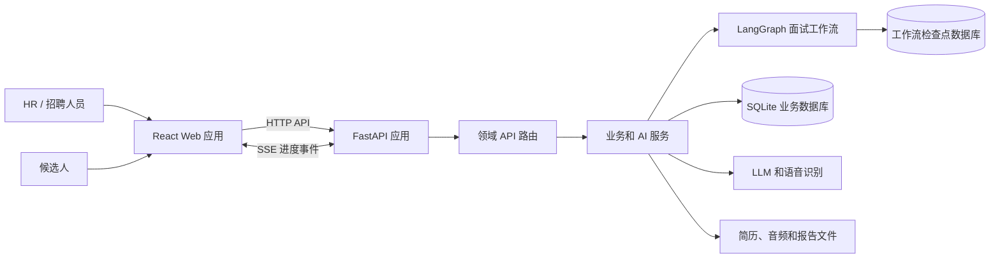

本页介绍 AI 驱动的招聘面试系统：它的功能、主要组成部分如何协同工作，以及新开发者接下来可以从哪里入手。这是一份入门指南，而非设置教程或详细设计规范。**您当前所在位置：[概览](1-overview)。**要运行应用，请接着阅读[快速入门](2-quick-start)。来源：[README.md](README.md#L6-L17)

## 系统的功能

该应用将多项招聘活动整合到一个工作流中：管理职位和候选人、根据候选人和职位信息准备面试问题、让候选人完成在线语音面试，以及生成面试评估报告。系统还包含自动化工作流处理，并使用服务器发送事件（SSE）推送面试进度更新。来源：[README.md](README.md#L8-L17)

| 功能 | 简要说明 |
|---|---|
| 招聘管理 | HR 用户管理职位、候选人和面试。 |
| 面试准备 | 系统根据候选人的简历和职位要求生成问题。 |
| 语音面试 | 候选人在浏览器中录制口头回答；音频使用 Whisper 转录。 |
| 评估报告 | 系统分析面试表现并生成报告。 |
| 进度更新 | SSE 向已连接的客户端推送面试状态变更。 |

来源：[README.md](README.md#L8-L17)

## 架构概览

下图展示了主要的面向用户和服务器端组件，以及它们之间的大致流程。前端是一个 React 应用；后端提供 FastAPI API，并注册用于身份验证、职位、候选人、面试、候选人访问和事件的领域路由。README 指出，LangGraph 用作工作流编排器，SQLite 用作 MVP 数据库。来源：[README.md](README.md#L21-L39)、[backend/app/main.py](backend/app/main.py#L230-L249)、[backend/app/api/router.py](backend/app/api/router.py#L6-L18)、[frontend/src/main.tsx](frontend/src/main.tsx#L1-L15)



前端入口会挂载应用的 providers 和路由器。后端入口会初始化应用服务、注册 API 路由，并提供健康检查端点。在部署配置中，Docker Compose 定义了一个 API 服务和一个 Nginx 服务；Nginx 提供前端构建文件，并代理请求。来源：[frontend/src/main.tsx](frontend/src/main.tsx#L1-L15)、[backend/app/main.py](backend/app/main.py#L230-L249)、[docker-compose.yml](docker-compose.yml#L1-L18)、[docker-compose.yml](docker-compose.yml#L40-L68)

## 项目地图

在深入了解实现细节之前，可以先通过这个简化的目录树熟悉项目。`backend/app` 包含 API、领域模型、服务和面试工作流；`frontend/src` 包含浏览器应用、页面、可复用组件和 API 客户端模块。来源：[README.md](README.md#L62-L80)、[backend/app/main.py](backend/app/main.py#L230-L249)

```text
smart_interview_ai/
├── README.md
├── backend/
│   ├── app/
│   │   ├── api/          # HTTP route modules
│   │   ├── models/       # Database models
│   │   ├── schemas/      # Request/response data structures
│   │   ├── services/     # Business and AI services
│   │   ├── workers/      # Background scheduling
│   │   └── workflow/     # Interview workflow implementation
│   └── tests/            # Backend tests
├── frontend/
│   └── src/
│       ├── api/           # API client modules
│       ├── components/    # Shared and feature UI components
│       ├── hooks/         # Reusable hooks
│       ├── pages/         # Application pages
│       └── routes.tsx     # Route configuration
├── docs/                  # Project documentation and diagrams
├── docker-compose.yml
└── nginx/                 # Reverse-proxy configuration
```

浏览器路由将公开页面与受身份验证守卫保护的 HR 页面区分开来。后端通过一个 API 路由器整合各个路由模块。跟踪从页面到服务器端点的用户操作时，这些都是很好的切入点。来源：[frontend/src/routes.tsx](frontend/src/routes.tsx#L18-L44)、[backend/app/api/router.py](backend/app/api/router.py#L6-L18)

## 后续阅读

对于初学者，建议先运行应用，然后了解用户工作流，并找到实现该工作流的代码区域。从整体架构入手，再深入阅读与当前任务相关的后端、前端或运维主题。

1. [快速入门](2-quick-start) — 在本地运行项目。
2. [招聘工作流和用户角色](3-recruitment-workflow-and-user-roles) — 了解系统支持的人员和流程。
3. [代码库地图和推荐阅读路径](4-repository-map-and-recommended-reading-paths) — 选择代码阅读路径。
4. [本地配置和环境变量](5-local-configuration-and-environment-variables) — 了解本地设置。
5. [系统架构和组件边界](6-system-architecture-and-component-boundaries) — 探索系统的主要组件。

之后，选择最贴近你工作的领域继续阅读：后端和数据主题可从[招聘领域模型和数据关系](7-recruitment-domain-model-and-data-relationships)以及[服务层、仓储和数据库会话](17-service-layer-repositories-and-database-sessions)开始；前端主题可从[React 应用入口、路由和页面职责](22-react-application-entry-routing-and-page-responsibilities)开始；运维主题可从[Docker Compose、Nginx 和支持 SSE 的部署](30-docker-compose-nginx-and-sse-aware-deployment)开始。来源：[README.md](README.md#L6-L17)、[README.md](README.md#L62-L80)、[frontend/src/routes.tsx](frontend/src/routes.tsx#L18-L44)

## 范围和注意事项

本概览介绍了代码库文档中描述的用途和可见的组件结构。它不介绍环境设置、配置值、API 契约、详细的工作流转换或生产运维；目录中有专门的页面介绍这些主题。来源：[README.md](README.md#L6-L17)、[backend/app/api/router.py](backend/app/api/router.py#L6-L18)
