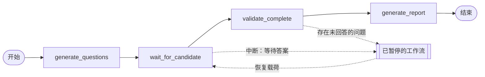
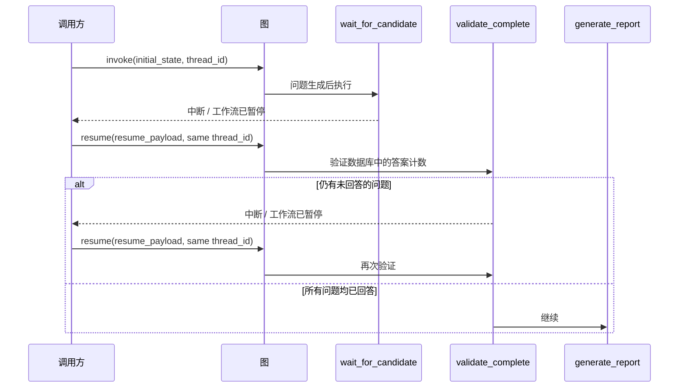

访谈工作流是一个**带检查点、可中断的状态机**：它生成问题，在候选人回答时暂停，验证答案是否完整，然后生成报告。其共享的 `InterviewState` 在各节点之间传递工作流数据；每个节点仅返回其更新的字段。本页重点介绍该状态模型和生命周期，不涉及持久化内部机制、API 行为或各个 LangGraph 基本构件的实现。  
来源：[state.py](backend/app/workflow/state.py#L25-L55) [graph.py](backend/app/workflow/graph.py#L42-L55)

## 状态模型

`InterviewState` 是一个使用 `total=False` 声明的 `TypedDict`，因此从类型层面来说，字段都是可选的。状态按用途分组：访谈和参与者标识符、问题生成输入、生成的问题和难度计数、答案进度字段、报告输出以及错误详情。嵌套的问题和答案形状也声明为 `TypedDict`，但它们不是必需字段。  
来源：[state.py](backend/app/workflow/state.py#L9-L23) [state.py](backend/app/workflow/state.py#L25-L55)

| 状态组 | 字段 | 在生命周期中的作用 |
|---|---|---|
| 标识信息 | `interview_id`, `langgraph_thread_id`, `candidate_id`, `position_id` | 标识访谈及其工作流线程。 |
| 生成输入 | `resume_text`, `position_name`, `position_requirements`, `position_responsibilities` | 为问题生成提供候选人和职位背景信息。 |
| 生成的问题 | `questions`, `question_count`, `difficulty_distribution` | 保存生成的问题数据及其摘要。 |
| 答案进度 | `answered_count`, `pending_question_ids` | 表示候选人等待之前和之后的进度。 |
| 报告输出 | `report_id`, `report_path` | 提供可选的报告标识符和位置。 |
| 错误信息 | `error`, `error_node` | 记录错误消息和相关节点。 |

来源：[state.py](backend/app/workflow/state.py#L25-L55)

可选字段使部分状态也有效，但这也意味着使用者不能假定生命周期中的每个值在任何时刻都存在。例如，如果 `pending_question_ids` 不存在，等待节点会回退到 `questions` 中的问题 ID；而报告字段是可选输出。工作流测试明确验证了仅包含 `interview_id` 的状态有效。  
来源：[state.py](backend/app/workflow/state.py#L25-L55) [nodes.py](backend/app/workflow/nodes.py#L126-L144) [test_workflow.py](backend/tests/test_workflow.py#L34-L39)

## 生命周期和状态转换

该图由四个具名节点按线性顺序组成。候选人等待节点会引入一个中断，因此执行可以在问题生成之后、完成情况验证之前暂停。如果数据库报告仍有未回答的问题，验证过程本身也可能再次中断。  
来源：[graph.py](backend/app/workflow/graph.py#L42-L55) [nodes.py](backend/app/workflow/nodes.py#L124-L171)

来源：[graph.py](backend/app/workflow/graph.py#L42-L55) [nodes.py](backend/app/workflow/nodes.py#L124-L171)

**问题生成**通过注入的依赖项读取访谈、候选人和职位信息。如果缺少必需记录或 LLM 调用失败，它会返回 `error` 和 `error_node`；否则，它会创建问题、更新访谈摘要，并将生成的问题数据、数量和难度分布返回到工作流状态中。该函数返回的字典就是节点的状态更新。  
来源：[nodes.py](backend/app/workflow/nodes.py#L22-L38) [nodes.py](backend/app/workflow/nodes.py#L55-L67) [nodes.py](backend/app/workflow/nodes.py#L69-L121)

**候选人等待**从 `pending_question_ids` 获取待处理列表；如果不存在，则回退到 `questions` 中的 ID。随后，它会通过中断传递访谈 ID、待处理 ID、总数和消息。恢复时，它会从恢复载荷中返回 `answered_count`（默认值为零），并清除 `pending_question_ids`。  
来源：[nodes.py](backend/app/workflow/nodes.py#L124-L144)

**完成情况验证**会查询问题存储库，获取问题总数和已回答数量。如果已回答的问题少于问题总数，它会获取未回答的问题，并通过中断传递这些问题的 ID 和剩余工作提示。否则，它会返回由数据库得出的 `answered_count`。因此，验证依据的是存储库中的计数，而非仅依赖状态中此前携带的进度。  
来源：[nodes.py](backend/app/workflow/nodes.py#L147-L171)

**报告生成**在图的执行顺序中位于验证成功之后。它会读取访谈以及相关的候选人、职位和问题；状态架构为报告输出预留了 `report_id` 和 `report_path`。  
来源：[graph.py](backend/app/workflow/graph.py#L51-L55) [nodes.py](backend/app/workflow/nodes.py#L174-L200) [state.py](backend/app/workflow/state.py#L49-L55)

## 线程标识、恢复和状态检查

工作流的调用和恢复使用 LangGraph 的可配置 `thread_id` 作为键。`run_workflow_sync` 使用检查点器编译该图，并通过提供的线程 ID 调用图；`resume_workflow` 使用 `Command(resume=resume_payload)` 和同一个线程 ID 调用已编译的图。`get_workflow_state` 使用该线程 ID 获取状态快照。`langgraph_thread_id` 字段也存在于 `InterviewState` 中，但所示调用代码通过 `configurable.thread_id` 配置线程。  
来源：[graph.py](backend/app/workflow/graph.py#L81-L117) [state.py](backend/app/workflow/state.py#L28-L32)

来源：[graph.py](backend/app/workflow/graph.py#L81-L117) [nodes.py](backend/app/workflow/nodes.py#L126-L171) [graph.py](backend/app/workflow/graph.py#L51-L55)

## 故障和正确性边界

状态架构提供了 `error` 和 `error_node` 字段；问题生成会在访谈、候选人或职位记录缺失以及 LLM 出现异常时使用这些字段。所示的图定义使用节点之间的无条件边，并未定义基于这些错误字段的条件路由。因此，调用方和相邻的工作流集成代码不应仅凭状态结构就推断错误会自动终止或重定向执行。  
来源：[state.py](backend/app/workflow/state.py#L53-L55) [nodes.py](backend/app/workflow/nodes.py#L30-L38) [nodes.py](backend/app/workflow/nodes.py#L55-L67) [graph.py](backend/app/workflow/graph.py#L51-L55)

等待节点的恢复载荷会提供进度计数，但完成情况会根据存储库中的计数独立检查。这一区别很重要：状态中的 `answered_count` 反映的是节点结果，而完整性关卡会在报告节点运行之前，使用问题总数和已回答问题数进行检查。  
来源：[nodes.py](backend/app/workflow/nodes.py#L134-L144) [nodes.py](backend/app/workflow/nodes.py#L149-L171)

## 测试中的验证

工作流测试验证了 `InterviewState` 接受部分字段集、图可以通过注入的模拟依赖项成功编译，以及四个工作流节点都存在。另一个检查点器测试使用内存保存器启动执行，并确认线程到达候选人等待中断后，其状态快照仍保留所提供的访谈 ID。完整的端到端流水线测试明确标记为跳过，等待更完整的数据库模拟，因此这些测试验证的是结构和检查点行为，而非完整的生命周期。  
来源：[test_workflow.py](backend/tests/test_workflow.py#L18-L39) [test_workflow.py](backend/tests/test_workflow.py#L43-L64) [test_workflow.py](backend/tests/test_workflow.py#L76-L125) [test_workflow.py](backend/tests/test_workflow.py#L141-L149)

## 继续阅读

如需了解节点级的中断和恢复机制，请继续阅读[LangGraph 节点、中断与恢复语义](11-langgraph-nodes-interrupts-and-resume-semantics)。如需了解工作流依赖项的构造方式以及检查点持久化的配置方式，请参阅[工作流依赖注入与检查点持久化](12-workflow-dependency-injection-and-checkpoint-persistence)。
