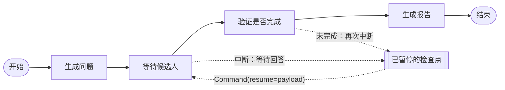
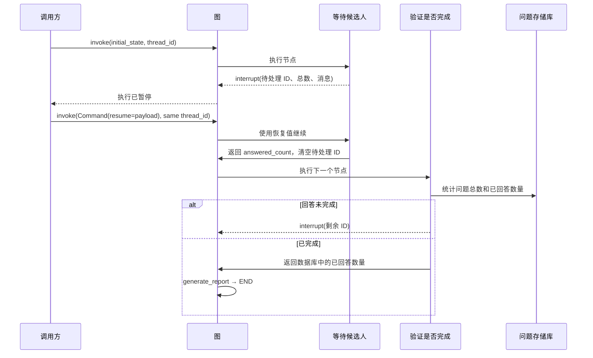

本页说明面试工作流如何组装为 LangGraph `StateGraph`、每个节点如何为共享状态提供内容，以及如何恢复候选人响应中断。本页范围是图的执行语义，而非依赖项构造或检查点存储内部机制；这些内容见[工作流依赖注入与检查点持久化](12-workflow-dependency-injection-and-checkpoint-persistence)。

**架构假设：**该工作流是一个由四个节点组成的线性图，候选人响应被建模为可持久化的暂停，而不是长时间运行的节点。恢复时，会向已挂起的中断提供一个值；之后，另一个由数据库支持的验证节点会在生成报告前进行第二次校验。图的连线和节点主体证实了这一模式。  
来源：[graph.py](backend/app/workflow/graph.py#L31-L57) [nodes.py](backend/app/workflow/nodes.py#L124-L171)

## 图拓扑与状态流

该图在 `InterviewState` 上注册了四个节点，并按固定顺序连接：生成问题 → 等待候选人 → 验证是否完成 → 生成报告。此图定义中没有条件边。节点返回部分状态更新；状态模式是一个带有 `total=False` 的 `TypedDict`，因此在执行填充之前，字段可以不存在。  
来源：[graph.py](backend/app/workflow/graph.py#L42-L57) [state.py](backend/app/workflow/state.py#L25-L55)

该图将普通图边与中断/恢复行为区分开来。中断会在当前节点暂停执行；恢复时，会使用提供的恢复值继续执行该节点，之后沿正常的出边前往验证。如果验证发现有未回答的问题，就可以再次暂停，然后图才会继续前往报告生成节点。  
来源：[graph.py](backend/app/workflow/graph.py#L50-L55) [nodes.py](backend/app/workflow/nodes.py#L126-L171)

## 节点职责与状态更新

| 节点 | 主要工作 | 返回的状态 |
|---|---|---|
| `generate_questions` | 加载面试相关记录，渲染提示词，调用结构化 LLM 服务，持久化问题和审计数据，并发布进度事件。缺少面试/候选人/职位数据或 LLM 异常时，会返回 `error` 和 `error_node` 更新。 | 成功时返回 `questions`、`question_count` 和 `difficulty_distribution` |
| `wait_for_candidate` | 从 `pending_question_ids` 获取待处理 ID；如果没有，则使用 `questions` 中的 ID；随后通过中断载荷暂停。 | 恢复后：从载荷中获取 `answered_count`（默认值为 `0`），并返回空的待处理 ID 列表 |
| `validate_complete` | 通过存储库统计问题总数和已回答问题数。如果回答尚未完成，则获取未回答的问题并再次中断；否则返回从数据库得出的已回答数量。 | 恢复后仍未完成：返回 `answered_count` 和空的待处理 ID；已完成：返回 `answered_count` |
| `generate_report` | 加载面试数据和回答，调用评估 LLM，渲染并存储 PDF，更新面试记录，并记录审计事件。LLM 异常时会返回错误更新。 | 成功时返回 `report_id` 和 `report_path` |

该表描述的是节点返回值，它们是部分更新，而非替换整个模式。特别是，错误返回本身并不会定义备用边：图仍采用相同的线性连线，因此调用方和外围工作流处理逻辑必须考虑返回的错误字段。  
来源：[nodes.py](backend/app/workflow/nodes.py#L24-L121) [nodes.py](backend/app/workflow/nodes.py#L126-L171) [nodes.py](backend/app/workflow/nodes.py#L176-L274) [graph.py](backend/app/workflow/graph.py#L50-L55)

声明的状态包含工作流标识符、问题数据、回答进度、报告元数据和错误元数据。它还定义了 `langgraph_thread_id` 等字段，但图调用代码在 LangGraph 的可配置运行时配置中使用 `thread_id`；在所示实现中，两者是不同的概念。  
来源：[state.py](backend/app/workflow/state.py#L25-L55) [graph.py](backend/app/workflow/graph.py#L81-L110)

## 中断与恢复语义

`wait_for_candidate_node` 调用 `interrupt()`，并传入一个应用层载荷，其中包含面试 ID、待处理问题 ID、总数以及一条人类可读消息。随后，它期望恢复值的行为类似映射，并读取 `answered_count`；默认值为零。恢复后，节点会在其返回的更新中清空 `pending_question_ids`。  
来源：[nodes.py](backend/app/workflow/nodes.py#L126-L144)

`validate_complete_node` 不会将恢复后的计数视为所有回答均已持久化的证明。它会从问题存储库查询问题总数和已回答数量。如果 `answered < total`，它会获取未回答的问题，并使用剩余 ID 再次触发中断；否则，它会返回数据库计数。因此，在此阶段，存储库状态是完成条件，而恢复载荷则向已挂起的节点提供进度数据。  
来源：[nodes.py](backend/app/workflow/nodes.py#L149-L171)

公开的恢复辅助函数会构造 `Command(resume=resume_payload)`，并使用提供的 `thread_id` 调用已编译的图。相同的线程标识符用于选取对应的图执行状态。此辅助函数不会对载荷契约进行模式验证；其预期的 `answered_count` 字段是根据节点对映射的访问方式推断出来的。  
来源：[graph.py](backend/app/workflow/graph.py#L105-L110) [nodes.py](backend/app/workflow/nodes.py#L134-L144)

此序列基于调用辅助函数、两个中断位置以及固定的图边。所示代码确定了恢复调用的形式，但没有定义 API 层面的恢复载荷验证契约，也没有展示生成这些载荷的调用方。  
来源：[graph.py](backend/app/workflow/graph.py#L105-L110) [graph.py](backend/app/workflow/graph.py#L50-L55) [nodes.py](backend/app/workflow/nodes.py#L126-L171)

## 对执行与可观测性的影响

`run_workflow_sync` 会构建一个图，并使用初始状态和可配置的线程 ID 调用它。`get_workflow_state` 会查询该线程的图快照，而 `resume_workflow` 则使用已编译的单例图进行恢复。这是不同的入口：初始执行接受可选依赖项，而恢复辅助函数会在内部获取单例图。  
来源：[graph.py](backend/app/workflow/graph.py#L81-L117)

测试会验证图已编译，并且包含全部四个节点。一项检查点测试使用内存保存器启动图，并检查执行到候选人等待阶段后是否存在状态快照；该测试没有执行成功恢复或完整流水线。端到端工作流测试明确标记为跳过，等待补齐完整的数据库模拟，因此测试套件并未证实这些行为。  
来源：[test_workflow.py](backend/tests/test_workflow.py#L41-L64) [test_workflow.py](backend/tests/test_workflow.py#L76-L125) [test_workflow.py](backend/tests/test_workflow.py#L141-L149)

如需了解相邻的实现细节，请继续阅读[工作流依赖注入与检查点持久化](12-workflow-dependency-injection-and-checkpoint-persistence)。
