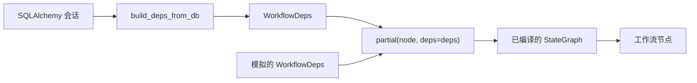
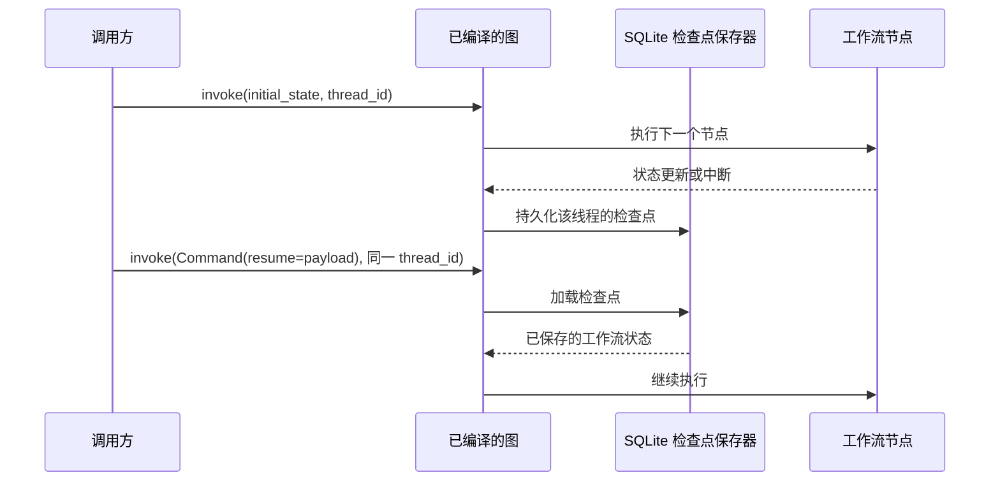

本页说明工作流节点如何接收运行时依赖，以及 LangGraph 执行状态如何在暂停和恢复期间持久化。关键的架构区别在于：**工作流依赖用于访问运行中的应用服务**，而**检查点保存器按线程存储工作流状态**；这两种机制互为补充，不能互相替代。来源：[dependencies.py](backend/app/workflow/dependencies.py#L19-L56) [checkpointer.py](backend/app/workflow/checkpointer.py#L17-L48) [graph.py](backend/app/workflow/graph.py#L31-L69)

## 依赖注入：在图构建时绑定服务

`WorkflowDeps` 是一个数据类，用于组合 SQLAlchemy 会话、存储库、文件存储、SSE 管理器和提示渲染器。生产代码可以通过 `build_deps_from_db(db)` 构建此依赖包；该函数会围绕提供的会话创建存储库实例，并获取共享的存储和 SSE 服务。节点代码会显式接收此依赖包，而不是导入会话工厂或直接访问这些服务。来源：[dependencies.py](backend/app/workflow/dependencies.py#L19-L56)

图构建器使用 `functools.partial` 将同一个 `deps` 对象绑定到每个节点。这样一来，依赖边界在组装时清晰可见：节点基于工作流状态和注入的依赖包运行，而图构建器负责定义节点顺序。测试可以提供模拟的 `WorkflowDeps`，并在不构建真实存储库或数据库会话的情况下编译图。来源：[graph.py](backend/app/workflow/graph.py#L31-L57) [test_workflow.py](backend/tests/test_workflow.py#L43-L64) [test_workflow.py](backend/tests/test_workflow.py#L152-L180)

该图展示了在节点绑定处汇合的两种构建路径：生产环境中的依赖由数据库会话组装，而测试可以使用模拟对象替代。这是通过图组装实现的依赖注入，而不是独立的容器或自动运行时解析器。来源：[dependencies.py](backend/app/workflow/dependencies.py#L40-L56) [graph.py](backend/app/workflow/graph.py#L31-L48) [test_workflow.py](backend/tests/test_workflow.py#L152-L164)

## 会话所有权与生命周期影响

`WorkflowDeps.close()` 会关闭其关联的数据库会话。常规的 FastAPI `get_db()` 依赖也会创建会话，并在请求依赖结束时将其关闭。这是代码中彼此独立的生命周期机制：构建工作流依赖的调用方需要负责选择合适的会话生命周期和清理方式。单例图路径会缓存 `_cached_deps`；重置该单例时，`reset_compiled_graph()` 会关闭这些缓存的依赖。来源：[dependencies.py](backend/app/workflow/dependencies.py#L34-L38) [database.py](backend/app/database.py#L66-L74) [graph.py](backend/app/workflow/graph.py#L26-L29) [graph.py](backend/app/workflow/graph.py#L72-L79)

如果没有提供 `deps` 参数，`run_workflow_sync()` 会创建会话和依赖包，然后为本次调用构建并编译图。在所示实现中，该路径在返回前不会调用 `deps.close()`。相比之下，`get_compiled_graph()` 会将其依赖包保留在 `_cached_deps` 中，直到调用 `reset_compiled_graph()`。这些所有权差异在将工作流执行与请求或工作进程生命周期集成时十分重要。来源：[graph.py](backend/app/workflow/graph.py#L60-L79) [graph.py](backend/app/workflow/graph.py#L81-L103)

## 检查点持久化：按线程键控状态

检查点模块提供两种访问方式。`get_checkpointer()` 是围绕 `SqliteSaver.from_conn_string(...)` 的上下文管理器；`get_checkpointer_sync()` 会延迟创建并缓存由直接 SQLite 连接支持的 `SqliteSaver`。同步路径使用 `check_same_thread=False` 打开连接，内联注释说明这样做是因为需要在线程中运行。两种路径解析出的检查点数据库都是 `backend/workflow_checkpoints.db`，与业务数据库分开。来源：[checkpointer.py](backend/app/workflow/checkpointer.py#L17-L48)

编译后的图通过 `builder.compile(checkpointer=...)` 接收同步保存器。调用和状态查询配置使用 `{"configurable": {"thread_id": thread_id}}`，因此线程标识符是传递给 LangGraph、用于执行和查询检查点的键。`resume_workflow()` 在同一线程配置下，使用 `Command(resume=resume_payload)` 调用编译后的图；`get_workflow_state()` 则查询该线程的状态。来源：[graph.py](backend/app/workflow/graph.py#L60-L69) [graph.py](backend/app/workflow/graph.py#L99-L117)

该时序图说明了持久化边界：图执行会提供线程标识符，而保存器在编译时附加，并负责保留检查点。工作流的暂停和恢复行为由节点中的 LangGraph 中断实现；持久化层则支持之后访问该线程的状态。来源：[graph.py](backend/app/workflow/graph.py#L99-L117) [nodes.py](backend/app/workflow/nodes.py#L124-L144) [checkpointer.py](backend/app/workflow/checkpointer.py#L36-L48)

## 依赖与持久化职责

| 关注点 | 机制 | 提供的内容 | 不负责确定的内容 |
|---|---|---|---|
| 运行时服务 | `WorkflowDeps` | 提供给节点使用的会话、存储库、存储、SSE 管理器和提示渲染器 | 持久化工作流状态 |
| 节点绑定 | `partial(..., deps=deps)` | 注册图节点时显式绑定依赖 | 自动管理会话生命周期 |
| 工作流持久化 | `SqliteSaver` | 将检查点存储在工作流检查点数据库中 | 持久化业务记录或管理存储库事务 |
| 执行标识 | `thread_id` 在 `configurable` 中 | 传递给调用、恢复和状态查询的线程键 | 依赖包的选择 |

这些边界在实现中清晰可见：存储库和服务对象位于 `WorkflowDeps` 中，而保存器则作为独立参数传递给图编译。节点代码也会通过注入的数据库会话显式提交业务变更，这与 LangGraph 写入检查点是不同的操作。来源：[dependencies.py](backend/app/workflow/dependencies.py#L19-L29) [graph.py](backend/app/workflow/graph.py#L99-L117) [nodes.py](backend/app/workflow/nodes.py#L69-L121) [checkpointer.py](backend/app/workflow/checkpointer.py#L36-L48)

## 运维与测试特征

同步检查点保存器是模块级单例。`reset_checkpointer()` 会尝试对缓存的保存器调用 `__exit__`，然后清除引用；`reset_compiled_graph()` 则独立清除编译后的图并关闭缓存的依赖。这些是彼此独立的重置函数，因此，需要同时重置图依赖和检查点访问的测试或生命周期代码，必须处理这两种模块级状态。来源：[checkpointer.py](backend/app/workflow/checkpointer.py#L51-L59) [graph.py](backend/app/workflow/graph.py#L72-L79)

工作流测试验证了模拟依赖包足以构建并编译图，也验证了可以向测试图提供 `InMemorySaver`，以便在中断后检查状态。另一个独立测试检查 SQLite 检查点访问器的单例身份。因此，测试套件展示了图的连接方式和检查点访问模式，但将完整的端到端工作流测试标记为跳过，等待全面的数据库模拟。来源：[test_workflow.py](backend/tests/test_workflow.py#L66-L124) [test_workflow.py](backend/tests/test_workflow.py#L141-L159)

## 后续步骤

若要了解与检查点状态相关的执行生命周期和中断语义，请继续阅读 [LangGraph 节点、中断与恢复语义](11-langgraph-nodes-interrupts-and-resume-semantics)。若要了解工作流检查点存储与业务数据持久化之间的区别，请参阅 [SQLite WAL、业务数据与工作流检查点](18-sqlite-wal-business-data-and-workflow-checkpoints)。来源：[graph.py](backend/app/workflow/graph.py#L99-L117) [checkpointer.py](backend/app/workflow/checkpointer.py#L26-L48)
