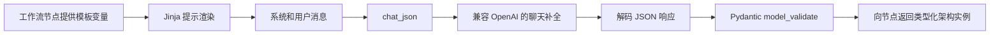

本页说明后端如何配置兼容 OpenAI 的 LLM 客户端、渲染带版本号的提示模板，以及将模型响应验证为类型化的 Pydantic 对象。内容涵盖从配置到工作流节点调用的实现边界；不介绍更广泛的面试生命周期或报告渲染。来源：[config.py](backend/app/config.py#L24-L31) [llm_service.py](backend/app/services/llm_service.py#L31-L45) [workflow_service.py](backend/app/services/workflow_service.py#L22-L57)

## 提供方配置与客户端构建

设置项提供提供方标签、API 密钥、基础 URL、模型名称、温度、超时和重试次数。配置的提供方标签仅限于 `deepseek`、`qwen` 或 `glm`，但客户端本身使用 OpenAI SDK 和配置的基础 URL 构建。换言之，实现中的提供方兼容机制是 OpenAI 兼容的端点配置，而不是根据 `LLM_PROVIDER` 选择单独的 SDK 适配器。来源：[config.py](backend/app/config.py#L24-L31) [llm_service.py](backend/app/services/llm_service.py#L31-L45)

| 设置项 | 在实现中的作用 |
|---|---|
| `LLM_PROVIDER` | 提供方标识符；允许的值为 `deepseek`、`qwen` 和 `glm`。 |
| `OPENAI_API_KEY` | 传递给 SDK 客户端的凭据。占位符默认值会在 `chat_json` 中启用模拟分支。 |
| `OPENAI_BASE_URL` | 传递给 OpenAI SDK 客户端的端点。 |
| `LLM_MODEL` | 调用未显式传入模型时使用的默认模型。 |
| `LLM_TEMPERATURE` | 未在每次调用中覆盖时使用的默认采样温度。 |
| `LLM_TIMEOUT_SECONDS` | SDK 客户端请求超时时间。 |
| `LLM_MAX_RETRIES` | 服务重试辅助函数使用的默认尝试次数。 |

来源：[config.py](backend/app/config.py#L24-L31) [llm_service.py](backend/app/services/llm_service.py#L35-L45) [llm_service.py](backend/app/services/llm_service.py#L113-L116)

示例环境文件将 DeepSeek 设为示例提供方，并提供其兼容端点和模型。若要使用其他受支持的提供方，必须根据该提供方的 OpenAI 兼容 API 一致地配置相应的提供方标识符、API 密钥、基础 URL 和模型。所示代码不包含提供方专用的请求转换。来源：[.env.example](.env.example#L1-L7) [config.py](backend/app/config.py#L24-L31) [llm_service.py](backend/app/services/llm_service.py#L35-L45)

## 请求路径：从模板到经过验证的响应

工作流节点负责与具体任务相关的输入准备：渲染提示、构造系统/用户聊天消息，并使用 Pydantic 架构调用 `chat_json`。共享 LLM 服务负责 API 客户端复用、请求默认值、重试、JSON 解码和架构验证。随后，调用节点即可将返回的架构实例作为类型化数据使用。来源：[nodes.py](backend/app/workflow/nodes.py#L46-L67) [llm_service.py](backend/app/services/llm_service.py#L158-L224)

该图展示了实际的问题生成路径：节点将候选人和职位数据传递给渲染器，把返回的字符串打包为聊天消息，并请求一个 `QuestionList`。`chat_json` 以 JSON 响应模式调用聊天补全端点，解析返回的文本，并根据请求的架构验证解码后的对象。来源：[nodes.py](backend/app/workflow/nodes.py#L46-L64) [llm_service.py](backend/app/services/llm_service.py#L185-L224)

## 提示模板与渲染约定

提示存放在 `backend/app/prompts` 中，并使用 `.v1.j2` 文件名标识其任务和版本。工作流服务使用 Jinja 变量渲染模板文本，并返回包含 `system` 和 `user` 的字典。其拆分约定是有条件的：如果模板包含字面标记 `# system`，则该标记之前的文本作为系统内容，渲染后该标记之后的部分作为用户内容；如果没有该标记，则系统内容为空，整个渲染后的模板都作为用户内容。来源：[workflow_service.py](backend/app/services/workflow_service.py#L22-L57) [question_generation.v1.j2](backend/app/prompts/question_generation.v1.j2#L1-L21)

问题生成模板使用职位名称、要求、职责和简历文本。它要求模型严格生成十个问题，并按指定难度分布提供问题文本、评分标准和难度字段。报告评估模板则格式化候选人/面试官背景信息以及一系列问题、评分标准和答案记录，然后指定所需的评估字段。这些指令会影响模型行为；Pydantic 架构则负责运行时结构检查。来源：[question_generation.v1.j2](backend/app/prompts/question_generation.v1.j2#L13-L44) [report_evaluation.v1.j2](backend/app/prompts/report_evaluation.v1.j2#L6-L53)

## 结构化输出：JSON 模式与 Pydantic 验证

`chat_json` 请求 `response_format={"type": "json_object"}`，然后使用 `json.loads` 解析响应文本。如果解析失败，则会尝试提取带围栏的 JSON 代码块，之后再引发解码错误。解析成功后，会调用 `schema.model_validate(data)`；如果验证失败，则会记录日志并重新引发异常。因此，JSON 模式会要求提供方返回 JSON，而 Pydantic 模型则会强制执行应用程序的字段和值约束。来源：[llm_service.py](backend/app/services/llm_service.py#L190-L224) [llm_service.py](backend/app/services/llm_service.py#L227-L237)

| 架构 | 主要约束和规范化 |
|---|---|
| `QuestionItem` | `question` 的最小长度为 5；`score_standard` 的最小长度为 3；`difficulty` 为 `hard`、`medium` 或 `easy`。 |
| `QuestionList` | 要求恰好有 10 个 `QuestionItem` 值。 |
| `QuestionEvaluation` | 要求分数为 0 到 10 之间的整数，并包含问题、答案、标准和评论。 |
| `ReportEvaluation` | 要求技术、沟通和总分均为 0 到 100 之间的数值；评论至少为 10 个字符。验证前，浮点数或数字字符串形式的分数值会先四舍五入，再强制转换为整数。 |

来源：[schemas/llm.py](backend/app/schemas/llm.py#L13-L27) [schemas/llm.py](backend/app/schemas/llm.py#L31-L38) [schemas/llm.py](backend/app/schemas/llm.py#L41-L74)

`ReportEvaluation.recommendation` 有一个默认字符串；当收到的值为空或等于该默认值时，其验证器会根据 `overall_score` 得出推荐结果：80 分及以上对应“建议录用”，60 分及以上对应“可以考虑”，低于 60 分对应“不建议录用”。这是架构侧的回退行为，并非提供方保证。来源：[schemas/llm.py](backend/app/schemas/llm.py#L55-L87)

## 重试行为与模拟模式

服务会在遇到速率限制、超时以及 HTTP 状态码为 5xx 的 API 错误时重试。等待间隔按指数增长（`2 ** attempt` 秒）；其他 API 错误（包括非 429 的 4xx 错误）会立即引发。OpenAI 客户端内置的重试已禁用，因此重试策略由此服务辅助函数负责。来源：[llm_service.py](backend/app/services/llm_service.py#L35-L45) [llm_service.py](backend/app/services/llm_service.py#L48-L91)

当 `OPENAI_API_KEY` 等于字面占位符 `sk-placeholder-replace-me` 时，`chat_json` 会进入模拟路径，并为 `QuestionList` 返回模拟数据。对于其他架构类型，模拟生成器会引发 `ValueError`，因此所示的模拟实现没有提供相应的报告评估模拟。此分支适用于 `chat_json`；纯文本 `chat` 函数则沿用 API 调用路径。来源：[config.py](backend/app/config.py#L24-L31) [llm_service.py](backend/app/services/llm_service.py#L131-L155) [llm_service.py](backend/app/services/llm_service.py#L158-L185)

## 集成边界

工作流节点会延迟导入 `chat_json`，并显式传入架构类。在问题生成过程中，`generate_questions_node` 会提供渲染后的消息和 `QuestionList`；成功返回后，节点会使用类型化的 `questions` 条目。报告节点对报告评估采用相同模式，使提示内容和架构要求因任务而异，同时复用服务的传输与验证行为。来源：[nodes.py](backend/app/workflow/nodes.py#L46-L67) [nodes.py](backend/app/workflow/nodes.py#L174-L200) [schemas/llm.py](backend/app/schemas/llm.py#L24-L26) [schemas/llm.py](backend/app/schemas/llm.py#L55-L74)

根据这种职责划分，可以采用一条实用的维护原则：任务指令或输入组织方式发生变化时，更新提示；接受的输出契约发生变化时，更新 Pydantic 架构；并同时验证两者，因为提示可能要求运行时验证并未强制执行的字段或约束，也可能导致验证拒绝提示所允许的输出。来源：[question_generation.v1.j2](backend/app/prompts/question_generation.v1.j2#L23-L44) [report_evaluation.v1.j2](backend/app/prompts/report_evaluation.v1.j2#L28-L53) [schemas/llm.py](backend/app/schemas/llm.py#L13-L87)

## 建议继续阅读

如需了解工作流级别的执行上下文，请继续阅读[LangGraph 节点、中断与恢复语义](11-langgraph-nodes-interrupts-and-resume-semantics)。如需了解下游处理前如何准备简历文本，请参阅[简历解析与候选人数据准备](14-resume-parsing-and-candidate-data-preparation)。来源：[nodes.py](backend/app/workflow/nodes.py#L22-L67) [workflow_service.py](backend/app/services/workflow_service.py#L32-L57)
