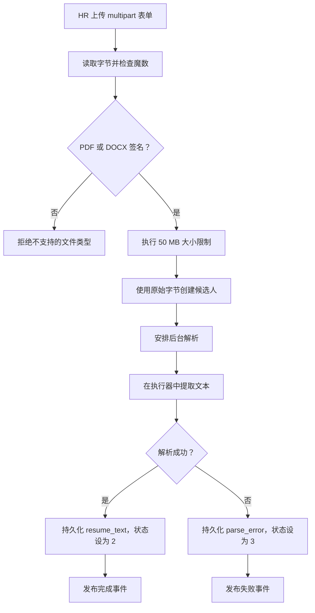

本页说明上传的 PDF 或 DOCX 如何变为已存储的候选人数据和提取出的简历文本。实现将**上传和候选人创建**与**后台文本提取**分开：API 存储原始字节并及时返回，而计划任务负责解析文档并记录结果。本页范围仅包括简历导入、解析器行为和生成的候选人字段，不包括面试工作流或下游评估。来源：[候选人](backend/app/api/candidates.py#L58-L114)、[简历解析器服务](backend/app/services/resume_parser_service.py#L30-L58)、[候选人](backend/app/models/candidate.py#L28-L42)

## 架构模型

关键边界在于**原始文件保留**与**派生文本准备**之间。原始上传文件用于解析和重试；提取出的纯文本和解析状态则分别存储在候选人记录中。解析器不会从文档中填充候选人姓名或电子邮件地址：这些信息由表单字段提供，并由候选人服务验证。来源：[候选人](backend/app/api/candidates.py#L58-L107)、[候选人服务](backend/app/services/candidate_service.py#L55-L105)、[候选人](backend/app/models/candidate.py#L28-L42)

此流程展示了候选人 API 实现的上传和解析路径。图中的成功和失败分支代表后台任务发出的状态更新和 SSE 事件。来源：[候选人](backend/app/api/candidates.py#L68-L114)、[候选人](backend/app/api/candidates.py#L140-L200)

## 上传验证和候选人创建

`POST /api/candidates` 接受 `name`、`email`、`position_id` 和一个简历文件作为 multipart 表单数据。它会读取前八个字节，以识别 PDF（`%PDF-`）或 DOCX（ZIP 签名 `PK\x03\x04`），然后读取其余内容。创建候选人之前，会拒绝不受支持的签名以及超过 50 MiB 的文件。这种识别方式基于签名；所示代码不会使用文件扩展名来选择上传类型。来源：[候选人](backend/app/api/candidates.py#L31-L34)、[候选人](backend/app/api/candidates.py#L58-L88)

| 输入或条件 | 实现行为 |
|---|---|
| PDF 魔数字节 | 存储 `resume_type = 0` |
| DOCX ZIP 签名 | 存储 `resume_type = 1` |
| 任何其他签名 | 返回不支持的文件类型 API 错误 |
| 文件大于 50 MiB | 返回文件过大 API 错误 |
| 姓名为空白或电子邮件格式错误 | 候选人服务拒绝请求 |
| 职位未知 | 候选人服务返回未找到 |

来源：[候选人](backend/app/api/candidates.py#L68-L88)、[候选人服务](backend/app/services/candidate_service.py#L65-L80)

验证完成后，端点会将上传的字节写入 `resume_content` 来创建候选人，然后安排解析，并返回候选人 ID 和人类可读状态 `"parsing"`。该服务会为候选人创建记录审计事件。存储库会将持久化的数值 `parse_status` 初始化为 `1`（解析中）。来源：[候选人](backend/app/api/candidates.py#L90-L114)、[候选人服务](backend/app/services/candidate_service.py#L82-L105)、[候选人](backend/app/models/candidate.py#L102-L131)

## 解析器行为和输出

基于字节的解析器函数可以处理上传内容，而无需先将其写入磁盘。PDF 解析使用 PyPDF2，拒绝加密文件，逐页提取文本，并以换行符连接各页文本。单页提取异常会被记录并跳过；如果最终文档没有可提取的文本，解析将引发 `SCANNED_PDF`。该实现不执行 OCR。来源：[简历解析器服务](backend/app/services/resume_parser_service.py#L153-L184)

DOCX 解析使用 `python-docx`。它会收集非空段落文本，然后收集文档表格中的非空单元格，并以换行符连接收集到的内容。未提取到文本的文档会引发 `EMPTY_DOCX`。来源：[简历解析器服务](backend/app/services/resume_parser_service.py#L187-L211)

两类解析器都会针对可识别的失败引发 `ResumeParseError`，并提供代码和消息。这些失败包括缺少依赖项、PDF 已加密、文档为空或为扫描件，以及一般解析失败。基于路径的 `parse_resume` 函数还会检查路径是否存在，并且只接受 `"pdf"` 或 `"docx"`；此处所示的上传路由使用的是基于字节的函数。来源：[简历解析器服务](backend/app/services/resume_parser_service.py#L18-L25)、[简历解析器服务](backend/app/services/resume_parser_service.py#L30-L58)、[简历解析器服务](backend/app/services/resume_parser_service.py#L61-L97)、[简历解析器服务](backend/app/services/resume_parser_service.py#L99-L127)

## 后台解析和候选人状态

API 会安排异步任务。该任务会发布 `resume_parse_started`，通过事件循环的执行器运行同步解析器，并使用单独的数据库会话写入结果。成功时，会将提取出的文本与状态 `2` 一起存储；发生解析器特定异常或意外异常时，则存储状态 `3` 和错误字符串。随后，任务会发布 `resume_parse_complete` 或 `resume_parse_failed`，其中包含候选人 ID 和触发条件；完成事件还包含文本长度和解析器类型。来源：[候选人](backend/app/api/candidates.py#L117-L171)、[候选人](backend/app/api/candidates.py#L173-L200)、[候选人](backend/app/api/candidates.py#L202-L244)

| `parse_status` | 在架构中的含义 | API/任务行为 |
|---:|---|---|
| `0` | 待处理 | 简历文本端点将其视为仍在解析 |
| `1` | 解析中 | 存储库创建候选人时设置；重试时也会使用 |
| `2` | 成功 | 提取出的文本会被持久化，并发布完成事件 |
| `3` | 失败 | 解析错误会被持久化，并发布失败事件 |

候选人模型会存储 `resume_type`（原始字节或路径）、提取出的 `resume_text`、`parse_status`、`parse_error`、`is_scanned_document` 和 `parsed_at`。在此处描述的上传流程中，解析成功或失败时会相应更新状态、文本和错误；所示的解析任务更新不会设置 `is_scanned_document`。响应架构会公开该字段，但不应据此认定此解析路径会将扫描文档分类；该路径只会报告 `SCANNED_PDF` 解析错误。来源：[候选人](backend/app/models/candidate.py#L28-L42)、[候选人](backend/app/models/candidate.py#L150-L170)、[候选人](backend/app/schemas/candidate.py#L12-L25)

## 读取结果和重试

`GET /api/candidates/{candidate_id}/resume-text` 在 `parse_status` 为 `0` 或 `1` 时返回冲突。处理完成后，其响应会包含状态、解析错误、提取出的文本、扫描文档标志、解析时间戳和简历类型。候选人列表和详情输出会包含解析状态和错误，但不包含简历文本字段。来源：[候选人](backend/app/api/candidates.py#L247-L257)、[候选人](backend/app/api/candidates.py#L284-L316)、[候选人](backend/app/schemas/candidate.py#L12-L25)、[候选人](backend/app/schemas/candidate.py#L41-L51)

`POST /api/candidates/{candidate_id}/reparse` 会重用 `resume_content`；它不接受新的上传文件。对于没有存储字节的候选人以及当前标记为正在解析的候选人，该端点会拒绝请求。否则，它会将状态重置为 `1`，清除先前的文本和错误，记录重试审计事件，并使用触发条件 `"reparse"` 安排解析。来源：[候选人](backend/app/api/candidates.py#L319-L380)

## 测试中的验证

解析器测试涵盖无效和空的 PDF/DOCX 输入、不受支持的基于路径的解析器类型、路径不存在、实际 DOCX 段落、DOCX 表格，以及从文件路径解析 DOCX。使用空白页的 PDF 测试会因无法提取文本而预期出现解析错误；允许的错误包括 `SCANNED_PDF` 或 `PARSE_FAILED`。来源：[简历解析器测试](backend/tests/test_resume_parser.py#L17-L79)、[简历解析器测试](backend/tests/test_resume_parser.py#L82-L107)、[简历解析器测试](backend/tests/test_resume_parser.py#L109-L156)

## 后续步骤

如需了解相关生命周期和状态语义，请继续阅读[面试工作流状态与生命周期](10-interview-workflow-state-and-lifecycle)。如需了解解析器与 LLM 相关的背景，请参阅[LLM 提供方、提示模板和结构化输出](13-llm-providers-prompt-templates-and-structured-outputs)；本页介绍确定性的 PDF/DOCX 文本提取，不介绍 LLM 提取。来源：[简历解析器服务](backend/app/services/resume_parser_service.py#L30-L58)、[简历解析器服务](backend/app/services/resume_parser_service.py#L153-L211)
