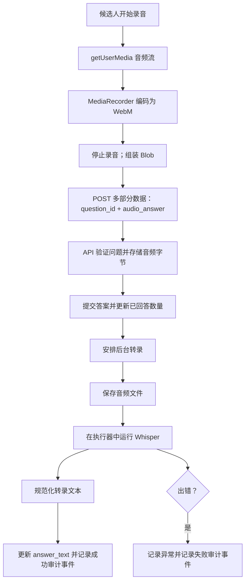

本页追踪一个答案从浏览器麦克风采集，经多部分上传、音频持久化存储，到异步语音转文本处理的完整过程。实现使用浏览器的 `MediaRecorder` API 生成 WebM 音频，然后在后台执行器中运行本地加载的 Whisper 兼容模型。**HTTP 答案提交不会等待转录完成。**来源：[VoiceRecorder.tsx](frontend/src/components/VoiceRecorder.tsx#L1-L12)、[candidate_portal.py](backend/app/api/candidate_portal.py#L108-L120)、[candidate_portal.py](backend/app/api/candidate_portal.py#L156-L206)

## 端到端流程

浏览器将音频采集为 `Blob`，并连同问题 ID 一起上传。API 将收到的字节存入问题记录，并在安排转录任务之前提交答案。随后，任务会保存一份文件副本，在执行器中调用同步 ASR 函数，并将生成的文本写回答案记录。来源：[VoiceRecorder.tsx](frontend/src/components/VoiceRecorder.tsx#L63-L101)、[candidatePortal.ts](frontend/src/api/candidatePortal.ts#L49-L62)、[candidate_portal.py](backend/app/api/candidate_portal.py#L137-L154)、[candidate_portal.py](backend/app/api/candidate_portal.py#L197-L216)

转录仍在进行时，响应可以包含下一个问题。API 会检查是否所有问题都已回答，并可能在此时恢复面试工作流；此答案提交流程与等待转录完成是彼此独立的。来源：[candidate_portal.py](backend/app/api/candidate_portal.py#L258-L307)

## 浏览器录音与上传

`VoiceRecorder` 使用 `navigator.mediaDevices.getUserMedia({ audio: true })` 请求麦克风访问权限。在支持的情况下，它优先使用 `audio/webm;codecs=opus`，否则请求 `audio/webm`。系统会收集非空的 `dataavailable`；录音停止时，这些数据会被组装成 `Blob`，传递给 `onComplete`，并停止麦克风轨道。组件卸载时的清理逻辑也会停止所有活动轨道并清除计时器。来源：[VoiceRecorder.tsx](frontend/src/components/VoiceRecorder.tsx#L29-L61)、[VoiceRecorder.tsx](frontend/src/components/VoiceRecorder.tsx#L63-L113)

API 客户端将问题 ID 和音频 blob 放入 `FormData`，使用文件名 `answer.webm`，并将其提交至 `/api/candidate/{token}/answers`。在服务器端，FastAPI 将 `question_id` 作为表单字段接收，将 `audio_answer` 作为上传文件接收。保存之前，处理程序会验证问题是否存在、是否属于当前面试，以及是否尚未回答。来源：[candidatePortal.ts](frontend/src/api/candidatePortal.ts#L49-L62)、[candidate_portal.py](backend/app/api/candidate_portal.py#L108-L135)

| 阶段 | 实现细节 | 运行影响 |
|---|---|---|
| 采集 | 浏览器 `MediaRecorder`；优先使用 WebM/Opus | 录音需要通过浏览器获得麦克风访问权限。 |
| 上传 | 包含 `question_id` 和 `audio_answer` 的多部分表单 | 客户端提供 `answer.webm` 文件名。 |
| 初始持久化 | 将音频字节赋给 `question.answer_audio`；更新答案时间戳和面试进度 | 后台 ASR 任务启动前，答案已提交。 |
| ASR 文件持久化 | 后台任务调用 `storage.save_audio(interview_id, question_id, audio_data)` | 转录会读取已保存的音频路径。 |
| 转录文本持久化 | 使用 `update_answer(..., answer_text=text)` 写入 ASR 输出 | 后台处理成功后，文本即可使用。 |

来源：[VoiceRecorder.tsx](frontend/src/components/VoiceRecorder.tsx#L72-L92)、[candidatePortal.ts](frontend/src/api/candidatePortal.ts#L52-L60)、[candidate_portal.py](backend/app/api/candidate_portal.py#L137-L154)、[candidate_portal.py](backend/app/api/candidate_portal.py#L197-L216)

## FFmpeg 与音频解码

应用在尝试加载 ASR 模型之前，会在启动期间运行 `ensure_ffmpeg_in_path()`。该辅助程序首先检查是否已能找到 `ffmpeg`。如果找不到，它会搜索已配置的 Windows WinGet 软件包位置和常见安装目录，然后将找到的目录添加到 `PATH` 的开头。如果找不到候选项，它会记录警告；启动流程仍会继续加载模型。来源：[main.py](backend/app/main.py#L85-L101)、[ffmpeg.py](backend/app/core/ffmpeg.py#L37-L87)

这一点很重要，因为 FFmpeg 辅助程序说明，Whisper 会使用子进程解码 WebM 等音频格式。因此，即使应用和模型都在运行，缺少可执行文件仍可能导致 WebM 转录失败。代码中的启动警告明确指出，WebM 录音需要 FFmpeg。来源：[ffmpeg.py](backend/app/core/ffmpeg.py#L1-L10)、[main.py](backend/app/main.py#L88-L95)

## 模型生命周期与转录行为

应用启动时，生命周期处理程序会尝试在执行器中加载 ASR 模型。模型加载失败会被捕获并记录，而不会被视为必须中止启动的原因。如果调用 `transcribe()` 时模型尚未初始化，ASR 服务也支持延迟加载；如果尝试后仍无法获得模型，则会引发 `RuntimeError`。关闭时，生命周期处理程序会调用 `release_whisper_model()`。来源：[main.py](backend/app/main.py#L85-L101)、[main.py](backend/app/main.py#L114-L125)、[asr_service.py](backend/app/services/asr_service.py#L254-L305)、[asr_service.py](backend/app/services/asr_service.py#L316-L344)

服务会根据 `WHISPER_DEVICE` 选择设备：`cuda` 在 CUDA 可用时使用 CUDA，`cpu` 强制使用 CPU，`auto` 则优先使用 CUDA（如果可用）。CUDA 使用 `float16`，CPU 使用 `int8`；随后，服务会使用配置的模型名称构造一个 `faster_whisper.WhisperModel`。默认模型为 `base`，配置的设备默认值为 `auto`。来源：[asr_service.py](backend/app/services/asr_service.py#L240-L250)、[asr_service.py](backend/app/services/asr_service.py#L254-L292)、[config.py](backend/app/config.py#L57-L60)

`transcribe()` 默认使用中文（`zh`），并采用包含领域术语的中文初始提示。它请求使用 beam size 5 和 VAD 过滤，拼接各片段文本，应用术语修正字典，然后尝试通过 OpenCC 进行繁体到简体转换。OpenCC 在运行时是可选的：如果加载或转换失败，服务会记录警告并返回未经该转换处理的文本。来源：[asr_service.py](backend/app/services/asr_service.py#L32-L42)、[asr_service.py](backend/app/services/asr_service.py#L197-L234)、[asr_service.py](backend/app/services/asr_service.py#L316-L367)

| 配置或选项 | 默认值 / 行为 | 依据 |
|---|---|---|
| `WHISPER_MODEL` | `base`；允许的值包括 `tiny`、`small`、`medium` 和 `large-v3` | [config.py](backend/app/config.py#L57-L60) |
| `WHISPER_DEVICE` | `auto`；设备选择会在 CUDA 可用时优先使用 CUDA | [config.py](backend/app/config.py#L57-L60)、[asr_service.py](backend/app/services/asr_service.py#L240-L250) |
| 计算类型 | CUDA 使用 `float16`；CPU 使用 `int8` | [asr_service.py](backend/app/services/asr_service.py#L261-L270) |
| 语言 | 转录函数默认使用 `zh` | [asr_service.py](backend/app/services/asr_service.py#L316-L329) |
| 解码选项 | beam size 为 5，并启用 VAD 过滤 | [asr_service.py](backend/app/services/asr_service.py#L345-L357) |
| 转录文本清理 | 先进行术语替换，再进行可选的 OpenCC `t2s` 转换 | [asr_service.py](backend/app/services/asr_service.py#L197-L234)、[asr_service.py](backend/app/services/asr_service.py#L359-L367) |

来源：[config.py](backend/app/config.py#L57-L60)、[asr_service.py](backend/app/services/asr_service.py#L240-L270)、[asr_service.py](backend/app/services/asr_service.py#L316-L367)

## 后台执行与故障可见性

答案处理程序会先提交音频和答案状态，然后再创建转录任务。该任务会保存音频文件，通过主事件循环的默认执行器运行同步的 `transcribe()` 调用，并打开单独的数据库会话来更新 `answer_text`。这样可以避免在请求的直接执行路径中运行模型推理。来源：[candidate_portal.py](backend/app/api/candidate_portal.py#L137-L154)、[candidate_portal.py](backend/app/api/candidate_portal.py#L197-L216)

成功时，任务会写入一条 `answer_transcribed` 审计事件，其中包含问题 ID、音频路径和转录文本长度。失败时，任务会记录异常并写入 `answer_transcribe_failed`，其中包括错误信息和经过截断的回溯信息。如果有未捕获的异常逃逸出任务自身的错误处理逻辑，任务还会通过完成回调记录该异常。来源：[candidate_portal.py](backend/app/api/candidate_portal.py#L180-L195)、[candidate_portal.py](backend/app/api/candidate_portal.py#L218-L256)

## 按故障点排查问题

| 症状 | 验证项 | 代码支持的解释 |
|---|---|---|
| 无法启动麦克风 | 浏览器麦克风权限和 `getUserMedia` 是否可用 | 采集设置失败时，组件会显示错误，并弹出与权限相关的提示。 |
| WebM 音频无法转录 | FFmpeg 是否可被发现，或是否被启动探测程序找到 | 启动流程会在缺少 FFmpeg 时发出警告；辅助程序说明了 FFmpeg 在解码 WebM 时的作用。 |
| 模型不可用 | 模型加载日志以及已配置的设备/模型 | 启动加载错误会被记录；转录会尝试延迟加载，如果模型仍不可用则会引发错误。 |
| 答案存在但没有转录文本 | `answer_transcribe_failed` 审计事件和服务器日志 | 转录是异步的，失败记录与答案提交记录相互独立。 |
| 转录文本与原始识别结果不同 | 术语替换和 OpenCC 是否可用 | 服务会先应用明确的替换规则，再进行可选的繁体到简体转换。 |

来源：[VoiceRecorder.tsx](frontend/src/components/VoiceRecorder.tsx#L63-L105)、[ffmpeg.py](backend/app/core/ffmpeg.py#L37-L87)、[main.py](backend/app/main.py#L85-L101)、[asr_service.py](backend/app/services/asr_service.py#L316-L367)、[candidate_portal.py](backend/app/api/candidate_portal.py#L218-L247)

## 依赖项与实现边界

后端依赖清单在语音识别依赖项中声明了 `openai-whisper` 和 `torch`。不过，ASR 服务在加载模型时导入的是 `faster_whisper.WhisperModel`。这是已声明的语音识别依赖项与运行时导入路径之间可验证的差异；在认定仅安装已声明的软件包就能提供所导入的模块之前，请先检查项目的依赖配置和部署设置。来源：[pyproject.toml](backend/pyproject.toml#L35-L38)、[asr_service.py](backend/app/services/asr_service.py#L277-L285)

如需了解面向候选人的录音组件及其相关交互，请继续阅读[候选人门户、音频采集与面试体验](25-candidate-portal-audio-capture-and-interview-experience)。如需了解更广泛的模型和提示配置，请参阅[LLM 提供方、提示模板与结构化输出](13-llm-providers-prompt-templates-and-structured-outputs)。来源：[VoiceRecorder.tsx](frontend/src/components/VoiceRecorder.tsx#L1-L12)、[asr_service.py](backend/app/services/asr_service.py#L32-L42)
