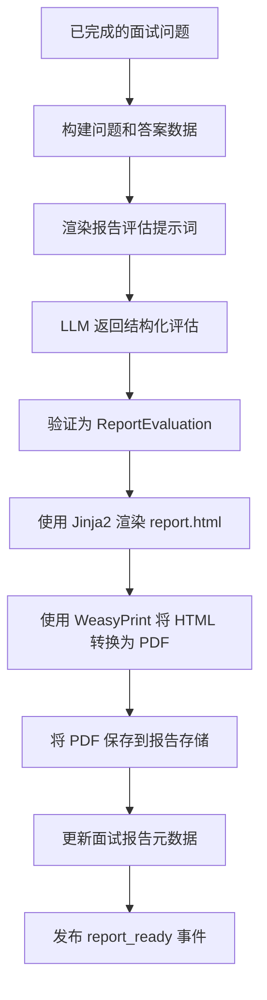

本页说明已完成的面试如何转化为结构化评估并生成可下载的 PDF。本文范围包括报告生成流程、渲染器和模板，以及基于文件的报告交付；不涉及更广泛的面试工作流或通用文件存储操作。

## 报告生成流程

报告分两个阶段生成：工作流先请求 LLM 生成经过架构验证的评估，然后将结果渲染为 PDF 字节并保存。以下顺序展示了评估数据与呈现之间的边界。来源：[nodes.py](backend/app/workflow/nodes.py#L164-L257)、[llm.py](backend/app/schemas/llm.py#L26-L87)、[report_renderer.py](backend/app/services/report_renderer.py#L84-L156)、[file_storage.py](backend/app/services/file_storage.py#L117-L125)

`generate_report_node` 会加载面试、候选人、职位及其问题。它构建问题与答案输入，渲染 `report_evaluation.v1.j2`，并将 `chat_json` 与 `ReportEvaluation` 作为架构传入进行调用。如果 LLM 调用引发异常，该节点会返回错误结果，而不会继续进行 PDF 渲染。来源：[nodes.py](backend/app/workflow/nodes.py#L164-L224)、[report_evaluation.v1.j2](backend/app/prompts/report_evaluation.v1.j2#L1-L54)

该架构将问题分数限制为 0 到 10 的整数，并将三个摘要分数限制为 0 到 100 的整数。摘要分数验证器会在验证前将浮点数或数字字符串转换为整数。推荐内容为自由文本；如果未提供推荐内容，或其值等于架构的回退占位符，则根据总体分数阈值生成推荐：80 及以上、60–79，以及低于 60。来源：[llm.py](backend/app/schemas/llm.py#L26-L87)

## 评估数据和报告内容

评估提示词要求提供每个问题的分数和评论、技术能力分数、沟通能力分数、总体分数、总体评论以及推荐内容。提示词还说明问题分数范围为 0–10，且简短或无关的回答应得零分；这些是提示词中的指示，而架构负责强制执行数据结构和分数范围。来源：[report_evaluation.v1.j2](backend/app/prompts/report_evaluation.v1.j2#L10-L54)、[llm.py](backend/app/schemas/llm.py#L26-L87)

PDF 模板展示面试日期、候选人和职位详情、面试官、问题数量、摘要分数、推荐内容、总体评论，以及包含问题、评分标准、答案、分数和评论的逐题部分。在工作流中，当 `overall_score >= 60` 时，`is_passed` 设为 1；否则设为 0。这是独立于报告中显示的推荐文本之外的工作流决策。来源：[report.html](backend/app/templates/report.html#L106-L180)、[nodes.py](backend/app/workflow/nodes.py#L226-L257)

| 数据或行为 | 实现方式 |
|---|---|
| 摘要分数 | 技术能力、沟通能力和总体分数；以 0–100 的范围显示。 |
| 单题分数 | 架构范围为 0–10；渲染器在选择显示颜色类时将其乘以 10。 |
| 摘要分数颜色 | 高分为 80 及以上，中等分数为 60–79，低分为低于 60。 |
| 推荐颜色 | 包含“推荐”的文本映射为正向；包含“考虑”的文本映射为中性；其他文本映射为负向。 |
| 问题数量 | 如果提供了明确数量，则使用该数量；否则回退为问题评估的数量。 |

来源：[report_renderer.py](backend/app/services/report_renderer.py#L24-L81)、[report.html](backend/app/templates/report.html#L129-L180)、[llm.py](backend/app/schemas/llm.py#L26-L87)

## 渲染器和 PDF 布局

`render_report_pdf` 接受候选人姓名、职位、面试官、评估对象以及可选的问题数量。它支持带有 `model_dump()` 的类 Pydantic 评估对象和字典形式的评估对象，准备模板字段和 CSS 类，通过模块级 Jinja2 环境渲染 `report.html`，并将生成的 HTML 传给 WeasyPrint。Jinja 自动转义对 HTML 和 XML 模板均已启用。来源：[report_renderer.py](backend/app/services/report_renderer.py#L17-L22)、[report_renderer.py](backend/app/services/report_renderer.py#L84-L129)

模板将页面定义为 A4，页边距为 2 cm，并对报告章节、分数表格、推荐横幅和问题块应用面向打印的样式。每个问题块使用 `page-break-inside: avoid`，以减少内容跨页拆分。如果 WeasyPrint 不可用，则会在转换函数内部导入时记录导入错误，并重新引发该错误。来源：[report.html](backend/app/templates/report.html#L1-L105)、[report.html](backend/app/templates/report.html#L147-L180)、[report_renderer.py](backend/app/services/report_renderer.py#L132-L141)

渲染器是同步的。该模块还提供 `render_report_pdf_async`，它会将同步渲染函数提交到通过 `get_main_loop` 获取的默认执行器；当前工作流节点直接调用同步函数。选择调用位置时需要注意这一区别：异步封装函数确实存在，但示例中的节点并未使用它。来源：[report_renderer.py](backend/app/services/report_renderer.py#L132-L156)、[nodes.py](backend/app/workflow/nodes.py#L226-L235)

## 持久化和下载行为

渲染完成后，工作流通过 `file_storage.save_report` 保存 PDF，将返回的路径存储在面试记录中，发布包含报告下载 URL 的 `report_ready` 事件，记录报告生成审计条目，并提交数据库事务。本地存储实现会在已配置的根目录下使用路径 `reports/{interview_id}.pdf`，并先写入临时文件，再执行 `os.replace`。来源：[nodes.py](backend/app/workflow/nodes.py#L226-L257)、[file_storage.py](backend/app/services/file_storage.py#L44-L56)、[file_storage.py](backend/app/services/file_storage.py#L66-L93)、[file_storage.py](backend/app/services/file_storage.py#L117-L125)

`InterviewService.download_report` 仅在面试状态至少为 4 时提供报告。它会先读取 `report_path`（如果其指向现有文件），然后回退到旧版 `report_content` BLOB；如果两者都不可用，则引发报告未找到错误。成功下载时使用的文件名为 `interview_report_{id}.pdf`。来源：[interview_service.py](backend/app/services/interview_service.py#L198-L228)

## 验证和实现说明

渲染器测试会检查分数和推荐类别的选择、PDF 输出字节及 `%PDF-` 签名、字典兼容性，以及没有问题评估时的渲染行为。如果 WeasyPrint 不可用或无法加载其系统依赖项，测试会跳过 PDF 断言。来源：[test_report_renderer.py](backend/tests/test_report_renderer.py#L49-L135)

一种实用的维护边界是：将评估语义保留在提示词和架构中，将视觉布局和格式转换保留在渲染器和 HTML 模板中。更改分数范围、推荐标签或显示字段时，应同时检查架构/提示词约定和渲染路径，确保经过验证的评估数据仍能正确映射到报告中。来源：[report_evaluation.v1.j2](backend/app/prompts/report_evaluation.v1.j2#L10-L54)、[llm.py](backend/app/schemas/llm.py#L26-L87)、[report_renderer.py](backend/app/services/report_renderer.py#L24-L129)、[report.html](backend/app/templates/report.html#L106-L180)

## 后续步骤

如需了解报告节点如何融入面试执行流程的上游背景，请继续阅读[LangGraph 节点、中断与恢复语义](11-langgraph-nodes-interrupts-and-resume-semantics)。如需了解相邻的持久化设计，请参阅[持久化文件、数据库备份与操作安全](31-persistent-files-database-backups-and-operational-safety)。来源：[nodes.py](backend/app/workflow/nodes.py#L164-L257)、[file_storage.py](backend/app/services/file_storage.py#L44-L56)、[interview_service.py](backend/app/services/interview_service.py#L198-L228)
