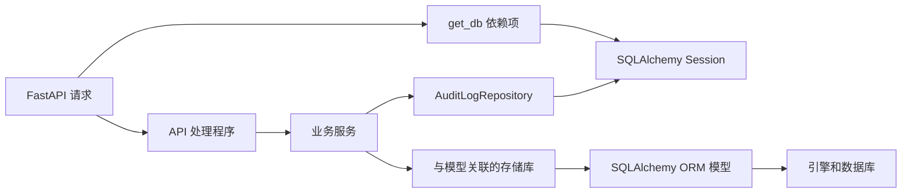

本页追踪后端业务操作如何到达 SQLAlchemy，以及数据库会话如何创建和共享。核心模式是**请求范围的会话注入**：API 处理程序使用 `Session` 构造服务；服务应用业务规则，并将持久化操作委托给与模型关联的存储库。代码没有采用统一的事务边界：一些存储库会单独提交写入，而一些服务操作会协调多项更改并一起提交。来源：[database.py](backend/app/database.py#L1-L95)、[deps.py](backend/app/deps.py#L1-L40)、[candidate_service.py](backend/app/services/candidate_service.py#L20-L31)、[candidate.py](backend/app/models/candidate.py#L67-L78)

## 职责边界

API 层接收依赖项，并将 HTTP 输入转换为服务调用。服务执行领域级验证、查询、审计以及多实体协调。存储库与 SQLAlchemy 模型一起位于 `app/models` 中；它们使用调用方提供的 `Session` 封装查询和持久化操作。来源：[candidates.py](backend/app/api/candidates.py#L20-L43)、[candidate_service.py](backend/app/services/candidate_service.py#L20-L31)、[candidate.py](backend/app/models/candidate.py#L67-L78)、[position.py](backend/app/models/position.py#L48-L57)

该图展示了常见的依赖路径，并不代表严格的抽象屏障：服务也可以直接修改 ORM 实体，而 API 代码也可以为后台任务创建额外的会话。来源：[deps.py](backend/app/deps.py#L17-L22)、[candidates.py](backend/app/api/candidates.py#L31-L43)、[interview_service.py](backend/app/services/interview_service.py#L126-L151)、[candidates.py](backend/app/api/candidates.py#L102-L110)

## 会话生命周期和引擎设置

`database.py` 创建模块级引擎和 `SessionLocal` 工厂。该工厂禁用自动刷新和自动提交，并设置 `expire_on_commit=False`。`get_db()` 创建一个会话，将其交给使用方，然后在 `finally` 块中关闭会话。`deps.get_db()` 委托给此生成器，使 FastAPI 端点能够通过依赖注入请求会话。来源：[database.py](backend/app/database.py#L44-L67)、[deps.py](backend/app/deps.py#L17-L22)

对于 SQLite URL，引擎使用 `check_same_thread=False` 创建。连接监听器会配置 WAL 日志模式、启用外键，并设置 `busy_timeout=5000`。引擎还会启用 `pool_pre_ping`；`init_db()` 会在调用 `Base.metadata.create_all()` 之前导入模型。这些是数据库配置和表创建行为，而不是针对每个请求的事务控制。来源：[database.py](backend/app/database.py#L25-L42)、[database.py](backend/app/database.py#L70-L95)

| 关注点 | 实现方式 |
|---|---|
| 引擎所有权 | 模块级 `engine`，由 `_create_engine()` 构造 |
| 会话工厂 | `SessionLocal`，绑定到引擎 |
| 请求会话 | `get_db()` 生成一个会话，并在之后将其关闭 |
| SQLite 连接选项 | `check_same_thread=False`；用于 WAL、外键和忙等待超时的连接 PRAGMA |
| 模式初始化 | 导入模型类，然后调用 `Base.metadata.create_all()` |

来源：[database.py](backend/app/database.py#L25-L95)

## 服务：业务规则和编排

服务在构造函数中接收 `Session`，并将其传递给存储库。例如，`CandidateService` 会初始化候选人和审计存储库；`PositionService` 会初始化职位和审计存储库。它们的方法将持久化操作与输入验证、相关实体是否存在、审计创建和删除策略等检查结合起来。来源：[candidate_service.py](backend/app/services/candidate_service.py#L20-L31)、[position_service.py](backend/app/services/position_service.py#L17-L25)

`CandidateService.create_candidate()` 会验证必填字段和简历类型，确认职位存在，创建候选人并记录审计事件。`PositionService.delete_position()` 会在删除前检查是否存在关联的候选人和面试。`InterviewService.update_interview()` 会验证状态变更，直接更新已加载的 ORM 对象，提交、刷新该对象，然后写入审计记录。最后一个示例说明，使用存储库是一种惯例，而非强制规则：服务也会直接执行会话操作。来源：[candidate_service.py](backend/app/services/candidate_service.py#L51-L103)、[position_service.py](backend/app/services/position_service.py#L112-L154)、[interview_service.py](backend/app/services/interview_service.py#L126-L160)

## 存储库：查询和持久化

存储库是轻量级类，使用 SQLAlchemy `Session` 初始化。它们提供面向实体的方法，例如 `get`、`list_all`、`create`、`update` 和 `delete`，并使用 ORM 查询和映射后的模型实例。例如，`PositionRepository.list_all()` 会应用可选的状态筛选，按 ID 降序排序，然后应用偏移量和限制数量。来源：[position.py](backend/app/models/position.py#L48-L71)、[candidate.py](backend/app/models/candidate.py#L67-L105)、[interview.py](backend/app/models/interview.py#L102-L139)

存储库的事务行为各不相同。`PositionRepository.create()` 会提交并刷新；`CandidateRepository.create()` 也会执行相同操作。相比之下，`CandidateRepository.delete()` 会暂存删除操作而不提交，明确将提交责任留给服务。`AuditLogRepository.create()` 会提交其审计行。因此，调用方不能仅仅因为使用了同一个会话，就认定服务方法中的操作会共享一次原子提交。来源：[position.py](backend/app/models/position.py#L73-L102)、[candidate.py](backend/app/models/candidate.py#L107-L142)、[candidate.py](backend/app/models/candidate.py#L169-L177)、[audit_log.py](backend/app/models/audit_log.py#L64-L98)

## 提交边界和协调

最明确的协调事务是 `CandidateService.delete_candidate()`：它移除面试问题和面试，通过会话删除候选人，创建审计条目，然后提交会话。不过，`AuditLogRepository.create()` 本身会提交。由于审计存储库是在服务最终调用 `db.commit()` 之前调用的，因此该操作并未将所有这些步骤实现为单一的显式提交边界。同样，若干创建/更新存储库方法会在服务记录审计事件之前提交。来源：[candidate_service.py](backend/app/services/candidate_service.py#L103-L153)、[audit_log.py](backend/app/models/audit_log.py#L64-L98)、[position.py](backend/app/models/position.py#L73-L129)

更改持久化代码时，这种混合策略很重要：添加一次存储库调用，可能会使一个原本看似协调的操作更早提交。评估原子性或错误处理时，应检查每个被调用方法的提交行为；所示代码没有定义共享的工作单元抽象。来源：[candidate_service.py](backend/app/services/candidate_service.py#L103-L153)、[candidate.py](backend/app/models/candidate.py#L107-L142)、[audit_log.py](backend/app/models/audit_log.py#L64-L98)

## 后台任务和独立会话

候选人解析后台路径不会重用请求范围的会话。API 会安排解析任务，其辅助函数会导入 `SessionLocal`；解析成功或失败后，都会调用状态更新辅助函数。这建立了一种用于后台持久化的独立会话机制，而不是在异步任务期间保留请求的 `db` 会话。来源：[candidates.py](backend/app/api/candidates.py#L82-L110)、[database.py](backend/app/database.py#L44-L67)

身份验证依赖项也会使用注入的会话查询存储库：`get_current_user()` 通过 `UserRepository` 查找用户，而 `get_current_candidate()` 则通过 `InterviewRepository` 使用令牌查找面试。这使依赖项中的数据库访问与处理程序所使用的请求会话模式保持一致。来源：[deps.py](backend/app/deps.py#L25-L68)

## 实用阅读指南

跟踪由数据库支持的功能时，先从其 API 处理程序入手，确定注入的 `Session` 和服务的构造方式；再检查服务中的验证、跨实体协调和审计行为；然后检查每个存储库方法的查询形式以及它是否提交。最后查看 `database.py`，了解会话清理和引擎配置。来源：[candidates.py](backend/app/api/candidates.py#L31-L43)、[candidate_service.py](backend/app/services/candidate_service.py#L20-L31)、[candidate.py](backend/app/models/candidate.py#L67-L78)、[database.py](backend/app/database.py#L25-L67)

如需了解相关主题，请继续阅读[SQLite WAL、业务数据和工作流检查点](18-sqlite-wal-business-data-and-workflow-checkpoints)，了解持久化方面的区别；或阅读[后端测试策略和工作流测试替身](28-backend-test-strategy-and-workflow-test-doubles)，了解测试覆盖范围和数据库测试设置。来源：[database.py](backend/app/database.py#L25-L42)
