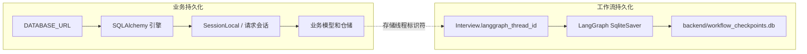
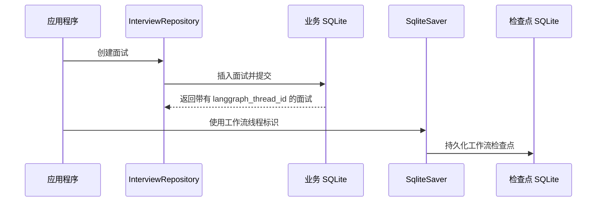

本页说明后端如何使用 SQLite 实现两种不同类型的持久化：由 SQLAlchemy 管理的招聘数据，以及 LangGraph 工作流检查点。这一区分对运维很重要：两种存储有各自独立的配置路径、生命周期和用途。[18 — SQLite WAL、业务数据与工作流检查点](18-sqlite-wal-business-data-and-workflow-checkpoints) 是目录中的当前页面。来源：[database.py](backend/app/database.py#L1-L95)、[checkpointer.py](backend/app/workflow/checkpointer.py#L1-L59)

## 两种存储，两种职责

**业务数据库**存储面试等应用实体，并通过 `DATABASE_URL` 配置。**检查点数据库**存储 LangGraph 执行状态，根据检查点实现，位于 `backend/workflow_checkpoints.db`。工作流的 `langgraph_thread_id` 字段将面试记录关联到工作流线程；它是一个标识符，而不是检查点状态的副本。来源：[config.py](backend/app/config.py#L29-L35)、[database.py](backend/app/database.py#L23-L49)、[checkpointer.py](backend/app/workflow/checkpointer.py#L22-L48)、[interview.py](backend/app/models/interview.py#L18-L27)、[interview.py](backend/app/models/interview.py#L57-L66)

该图将标识符关系与持久化机制区分开来：SQLAlchemy 管理面试记录，而 LangGraph 的 `SqliteSaver` 管理检查点。来源：[database.py](backend/app/database.py#L23-L49)、[checkpointer.py](backend/app/workflow/checkpointer.py#L22-L48)、[interview.py](backend/app/models/interview.py#L57-L66)

## 业务数据库：引擎、会话与 WAL

对于 SQLite URL，SQLAlchemy 引擎使用 `check_same_thread=False` 创建。连接事件会应用 `PRAGMA journal_mode=WAL`、启用外键，并配置 `PRAGMA busy_timeout=5000`。代码注释说明，WAL 允许并发读取而不阻塞写入；`busy_timeout` 将连接的锁等待时长设为五秒。这些设置会应用于由此引擎创建的业务数据库连接。来源：[database.py](backend/app/database.py#L23-L49)

`SessionLocal` 是绑定到该引擎的会话工厂。`get_db()` 为一次 FastAPI 依赖调用创建一个会话，并在 `finally` 块中关闭它。`init_db()` 会导入模型类、确保 SQLite 文件的父目录存在，并调用 `Base.metadata.create_all`；它会创建缺失的表，而不是表示一段迁移历史。来源：[database.py](backend/app/database.py#L52-L95)

默认配置的业务 URL 是 `sqlite:///./interview.db`。其相对位置取决于进程的工作目录；部署可以提供不同的 `DATABASE_URL`。相比之下，检查点路径是根据检查点模块的位置推导出来的，因此在此代码中，更改业务 URL 不会改变检查点数据库的位置。来源：[config.py](backend/app/config.py#L29-L35)、[checkpointer.py](backend/app/workflow/checkpointer.py#L22-L28)

| 关注点 | 业务数据库 | 工作流检查点存储 |
|---|---|---|
| 主要用途 | 招聘实体和应用数据 | LangGraph 检查点持久化 |
| 访问层 | SQLAlchemy 引擎、会话、模型、仓储 | LangGraph `SqliteSaver` |
| 位置/配置 | `DATABASE_URL`；默认值 `sqlite:///./interview.db` | `backend/workflow_checkpoints.db` |
| 代码中展示的 SQLite 选项 | WAL、外键、5 秒忙碌超时、跨线程连接选项 | 同步 getter 中直接使用 `sqlite3.connect(..., check_same_thread=False)` |
| 面试关联 | 在面试记录上存储 `langgraph_thread_id` | 使用工作流线程标识符关联检查点 |

来源：[config.py](backend/app/config.py#L29-L35)、[database.py](backend/app/database.py#L23-L49)、[database.py](backend/app/database.py#L52-L68)、[checkpointer.py](backend/app/workflow/checkpointer.py#L22-L48)、[interview.py](backend/app/models/interview.py#L57-L66)

## 业务记录与工作流标识

`Interview` 模型包含业务状态、时间、问题进度、结果和报告字段。它还具有唯一的 `langgraph_thread_id`，由生成 UUID 的默认值填充。仓储的 `create()` 方法会以 `0` 状态创建面试，提交事务并刷新实例；其文档字符串指出会自动生成令牌和工作流线程。由此，模型提供了业务侧的句柄，用于将面试与工作流持久化关联起来，而检查点内容则单独保存。来源：[interview.py](backend/app/models/interview.py#L18-L27)、[interview.py](backend/app/models/interview.py#L33-L66)、[interview.py](backend/app/models/interview.py#L117-L154)

该时序图展示了两条持久化路径，但并不意味着面试插入和检查点写入属于同一个跨数据库事务。检查过的实现使用独立的数据库机制；其中没有显示一个横跨两个存储的共享事务。来源：[interview.py](backend/app/models/interview.py#L117-L154)、[checkpointer.py](backend/app/workflow/checkpointer.py#L31-L48)

## 检查点器生命周期与并发边界

`get_checkpointer()` 是一个上下文管理器，它通过 `SqliteSaver.from_conn_string()` 为检查点文件打开 `SqliteSaver`。相比之下，`get_checkpointer_sync()` 会维护一个模块级单例：首次使用时，它使用 `check_same_thread=False` 打开一个直接的 SQLite 连接，将其封装在 `SqliteSaver` 中，并返回该对象以供复用。`reset_checkpointer()` 会尝试退出当前 saver 并清除单例，其文档字符串指出该函数用于测试。来源：[checkpointer.py](backend/app/workflow/checkpointer.py#L15-L59)

检查点模块将 SQLite 描述为 MVP 阶段的持久化选择，并提到 `PostgresSaver` 是多副本部署时可考虑的生产选项。这是对未来方向的说明，并不表示目前已配置 PostgreSQL 支持。所示检查点代码也没有将业务引擎的 WAL、外键或忙碌超时 PRAGMA 应用到其直接 SQLite 连接；不要假定这些业务引擎设置同样适用于检查点存储。来源：[checkpointer.py](backend/app/workflow/checkpointer.py#L1-L10)、[checkpointer.py](backend/app/workflow/checkpointer.py#L31-L48)、[database.py](backend/app/database.py#L23-L49)

## 运维影响

在配置备份、恢复状态或迁移安装时，应将这两个文件视为独立的持久化资产：业务数据库通过 `DATABASE_URL` 选择，而检查点位置是单独构建的。若备份流程要同时保留招聘记录和可恢复的工作流状态，就需要考虑这两个存储。这是路径和实现相互独立所带来的结果；引用的代码没有定义协调一致的备份或恢复流程。来源：[config.py](backend/app/config.py#L29-L35)、[checkpointer.py](backend/app/workflow/checkpointer.py#L22-L48)

应用启动时会调用 `init_db()` 来创建业务表；若初始化抛出异常，则会记录警告。这会初始化由 SQLAlchemy 管理的存储；检查点则由其工厂和单例函数单独管理。不要将业务表初始化成功解读为检查点持久化可用性的验证。来源：[main.py](backend/app/main.py#L35-L67)、[database.py](backend/app/database.py#L72-L95)、[checkpointer.py](backend/app/workflow/checkpointer.py#L15-L48)

## 继续阅读

若要进一步了解会话、仓储和服务之间的边界，请继续阅读[服务层、仓储与数据库会话](17-service-layer-repositories-and-database-sessions)。若要了解工作流持久化的接线与注入，请参阅[工作流依赖注入与检查点持久化](12-workflow-dependency-injection-and-checkpoint-persistence)。若要了解备份和运维流程，请参阅[持久化文件、数据库备份与运维安全](31-persistent-files-database-backups-and-operational-safety)。来源：[database.py](backend/app/database.py#L52-L68)、[checkpointer.py](backend/app/workflow/checkpointer.py#L15-L48)
