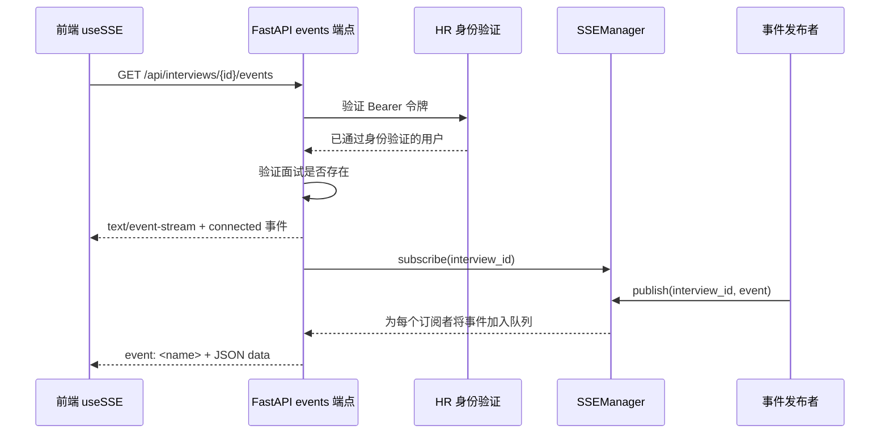
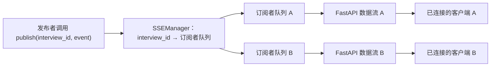

此页面说明后端如何向已连接的客户端流式传输特定面试的事件、前端如何使用这些事件，以及哪些部署设置可以维持该数据流。此实现采用内存中的异步发布/订阅路径：它为活跃订阅者提供实时传递，不提供持久化事件历史记录。来源：[events.py](backend/app/api/events.py#L26-L63) [sse_manager.py](backend/app/services/sse_manager.py#L26-L92)

## 端到端流程

SSE 端点会验证请求的面试，并要求用户通过 HR 身份验证。随后，它会发送一个连接事件，并流式传输从管理器中对应面试的订阅者队列接收到的事件。浏览器使用 `EventSource` 建立连接，并将具名事件分派给已注册的处理程序。来源：[events.py](backend/app/api/events.py#L26-L47) [useSSE.ts](frontend/src/hooks/useSSE.ts#L53-L114) [deps.py](backend/app/deps.py#L27-L68)

来源：[events.py](backend/app/api/events.py#L26-L47) [sse_manager.py](backend/app/services/sse_manager.py#L33-L71) [deps.py](backend/app/deps.py#L27-L68)

## 端点和线路格式

该端点为 `GET /api/interviews/{interview_id}/events`。它设置 `text/event-stream`、禁用缓存、请求持久连接，并为 Nginx 发送 `X-Accel-Buffering: no`。每个事件编码为一个 SSE `event:` 字段，后跟一个 JSON `data:` 字段和一个空行。第一个事件是 `connected`；其载荷包含面试 ID 和一个由正在运行的事件循环生成的时间戳。来源：[events.py](backend/app/api/events.py#L23-L63)

| 元素 | 实现 |
|---|---|
| 路由 | `GET /api/interviews/{interview_id}/events` |
| 访问控制 | `get_current_user` 验证 Bearer 访问令牌 |
| 面试检查 | `InterviewService.get_interview(interview_id)` 确认面试存在 |
| 内容类型 | `text/event-stream` |
| 初始事件 | `connected` |
| 事件封装格式 | `event: <name>\ndata: <JSON>\n\n` |
| 代理提示 | `X-Accel-Buffering: no` |

来源：[events.py](backend/app/api/events.py#L23-L63) [deps.py](backend/app/deps.py#L27-L68)

**身份验证集成细节：**后端路由依赖 `Authorization` 标头中的 Bearer 令牌。所示前端钩子会构造 `new EventSource(url, { withCredentials: false })`，且不设置 `Authorization` 标头。原生 `EventSource` 不提供通用的自定义标头选项，因此，仅凭此钩子无法说明所需的 Bearer 令牌如何到达该端点。在依赖此连接路径之前，请检查应用程序实际的 URL/身份验证集成；不要假定钩子的 `withCredentials` 选项会提供 Bearer 令牌。来源：[events.py](backend/app/api/events.py#L26-L32) [deps.py](backend/app/deps.py#L27-L45) [useSSE.ts](frontend/src/hooks/useSSE.ts#L61-L69)

## 内存中的发布/订阅

`SSEManager` 会为每个面试 ID 存储一组 `asyncio.Queue` 对象。订阅者注册一个队列并等待事件；`publish` 会将提供的载荷序列化为兼容 JSON 的数据，用事件名称封装后，将其加入每个当前订阅者的队列。该结构仅限进程内使用，且端点不会从持久化事件日志读取数据，因此客户端在事件发布后才连接时，不会收到该过往事件。来源：[sse_manager.py](backend/app/services/sse_manager.py#L26-L71) [events.py](backend/app/api/events.py#L37-L47)

来源：[sse_manager.py](backend/app/services/sse_manager.py#L29-L71) [events.py](backend/app/api/events.py#L37-L47)

每个订阅者队列的最大容量为 100。如果队列已满，`publish` 会丢弃新事件，而不是阻塞发布者；尽管附近的注释提到丢弃最旧的项目，但实际实现并不会移除已有队列项目。`close_session` 会尝试加入 `None` 哨兵以终止订阅者，但如果队列已满，则会静默跳过。由于这些行为，此数据流最适合用于实时通知，前提是消费者可以在其他位置恢复当前状态；它并不适合作为无损事件传输机制。来源：[sse_manager.py](backend/app/services/sse_manager.py#L33-L50) [sse_manager.py](backend/app/services/sse_manager.py#L52-L80)

## 事件名称和前端分派

钩子的 `knownEvents` 列表决定了它会监听哪些具名 SSE 消息。对于列表中的每个事件，钩子会解析 JSON 载荷、调用通过 `on(eventName, handler)` 注册的处理程序、同时调用作为 `"*"` 注册的通配符处理程序，并将事件追加到本地状态。解析失败时会忽略该事件。钩子会公开 `connected`、累积的 `events` 和 `on`；调用 `on` 会返回一个取消订阅函数。来源：[useSSE.ts](frontend/src/hooks/useSSE.ts#L15-L50) [useSSE.ts](frontend/src/hooks/useSSE.ts#L86-L110) [useSSE.ts](frontend/src/hooks/useSSE.ts#L127-L127)

TypeScript 事件定义描述了一个范围更广的面试和处理事件联合类型，包括连接、状态、简历解析、问题生成、转录、报告和失败事件。这些定义在前端中用于文档说明和类型检查；在此实现中，钩子显式指定的监听器列表才是运行时分派的允许列表。如果联合类型中的某个成员不在 `knownEvents` 中，除非更新监听器列表，否则此钩子不会处理它。来源：[events.ts](frontend/src/types/events.ts#L16-L160) [useSSE.ts](frontend/src/hooks/useSSE.ts#L86-L110)

| 事项 | 当前行为 |
|---|---|
| 具名事件传递 | 为 `knownEvents` 中的名称安装显式监听器 |
| 处理程序注册 | `on(name, handler)` 添加处理程序并返回一个取消订阅函数 |
| 通配符注册 | `"*"` 处理程序会接收 `{ event, data }` |
| 解析错误 | 静默忽略 |
| 事件历史记录 | 追加到钩子状态；未显示任何裁剪操作 |
| 重新连接 | 出错时标记为未连接，并在 3 秒后安排新连接 |

来源：[useSSE.ts](frontend/src/hooks/useSSE.ts#L27-L50) [useSSE.ts](frontend/src/hooks/useSSE.ts#L71-L84) [useSSE.ts](frontend/src/hooks/useSSE.ts#L101-L109)

## 连接生命周期和传递限制

客户端断开连接时，端点会捕获 `asyncio.CancelledError`。异步生成器的 `finally` 块会将其队列从面试的订阅者集合中移除。端点注释描述了心跳处理，但所示生成器并未发送心跳帧；注释表示客户端会检测断开连接并处理重新连接。前端钩子会在清理时关闭当前活动的 `EventSource`，并在发生错误时自行安排在三秒后重新连接。来源：[events.py](backend/app/api/events.py#L37-L53) [sse_manager.py](backend/app/services/sse_manager.py#L41-L50) [useSSE.ts](frontend/src/hooks/useSSE.ts#L75-L84) [useSSE.ts](frontend/src/hooks/useSSE.ts#L116-L124)

此数据流并非持久化队列：订阅者只能接收其队列注册期间发布的事件，队列溢出时还可能丢弃新事件。实现中也没有显示事件 ID 或重放游标。因此，重新连接可以恢复实时订阅，但不会自动重放遗漏的进度事件。来源：[sse_manager.py](backend/app/services/sse_manager.py#L33-L71) [events.py](backend/app/api/events.py#L43-L47) [useSSE.ts](frontend/src/hooks/useSSE.ts#L75-L84)

## 反向代理要求

Nginx 配置为面试事件 URL 设置了专用位置。它会禁用响应缓冲和缓存，将代理读取和发送超时设为一小时，使用 HTTP/1.1，并清除用于上游保持活动连接的 `Connection` 标头。这些设置与响应的 `X-Accel-Buffering: no` 标头相辅相成，可防止代理将此数据流视为一个持续时间较短的普通 API 响应。来源：[nginx.conf](nginx/nginx.conf#L57-L70) [events.py](backend/app/api/events.py#L55-L63)

| 层 | 与 SSE 相关的设置 | 目的 |
|---|---|---|
| FastAPI 响应 | `Cache-Control: no-cache` | 避免缓存数据流 |
| FastAPI 响应 | `X-Accel-Buffering: no` | 告知 Nginx 不要缓冲此响应 |
| Nginx SSE 位置 | `proxy_buffering off` 和 `proxy_cache off` | 转发事件时不进行代理缓冲或缓存 |
| Nginx SSE 位置 | `proxy_read_timeout 1h`、`proxy_send_timeout 1h` | 允许上游数据流保持长时间连接 |
| Nginx SSE 位置 | HTTP/1.1 和 `Connection ""` | 配置上游连接处理 |

来源：[events.py](backend/app/api/events.py#L55-L63) [nginx.conf](nginx/nginx.conf#L57-L70)

## 实际影响

添加事件时，请确保后端载荷的 `event` 值与前端监听器名称及相应的 TypeScript 联合类型成员保持一致。请确认任何预期事件都存在于钩子的 `knownEvents` 列表中；否则，钩子不会分派该事件。对于重要的状态转换，应将 SSE 视为通知通道，并通过应用程序的常规数据路径获取权威状态，而不要依赖事件重放或无损传递。来源：[sse_manager.py](backend/app/services/sse_manager.py#L52-L71) [useSSE.ts](frontend/src/hooks/useSSE.ts#L86-L110) [events.ts](frontend/src/types/events.ts#L141-L160)

如需了解相关实现背景，请继续阅读 [SSE 订阅和类型化事件处理](26-sse-subscription-and-typed-event-handling)，了解前端如何使用事件；并阅读 [Docker Compose、Nginx 和支持 SSE 的部署](30-docker-compose-nginx-and-sse-aware-deployment)，了解部署行为。来源：[useSSE.ts](frontend/src/hooks/useSSE.ts#L20-L127) [nginx.conf](nginx/nginx.conf#L57-L70)
