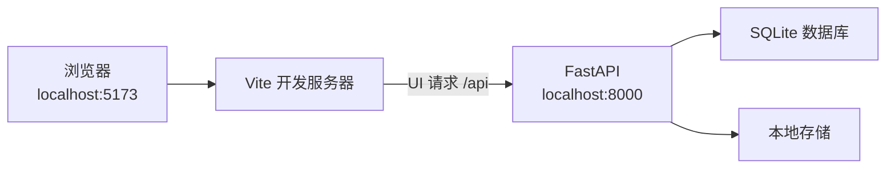

本页介绍如何在本地运行项目：启动 FastAPI 后端和 React 前端，然后打开应用和 API 文档。内容涵盖最基本的设置和首次运行检查；更深入的配置和架构主题请参阅[本地配置和环境变量](5-local-configuration-and-environment-variables)和[系统架构和组件边界](6-system-architecture-and-component-boundaries)。来源：[README.md](README.md#L1-L4)

## 你将运行的内容

本地开发环境使用两个进程。Vite 开发服务器在端口 `5173` 上提供前端服务，并将 `/api` 请求代理到运行在端口 `8000` 上的 FastAPI 服务器；后端启动时会初始化数据库和存储目录。来源：[vite.config.ts](frontend/vite.config.ts#L10-L29)、[main.py](backend/app/main.py#L34-L87)



前端和后端独立开发。在一个终端中启动后端，在另一个终端中启动前端；使用本地应用期间，请让两者保持运行。来源：[README.md](README.md#L119-L152)、[vite.config.ts](frontend/vite.config.ts#L10-L29)

## 前置条件

| 要求 | 版本或说明 |
|---|---|
| Python | `>=3.11,<3.13` |
| 后端包管理器 | `uv` |
| Node.js | 运行前端所必需；检查过的项目文件中未声明具体版本 |
| 前端包管理器 | `npm` 或 `pnpm` |

后端依赖声明要求 Python 3.11 或更高版本，但低于 3.13；前端 README 中的说明支持使用 npm 或 pnpm。来源：[pyproject.toml](backend/pyproject.toml#L1-L5)、[README.md](README.md#L119-L152)

## 启动后端

1. 在仓库根目录打开终端，然后切换到 `backend`。
2. 使用 `uv sync` 安装依赖。
3. 使用下面的命令初始化数据库。
4. 运行开发服务器。

```bash
cd backend
uv sync
uv run python -c "from app.database import init_db; init_db()"
uv run uvicorn app.main:app --host 0.0.0.0 --port 8000 --reload
```

如果需要，`init_db()` 会创建配置的 SQLite 数据库目录，并为已注册的模型创建数据表。应用启动时也会调用数据库初始化，因此显式运行初始化命令是为了让设置步骤清晰可见，而不是取代服务器的启动行为。来源：[README.md](README.md#L119-L137)、[database.py](backend/app/database.py#L72-L95)、[main.py](backend/app/main.py#L34-L57)

首次启动时，如果用户名 `admin` 尚不存在，后端会尝试创建一个默认 HR 账户，密码为 `123456`。请将这些视为开发环境默认凭据，而非生产环境凭据。来源：[main.py](backend/app/main.py#L46-L64)

## 启动前端

在第二个终端中，从仓库根目录执行：

```bash
cd frontend
npm install
npm run dev
```

或者，先运行 `pnpm install`，再运行 `pnpm dev`。Vite 配置使用端口 `5173`，并通过开发代理将 `/api` 请求转发到 `http://localhost:8000`。来源：[README.md](README.md#L139-L152)、[package.json](frontend/package.json#L1-L12)、[vite.config.ts](frontend/vite.config.ts#L10-L29)

在浏览器中打开 **http://localhost:5173**。如需直接探索后端 API，请打开 **http://localhost:8000/docs**；后端还在 **http://localhost:8000/redoc** 提供 ReDoc。来源：[README.md](README.md#L135-L152)

## 验证设置

| 检查项 | 预期结果 |
|---|---|
| 前端页面 | 应用在 `http://localhost:5173` 加载。 |
| API 文档 | Swagger UI 在 `http://localhost:8000/docs` 加载。 |
| 前端 API 调用 | 对 `/api` 的请求会被代理到运行在端口 `8000` 上的后端。 |

这些检查对应已配置的 Vite 端口和代理，以及后端文档中列出的 API 路由。来源：[vite.config.ts](frontend/vite.config.ts#L10-L29)、[README.md](README.md#L135-L152)、[main.py](backend/app/main.py#L124-L140)

## 常见启动问题

| 症状 | 检查事项 |
|---|---|
| 后端依赖安装失败 | 确认所选 Python 版本符合 `>=3.11,<3.13`。 |
| 前端无法访问 API 路由 | 确认后端正在端口 `8000` 上运行；Vite 的代理目标为 `http://localhost:8000`。 |
| Vite 报告端口 `5173` 已被占用 | 停止占用该端口的进程。Vite 配置为 `strictPort: true`，因此不会静默切换到其他端口。 |
| 语音转录不可用 | 后端会在启动时尝试加载 Whisper，但加载失败只会记录日志，不会阻止启动；后端 Docker 镜像包含 FFmpeg。 |

来源：[pyproject.toml](backend/pyproject.toml#L1-L5)、[vite.config.ts](frontend/vite.config.ts#L10-L29)、[main.py](backend/app/main.py#L72-L94)、[Dockerfile](backend/Dockerfile#L30-L42)

## 可选：Docker Compose

如需使用容器化设置，请从 `.env.example` 准备一个 `.env` 文件，配置 LLM 凭据和其他必需的部署设置，然后构建前端并启动 Compose：

```bash
# From the repository root
cp .env.example .env

# Build the frontend distribution
cd frontend
pnpm install
pnpm build
cd ..

# Start the API and Nginx services
docker compose up -d
docker compose logs -f api
```

Compose 会运行一个 API 服务和一个 Nginx 服务；Nginx 提供挂载的 `frontend/dist` 目录，并等待 API 健康检查通过。由于 Compose 将该目录挂载为静态站点根目录，因此必须先构建前端。在 Windows PowerShell 中，请使用 `Copy-Item .env.example .env`，而不是 `cp`。来源：[README.md](README.md#L154-L170)、[docker-compose.yml](docker-compose.yml#L7-L68)、[package.json](frontend/package.json#L5-L12)

## 项目结构一览

```text
smart_interview_ai/
├── backend/
│   ├── app/             # FastAPI application, services, workflows, models
│   ├── tests/           # Backend tests
│   └── pyproject.toml   # Python dependencies and tooling
├── frontend/
│   ├── src/             # React application source
│   └── package.json     # Frontend scripts and dependencies
├── nginx/               # Reverse proxy configuration
├── docker-compose.yml   # Container orchestration
└── .env.example         # Environment variable template
```

此结构图突出显示了本地启动所需的入口点：后端依赖和应用代码位于 `backend` 下，前端脚本和源代码位于 `frontend` 下。来源：[README.md](README.md#L38-L94)

## 后续阅读

按以下顺序，从运行项目逐步深入了解项目：

1. [概述](1-overview) — 了解系统的目标和范围。
2. [招聘工作流和用户角色](3-recruitment-workflow-and-user-roles) — 了解产品流程以及使用者。
3. [仓库结构图和推荐阅读路径](4-repository-map-and-recommended-reading-paths) — 选择代码阅读路径。
4. [本地配置和环境变量](5-local-configuration-and-environment-variables) — 了解设置和凭据。
5. [系统架构和组件边界](6-system-architecture-and-component-boundaries) — 查看主要组件之间的连接方式。
