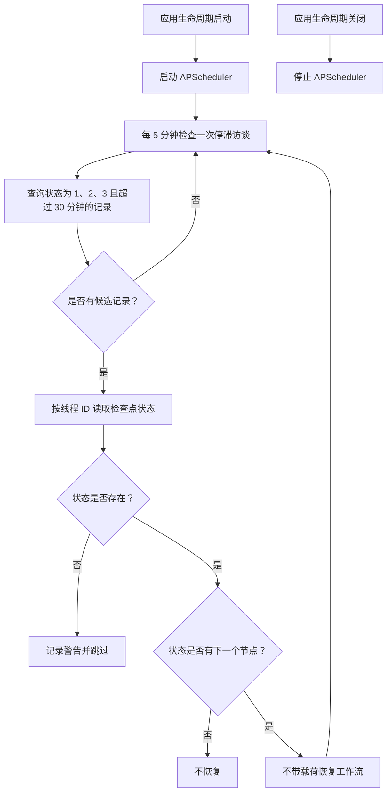
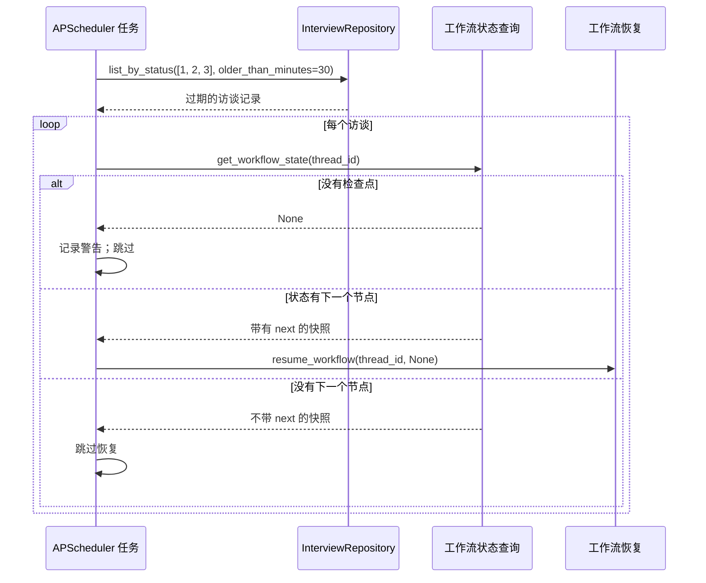

本页说明后端的定时恢复机制：应用如何启动和停止调度器、哪些访谈符合停滞条件，以及恢复机制如何尝试从 LangGraph 检查点继续工作流。本页仅介绍调度和停滞访谈恢复；工作流内部机制和检查点存储见[LangGraph 节点、中断与恢复语义](11-langgraph-nodes-interrupts-and-resume-semantics)和[工作流依赖注入与检查点持久化](12-workflow-dependency-injection-and-checkpoint-persistence)。来源：[scheduler.py](backend/app/workers/scheduler.py#L1-L10)

## 恢复模型

调度器是一个**周期性恢复触发器**，而不是独立的工作流引擎。它会选择处于活动状态且 `updated_at` 时间戳早于配置的时间阈值的访谈，根据线程 ID 查找每个访谈的工作流状态，并在状态表明存在下一个节点时请求图继续执行。来源：[scheduler.py](backend/app/workers/scheduler.py#L26-L63) [interview.py](backend/app/models/interview.py#L121-L132)

该图展示了已实现的控制流。检查点缺失和状态没有待处理的下一个节点，都会导致不恢复；调度器不会创建替代检查点，也不会自行更改访谈状态。来源：[scheduler.py](backend/app/workers/scheduler.py#L38-L71)

## 生命周期与运行频率

FastAPI 的生命周期会在数据库初始化、存储设置以及尝试加载 Whisper 模型之后启动调度器。启动错误会被捕获并记录为 `scheduler_start_skipped`，应用启动因此可以继续。关闭时，生命周期会调用 `stop_scheduler()`；如果停止失败，则记录警告。来源：[main.py](backend/app/main.py#L37-L40) [main.py](backend/app/main.py#L103-L120)

调度器保存在模块级单例中。如果该单例已设置，`start_scheduler()` 会立即返回；否则，它会创建一个 `AsyncIOScheduler`，以五分钟的 cron 间隔注册 `check_stuck_interviews` 任务，并启动调度器。关闭时会调用 `wait=False`，捕获关闭异常，并清除单例引用。来源：[scheduler.py](backend/app/workers/scheduler.py#L22-L24) [scheduler.py](backend/app/workers/scheduler.py#L74-L107)

| 关注事项 | 已实现行为 |
|---|---|
| 调度器类型 | APScheduler `AsyncIOScheduler` |
| 任务运行频率 | 每五分钟一次（`CronTrigger(minute="*/5")`） |
| 启动钩子 | FastAPI 生命周期 |
| 关闭行为 | 使用 `wait=False` 关闭调度器 |
| 防止重复启动 | 如果模块级调度器已存在，则返回 |
| 启动失败 | 记录日志；不会从生命周期启动代码块中向外传播 |

来源：[scheduler.py](backend/app/workers/scheduler.py#L74-L107) [main.py](backend/app/main.py#L103-L120)

## 候选记录筛选

状态为**1、2 或 3**且 `updated_at` 值早于当前 UTC 时间减去 30 分钟的记录，符合检查条件。存储库会将截止时间计算为 Unix 时间戳，并将其用作数据库筛选条件。模型将状态 1–3 分别说明为问题已就绪、访谈进行中和访谈已完成；状态 4（报告已生成）不在调度器的查询范围内。来源：[scheduler.py](backend/app/workers/scheduler.py#L26-L41) [interview.py](backend/app/models/interview.py#L40-L42) [interview.py](backend/app/models/interview.py#L121-L132)

该阈值使用访谈的**最后更新时间戳**，而不是创建时间或开始时间。状态变更会更新 `updated_at`，问题生成也会更新该字段。因此，此处的“停滞”指“处于查询状态之一且至少 30 分钟未更新的访谈”；它并不是来自工作流运行时的独立存活信号。来源：[interview.py](backend/app/models/interview.py#L73-L79) [interview.py](backend/app/models/interview.py#L160-L195)

## 恢复决策与执行

对于每个选中的访谈，任务会读取 `langgraph_thread_id` 并调用 `get_workflow_state(thread_id)`。如果没有返回状态快照，则记录 `stuck_interview_no_checkpoint` 并继续处理下一个访谈。如果存在快照，则只有在 `state_snapshot.next` 为真时，调度器才会尝试恢复；它会记录待处理节点并调用 `resume_workflow(thread_id, None)`。每个访谈产生的异常都会被捕获并记录为 `stuck_interview_resume_failed`，因此某个候选记录处理失败不会导致循环退出。来源：[scheduler.py](backend/app/workers/scheduler.py#L44-L69)

在此恢复路径中，使用 `None` 载荷是有意为之：调度器不会提供候选答案数据。图的恢复入口会使用 LangGraph `Command(resume=resume_payload)` 和访谈的线程 ID 调用图。调度器根据检查点的 `next` 字段进行判断；它本身不会检查各个工作流节点，也不会确定接下来应执行哪项业务操作。来源：[scheduler.py](backend/app/workers/scheduler.py#L55-L63) [graph.py](backend/app/workflow/graph.py#L105-L117)

来源：[scheduler.py](backend/app/workers/scheduler.py#L38-L71) [graph.py](backend/app/workflow/graph.py#L105-L117)

## 运维解读

| 观察到的情况 | 调度器行为 | 应检查的证据 |
|---|---|---|
| 没有过期的访谈 | 任务直接返回，不逐个处理访谈 | 查询结果处理 |
| 过期访谈没有检查点 | 记录警告并跳过 | `stuck_interview_no_checkpoint` |
| 检查点没有下一个节点 | 不调用恢复 | `state_snapshot.next` 条件 |
| 恢复引发异常 | 记录访谈 ID 和异常；继续处理 | `stuck_interview_resume_failed` |
| 调度器启动引发异常 | 应用生命周期记录警告并继续启动 | `scheduler_start_skipped` |

来源：[scheduler.py](backend/app/workers/scheduler.py#L40-L69) [main.py](backend/app/main.py#L103-L108)

调度器代码不会在尝试恢复后明确更改访谈状态，不会立即重试失败的恢复，也不会通过专用 API 报告恢复结果。如果记录仍符合状态和时间条件，之后的定时运行可以再次检查这些记录。这些是此实现的边界，并不代表恢复后的工作流一定会如何更新业务数据。来源：[scheduler.py](backend/app/workers/scheduler.py#L38-L71) [interview.py](backend/app/models/interview.py#L121-L132)

如需了解相邻的实现细节，请继续阅读[LangGraph 节点、中断与恢复语义](11-langgraph-nodes-interrupts-and-resume-semantics)，了解图的执行行为；或阅读[SQLite WAL、业务数据与工作流检查点](18-sqlite-wal-business-data-and-workflow-checkpoints)，了解持久化背景。来源：[scheduler.py](backend/app/workers/scheduler.py#L48-L63)
