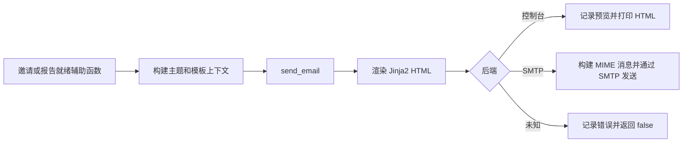

本页介绍后端的电子邮件模板和投递流程：调用方如何提供通知数据、服务如何渲染 HTML，以及投递后端如何报告成功或失败。实现提供了邀请和报告就绪的辅助函数，但默认后端目前只记录并打印电子邮件内容，不会将其发送到 SMTP 服务器。来源：[email_service.py](backend/app/services/email_service.py#L1-L35)

## 投递架构

该服务将**通知构建**、**模板渲染**和**传输**分开处理。便捷函数会构建主题和模板上下文；`send_email` 渲染指定的 HTML 模板，然后委托给控制台或 SMTP 发送器。默认后端是控制台，因此当前配置不会自动选择 SMTP。来源：[email_service.py](backend/app/services/email_service.py#L38-L93)

## 模板和通知数据

这些模板是从 `backend/app/templates/email` 加载的 HTML 文件。Jinja2 配置了 HTML/XML 自动转义，因此这些 HTML 模板中的插值会在渲染时进行转义。`interview_invite.html` 使用候选人姓名、职位、面试时间和面试 URL 来展示邀请，并提供开始面试的链接。来源：[email_service.py](backend/app/services/email_service.py#L32-L45)、[interview_invite.html](backend/app/templates/email/interview_invite.html#L1-L45)

`report_ready.html` 会显示职位、总分、推荐结果和报告链接。推荐结果的样式取决于 `is_passed`；辅助函数会将该布尔值映射为中文推荐文本“推荐录用”或“暂未通过”。来源：[report_ready.html](backend/app/templates/email/report_ready.html#L1-L45)、[email_service.py](backend/app/services/email_service.py#L161-L194)

| 通知 | 辅助函数输入 | 辅助函数组装的模板上下文 |
|---|---|---|
| 面试邀请 | 收件人电子邮件、候选人姓名、职位名称、面试 URL、可选的面试时间 | `candidate_name`、`position_name`、`interview_url`、`interview_time`；缺少时间时使用“请尽快登录查看” |
| 报告就绪 | 收件人电子邮件、候选人姓名、职位名称、分数、报告 URL、可选的通过状态 | `candidate_name`、`position_name`、`overall_score`、`report_url`、`is_passed`、`recommendation` |

来源：[email_service.py](backend/app/services/email_service.py#L148-L194)

## 后端行为和限制

`send_email` 接受可选的后端覆盖值。如果未提供，`_get_default_backend()` 会无条件返回 `"console"`。控制台实现会记录收件人、主题、渲染后的 HTML 长度和预览，然后将 HTML 的前 500 个字符（至多）打印到标准输出；它会返回 `True`。因此，在默认后端下成功返回意味着消息已输出到日志/标准输出，而不是已投递到邮箱。来源：[email_service.py](backend/app/services/email_service.py#L48-L112)

SMTP 实现会构建 HTML MIME 消息，使用 STARTTLS 建立连接，在存在用户名时进行身份验证，并调用 `send_message`。其主机、端口、用户名、密码和发件人地址直接从环境变量读取，默认值分别为 `localhost`、`587`、空凭据和 `noreply@interview-system.local`。异常会被记录并转换为 `False`；未知后端也会记录错误并返回 `False`。来源：[email_service.py](backend/app/services/email_service.py#L115-L145)

SMTP 设置未在应用的 Pydantic `Settings` 模型中声明，默认后端选择器也不会检查这些设置。代码将异步投递、重试和死信队列列为可能的增强项，但此处展示的服务执行的是同步发送，并且没有重试或队列实现。来源：[config.py](backend/app/config.py#L1-L92)、[email_service.py](backend/app/services/email_service.py#L1-L13)、[email_service.py](backend/app/services/email_service.py#L48-L93)

## 验证

电子邮件测试会验证控制台模式下的成功结果和日志记录、模板变量渲染、未知后端失败，以及通过和未通过两种报告通知。测试覆盖的是默认辅助函数路径，该路径会解析为控制台模式；这些测试并不能证明 SMTP 投递可在真实邮件服务器上正常工作。来源：[test_email.py](backend/tests/test_email.py#L1-L112)、[email_service.py](backend/app/services/email_service.py#L88-L93)

## 后续步骤

如需了解相关后端背景，请继续阅读[后台调度和停滞面试恢复](20-background-scheduling-and-stalled-interview-recovery)或[服务层、存储库和数据库会话](17-service-layer-repositories-and-database-sessions)。来源：[email_service.py](backend/app/services/email_service.py#L1-L13)
