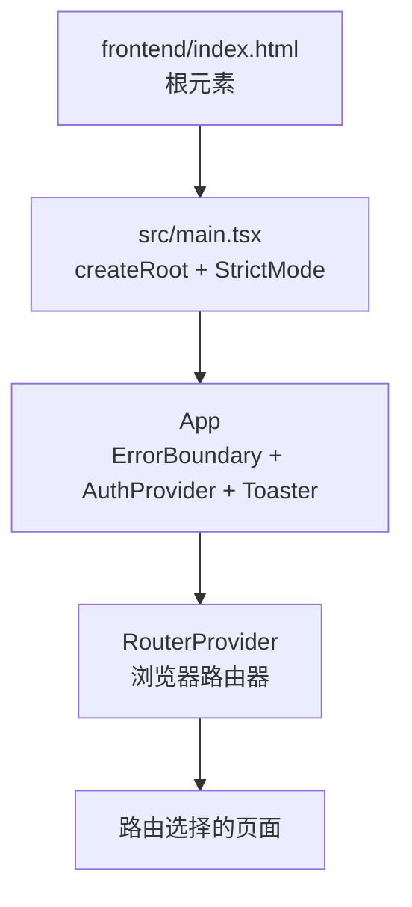
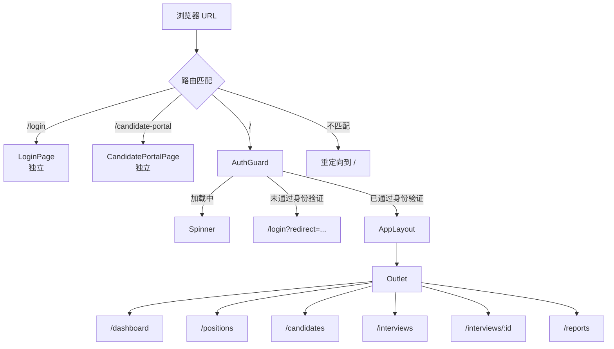

**本页说明 React 前端如何启动、URL 路径如何选择屏幕，以及每个页面负责什么。** 核心模式是通过单个应用入口安装全局提供程序和浏览器路由器。然后，路由将面向公众的候选人和登录体验与经过身份验证的 HR 工作区分开。来源：[main.tsx](frontend/src/main.tsx#L1-L15)、[App.tsx](frontend/src/App.tsx#L1-L24)、[routes.tsx](frontend/src/routes.tsx#L1-L44)

## 1. 应用从何处启动

HTML 外壳提供一个 `root` 元素，并将 `/src/main.tsx` 作为 JavaScript 模块加载。`main.tsx` 会查找该元素，创建 React 根节点，并在 `StrictMode` 内渲染应用。它导入全局样式表，并提供共享的 `App` 包装器和路由器提供程序。实际上，这就是前端的启动链：HTML → React 入口 → 全局包装器 → 路由选择的屏幕。来源：[index.html](frontend/index.html#L1-L17)、[main.tsx](frontend/src/main.tsx#L1-L15)

`App` 不负责选择页面；它只包装其子元素。它在 `AuthProvider` 外层放置 `ErrorBoundary`，然后渲染子元素和全局 Sonner 通知提示器。这样，路由就可以访问共享的身份验证状态，通知也可以在各个屏幕中使用，而错误边界则提供了捕获渲染错误的顶层位置。来源：[App.tsx](frontend/src/App.tsx#L1-L24)

该图遵循实际的渲染组合：路由器提供程序是 `App` 的子元素，而所选页面由路由配置决定。`StrictMode` 是 React 开发包装器；它不定义应用的 URL 结构。来源：[main.tsx](frontend/src/main.tsx#L1-L15)、[App.tsx](frontend/src/App.tsx#L12-L24)、[routes.tsx](frontend/src/routes.tsx#L8-L17)

## 2. 路由如何划分应用

`routes.tsx` 使用 `createBrowserRouter` 定义应用的 URL 映射。两个独立的公共路由是 `/login` 和 `/candidate-portal`。HR 路由嵌套在 `/` 下；该父路由会在 `AppLayout` 外层渲染 `AuthGuard`，其子路由则在布局的 `Outlet` 中渲染。根索引路由重定向到 `/dashboard`，而通配符路由会将不匹配的路径重定向到 `/`。来源：[routes.tsx](frontend/src/routes.tsx#L8-L44)、[AppLayout.tsx](frontend/src/components/AppLayout.tsx#L14-L22)

`AuthGuard` 会检查共享的身份验证状态。身份验证正在加载时，它会显示居中的旋转指示器。如果用户未通过身份验证，它会重定向到 `/login`，并在 `redirect` 查询参数中对请求的路径名进行 URL 编码；否则，它会渲染受保护的布局。成功登录后，`LoginPage` 会读取该参数并导航到相应路径；如果参数不存在，则默认导航到 `/dashboard`。来源：[AuthGuard.tsx](frontend/src/components/AuthGuard.tsx#L11-L35)、[LoginPage.tsx](frontend/src/pages/LoginPage.tsx#L20-L57)

在路由配置中，候选人门户有意放在 HR 布局和身份验证守卫之外。它会读取 `token` 查询参数，并用它加载面试体验；如果缺少令牌，则会进入错误状态。这与受保护的 `/interviews/:id` HR 详情路由不同，后者属于 HR 路由组。来源：[routes.tsx](frontend/src/routes.tsx#L18-L44)、[CandidatePortalPage.tsx](frontend/src/pages/CandidatePortalPage.tsx#L23-L59)

## 3. 共享 HR 布局提供的功能

`AppLayout` 为受保护的 HR 屏幕提供持久外壳：包含导航链接的侧边栏、用户信息区域，以及包含 `Outlet` 的主区域。导航链接对应仪表板、职位、候选人、面试和报告。嵌套的面试详情路由已注册，但不是侧边栏导航中的独立项目。来源：[AppLayout.tsx](frontend/src/components/AppLayout.tsx#L14-L22)、[AppLayout.tsx](frontend/src/components/AppLayout.tsx#L39-L109)、[routes.tsx](frontend/src/routes.tsx#L25-L36)

该布局还负责处理注销：它会调用身份验证上下文中的 `logout`，显示成功提示，并使用替换历史记录导航到 `/login`。因此，页面组件专注于各自屏幕的内容，而布局负责共享的 HR 导航和周边结构。来源：[AppLayout.tsx](frontend/src/components/AppLayout.tsx#L24-L37)、[AppLayout.tsx](frontend/src/components/AppLayout.tsx#L67-L78)

## 4. 页面职责一览

| 路由 | 页面 | 职责 |
|---|---|---|
| `/login` | `LoginPage` | 收集凭据、提交登录请求、更新身份验证状态，并返回到请求的重定向目标或仪表板。 |
| `/candidate-portal` | `CandidatePortalPage` | 使用 URL 令牌加载候选人面试视图，并呈现加载、错误、尚未开始、进行中和已完成状态。 |
| `/dashboard` | `DashboardPage` | 展示 KPI 卡片和近期面试表格；卡片可导航到相关 HR 区域。 |
| `/positions` | `PositionsPage` | 列出职位，并提供创建、编辑和删除操作。 |
| `/candidates` | `CandidatesPage` | 列出候选人、加载用于关联的职位，并提供简历上传、详情查看、下载和删除操作。 |
| `/interviews` | `InterviewsPage` | 列出面试，并提供创建面试、复制候选人链接和下载报告的操作。 |
| `/interviews/:id` | `InterviewDetailPage` | 加载一场面试及相关候选人和职位信息，显示进度，订阅进度事件，并提供报告和链接操作。 |
| `/reports` | `ReportsPage` | 将已完成的面试列为报告，并提供报告下载。 |

这些是页面级职责：路由配置选择页面，而每个页面组件实现自己的视图和交互。该表不描述 API 请求处理、表单验证模式、音频采集或事件传输的细节；这些主题由目录中的专门前端页面介绍。来源：[routes.tsx](frontend/src/routes.tsx#L18-L44)、[LoginPage.tsx](frontend/src/pages/LoginPage.tsx#L20-L57)、[CandidatePortalPage.tsx](frontend/src/pages/CandidatePortalPage.tsx#L23-L59)、[DashboardPage.tsx](frontend/src/pages/DashboardPage.tsx#L20-L60)、[PositionsPage.tsx](frontend/src/pages/PositionsPage.tsx#L27-L86)、[CandidatesPage.tsx](frontend/src/pages/CandidatesPage.tsx#L25-L101)、[InterviewsPage.tsx](frontend/src/pages/InterviewsPage.tsx#L28-L100)、[InterviewDetailPage.tsx](frontend/src/pages/InterviewDetailPage.tsx#L30-L91)、[ReportsPage.tsx](frontend/src/pages/ReportsPage.tsx#L13-L47)

## 5. 跟踪屏幕的实用方法

了解此 frontend 时，可以从外到内沿着路由追踪：在 `routes.tsx` 中找到其路径，检查它是否嵌套在 `AuthGuard` 和 `AppLayout` 下，然后打开所引用的页面组件，了解该屏幕的职责。例如，`/interviews/:id` 是一个受保护的子路由，通过 HR 布局渲染；`InterviewDetailPage` 会读取 `id` 参数，以加载匹配的面试。来源：[routes.tsx](frontend/src/routes.tsx#L25-L36)、[AppLayout.tsx](frontend/src/components/AppLayout.tsx#L86-L109)、[InterviewDetailPage.tsx](frontend/src/pages/InterviewDetailPage.tsx#L30-L61)

## 后续步骤

若要了解页面如何与后端端点通信以及如何共享身份验证行为，请继续阅读[API 客户端、身份验证状态与请求处理](23-api-client-authentication-state-and-request-handling)。有关页面级数据获取、表单和客户端验证，请参阅[TanStack Query、表单与客户端验证](24-tanstack-query-forms-and-client-side-validation)。来源：[routes.tsx](frontend/src/routes.tsx#L8-L17)
