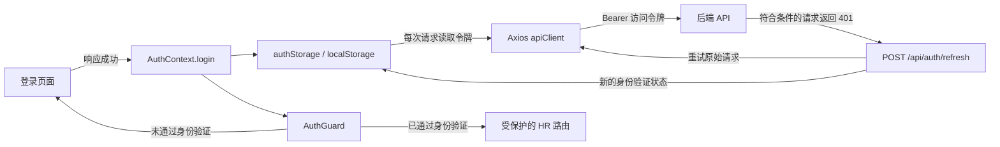

本页说明 React 前端如何持久化身份验证信息、为 API 调用附加凭据、处理过期会话，以及将特定端点模块转换为类型化请求辅助函数。核心模式是使用共享 Axios 客户端注入令牌并处理响应，外加身份验证上下文管理 UI 状态。本文仅介绍前端行为；后端授权规则和端点契约另见[身份验证、授权和候选人访问](9-authentication-authorization-and-candidate-access)和[API 契约、验证和错误处理](8-api-contracts-validation-and-error-handling)。来源：[client.ts](frontend/src/api/client.ts#L10-L107)、[auth.ts](frontend/src/lib/auth.ts#L9-L64)、[AuthContext.tsx](frontend/src/contexts/AuthContext.tsx#L23-L75)

## 架构模型

前端将**凭据持久化**、**内存中的 UI 状态**、**请求传输**和**路由门控**分开处理。`authStorage` 是浏览器存储边界；`AuthProvider` 向 React 暴露面向用户的状态；`apiClient` 应用凭据并规范化部分失败；`AuthGuard` 则决定受保护的 HR 路由是否可以呈现。这一区分很重要：UI 状态变更本身不会发送请求，而 API 调用会在请求拦截器运行时读取最新持久化的令牌。来源：[auth.ts](frontend/src/lib/auth.ts#L25-L64)、[AuthContext.tsx](frontend/src/contexts/AuthContext.tsx#L33-L75)、[client.ts](frontend/src/api/client.ts#L32-L49)、[AuthGuard.tsx](frontend/src/components/AuthGuard.tsx#L17-L35)

该图展示了前端的主要路径：登录成功后写入 `AuthState`，API 请求读取已存储的访问令牌，而路由守卫使用上下文状态进行导航。刷新分支由 Axios 响应拦截器实现，而非由上下文实现。来源：[LoginPage.tsx](frontend/src/pages/LoginPage.tsx#L26-L72)、[client.ts](frontend/src/api/client.ts#L42-L85)、[AuthContext.tsx](frontend/src/contexts/AuthContext.tsx#L33-L62)、[AuthGuard.tsx](frontend/src/components/AuthGuard.tsx#L17-L35)

## 身份验证状态：存储和 React 上下文

`AuthState` 包含 `access_token`、`refresh_token`、`token_type`，以及一个包含身份字段的 `user` 对象。`authStorage` 会将完整状态序列化，并以 `interview_auth` 作为 localStorage 键保存。其 `get()` 方法在没有 `window` 的情况下运行、键不存在或存储的 JSON 无法解析时，会返回 `null`；`set()` 用于写入序列化后的状态，`clear()` 用于移除该状态。该辅助对象还提供身份验证和当前用户相关的便捷方法。来源：[auth.ts](frontend/src/lib/auth.ts#L9-L64)

`AuthProvider` 使用 `user = null` 和 `loading = true` 初始化，然后在 effect 中读取已保存的状态、更新用户，并将初始化标记为完成。其 `login()` 方法会持久化传入的状态并更新 React 用户；`logout()` 会清除存储内容，并将用户设为 `null`。上下文的 `isAuthenticated` 值是根据 `user !== null` 推导而来，而不是通过单独的令牌过期检查得出。组件使用 `useAuth()`；如果组件在提供程序之外渲染，该方法会抛出异常。来源：[AuthContext.tsx](frontend/src/contexts/AuthContext.tsx#L23-L75)

| 关注事项 | 实现方式 | 可观察行为 |
|---|---|---|
| 持久化 | `authStorage` 将 JSON 存储在 `interview_auth` 中 | 提供程序初始化时，可以从 localStorage 恢复状态。 |
| UI 身份 | `AuthProvider` 在 React 状态中存储 `UserInfo \| null` | 消费者会收到 `user`、`isAuthenticated` 和 `loading`。 |
| 登录转换 | `login(state)` 持久化状态并设置用户 | 登录页面调用该方法后，UI 会进入已通过身份验证的状态。 |
| 注销转换 | `logout()` 移除存储的状态并清除用户 | 上下文消费者会观察到未通过身份验证的状态。 |
| 令牌续期 | 响应拦截器调用 `authStorage.set(newAuth)` | 存储的凭据会被替换；所示拦截器不会直接更新 `AuthProvider` 状态。 |

来源：[auth.ts](frontend/src/lib/auth.ts#L25-L64)、[AuthContext.tsx](frontend/src/contexts/AuthContext.tsx#L33-L62)、[client.ts](frontend/src/api/client.ts#L57-L83)

**实现细节：**刷新处理程序会替换持久化的身份验证对象，但不会调用上下文方法。由于上下文单独存储用户，令牌续期与 UI 身份并未通过显式的上下文更新关联起来。修改身份验证状态时应注意这一边界：任何需要更新 React 消费者的变更，都应通过上下文或其他共享状态机制接入，而不要假定写入 localStorage 会触发 React 重新渲染。来源：[client.ts](frontend/src/api/client.ts#L63-L80)、[AuthContext.tsx](frontend/src/contexts/AuthContext.tsx#L33-L62)

## 共享 API 客户端和请求管线

`apiClient` 是一个 Axios 实例，其配置包括 `VITE_API_BASE_URL`（或空字符串）、30 秒超时以及默认 JSON 内容类型。它的请求拦截器会为每个请求读取 `authStorage`；如果存在访问令牌，则设置 `Authorization: Bearer <access_token>`。这样，端点辅助函数便可专注于路径、参数、负载和结果类型，而不必重复附加令牌。来源：[client.ts](frontend/src/api/client.ts#L32-L49)

该客户端的响应拦截器会原样传递成功响应。对于 401 响应，仅当请求尚未重试且其 URL 不包含 `/api/auth/` 时，才会尝试刷新。如果存在刷新令牌，拦截器会将刷新令牌作为查询参数，发送请求到 `/api/auth/refresh`，保存 `resp.data.data`，替换原始请求的授权标头，并通过 `apiClient` 重试该请求。`_retry` 标记可防止同一个原始请求进入无限刷新的重试循环。来源：[client.ts](frontend/src/api/client.ts#L51-L85)

刷新调用直接使用 `axios.post`，而不是 `apiClient.post`，因此不会经过该客户端的请求和响应拦截器。代码还会将该刷新 URL 作为相对路径调用，且不会显式应用原始请求配置的 `baseURL`。这些是刷新传输路径中具体存在的差异；部署时应确认相对 URL 能按预期解析。来源：[client.ts](frontend/src/api/client.ts#L34-L40)、[client.ts](frontend/src/api/client.ts#L57-L77)

## 刷新失败和错误规范化

如果刷新失败，拦截器会清除持久化的身份验证信息，并将 `window.location.href` 设为 `/login`。如果没有刷新令牌，则会跳过刷新尝试，随后继续执行常规错误处理路径。拦截器没有展示共享刷新 Promise 或队列，因此并发的 401 响应会由各自的拦截器执行分别处理。来源：[client.ts](frontend/src/api/client.ts#L57-L85)

`ApiError` 包含一个数值型 `code`、一条消息以及可选的 `data`。其 `isRetryable` getter 在应用代码为 `4001` 和 `4002` 时返回 `true`（注释中将其标记为未授权和令牌过期）。当 Axios 错误的响应数据包含数值型且非零的 `code` 时，响应拦截器会抛出一个 `ApiError`，并使用响应中的 `msg`（或回退值）和 `data`。其他失败，包括响应正文不匹配的错误，都会作为原始错误被拒绝。`isApiError()` 提供 `instanceof` 类型守卫。来源：[client.ts](frontend/src/api/client.ts#L14-L30)、[client.ts](frontend/src/api/client.ts#L87-L107)

| 失败条件 | 客户端行为 |
|---|---|
| HTTP 响应成功 | 原样返回响应。 |
| HTTP 401；URL 符合条件；尚未重试；存在刷新令牌 | 请求刷新，存储返回的身份验证数据，并重试原始请求。 |
| 刷新请求失败 | 清除存储的身份验证信息，并导航到 `/login`。 |
| 响应正文包含数值型且非零的 `code` | 使用服务器消息和数据抛出 `ApiError`。 |
| 没有匹配的 API 错误正文 | 拒绝原始错误。 |

来源：[client.ts](frontend/src/api/client.ts#L51-L98)

## 路由保护和登录交接

`AuthGuard` 会等待上下文初始化：当 `loading` 为 true 时，它会渲染全屏加载指示器。加载完成后，未通过身份验证的用户会被重定向到 `/login`，并将当前路径名 URL 编码后作为 `redirect` 查询参数；已通过身份验证的用户则会看到受保护的子级内容。路由配置会在 HR 应用布局外围应用此守卫，而 `/login` 和 `/candidate-portal` 则声明在该受保护分支之外。来源：[AuthGuard.tsx](frontend/src/components/AuthGuard.tsx#L17-L35)、[routes.tsx](frontend/src/routes.tsx#L18-L44)

`LoginPage` 会通过 `apiClient` 将用户名和密码发送到 `/api/auth/login`，将响应的 `data` 负载传递给 `login()`，并导航到请求的重定向目标或 `/dashboard`。对于 `ApiError` 代码 `4004` 和 `4001`，它会按无效凭据处理；如有可用的其他 API 消息，则会显示该消息；对于非 `ApiError` 失败，则会报告网络错误。来源：[LoginPage.tsx](frontend/src/pages/LoginPage.tsx#L41-L72)

## 端点模块和请求约定

特定功能模块会导入共享客户端，并提供类型化方法，通常通过返回 `data.data` 来解包后端封装的数据。例如，候选人和面试相关方法会定义请求/响应接口，并集中管理路径、查询参数和 HTTP 动词。这种模式将传输和身份验证行为保留在 `client.ts` 中，而将特定领域的请求构造放在各功能的 API 模块中。来源：[candidates.ts](frontend/src/api/candidates.ts#L1-L5)、[candidates.ts](frontend/src/api/candidates.ts#L43-L92)、[interviews.ts](frontend/src/api/interviews.ts#L60-L94)

JSON 请求使用共享的默认内容类型。上传方法会构造 `FormData` 并传入 multipart 内容类型标头；候选人简历上传和候选人音频回答提交都遵循这一模式。候选人门户方法会将门户令牌作为 URL 路径的一部分，而不是将 HR 访问令牌用作其显式端点凭据。来源：[client.ts](frontend/src/api/client.ts#L34-L40)、[candidates.ts](frontend/src/api/candidates.ts#L54-L75)、[candidatePortal.ts](frontend/src/api/candidatePortal.ts#L29-L73)

少数辅助函数会返回 URL 字符串，而不是使用 Axios：`candidatesApi.resumeUrl()` 和 `interviewsApi.reportUrl()` 会为调用方构造 API 路径。这类 URL 辅助函数本身不会应用 Axios 请求拦截器，因此消费者不应假设它们会获得共享客户端的 Bearer 标头行为。来源：[candidates.ts](frontend/src/api/candidates.ts#L108-L112)、[interviews.ts](frontend/src/api/interviews.ts#L87-L94)

## 实践边界

代码明确将基于 localStorage 的 JWT 状态记录为 MVP 阶段的选择，并指出其可能因 XSS 而遭窃取，还提到 HttpOnly cookie 可作为未来的替代方案。这是实现层面的安全考量，并不表示当前前端能够缓解 XSS。来源：[auth.ts](frontend/src/lib/auth.ts#L1-L8)

修改客户端时，应保留共享传输策略与特定功能请求方法之间的分离。更改登录或刷新行为时，应同时检查持久化和 React 上下文行为；更改 API 错误处理时，应检查会区分 `ApiError` 与其他抛出错误的消费者。有关数据获取和表单模式，请继续阅读 [TanStack Query、表单和客户端验证](24-tanstack-query-forms-and-client-side-validation)；有关独立的实时传输路径，请阅读 [SSE 订阅和类型化事件处理](26-sse-subscription-and-typed-event-handling)。来源：[client.ts](frontend/src/api/client.ts#L14-L107)、[AuthContext.tsx](frontend/src/contexts/AuthContext.tsx#L23-L75)、[LoginPage.tsx](frontend/src/pages/LoginPage.tsx#L53-L71)
