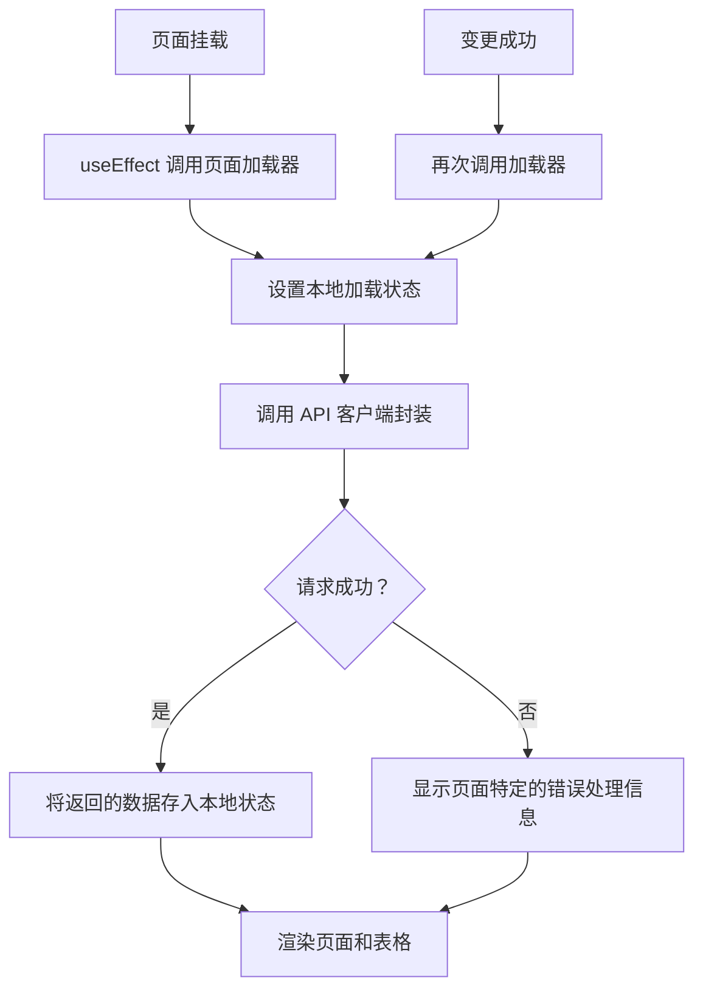

本页说明前端如何处理服务器数据和表单输入，同样重要的是，说明实现中**没有**使用依赖项所提供的哪些库。仓库包含 TanStack Query、React Hook Form、Zod，以及将 Zod 连接到 React Hook Form 的 resolver。不过，在所检查的页面中，服务器数据是通过组件副作用和本地状态加载的；表单处理则因页面而异，有一个由 schema 支持的 React Hook Form 示例，也有手动控制的输入项。来源：[package.json](frontend/package.json#L13-L50)、[PositionsPage.tsx](frontend/src/pages/PositionsPage.tsx#L6-L37)、[CandidatesPage.tsx](frontend/src/pages/CandidatesPage.tsx#L4-L41)

## 当前如何管理服务器数据

**项目已安装 TanStack Query，但所检查的页面没有使用它。**岗位、候选人、面试和仪表盘数据是在页面级异步函数中获取的，这些函数通常会从 `useEffect` 调用一次。结果和加载标志通过 `useState` 存储；错误在本地处理，管理页面会显示 toast 通知，而仪表盘会记录到控制台。来源：[package.json](frontend/package.json#L32-L45)、[PositionsPage.tsx](frontend/src/pages/PositionsPage.tsx#L28-L53)、[CandidatesPage.tsx](frontend/src/pages/CandidatesPage.tsx#L27-L61)、[InterviewsPage.tsx](frontend/src/pages/InterviewsPage.tsx#L23-L56)、[DashboardPage.tsx](frontend/src/pages/DashboardPage.tsx#L23-L54)

页面还会直接协调相关的数据读取。Candidates 使用 `Promise.all` 加载候选人和岗位；interviews 会同时加载面试、候选人和岗位；仪表盘则会同时加载岗位、候选人和面试，以计算 KPI。这使每个页面的加载顺序一目了然，但所展示的代码没有提供共享查询缓存或通用的数据加载抽象。来源：[CandidatesPage.tsx](frontend/src/pages/CandidatesPage.tsx#L43-L60)、[InterviewsPage.tsx](frontend/src/pages/InterviewsPage.tsx#L36-L56)、[DashboardPage.tsx](frontend/src/pages/DashboardPage.tsx#L29-L54)

该图描述了所观察到的页面级模式：岗位创建、更新或删除，以及候选人上传等变更操作之后，都会调用页面的加载器。这种刷新是显式执行的，而不是所观察到的缓存失效操作。来源：[PositionsPage.tsx](frontend/src/pages/PositionsPage.tsx#L74-L103)、[CandidatesPage.tsx](frontend/src/pages/CandidatesPage.tsx#L63-L85)

## 表单和验证模式

Positions 页面是基于 schema 的表单验证的最清晰示例。它定义了一个 Zod 对象 schema，其中包含必填且非空的名称、可选文本字段的默认值、整数强制转换和数量下限，以及限制在 0–2 范围内的整数状态。`zodResolver(positionSchema)` 将该 schema 连接到 `useForm`；表单会注册字段、读取验证错误，并将有效提交发送到 `onSubmit`。来源：[PositionsPage.tsx](frontend/src/pages/PositionsPage.tsx#L17-L37)、[PositionsPage.tsx](frontend/src/pages/PositionsPage.tsx#L163-L201)

创建和编辑共用同一个表单。`openCreate` 会清除正在编辑的记录，并将字段重置为空白或默认值；`openEdit` 会存储所选岗位，并根据其值重置表单。提交时，处理函数会根据当前是否正在编辑某条记录，调用创建或更新 API，然后关闭表单并重新加载列表。来源：[PositionsPage.tsx](frontend/src/pages/PositionsPage.tsx#L55-L92)

| 表单模式 | 所观察到的实现 | 验证和状态行为 |
|---|---|---|
| 岗位创建/编辑 | 使用 Zod resolver 的 React Hook Form | Schema 会检查名称、强制转换并限制数值范围，同时提供默认值；名称字段会显示错误信息。 |
| 候选人上传 | 由 React 状态控制 | 手动检查会确认姓名、电子邮件、岗位和文件均已填写；电子邮件输入框声明了 `type="email"`，文件输入框接受 `.pdf` 和 `.docx`。 |
| 创建面试 | 由 React 状态控制 | 手动检查要求选择候选人和岗位；面试官为可选项，留空时会作为 `undefined` 发送。 |
| 登录 | 由 React 状态控制 | 手动检查会确认用户名和密码均非空，然后再发送请求。 |

来源：[PositionsPage.tsx](frontend/src/pages/PositionsPage.tsx#L17-L37)、[PositionsPage.tsx](frontend/src/pages/PositionsPage.tsx#L163-L201)、[CandidatesPage.tsx](frontend/src/pages/CandidatesPage.tsx#L36-L41)、[CandidatesPage.tsx](frontend/src/pages/CandidatesPage.tsx#L63-L85)、[CandidatesPage.tsx](frontend/src/pages/CandidatesPage.tsx#L202-L253)、[InterviewsPage.tsx](frontend/src/pages/InterviewsPage.tsx#L31-L34)、[InterviewsPage.tsx](frontend/src/pages/InterviewsPage.tsx#L58-L83)、[LoginPage.tsx](frontend/src/pages/LoginPage.tsx#L26-L49)

这种差异很明显：岗位表单使用可复用的声明式 schema，并渲染字段级错误；其他所检查的表单则通过显式条件判断和页面本地状态进行验证。候选人上传的检查只验证必填项是否存在，在所展示的组件中，并未进行应用级别的电子邮件格式或文件内容验证。浏览器输入属性和客户端检查有助于改善交互体验，但所展示的代码不能取代服务器端验证。来源：[PositionsPage.tsx](frontend/src/pages/PositionsPage.tsx#L17-L37)、[PositionsPage.tsx](frontend/src/pages/PositionsPage.tsx#L163-L168)、[CandidatesPage.tsx](frontend/src/pages/CandidatesPage.tsx#L63-L85)、[CandidatesPage.tsx](frontend/src/pages/CandidatesPage.tsx#L207-L237)

## 提交、反馈和刷新行为

岗位表单提交会将验证后的表单值转换为 API 负载，调用创建或更新接口，显示成功 toast，关闭表单，并重新加载列表。失败时会显示通用的“保存失败” toast。候选人上传也会在请求进行期间禁用上传操作，成功后清除表单状态，并在选择提示消息时区分 `ApiError` 与其他错误。来源：[PositionsPage.tsx](frontend/src/pages/PositionsPage.tsx#L74-L92)、[CandidatesPage.tsx](frontend/src/pages/CandidatesPage.tsx#L63-L85)、[CandidatesPage.tsx](frontend/src/pages/CandidatesPage.tsx#L246-L253)

创建面试的流程同样会检查是否缺少所选项，将操作标记为正在创建，提交所选 ID 和可选的面试官，并在成功后重新加载。登录页面会跟踪自身的加载状态，阻止浏览器默认的表单提交，检查必填字段，并通过 toast 显示请求错误。这些都是本地组件工作流；所展示的代码并未将它们实现为 TanStack Query mutations。来源：[InterviewsPage.tsx](frontend/src/pages/InterviewsPage.tsx#L58-L83)、[LoginPage.tsx](frontend/src/pages/LoginPage.tsx#L26-L73)

## 准确理解实现

依赖项列表证明前端可以使用 TanStack Query、React Hook Form、Zod 和 `@hookform/resolvers`。它**不能**证明 TanStack Query 已配置或被此处描述的页面使用。所检查的应用入口会将路由器包裹在项目的 `App` 中，其 providers 包含错误边界、身份验证 provider 和 toaster；该 provider 树中没有显示 `QueryClientProvider`。来源：[package.json](frontend/package.json#L13-L50)、[main.tsx](frontend/src/main.tsx#L1-L15)、[App.tsx](frontend/src/App.tsx#L9-L24)

以 API 边界为例，岗位 API 模块定义了 TypeScript 请求和响应类型，并通过 `apiClient` 封装调用。页面会等待这些封装方法，并自行管理返回的数据。这种分离方式将端点调用从组件的请求细节中抽离出来，而在所检查的示例中，加载状态和刷新行为仍由页面负责。来源：[positions.ts](frontend/src/api/positions.ts#L6-L36)、[positions.ts](frontend/src/api/positions.ts#L45-L70)、[PositionsPage.tsx](frontend/src/pages/PositionsPage.tsx#L39-L53)

## 实际影响

维护当前模式时，应确保页面加载、请求错误、待处理状态和变更后的刷新行为与周边页面保持一致。对于由 schema 支持的表单，应同时更新 Zod schema 和渲染的字段反馈；对于受控表单，应确保手动检查与实际负载相符，并在成功和失败时都重置待处理状态。仓库中的证据支持将这些视为特定于实现的维护注意事项，但并不能证明项目普遍采用 TanStack Query 约定。来源：[PositionsPage.tsx](frontend/src/pages/PositionsPage.tsx#L17-L37)、[PositionsPage.tsx](frontend/src/pages/PositionsPage.tsx#L74-L92)、[CandidatesPage.tsx](frontend/src/pages/CandidatesPage.tsx#L63-L85)、[InterviewsPage.tsx](frontend/src/pages/InterviewsPage.tsx#L58-L83)

如需了解相关的前端背景，请继续阅读[API 客户端、身份验证状态和请求处理](23-api-client-authentication-state-and-request-handling)，然后阅读[候选人门户、音频采集和面试体验](25-candidate-portal-audio-capture-and-interview-experience)。来源：[positions.ts](frontend/src/api/positions.ts#L45-L70)、[CandidatesPage.tsx](frontend/src/pages/CandidatesPage.tsx#L63-L85)
