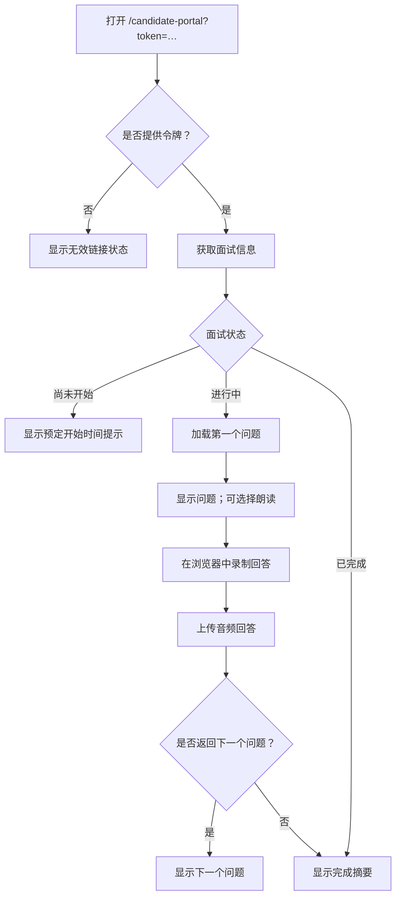

本页说明候选人公开面试流程：令牌化门户加载面试详情和问题，在启用时通过浏览器朗读问题，采集口头回答，并推进面试流程。内容聚焦于前端体验及其与门户 API 的交互；更广泛的路由、身份验证、转录和工作流内部机制请参阅[React 应用入口、路由与页面职责](22-react-application-entry-routing-and-page-responsibilities)、[身份验证、授权与候选人访问](9-authentication-authorization-and-candidate-access)以及[语音录制、FFmpeg 与 Whisper 转录](15-speech-recording-ffmpeg-and-whisper-transcription)。来源：[CandidatePortalPage.tsx](frontend/src/pages/CandidatePortalPage.tsx#L1-L38)

## 门户交互模型

门户是一个公开路由，会读取 `token` 查询参数；它不属于 HR 应用经过身份验证的布局。页面使用该令牌调用候选人门户 API。面向用户的状态包括加载、无效/错误、尚未开始、面试进行中和已完成。来源：[routes.tsx](frontend/src/routes.tsx#L15-L25) [CandidatePortalPage.tsx](frontend/src/pages/CandidatePortalPage.tsx#L24-L45)

这描述了客户端流程：`getInfo` 提供面试元数据和初始进度，随后页面为进行中的面试请求第一个问题。提交回答时，API 响应同时携带更新后的已回答数量和下一个问题，因此 UI 无需单独请求下一个问题即可继续推进。来源：[CandidatePortalPage.tsx](frontend/src/pages/CandidatePortalPage.tsx#L40-L105) [CandidatePortalPage.tsx](frontend/src/pages/CandidatePortalPage.tsx#L107-L139) [candidatePortal.ts](frontend/src/api/candidatePortal.ts#L24-L68)

## 面试页面状态与进度

页面初始化为 `loading`。缺少令牌或信息请求失败会进入 `error`；状态 `0` 被视为 `not_started`，状态 `3` 或更高则视为 `completed`，其他状态进入进行中的流程。回答时，页面会显示职位和候选人姓名、已回答/总数、按比例显示的进度条、当前问题和录音控件。来源：[CandidatePortalPage.tsx](frontend/src/pages/CandidatePortalPage.tsx#L24-L102) [CandidatePortalPage.tsx](frontend/src/pages/CandidatePortalPage.tsx#L180-L226)

| 体验状态 | 页面中的触发条件 | 候选人看到的结果 |
|---|---|---|
| 加载中 | 请求面试信息期间的初始状态 | 居中的加载指示器 |
| 无效/错误 | 缺少令牌或信息请求失败 | 无效链接提示 |
| 尚未开始 | 面试状态为 `0` | 预定面试时间和等待提示 |
| 进行中 | 状态低于 `3` 且不等于 `0` | 面试详情、进度、当前问题和音频控件 |
| 已完成 | 状态为 `3` 或更高，或未返回下一个问题 | 完成确认以及已回答/总数 |

来源：[CandidatePortalPage.tsx](frontend/src/pages/CandidatePortalPage.tsx#L24-L45) [CandidatePortalPage.tsx](frontend/src/pages/CandidatePortalPage.tsx#L62-L105) [CandidatePortalPage.tsx](frontend/src/pages/CandidatePortalPage.tsx#L142-L178)

页面会根据提交响应更新已回答数量，并显示成功通知。如果响应包含问题 ID `0`，页面会清除当前问题、将面试标记为已完成并显示完成通知；否则会渲染返回的下一个问题。提交错误会通过 toast 提示，且会在 `finally` 中重置提交标志。来源：[CandidatePortalPage.tsx](frontend/src/pages/CandidatePortalPage.tsx#L107-L139)

## 问题朗读与语音偏好

`QuestionReader` 在浏览器支持时使用 Speech Synthesis API。启用 `autoPlay` 后，当问题文本发生变化且朗读功能已启用时，会朗读问题；语音设置为 `zh-CN`，速率为 `1.0`，音调为 `1.0`。朗读器提供手动朗读/停止控件和自动朗读复选框。如果 Speech Synthesis 不可用，该组件不会渲染任何内容。来源：[QuestionReader.tsx](frontend/src/components/QuestionReader.tsx#L14-L41) [QuestionReader.tsx](frontend/src/components/QuestionReader.tsx#L43-L85)

门户会根据面试信息初始化其 `voiceReading` 状态，并将其传递给朗读器。切换时会立即更新本地状态，然后尝试通过 API 保存偏好；页面会有意忽略保存错误。后端偏好设置端点会更新面试偏好并写入审计事件。来源：[CandidatePortalPage.tsx](frontend/src/pages/CandidatePortalPage.tsx#L29-L34) [CandidatePortalPage.tsx](frontend/src/pages/CandidatePortalPage.tsx#L141-L151) [candidate_portal.py](backend/app/api/candidate_portal.py#L310-L327)

## 音频采集与提交

`VoiceRecorder` 通过 `navigator.mediaDevices.getUserMedia({ audio: true })` 获取麦克风流，创建 `MediaRecorder`，并收集非空数据块。如果支持，则优先使用 `audio/webm;codecs=opus`，否则使用 `audio/webm`。停止录音器后，会将数据块合并为 `Blob` 并调用 `onComplete`；组件也会在采集结束后和卸载时停止音轨。来源：[VoiceRecorder.tsx](frontend/src/components/VoiceRecorder.tsx#L15-L32) [VoiceRecorder.tsx](frontend/src/components/VoiceRecorder.tsx#L54-L92)

录音按钮可在开始和停止之间切换；录制期间，每秒更新一次已用时间。权限或设置失败时会设置行内错误并显示 toast。组件接受 `disabled` 属性，页面将其绑定到提交状态；录音状态提示也会使用该属性显示“请先听问题”，但页面不会根据语音播放状态推导 `disabled`。来源：[VoiceRecorder.tsx](frontend/src/components/VoiceRecorder.tsx#L34-L52) [VoiceRecorder.tsx](frontend/src/components/VoiceRecorder.tsx#L94-L143) [CandidatePortalPage.tsx](frontend/src/pages/CandidatePortalPage.tsx#L209-L221)

API 客户端以 multipart 字段发送 `question_id` 和录制的 blob，文件名为 `answer.webm`。后端会验证问题是否属于该令牌授权的面试且尚未回答，存储音频字节，记录回答时间戳，增加面试进度，并返回下一个问题或完成标记。来源：[candidatePortal.ts](frontend/src/api/candidatePortal.ts#L42-L55) [candidate_portal.py](backend/app/api/candidate_portal.py#L108-L154) [candidate_portal.py](backend/app/api/candidate_portal.py#L288-L307)

## 门户使用的 API 调用

| 客户端操作 | 请求 | 在体验中的作用 |
|---|---|---|
| `getInfo(token)` | `GET /api/candidate/{token}/info` | 加载面试身份、状态、数量、预定时间和语音偏好 |
| `getNextQuestion(token, afterId)` | `GET /api/candidate/{token}/questions/next?after=…` | 获取初始问题；页面将 ID `0` 视为已完成 |
| `submitAnswer(token, questionId, audioBlob)` | `POST /api/candidate/{token}/answers`（multipart 表单数据） | 提交录制的回答，并接收进度和下一个问题 |
| `toggleVoice(token, enabled)` | `PATCH /api/candidate/{token}/preferences` | 保存自动语音朗读偏好 |

来源：[candidatePortal.ts](frontend/src/api/candidatePortal.ts#L24-L68) [candidate_portal.py](backend/app/api/candidate_portal.py#L40-L105) [candidate_portal.py](backend/app/api/candidate_portal.py#L108-L154) [candidate_portal.py](backend/app/api/candidate_portal.py#L310-L327)

## 实现边界

门户页面负责协调显示状态、问题推进、通知和 API 调用。`QuestionReader` 和 `VoiceRecorder` 将浏览器语音和录音 API 封装为可复用组件，而 `candidatePortalApi` 则集中管理门户的 HTTP 操作。本页面的代码注释提到 SSE 是未来的集成方向，但所展示的回答流程使用请求/响应 API 调用，而非 SSE 订阅。来源：[CandidatePortalPage.tsx](frontend/src/pages/CandidatePortalPage.tsx#L1-L22) [QuestionReader.tsx](frontend/src/components/QuestionReader.tsx#L1-L12) [VoiceRecorder.tsx](frontend/src/components/VoiceRecorder.tsx#L1-L13) [candidatePortal.ts](frontend/src/api/candidatePortal.ts#L1-L6)

如需了解相邻实现内容，可继续阅读[语音录制、FFmpeg 与 Whisper 转录](15-speech-recording-ffmpeg-and-whisper-transcription)了解音频处理，或阅读[SSE 订阅与类型化事件处理](26-sse-subscription-and-typed-event-handling)了解实时事件处理。来源：[candidate_portal.py](backend/app/api/candidate_portal.py#L156-L177) [CandidatePortalPage.tsx](frontend/src/pages/CandidatePortalPage.tsx#L1-L22)
