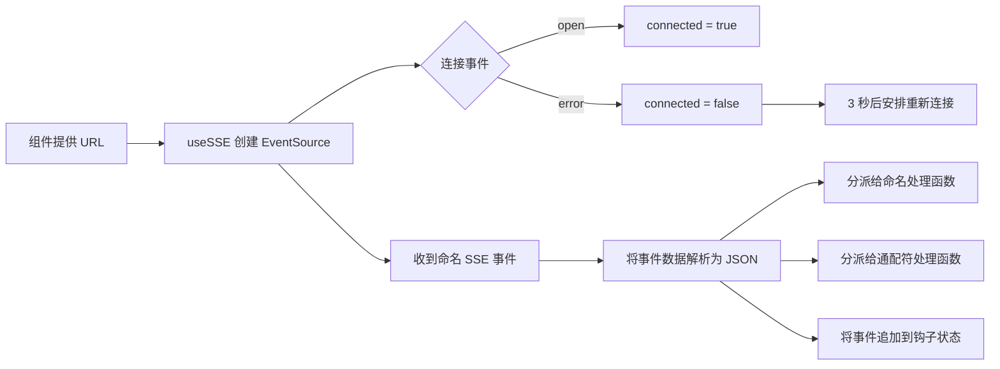

本页介绍前端的服务器发送事件（SSE）订阅钩子及其公开的 TypeScript 事件模型。该实现会为给定 URL 创建 `EventSource` 连接，将已识别的命名事件分派给已注册的回调，并在钩子状态中记录解析后的事件。**运行时钩子与导出的事件类型是彼此独立的机制**：钩子的回调负载类型为 `any`，而 `types/events.ts` 则为应用代码定义了一个可辨识联合类型和类型守卫。来源：[useSSE.ts](frontend/src/hooks/useSSE.ts#L15-L24) [events.ts](frontend/src/types/events.ts#L10-L16)

## 订阅与分派模型

钩子接受 URL 或 `null`。传入 URL 时，它会创建一个 `EventSource`；传入 `null` 时，它会将连接标记为已断开，且不会打开数据流。钩子公开 `connected`、累积的 `events` 数组，以及用于注册回调的 `on(eventName, handler)`。内部订阅者存储在一个映射中，该映射将事件名称关联到处理函数集合，因此同一事件名称可以有多个处理函数。来源：[useSSE.ts](frontend/src/hooks/useSSE.ts#L20-L38) [useSSE.ts](frontend/src/hooks/useSSE.ts#L127-L127) [useSSE.ts](frontend/src/hooks/useSSE.ts#L53-L57)

该钩子会为固定列表中的事件名称注册监听器。对于收到的每个命名事件，它会将 `MessageEvent.data` 解析为 JSON，调用匹配的处理函数，调用通配符（`"*"`）处理函数并传入 `{ event, data }`，然后将 `{ event, data }` 追加到 `events` 数组中。如果 JSON 解析抛出异常，catch 代码块会忽略该消息；不会分派该消息，也不会将其添加到状态中。来源：[useSSE.ts](frontend/src/hooks/useSSE.ts#L86-L110) [useSSE.ts](frontend/src/hooks/useSSE.ts#L40-L51)

## 连接生命周期与清理

该钩子使用浏览器的 `EventSource` API 和 `withCredentials: false`。在 `open` 时，它会将 `connected` 设为 `true`。在 `error` 时，它会将 `connected` 设为 `false`，并安排在三秒后尝试建立新连接；重新连接之前，会先关闭先前的 `EventSource`。来源：[useSSE.ts](frontend/src/hooks/useSSE.ts#L61-L84)

URL 依赖的 effect 清理时，会设置本地停止标志、清除待执行的重新连接计时器，并关闭当前数据源。停止标志可防止清理后已安排的 `connect` 调用打开连接。重新连接行为由此钩子实现；本说明并不意味着服务器端具有重放或投递保证。来源：[useSSE.ts](frontend/src/hooks/useSSE.ts#L59-L69) [useSSE.ts](frontend/src/hooks/useSSE.ts#L116-L125)

## 类型化事件契约

`events.ts` 定义了事件负载接口，这些接口共享一个 `timestamp` 字段，并使用字符串字面量 `event` 属性来标识每种事件。导出的 `InterviewEvent` 联合类型组合了这些接口；`SSEEventName` 则从 `event` 字段推导出有效的事件名称联合类型。这样可以根据事件判别字段缩窄联合类型值。来源：[events.ts](frontend/src/types/events.ts#L10-L16) [events.ts](frontend/src/types/events.ts#L18-L40) [events.ts](frontend/src/types/events.ts#L141-L162)

| 类型构造 | 作用 |
|---|---|
| `EventBase` | 通用 `timestamp: string` 字段 |
| 事件接口 | 描述特定事件的判别字段和负载字段 |
| `InterviewEvent` | 已声明事件接口的联合类型 |
| `SSEEventName` | 判别字段值的联合类型 |
| `isEventOfType` | 使用 TypeScript 类型谓词进行运行时判别检查 |

来源：[events.ts](frontend/src/types/events.ts#L10-L16) [events.ts](frontend/src/types/events.ts#L141-L162) [events.ts](frontend/src/types/events.ts#L184-L191)

类型守卫 `isEventOfType(event, type)` 会检查 `event.event` 是否与所请求的类型相等，并将该值缩窄为相应的联合类型成员。该文件还导出 `InterviewStatus` 常量及其标签映射；这些内容描述的是面试状态值，而非 SSE 订阅机制。来源：[events.ts](frontend/src/types/events.ts#L164-L182) [events.ts](frontend/src/types/events.ts#L184-L191)

## 重要边界：已声明类型与运行时处理

该钩子的 `on` 回调接受字符串事件名称，以及一个处理函数；该处理函数的 `data` 参数类型为 `any`。该钩子的 `SSEEvent` 同样存储 `data: any`。`events.ts` 中的事件接口不会自动使 `useSSE` 回调具备类型安全：该钩子不会导入 `InterviewEvent` 或 `SSEEventName`，并且其 `knownEvents` 列表独立于事件联合类型维护。来源：[useSSE.ts](frontend/src/hooks/useSSE.ts#L15-L18) [useSSE.ts](frontend/src/hooks/useSSE.ts#L27-L38) [useSSE.ts](frontend/src/hooks/useSSE.ts#L86-L100) [events.ts](frontend/src/types/events.ts#L141-L162)

声明与钩子监听器之间还存在明显的覆盖范围差异。类型联合声明了诸如 `connected`、`interview_created`、`resume_uploaded`、`audio_uploaded`、`transcription_started` 和 `transcription_complete` 等事件变体，而钩子的监听器列表包含的事件集合更小且有所不同。因此，该联合类型记录了可用的负载形状，但不应将其解读为该钩子目前订阅了所有已声明事件的证明。来源：[events.ts](frontend/src/types/events.ts#L18-L31) [events.ts](frontend/src/types/events.ts#L39-L91) [useSSE.ts](frontend/src/hooks/useSSE.ts#L86-L100)

## 对使用者的实际影响

使用者可以通过 `on` 注册命名处理函数或通配符处理函数；返回的函数会从对应事件名称的集合中移除该处理函数。注册操作本身不会自动返回 React effect 清理函数，因此，在 effect 内订阅的组件应使用返回的取消订阅函数作为该 effect 的清理函数。这一点可直接从钩子的订阅 API 及其返回函数看出。来源：[useSSE.ts](frontend/src/hooks/useSSE.ts#L27-L38)

对于编译时负载检查，使用者可以在已有 `InterviewEvent` 时使用导出的事件类型和 `isEventOfType` 守卫。当前钩子 API 并未将这些类型关联到其回调签名，因此 TypeScript 无法验证订阅边界上的负载类型。来源：[useSSE.ts](frontend/src/hooks/useSSE.ts#L27-L38) [events.ts](frontend/src/types/events.ts#L141-L162) [events.ts](frontend/src/types/events.ts#L184-L191)

## 后续步骤

有关服务器端事件流和投递路径，请继续阅读[服务器发送事件与实时进度投递](19-server-sent-events-and-real-time-progress-delivery)。有关影响长连接 SSE 的部署行为，请参阅 [Docker Compose、Nginx 与支持 SSE 的部署](30-docker-compose-nginx-and-sse-aware-deployment)。来源：[useSSE.ts](frontend/src/hooks/useSSE.ts#L61-L84)
