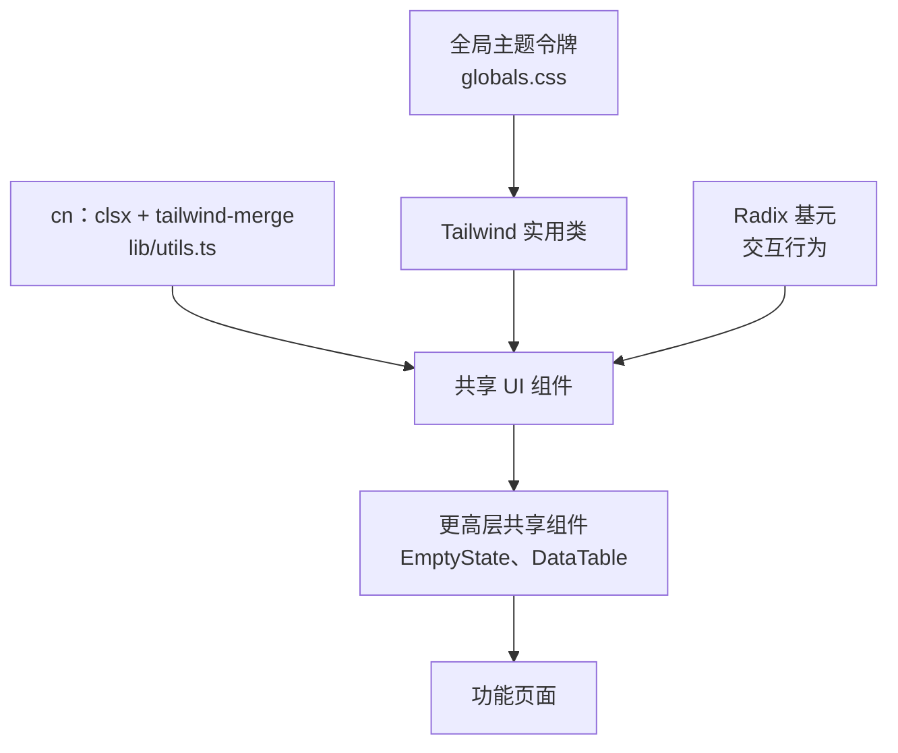

此页面介绍前端共享 UI 的组成方式：设计令牌和全局样式提供视觉基础；小型实用函数和变体定义统一类名组合；可复用组件则提供一致的控件和展示模式。本文聚焦于这些基础元素和共享组件，而非特定页面流程。来源：[globals.css](frontend/src/styles/globals.css#L1-L34)、[utils.ts](frontend/src/lib/utils.ts#L1-L9)、[ui/index.ts](frontend/src/components/ui/index.ts#L1-L39)

## 组件架构

UI 层采用组合模式。Tailwind 实用类实现组件外观，`cn` 组合并解析类名，部分组件使用 Radix 基元实现交互行为。`ui` 聚合导出共享组件，便于导入；`EmptyState` 和 `DataTable` 等更高层组件则将这些构建块组合成常见的应用模式。来源：[utils.ts](frontend/src/lib/utils.ts#L1-L9)、[button.tsx](frontend/src/components/ui/button.tsx#L1-L32)、[dialog.tsx](frontend/src/components/ui/dialog.tsx#L1-L32)、[ui/index.ts](frontend/src/components/ui/index.ts#L1-L39)、[EmptyState.tsx](frontend/src/components/EmptyState.tsx#L1-L42)、[DataTable.tsx](frontend/src/components/DataTable.tsx#L1-L48)

此图表示观察到的依赖方向：主题定义和类名实用工具为可复用 UI 组件提供支持，而这些组件之后可由应用级共享组件组合使用。这并不意味着每个组件都使用 Radix；基础 Button、Input 和 Card 实现使用的是原生 HTML 元素。来源：[globals.css](frontend/src/styles/globals.css#L1-L34)、[utils.ts](frontend/src/lib/utils.ts#L1-L9)、[button.tsx](frontend/src/components/ui/button.tsx#L1-L118)、[dialog.tsx](frontend/src/components/ui/dialog.tsx#L1-L32)

## 样式基础与类名组合

`globals.css` 导入 Tailwind，并通过 CSS 变量声明主题，其中包括背景色和前景色、柔和表面色、卡片和弹出层颜色、主要和次要颜色、危险操作颜色、焦点环颜色以及共享圆角。它还应用全局边框颜色，并设置文档主体的背景、文本颜色和字体特性。组件通过 `bg-primary`、`text-muted-foreground`、`border-input` 和 `ring-ring` 等实用类引用这些令牌，使组件样式与共享调色板保持一致。来源：[globals.css](frontend/src/styles/globals.css#L1-L34)、[button.tsx](frontend/src/components/ui/button.tsx#L10-L57)

`cn` 辅助函数接收 `ClassValue` 输入，先将其传入 `clsx` 以组合条件类名，再传入 `tailwind-merge` 以协调相互冲突的 Tailwind 类。这是接受 `className` 的组件所使用的通用扩展点：调用方可以自定义布局或外观，而辅助函数会将这些类与默认类合并。来源：[utils.ts](frontend/src/lib/utils.ts#L1-L9)、[button.tsx](frontend/src/components/ui/button.tsx#L10-L57)、[EmptyState.tsx](frontend/src/components/EmptyState.tsx#L7-L33)

## 基础组件与无障碍相关行为

共享的 `Button` 使用 `class-variance-authority` 定义六种视觉变体——默认、危险操作、轮廓、次要、幽灵和链接——以及四种尺寸——默认、小、大和图标。其通用类字符串包含使用 `focus-visible` 环形实用类实现的可见焦点样式，以及禁用状态的不透明度和指针事件样式。该组件会转发其 ref 和原生按钮属性，因此调用方可以在变体和尺寸属性之外使用常规按钮属性。来源：[button.tsx](frontend/src/components/ui/button.tsx#L1-L48)

同一模块还定义了 `Input` 和 Card 构建块。`Input` 会转发其 ref 和原生输入属性，并提供共享的边框、占位符、焦点可见和禁用样式。Card、CardHeader、CardTitle、CardDescription 和 CardContent 则提供一致的容器、标题、描述和内容样式。它们的 HTML 元素类型在 forward-ref 定义中明确指定。来源：[button.tsx](frontend/src/components/ui/button.tsx#L51-L118)

Dialog 组件包装 Radix Dialog 基元，并提供根组件、触发器、Portal、遮罩层、关闭控件、内容、标题和描述等构建块。内容会在带有遮罩层和定位样式的 portal 中渲染；关闭控件包含一个 X 图标和供屏幕阅读器读取的“关闭”文本。使用方可以组合导出的组件，而不必直接实现对话框机制。来源：[dialog.tsx](frontend/src/components/ui/dialog.tsx#L1-L108)

这些实现提供了特定的无障碍支持功能，例如焦点可见样式，以及对话框关闭控件中供屏幕阅读器读取的文本，但代码证据并不能证明每个组件或每种用法都完全符合无障碍标准。尤其是，无障碍效果取决于组件的组合方式，以及使用方提供的标签和内容。来源：[button.tsx](frontend/src/components/ui/button.tsx#L10-L48)、[dialog.tsx](frontend/src/components/ui/dialog.tsx#L38-L82)、[ui/index.ts](frontend/src/components/ui/index.ts#L1-L39)

## 共享组件模式

`ui/index.ts` 按用途归类导出内容：基础控件和表单控件、布局组件、数据展示组件、反馈组件以及滑块。此聚合导出文件包含标签、文本区域、复选框、选择器、抽屉、菜单、选项卡、表格、徽标、进度条、提示框、工具提示和加载动画等组件。包清单列出了相应的 Radix 包，以及 React、Tailwind、`class-variance-authority`、`clsx` 和 `tailwind-merge`；导出内容本身则展示了共享 UI 模块提供哪些组件。来源：[ui/index.ts](frontend/src/components/ui/index.ts#L1-L39)、[package.json](frontend/package.json#L1-L71)

| 共享模式 | 行为和自定义方式 |
|---|---|
| 基础控件 | Button 和 Input 使用原生属性及 ref 转发；Button 还支持类型化的变体和尺寸。 |
| 基于 Radix 的组合 | Dialog 分别导出其子组件，使调用方可以组装交互结构和内容结构。 |
| 空状态 | `EmptyState` 接受可选图标、标题、描述、操作节点和类名，并为图标和标题提供默认值。 |
| 数据表格 | `DataTable` 接受类型化列、数据、行键、可选行操作、加载状态、空数据文本和行点击处理函数。 |

来源：[button.tsx](frontend/src/components/ui/button.tsx#L33-L80)、[dialog.tsx](frontend/src/components/ui/dialog.tsx#L1-L108)、[EmptyState.tsx](frontend/src/components/EmptyState.tsx#L8-L42)、[DataTable.tsx](frontend/src/components/DataTable.tsx#L8-L48)

`EmptyState` 提供带虚线边框的居中布局，其中包含图标、标题、可选描述和可选操作区域。其属性使这种视觉模式能够重复使用，同时允许调用方提供符合上下文的文本和操作节点。来源：[EmptyState.tsx](frontend/src/components/EmptyState.tsx#L8-L42)

`DataTable` 处理三种渲染状态：加载时显示三行骨架屏；数据缺失或为空时显示空数据提示；存在数据时则渲染可水平滚动的 HTML 表格。列定义包括键、表头、渲染函数，以及可选的类名和宽度。可选操作会渲染为按钮；点击处理函数会在调用操作回调之前停止事件传播——当行本身也有 `onRowClick` 处理函数时，这一点尤为重要。来源：[DataTable.tsx](frontend/src/components/DataTable.tsx#L8-L48)、[DataTable.tsx](frontend/src/components/DataTable.tsx#L50-L139)

## 实用扩展指南

添加共享基础组件时，请遵循既有约定：将组件放在 `frontend/src/components/ui` 下，使用基于主题的 Tailwind 实用类，在需要自定义时接受 `className`，并通过 `cn` 组合类名。如果该组件属于共享 UI 的对外接口，请将其添加到聚合导出文件中。button 模块展示了类名变体和 ref 转发的做法；dialog 模块展示了基于基元的组合方式。来源：[button.tsx](frontend/src/components/ui/button.tsx#L1-L57)、[dialog.tsx](frontend/src/components/ui/dialog.tsx#L1-L32)、[utils.ts](frontend/src/lib/utils.ts#L1-L9)、[ui/index.ts](frontend/src/components/ui/index.ts#L1-L39)

扩展更高层共享组件时，请通过明确的 TypeScript 接口定义其数据和回调，就像 `DataTable` 对通用列、行键和操作所做的那样。应清晰区分各状态下的渲染逻辑——其实现将加载、空数据和有数据状态分别置于不同分支中。来源：[DataTable.tsx](frontend/src/components/DataTable.tsx#L8-L48)、[DataTable.tsx](frontend/src/components/DataTable.tsx#L50-L139)

## 后续步骤

如需了解更广泛的前端背景，请继续阅读[React 应用入口、路由和页面职责](22-react-application-entry-routing-and-page-responsibilities)，然后阅读[TanStack Query、表单和客户端验证](24-tanstack-query-forms-and-client-side-validation)。如需验证前端更改，请参阅[前端类型检查、Lint 和生产构建](29-frontend-type-checking-linting-and-production-builds)。来源：[package.json](frontend/package.json#L1-L18)
