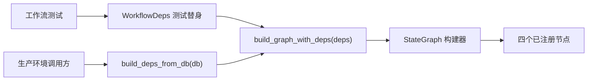

本页说明后端测试的组织方式，以及工作流依赖注入如何让测试将图构建与生产服务隔离开来。本文重点介绍测试边界、固件和替身；不介绍工作流生命周期或生产数据库操作。来源：[test_workflow.py](backend/tests/test_workflow.py#L1-L14) [dependencies.py](backend/app/workflow/dependencies.py#L1-L6)

## 测试层级及其验证内容

后端测试套件结合了专项测试、API 级测试，以及有限的端到端风格测试。工作流测试验证状态类型、图构建、节点注册和检查点行为。服务测试使用模拟对象或隔离的临时存储来测试选定的服务。API 测试使用 FastAPI 的 `TestClient` 和内存 SQLite 数据库。集成测试涵盖 API 操作，但明确不会使用其测试数据库执行完整工作流。来源：[test_workflow.py](backend/tests/test_workflow.py#L16-L64) [test_services.py](backend/tests/test_services.py#L16-L24) [test_api.py](backend/tests/test_api.py#L26-L53) [test_integration.py](backend/tests/test_integration.py#L82-L90)

| 测试层级 | 典型边界 | 验证示例 |
|---|---|---|
| 工作流单元/组装测试 | 内存替身；编译图无需真实数据库 | 状态字段、图编译、已注册的节点名称 |
| 工作流检查点测试 | `InMemorySaver` | 到达中断后，图状态可以保存并读回 |
| 服务测试 | 模拟的外部客户端或临时文件系统 | LLM 响应解析与重试；文件存储操作 |
| API 测试 | `TestClient` 和内存 SQLite | 测试数据库中的 HTTP 行为和持久化 |
| 集成风格 API 流程 | `TestClient`；外部 AI 服务不是重点 | 职位、候选人和面试端点的调用顺序；不运行完整工作流 |

来源：[test_workflow.py](backend/tests/test_workflow.py#L18-L64) [test_workflow.py](backend/tests/test_workflow.py#L76-L124) [test_services.py](backend/tests/test_services.py#L16-L24) [test_services.py](backend/tests/test_services.py#L92-L107) [test_api.py](backend/tests/test_api.py#L28-L53) [test_integration.py](backend/tests/test_integration.py#L82-L90)

## 工作流依赖注入：测试替身的接入点

工作流节点的依赖项汇总在 `WorkflowDeps` 数据类中，包括数据库会话、存储库、文件存储、SSE 管理器和提示词渲染器。工作流模块说明，测试可以注入这些依赖项，而不必打开真实的数据库会话。LLM 函数在节点内延迟导入，因此可以通过修补 `app.workflow.nodes.chat_json` 来拦截。来源：[dependencies.py](backend/app/workflow/dependencies.py#L19-L32)

`build_graph_with_deps` 使用 `partial` 将提供的依赖对象绑定到每个节点，然后返回一个 `StateGraph` 构建器。生产环境通过 `build_deps_from_db(db)` 组装真实依赖项；测试则传入模拟对象。这种分离意味着无需构造由实时数据库支持的存储库，也可以检查图的组装情况。来源：[graph.py](backend/app/workflow/graph.py#L31-L57) [dependencies.py](backend/app/workflow/dependencies.py#L40-L56)

该图区分了在图组装时汇合的两种依赖来源：测试可以提供替身，而生产代码可以使用由数据库支持的工厂。来源：[graph.py](backend/app/workflow/graph.py#L31-L57) [dependencies.py](backend/app/workflow/dependencies.py#L40-L56)

## 现有的工作流测试替身和断言

在图组装检查中，`MagicMock(spec=WorkflowDeps)` 会传入 `build_graph_with_deps`；测试会编译返回的构建器，并断言预期节点已注册。`spec` 将模拟对象限制为声明的依赖接口，而这些测试不会执行节点行为，也不需要真实的存储库操作。来源：[test_workflow.py](backend/tests/test_workflow.py#L43-L64) [test_workflow.py](backend/tests/test_workflow.py#L154-L164)

另一个测试会直接使用占位值构造 `WorkflowDeps`，并验证它是一个包含九个字段的数据类。这项检查验证的是容器的结构，而不是占位值是否实现了存储库或服务行为。对于节点级测试，声明的修补接入点是 `app.workflow.nodes.chat_json`；引用的工作流测试文件在测试注释中确认了该接入点，但未展示节点级 LLM 修补示例。来源：[test_workflow.py](backend/tests/test_workflow.py#L166-L182) [dependencies.py](backend/app/workflow/dependencies.py#L19-L32)

## 检查点替身和状态断言

检查点往返测试使用 LangGraph 的 `InMemorySaver`，而不是由 SQLite 支持的 saver，因此测试不依赖检查点文件。测试会使用该 saver 编译图，在后台线程上开始执行，并检查图状态是否可查询且包含初始面试标识符。测试注释说明，未提供恢复负载时，执行会在等待候选人的中断处停止。来源：[test_workflow.py](backend/tests/test_workflow.py#L76-L124)

该测试提供的是针对检查点和状态的专项断言，而非完整的工作流覆盖。尤其是，完整流水线测试——包括模拟的 LLM、数据库操作、中断/恢复和报告生成——明确处于跳过状态，等待完整的数据库模拟固件。来源：[test_workflow.py](backend/tests/test_workflow.py#L141-L149)

## API 数据库固件和依赖项覆盖

API 测试固件会创建内存 SQLite 引擎，使用 `StaticPool` 使各连接共享同一个内存数据库，创建 ORM 表，并在测试后释放引擎。其 `client` 固件会替换 API 使用的 `get_db` 依赖项，改为一个生成器，该生成器会产出绑定到该引擎的会话；随后会在清理阶段清除 `app.dependency_overrides`。来源：[test_api.py](backend/tests/test_api.py#L28-L53) [test_api.py](backend/tests/test_api.py#L56-L87)

测试代码强调了一个重要的覆盖细节：它从 `app.deps` 导入并覆盖 `get_db`，因为 API 模块使用的是该函数对象。覆盖从 `app.database` 导入的另一个 `get_db`，不会替换这些路由注册的依赖项。集成测试使用了类似的内存引擎和覆盖模式。来源：[test_api.py](backend/tests/test_api.py#L56-L80) [test_integration.py](backend/tests/test_integration.py#L25-L64)

该集成风格流程有意限定了范围：其中的注释指出，工作流会在后台线程中使用全局数据库启动，因此无法读取测试数据库中的候选人数据。因此，该测试检查的是 HTTP 层面的行为和候选人访问，而不是端到端的工作流执行。来源：[test_integration.py](backend/tests/test_integration.py#L84-L90) [test_integration.py](backend/tests/test_integration.py#L110-L137)

## 测试配置和运行测试套件

Pytest 配置为发现 `tests` 和名为 `test_*.py` 的文件，以自动 asyncio 模式运行，并启用详细输出和简短回溯。开发依赖项包括 pytest、pytest-asyncio 和 pytest-cov。共享的 `conftest.py` 会将后端目录添加到 `sys.path`，并在系统临时目录下设置每个进程各自的临时基础目录。来源：[pyproject.toml](backend/pyproject.toml#L61-L70) [pyproject.toml](backend/pyproject.toml#L85-L90) [conftest.py](backend/tests/conftest.py#L1-L18)

在后端目录中使用 `pytest` 运行测试。如需针对性诊断，可以选择某个模块或测试名称，例如 `pytest tests/test_workflow.py` 或 `pytest tests/test_workflow.py -k checkpointer`。项目配置规定了 pytest 的发现规则和选项；这些命令使用 pytest 的标准选择语法。来源：[pyproject.toml](backend/pyproject.toml#L85-L90) [test_workflow.py](backend/tests/test_workflow.py#L66-L80)

## 实际限制和改进目标

当前测试套件直接展示了使用依赖替身进行图组装、使用内存 saver 检查检查点状态、使用模拟 LLM 客户端进行服务测试，以及使用隔离数据库进行 API 测试。它还说明了一个覆盖缺口：由于尚未添加完整的数据库模拟，完整工作流流水线测试仍处于跳过状态。应将跳过的测试视为已知限制，而不是中断/恢复和报告生成已得到端到端覆盖的证据。来源：[test_workflow.py](backend/tests/test_workflow.py#L76-L124) [test_services.py](backend/tests/test_services.py#L92-L107) [test_workflow.py](backend/tests/test_workflow.py#L141-L149)

一种稳妥的扩展方式是添加专项节点测试，注入 `WorkflowDeps` 替身，在测试依赖 LLM 的行为时修补 `app.workflow.nodes.chat_json`，并且只断言节点可观察到的状态变化或调用。如需更广泛的覆盖，可以构建一个在启用跳过的流水线测试之前，将工作流存储库绑定到测试数据库的固件；现有集成测试明确指出，全局数据库不匹配是一个阻碍。来源：[dependencies.py](backend/app/workflow/dependencies.py#L19-L32) [test_workflow.py](backend/tests/test_workflow.py#L146-L149) [test_integration.py](backend/tests/test_integration.py#L84-L90)

## 建议继续阅读

接下来可以阅读[前端类型检查、Lint 和生产构建](29-frontend-type-checking-linting-and-production-builds)，了解下一个以质量为重点的页面；或者查阅[工作流依赖注入和检查点持久化](12-workflow-dependency-injection-and-checkpoint-persistence)，了解工作流测试接入点背后更广泛的生产架构。来源：[graph.py](backend/app/workflow/graph.py#L31-L57) [dependencies.py](backend/app/workflow/dependencies.py#L19-L32)
