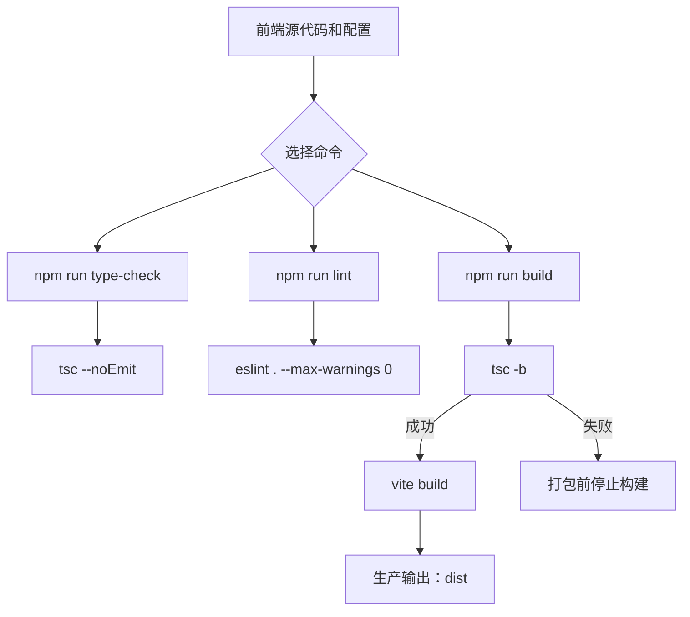

本页介绍前端可用的验证和构建命令、每个命令检查的内容，以及 TypeScript 和 Vite 配置之间的关系。package 脚本定义了三个独立的质量门槛：独立类型检查、ESLint，以及在打包前运行 TypeScript 项目构建检查的生产构建。这里定义了这些命令，但不声称它们有任何测试结果。来源：[package.json](frontend/package.json#L6-L12)

## 验证和构建流程

构建管道按顺序执行：`npm run build` 首先运行 `tsc -b`，并且只有该步骤成功后才会调用 `vite build`。Lint 是一个独立命令；`npm run build` 和 `npm run type-check` 都不会隐式运行它。来源：[package.json](frontend/package.json#L6-L12)

来源：[package.json](frontend/package.json#L6-L12)、[vite.config.ts](frontend/vite.config.ts#L33-L38)

## 命令及其适用场景

请在 `frontend` 目录中运行这些命令；package 脚本以及 TypeScript/Vite 配置都位于此目录。`type-check` 执行不生成输出文件的 TypeScript 检查；`lint` 对 `.` 运行 ESLint，并将任何警告视为失败；`build` 则在创建 Vite 生产构建包之前执行项目构建检查。来源：[package.json](frontend/package.json#L6-L12)

| 命令 | 执行内容 | 用途 |
|---|---|---|
| `npm run type-check` | `tsc --noEmit` | 运行独立的 TypeScript 检查，不生成输出文件。 |
| `npm run lint` | `eslint . --max-warnings 0` | 使用 ESLint 检查前端目录树；出现警告时命令会失败。 |
| `npm run build` | `tsc -b && vite build` | 检查 TypeScript 项目引用；若检查成功，则创建生产构建包。 |
| `npm run dev` | `vite` | 启动 Vite 开发服务器；这不是 lint 或生产构建检查。 |
| `npm run preview` | `vite preview` | 使用 Vite 预览服务器预览已构建的网站。 |

来源：[package.json](frontend/package.json#L6-L12)

## TypeScript 配置边界

应用程序的 TypeScript 配置启用了 `strict` 检查、未使用的局部变量和参数检查、贯穿检查以及副作用导入检查。它采用打包器风格的模块解析、React 自动 JSX 运行时，并为 `src` 下的路径设置 `@/*` 别名。其 `include` 为 `src`，并引用 `tsconfig.node.json`。来源：[tsconfig.json](frontend/tsconfig.json#L2-L34)

所引用的 Node 端配置为复合配置，并包含 `vite.config.ts`；该配置同样会在此处执行严格检查和未使用代码检查。这种配置将应用程序源代码检查与 Vite 配置检查分开，同时允许 `tsc -b` 遍历项目引用。来源：[tsconfig.node.json](frontend/tsconfig.node.json#L1-L20)、[tsconfig.json](frontend/tsconfig.json#L25-L34)

| 范围 | 配置 | 包含的文件 | 相关行为 |
|---|---|---|---|
| 应用程序 | `tsconfig.json` | `src` | 严格检查、不生成输出文件、`@/*` 路径映射、引用 Node 端项目。 |
| Vite 配置 | `tsconfig.node.json` | `vite.config.ts` | 启用严格检查和未使用代码检查的复合项目。 |

来源：[tsconfig.json](frontend/tsconfig.json#L2-L34)、[tsconfig.node.json](frontend/tsconfig.node.json#L1-L20)

## 生产构建包设置

Vite 将生产输出写入 `dist`，启用源映射，并将块大小警告阈值设为 500 KB。该阈值属于警告配置，与 ESLint 脚本明确规定的零警告策略不同；package 脚本没有显示任何会令 Vite 块大小警告变为致命错误的命令行选项。来源：[vite.config.ts](frontend/vite.config.ts#L33-L38)、[package.json](frontend/package.json#L6-L12)

Vite 配置还注册了 React 和 Tailwind 插件，并将 `@` 定义为 `src`。TypeScript 配置会独立将 `@/*` 映射到 `./src/*`；保持两处映射一致，能够让类型检查器和 Vite 解析器都识别该别名。来源：[vite.config.ts](frontend/vite.config.ts#L1-L13)、[tsconfig.json](frontend/tsconfig.json#L25-L29)

## 实用验证顺序

对于范围明确的修改，请运行 `npm run type-check` 和 `npm run lint`，分别检查类型和 lint 规则。在生成或验证发布构建包之前，请运行 `npm run build`；该命令会重复执行自身的 TypeScript 项目构建步骤，然后使用 Vite 打包。脚本没有定义组合运行 lint 和构建的命令。来源：[package.json](frontend/package.json#L6-L12)

来源：[package.json](frontend/package.json#L6-L12)、[vite.config.ts](frontend/vite.config.ts#L33-L38)

## 依赖安装和锁文件

前端同时包含 `package-lock.json` 和 `pnpm-lock.yaml`，而 `package.json` 定义了脚本和依赖声明。仅凭仓库文件无法确定所有工作流必须使用哪种包管理器；选择安装命令时，请遵循项目团队或 CI 的约定，并避免随意使用不同的包管理器重新生成某个锁文件。来源：[package.json](frontend/package.json#L1-L12)、[package-lock.json](frontend/package-lock.json#L1-L5)、[pnpm-workspace.yaml](frontend/pnpm-workspace.yaml#L1-L3)

## 延伸阅读

如需了解前端运行时和工具链背景，请继续阅读[React 应用程序入口、路由和页面职责](22-react-application-entry-routing-and-page-responsibilities)、[无障碍 UI 基元、样式和共享组件](27-accessible-ui-primitives-styling-and-shared-components)，或了解[Docker Compose、Nginx 和支持 SSE 的部署](30-docker-compose-nginx-and-sse-aware-deployment)中的运维部署影响。来源：[package.json](frontend/package.json#L6-L12)、[vite.config.ts](frontend/vite.config.ts#L33-L38)
