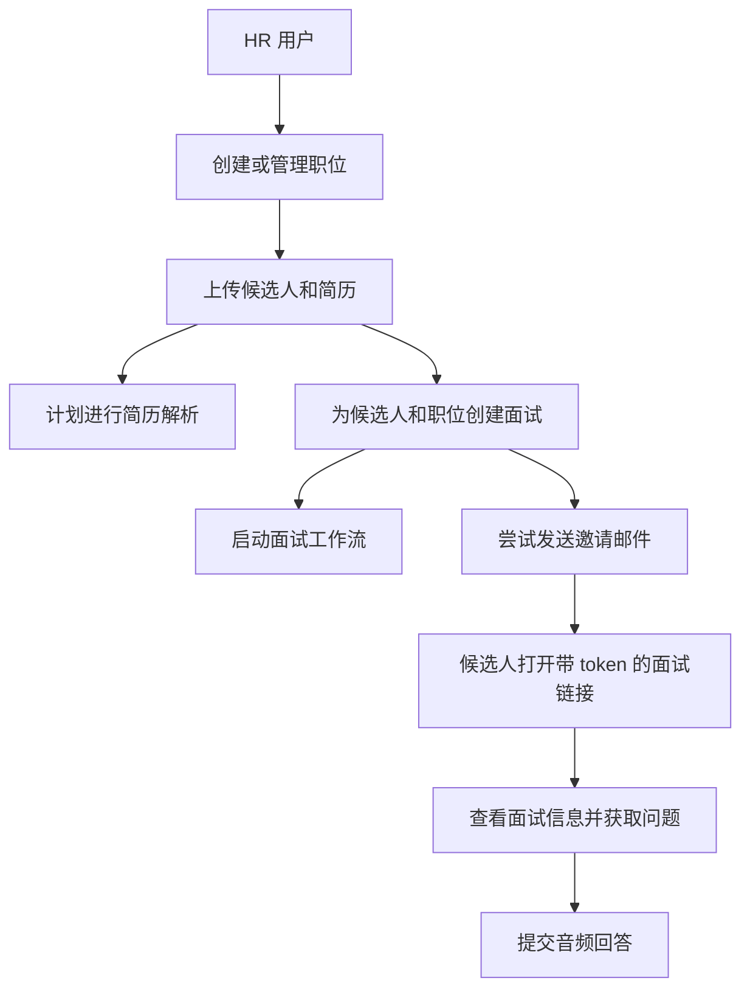

本入门页面介绍仓库中可见的招聘工作流，以及面向用户的两类角色——HR 用户和候选人——各自的职责。该工作流将职位与候选人和面试关联起来；HR 管理这些记录，候选人则使用特定于面试的 URL token 访问并参加面试。本页面是入门路径中的当前位置：[招聘工作流与用户角色](3-recruitment-workflow-and-user-roles)。来源：[interview.py](backend/app/models/interview.py#L1-L11) [deps.py](backend/app/deps.py#L27-L32) [candidate_portal.py](backend/app/api/candidate_portal.py#L1-L8)

## 工作流概览

主要流程是**创建职位 → 将候选人添加到该职位 → 创建面试 → 候选人打开面试链接并提交答案**。创建面试时还会启动面试工作流，并尝试发送邀请邮件。这些步骤由不同的 API 和服务模块分别实现，而非由单个工作流处理器统一处理。来源：[positions.py](backend/app/api/positions.py#L51-L67) [candidates.py](backend/app/api/candidates.py#L58-L114) [interviews.py](backend/app/api/interviews.py#L62-L96)

**如何阅读此图：**HR 操作使用经过身份验证的管理 API。面向候选人的门户使用 URL 中的面试 token，而不是 HR 登录 token。在图示的 API 路径中，简历解析和工作流执行会异步触发；该图并不表示必须等到简历解析完成后才能创建面试。来源：[positions.py](backend/app/api/positions.py#L26-L35) [candidates.py](backend/app/api/candidates.py#L101-L107) [interviews.py](backend/app/api/interviews.py#L79-L88) [candidate_portal.py](backend/app/api/candidate_portal.py#L40-L61)

## 角色与访问边界

| 角色 | 角色识别方式 | 主要职责 |
|---|---|---|
| HR 用户 | 将 Bearer 访问令牌解析为有效用户 | 管理职位、候选人和面试；查看面试记录并下载报告 |
| 候选人 | 将特定于面试的 URL token 解析为面试 | 查看面试信息、获取问题、提交音频回答，以及更改语音朗读偏好 |

HR API 处理器依赖 `get_current_user`：它读取 Bearer token，将其校验为访问令牌，加载对应用户，并拒绝缺失、无效或未激活的账户。候选人门户则依赖 `get_current_candidate`，通过 URL token 查找面试；候选人无需以 HR 用户身份进行身份验证。来源：[deps.py](backend/app/deps.py#L27-L68) [deps.py](backend/app/deps.py#L84-L102)

`User` 模型包含 `is_admin` 字段，但检查过的职位、候选人和面试处理器使用的是通用的当前用户依赖项。因此，这些路由建立的是经过身份验证的 HR 用户访问边界；此处展示的代码并未体现对这些操作单独设置仅限管理员的权限。来源：[user.py](backend/app/models/user.py#L16-L28) [positions.py](backend/app/api/positions.py#L29-L35) [candidates.py](backend/app/api/candidates.py#L36-L45) [interviews.py](backend/app/api/interviews.py#L32-L43)

## HR：管理职位和候选人

职位记录职位名称、要求、职责、招聘人数、状态以及可选的招聘人员姓名。职位状态值为 `0`（未开始）、`1`（进行中）和 `2`（已完成）。HR 创建职位时如果未指定招聘人员，API 会使用经过身份验证的用户的用户名。来源：[position.py](backend/app/models/position.py#L15-L41) [positions.py](backend/app/api/positions.py#L51-L67)

HR 通过提交姓名、电子邮件地址、职位 ID 和简历文件来添加候选人。候选人服务会检查职位是否存在，并记录上传该候选人的用户。API 根据文件签名接受 PDF 或 DOCX 文件，将文件大小限制为 50 MB，并在创建候选人后安排简历解析。来源：[candidates.py](backend/app/api/candidates.py#L58-L107) [candidate_service.py](backend/app/services/candidate_service.py#L55-L105)

职位删除受到限制：如果职位仍有关联的候选人或面试，服务会拒绝删除该职位。因此，职位是整理招聘记录的实用组织单元，而不只是一个独立标签。来源：[position_service.py](backend/app/services/position_service.py#L127-L155)

## HR：创建并跟进面试

面试将候选人与职位关联起来，也可以包含面试官和预定开始时间。如果未提供开始时间，服务会使用当前时间；创建记录时还会生成候选人 URL token 和工作流线程标识符。随后，API 会启动工作流并尝试发送邀请邮件，邮件投递按尽力而为处理。来源：[interview.py](backend/app/models/interview.py#L24-L71) [interview.py](backend/app/models/interview.py#L134-L158) [interview_service.py](backend/app/services/interview_service.py#L73-L130) [interviews.py](backend/app/api/interviews.py#L62-L96)

面试状态值为 `0`（未开始）、`1`（问题已就绪）、`2`（进行中）、`3`（已完成）和 `4`（报告已生成）。通过面试更新进行状态变更时，服务会根据显式的转换映射进行校验；例如，状态 `4` 在该映射中是终止状态。应将这些值视为工作流状态，而非招聘决定：模型会在 `is_passed` 中单独存储通过/未通过结果。来源：[interview.py](backend/app/models/interview.py#L40-L55) [interview_service.py](backend/app/services/interview_service.py#L132-L180)

## 候选人：进入并完成面试

候选人使用 token 请求面试信息时，门户会加载关联的候选人和职位详情。如果面试仍处于 `0` 状态，此请求会将其更改为 `1` 状态。如果尚无问题且问题数量未设置，处理器还会触发面试工作流。来源：[candidate_portal.py](backend/app/api/candidate_portal.py#L40-L70)

候选人可以请求下一个问题，并为属于该面试的问题提交音频回答。处理器会拒绝不属于该面试的问题，也会拒绝为已回答的问题再次提交答案。保存音频并更新进度后，处理器会在后台安排转录任务。来源：[candidate_portal.py](backend/app/api/candidate_portal.py#L91-L105) [candidate_portal.py](backend/app/api/candidate_portal.py#L108-L158)

## 实用阅读路径

先在此处了解各阶段由谁执行操作，然后在接下来的入门页面中查看实现细节。[仓库地图与推荐阅读路径](4-repository-map-and-recommended-reading-paths)有助于找到相关模块；[身份验证、授权与候选人访问](9-authentication-authorization-and-candidate-access)深入说明访问边界；[面试工作流状态与生命周期](10-interview-workflow-state-and-lifecycle)则聚焦面试状态及其转换。来源：[positions.py](backend/app/api/positions.py#L26-L67) [deps.py](backend/app/deps.py#L27-L102) [interview.py](backend/app/models/interview.py#L40-L55)
