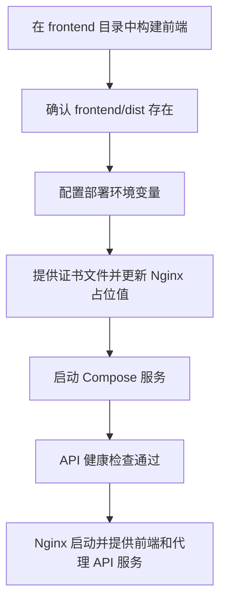

此页面说明仓库中的 Compose 部署如何将 FastAPI 容器连接到 Nginx、提供构建后的前端，并将 interview-events 端点配置为服务器发送事件（SSE）。已提交到仓库的部署由两个服务组成；前端单独构建并挂载到 Nginx，而不是由前端容器构建。**重要的运维限制：**HTTPS 服务器引用了占位域名和证书名称，因此要在生产环境中使用，必须先配置这些值并提供匹配的证书文件，之后 Nginx 才能提供 HTTPS 服务。来源：[docker-compose.yml](docker-compose.yml#L3-L6)、[nginx.conf](nginx/nginx.conf#L40-L55)、[SSL 自述文件](nginx/ssl/README.md#L3-L6)

## 部署拓扑

Compose 从 `backend/Dockerfile` 构建 API 映像，并从 `nginx:1.27-alpine` 映像启动 Nginx。Nginx 通过 Compose 服务主机名 `api` 的 `8000` 端口访问 API；为 Nginx 发布主机端口 `80` 和 `443`，同时 API 也直接发布 `8000` 端口。Nginx 会等待 API 的健康检查通过后再启动。来源：[docker-compose.yml](docker-compose.yml#L9-L15)、[docker-compose.yml](docker-compose.yml#L21-L22)、[docker-compose.yml](docker-compose.yml#L37-L42)、[docker-compose.yml](docker-compose.yml#L49-L57)、[nginx.conf](nginx/nginx.conf#L34-L38)

```mermaid
flowchart LR
    Browser -->|HTTP :80 重定向到 HTTPS| Nginx[Nginx :80 / :443]
    Browser -->|HTTPS :443| Nginx
    Nginx -->|/api/interviews/{id}/events| SSE[SSE 代理位置]
    Nginx -->|/api/| API[FastAPI api:8000]
    SSE --> API
    Nginx -->|/ 和 SPA 路由| Frontend[已挂载的 frontend/dist]
    API -->|SQLite| DB[(backend/interview.db)]
    API -->|上传和生成的文件| Storage[(backend/storage)]
```

该图反映了已配置的路由和挂载：Nginx 提供前端构建目录，并将 API 请求代理到 `api_backend` 上游；Compose 则将 SQLite 数据库和存储目录绑定挂载到 API 容器中。来源：[nginx.conf](nginx/nginx.conf#L34-L38)、[nginx.conf](nginx/nginx.conf#L50-L84)、[docker-compose.yml](docker-compose.yml#L16-L20)、[docker-compose.yml](docker-compose.yml#L59-L63)

## Compose 服务和运行时行为

| 服务 | 构建或映像 | 已发布端口 | 主要运行时行为 |
|---|---|---|---|
| `api` | 使用 `backend/Dockerfile` 从 `./backend` 构建 | `8000:8000` | 通过绑定挂载持久化存储和 SQLite；对 `/healthz` 进行健康检查；除非手动停止，否则自动重启。 |
| `nginx` | `nginx:1.27-alpine` | `80:80`、`443:443` | 等待 API 变为健康状态；以只读方式挂载 Nginx 配置、SSL 目录和前端构建输出。 |

API 容器从 Compose 接收数据库、存储、LLM、JWT、Whisper、日志记录和 CORS 相关环境设置。部分选定值提供了默认值，包括 LLM 提供商、模型、JWT 算法、日志级别和 Whisper 设置；API 密钥和 JWT 密钥则从环境中插值获取。Compose 还为每个服务配置了 JSON 文件日志轮换，大小上限为 10 MB，最多保留三个文件。来源：[docker-compose.yml](docker-compose.yml#L23-L36)、[docker-compose.yml](docker-compose.yml#L43-L47)、[docker-compose.yml](docker-compose.yml#L64-L68)

后端映像使用构建器阶段安装 Python 依赖，随后使用精简的运行时阶段。运行时会安装 FFmpeg 和应用功能所用的原生库，复制虚拟环境和应用源代码，以非 root 用户 `appuser` 运行，并在 `0.0.0.0:8000` 上启动 Uvicorn。映像级健康检查会访问 `/healthz`；Compose 还定义了对应的健康检查，启动等待时间为 60 秒、重试三次、间隔 30 秒。来源：[Dockerfile](backend/Dockerfile#L7-L32)、[Dockerfile](backend/Dockerfile#L34-L76)、[docker-compose.yml](docker-compose.yml#L37-L42)

## Nginx 请求路由

HTTPS 服务器处理三类流量。对 `/` 的请求由 `/usr/share/nginx/html` 提供服务，其中 `try_files` 会回退到 `index.html`，以处理客户端路由。范围更具体的 interview-events 位置会将匹配的事件 URL 代理到后端。其他 `/api/` 请求则使用标准 API 代理位置，该位置还会将请求正文大小上限设为 50 MB。来源：[nginx.conf](nginx/nginx.conf#L40-L55)、[nginx.conf](nginx/nginx.conf#L57-L84)

HTTP 服务器提供一个根目录为 `/var/www/certbot` 的 ACME 挑战位置，并将其他请求重定向到 HTTPS。Compose 文件没有将 Certbot Web 根目录挂载到该路径，也没有定义 Certbot 服务；因此，仅有该位置并不能构成完整的自动化证书签发或续期部署。来源：[nginx.conf](nginx/nginx.conf#L87-L101)、[docker-compose.yml](docker-compose.yml#L49-L68)

## SSE 专用代理行为

事件流位置匹配 `/api/interviews/{numeric-id}/events`。它会禁用代理缓冲和缓存，将读取和发送超时时间设为一小时，使用 HTTP/1.1，并清除 `Connection` 标头。这些设置旨在让流式响应数据不经 Nginx 缓冲直接传递，并允许代理请求长期保持打开状态。常规的 `/api/` 位置未定义这些 SSE 专用的缓冲和超时设置。来源：[nginx.conf](nginx/nginx.conf#L57-L70)、[nginx.conf](nginx/nginx.conf#L72-L84)

| 指令 | 配置值 | 部署效果 |
|---|---|---|
| `proxy_buffering` | 事件位置中为 `off` | 防止 Nginx 缓冲代理的事件响应。 |
| `proxy_cache` | 事件位置中为 `off` | 禁用该流路由的代理缓存。 |
| `proxy_read_timeout` | 事件位置中为 `1h` | 等待上游响应数据时允许较长的间隔。 |
| `proxy_send_timeout` | 事件位置中为 `1h` | 向上游发送数据时允许较长的间隔。 |
| `proxy_http_version` | `1.1` | 对上游代理使用 HTTP/1.1。 |
| `Connection` | 两个 API 位置中均为空值 | 转发空的 `Connection` 标头值，而不是设置连接令牌。 |

这些指令配置的是 Nginx 到 API 这一段链路；它们并不能保证每个客户端、网络中间设备或应用级事件源始终保持连接。这里明确设置的一小时超时时间并不意味着连接生命周期不受限制。来源：[nginx.conf](nginx/nginx.conf#L57-L69)

## 构建和启动顺序

Compose 配置要求前端构建产物位于 `frontend/dist`，并以只读方式将该目录挂载到 Nginx。Compose 文件注释说明，必须先从 `frontend` 目录使用 `pnpm build` 构建前端。此部署定义中不存在前端 Dockerfile 或前端构建服务。来源：[docker-compose.yml](docker-compose.yml#L59-L63)



该顺序区分了仓库要求和特定部署所需的准备工作：Compose 声明 Nginx 依赖健康的 API，同时还必须准备好已挂载的前端路径和 Nginx TLS 配置，才能按预期部署。仓库的 SSL 说明要求证书和密钥文件名与 `nginx.conf` 中的路径匹配；已提交到仓库的服务器名称和证书名称均为占位值。来源：[docker-compose.yml](docker-compose.yml#L53-L63)、[nginx.conf](nginx/nginx.conf#L40-L48)、[SSL 自述文件](nginx/ssl/README.md#L3-L6)

## TLS 和配置检查

启用 HTTPS 配置前，请将 `your-domain.com` 和 `nginx.conf` 中的证书文件名占位值替换为特定部署所用的值，然后将匹配的证书和私钥放入已挂载的 `nginx/ssl` 目录。该目录在 Nginx 容器中以只读方式挂载。SSL 自述文件警告不要提交真实证书材料，并指出 `.pem` 和 `.key` 文件会被 Git 忽略。来源：[nginx.conf](nginx/nginx.conf#L40-L48)、[docker-compose.yml](docker-compose.yml#L59-L61)、[SSL 自述文件](nginx/ssl/README.md#L3-L6)

根目录中的 `.env.example` 记录了 LLM 凭据、JWT 签名、CORS、Whisper 和日志记录的示例值。Compose 会将其中一部分设置传入 API 容器，并为其中一些设置提供自己的默认值。部署前请核对实际的 Compose 插值和应用预期；该示例文件只是模板，不能据此认定 Compose 会传递其中列出的所有设置。来源：[.env.example](.env.example#L1-L44)、[docker-compose.yml](docker-compose.yml#L23-L36)

## 运维检查和限制

| 检查项 | 仓库中的配置 | 实际影响 |
|---|---|---|
| API 就绪状态 | `/healthz` 检查；间隔 30 秒、超时 10 秒、重试三次、启动等待 60 秒 | Nginx 启动取决于 API 健康状态，而不仅仅是容器已创建。 |
| API 持久化数据 | 为 `backend/storage` 和 `backend/interview.db` 配置绑定挂载 | 数据存储在主机路径中，而不只存储在容器文件系统中。 |
| 前端可用性 | 以只读方式挂载 `frontend/dist` | 必须构建前端并将其放在该主机路径下，Nginx 才能提供服务。 |
| TLS 文件 | 以只读方式挂载 `nginx/ssl`；Nginx 中使用固定的证书路径 | 挂载目录必须包含与所配置路径匹配的文件。 |
| API 暴露 | 除 Nginx 端口外，还发布主机端口 `8000` | 除了通过 Nginx 的内部上游访问 API 外，也可以通过主机发布的端口访问 API。 |

这些检查项直接依据 Compose 和 Nginx 配置得出。具体而言，Nginx 的 API 依赖项使用 `service_healthy`，而 API 端口单独发布；因此，该配置并未将 API 访问限制为只能通过 Nginx 路由的流量。来源：[docker-compose.yml](docker-compose.yml#L16-L22)、[docker-compose.yml](docker-compose.yml#L37-L42)、[docker-compose.yml](docker-compose.yml#L53-L63)、[nginx.conf](nginx/nginx.conf#L34-L38)

## 继续阅读

如需了解 SSE 端点在应用层的事件行为，请继续阅读[服务器发送事件和实时进度传递](19-server-sent-events-and-real-time-progress-delivery)和[SSE 订阅与类型化事件处理](26-sse-subscription-and-typed-event-handling)。有关持久化和运维的相关指南，请参阅[持久化文件、数据库备份和运维安全](31-persistent-files-database-backups-and-operational-safety)。来源：[nginx.conf](nginx/nginx.conf#L57-L70)、[docker-compose.yml](docker-compose.yml#L16-L20)
