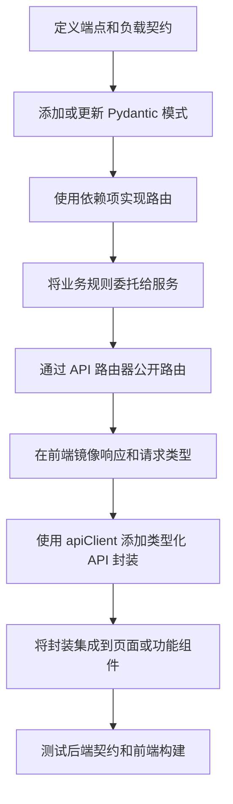

本指南介绍了一种经过验证的功能扩展模式，适用于同时涉及 FastAPI 后端和 React 前端的功能。指南以持仓功能为参考：后端路由负责验证请求、将业务行为委托给服务，并返回统一的响应封装；前端 API 模块调用共享 Axios 客户端，而页面负责处理用户交互和渲染。本指南重点介绍实现顺序、契约对齐和集成测试，而非通用的 API、服务或前端架构。来源：[positions.py](backend/app/api/positions.py#L11-L26)、[position_service.py](backend/app/services/position_service.py#L15-L22)、[positions.ts](frontend/src/api/positions.ts#L1-L5)、[PositionsPage.tsx](frontend/src/pages/PositionsPage.tsx#L28-L53)

## 跨层实现路径

核心工程任务是确保各层使用的契约保持一致。功能的请求和响应结构由后端模式定义，并通过路由对外提供；前端类型和 API 封装必须与这些结构相对应。随后，页面应使用该封装，而不是自行构造 HTTP 请求。来源：[position.py](backend/app/schemas/position.py#L11-L48)、[positions.py](backend/app/api/positions.py#L29-L48)、[positions.ts](frontend/src/api/positions.ts#L6-L36)、[PositionsPage.tsx](frontend/src/pages/PositionsPage.tsx#L13-L15)

该图反映了观察到的持仓功能实现：路由处理函数接收由模式定义类型的输入和依赖项，实例化服务，并将结果封装到 `APIResponse` 中；前端定义对应的 TypeScript 接口，使用 `apiClient`，并通过页面呈现结果。来源：[positions.py](backend/app/api/positions.py#L29-L67)、[position_service.py](backend/app/services/position_service.py#L15-L22)、[positions.ts](frontend/src/api/positions.ts#L6-L69)、[PositionsPage.tsx](frontend/src/pages/PositionsPage.tsx#L39-L52)

## 第 1 步：编码前明确契约

在实现任一端之前，先记录 HTTP 方法、路径、身份验证要求、查询参数或请求体、成功状态码以及响应数据结构。持仓路由展示了一种一致的契约：列表接口使用分页和可选的有界状态筛选条件；创建接口接收 `PositionCreate` 并返回 `201`；详情、更新和删除接口使用路径标识符。所有五个处理函数都要求 `get_current_user` 和 `get_db`。来源：[positions.py](backend/app/api/positions.py#L26-L36)、[positions.py](backend/app/api/positions.py#L51-L67)、[positions.py](backend/app/api/positions.py#L70-L112)

| 契约维度 | 已验证的持仓模式 | 功能设计操作 |
|---|---|---|
| 路由位置 | 具有资源前缀的功能专属路由器 | 将端点添加到相应的 `backend/app/api` 模块 |
| 输入验证 | Pydantic 请求模型和 FastAPI `Query` 约束 | 在 API 边界定义请求体/查询参数约束 |
| 身份验证和数据库 | `Depends(get_current_user)` 和 `Depends(get_db)` | 明确决定端点是否需要其中任一依赖项 |
| 业务行为 | 路由将工作委托给服务 | 不要将领域规则放入 HTTP 编排逻辑 |
| 成功响应 | `APIResponse.ok(...)`，创建操作使用 `201` | 统一指定封装结构和 HTTP 状态码 |
| 前端结构 | TypeScript 接口镜像后端模式输出 | 确保面向 API 的类型与契约一致 |

来源：[positions.py](backend/app/api/positions.py#L11-L67)、[position.py](backend/app/schemas/position.py#L11-L48)、[response.py](backend/app/schemas/response.py#L1-L200)、[positions.ts](frontend/src/api/positions.ts#L6-L36)

## 第 2 步：定义请求和响应模式

在 `backend/app/schemas` 下添加或扩展模块，以定义该功能公开的请求和响应结构。持仓示例将共享基础模型、创建输入、更新输入、输出模型和列表封装分开定义。其输出模型启用了 `from_attributes=True`，使路由能够使用 `PositionOut.model_validate(...)` 验证由 ORM 支持的对象。来源：[position.py](backend/app/schemas/position.py#L11-L48)、[positions.py](backend/app/api/positions.py#L41-L47)、[positions.py](backend/app/api/positions.py#L67-L67)

不要假定示例中的可选字段语义适用于所有更新操作。在 `PositionUpdate` 中，字段默认为 `None`，路由将其值传递给服务；服务使用 `None` 确定审计元数据中具体提供了哪些字段。如果新功能必须区分“未提供”和“明确设为 null”，应有意识地对这种区别进行建模和测试，而不是不检查领域需求就照搬此结构。来源：[position.py](backend/app/schemas/position.py#L26-L33)、[positions.py](backend/app/api/positions.py#L82-L100)、[position_service.py](backend/app/services/position_service.py#L86-L125)

## 第 3 步：实现路由编排和服务行为

创建或扩展具有资源前缀和标签的功能路由器。路由模块导入依赖项、模式、响应封装和服务；每个处理函数负责 HTTP 层编排，并在相关情况下将经过身份验证的操作者上下文传递给服务。持仓功能使用 `user.id` 作为 `actor_id`，根据 `page` 和 `page_size` 计算列表偏移量，并将 ORM 对象转换为模式输出。来源：[positions.py](backend/app/api/positions.py#L11-L26)、[positions.py](backend/app/api/positions.py#L29-L48)、[positions.py](backend/app/api/positions.py#L51-L67)

将领域规则和持久化协调放在服务中，而不是不断扩展路由处理函数。在经过验证的示例中，服务负责校验、未找到时的行为、仓库调用、审计记录和删除冲突检查。这样的边界使路由可以专注于 HTTP 输入、依赖项和响应构造。来源：[position_service.py](backend/app/services/position_service.py#L15-L22)、[position_service.py](backend/app/services/position_service.py#L36-L44)、[position_service.py](backend/app/services/position_service.py#L46-L84)、[position_service.py](backend/app/services/position_service.py#L127-L155)

在聚合 API 路由器中注册新路由器。`backend/app/api/router.py` 导入各个功能模块并包含其路由器；`backend/app/main.py` 则将该聚合路由器包含到 FastAPI 应用中。未纳入聚合路由器的路由文件不属于应用已注册的 API 范围。来源：[router.py](backend/app/api/router.py#L6-L18)、[main.py](backend/app/main.py#L189-L192)

## 第 4 步：在前端 API 模块中镜像契约

在 `frontend/src/api` 下添加功能 API 模块。为后端响应和输入负载定义 TypeScript 类型，然后提供专用函数，通过共享的 `apiClient` 发起调用。持仓封装会从后端响应封装中返回内部的 `data` 值，因此调用方可以直接处理 `Position` 或 `PositionListResponse`，而无需重复提取封装内容。来源：[positions.ts](frontend/src/api/positions.ts#L6-L36)、[positions.ts](frontend/src/api/positions.ts#L45-L69)

使用共享客户端，而不是创建功能专属的 Axios 实例。共享客户端设置基础 URL 和超时时间、附加已存储的访问令牌、尝试刷新令牌并重试符合条件的未授权请求，还会将可识别的后端错误封装转换为 `ApiError`。这意味着新封装会继承现有的请求和错误处理行为。来源：[client.ts](frontend/src/api/client.ts#L14-L40)、[client.ts](frontend/src/api/client.ts#L42-L49)、[client.ts](frontend/src/api/client.ts#L51-L98)

## 第 5 步：将 API 封装接入 UI

将端点调用放在功能 API 模块中，并从页面或组件调用该模块。`PositionsPage` 通过 `positionsApi.list` 加载列表，在提交表单时调用 `create` 或 `update`，并在确认后调用 `delete`。页面负责交互状态、表单处理、通知和渲染；封装负责 HTTP 细节。来源：[positions.ts](frontend/src/api/positions.ts#L45-L69)、[PositionsPage.tsx](frontend/src/pages/PositionsPage.tsx#L28-L53)、[PositionsPage.tsx](frontend/src/pages/PositionsPage.tsx#L74-L103)

对于用户输入的数据，应使客户端验证与后端接受的值保持一致，同时以服务器端验证为准。持仓页面使用 Zod 模式检查必填名称、最小数量和状态范围；后端模式规定字段类型，服务则执行诸如名称不得为空白、状态值必须有效等业务检查。来源：[PositionsPage.tsx](frontend/src/pages/PositionsPage.tsx#L17-L26)、[position.py](backend/app/schemas/position.py#L12-L33)、[position_service.py](backend/app/services/position_service.py#L46-L67)

## 第 6 步：在 API 边界验证功能

为外部可观察的契约添加后端集成测试，覆盖成功请求、验证或业务失败、适用时的身份验证行为，以及响应封装和负载字段。现有 API 测试模块使用内存 SQLite 引擎、覆盖 `get_db` 依赖项，并提供经过身份验证的用户测试夹具；如果该功能依赖相同的数据库依赖项，请沿用其设置模式。来源：[test_api.py](backend/tests/test_api.py#L26-L86)、[test_api.py](backend/tests/test_api.py#L89-L120)、[test_api.py](backend/tests/test_api.py#L161-L195)

运行与该功能相关的后端测试，以及仓库中可用的前端检查。前端包定义了 `type-check`、`lint` 和 `build` 脚本；构建脚本会先运行 TypeScript 项目构建，然后再执行 Vite 打包。这些脚本是仓库定义的验证命令，并不能证明某个具体功能已通过验证。来源：[package.json](frontend/package.json#L5-L12)

## 契约偏差检查

| 偏差风险 | 比较内容 |
|---|---|
| 路由未注册 | 检查功能路由器是否包含在聚合路由器中 |
| URL 或 HTTP 方法错误 | 比较路由器前缀/装饰器与前端封装的路径和方法 |
| 响应嵌套不匹配 | 比较后端 `APIResponse` 结构与前端封装提取逻辑 |
| 类型不匹配 | 比较 Pydantic 模式输出字段与 TypeScript 接口 |
| 验证不匹配 | 比较查询参数/请求体约束、服务规则和表单验证 |
| 错误处理不匹配 | 比较后端错误封装与共享 `ApiError` 转换及页面处理方式 |
| 缺少集成测试覆盖 | 检查测试请求、状态码、封装结构和预期数据字段 |

只有当响应体中存在数值且非零的 `code` 时，共享客户端才会将响应转换为 `ApiError`；其他失败会作为传输错误或 Axios 错误被拒绝。因此，除非页面对捕获的值进行类型收窄或规范化，否则不应假定所有捕获值的结构都相同。来源：[client.ts](frontend/src/api/client.ts#L87-L97)、[PositionsPage.tsx](frontend/src/pages/PositionsPage.tsx#L89-L103)

## 建议继续阅读

如需了解相关的契约约定，请参阅[API 契约、验证和错误处理](8-api-contracts-validation-and-error-handling)。若要在添加业务行为前了解服务边界，请继续阅读[服务层、仓库和数据库会话](17-service-layer-repositories-and-database-sessions)。有关前端 API 和身份验证机制，请参阅[API 客户端、身份验证状态和请求处理](23-api-client-authentication-state-and-request-handling)；有关测试设置和后端测试替身，请参阅[后端测试策略和工作流测试替身](28-backend-test-strategy-and-workflow-test-doubles)。来源：[positions.py](backend/app/api/positions.py#L11-L26)、[client.ts](frontend/src/api/client.ts#L32-L49)、[test_api.py](backend/tests/test_api.py#L56-L86)
