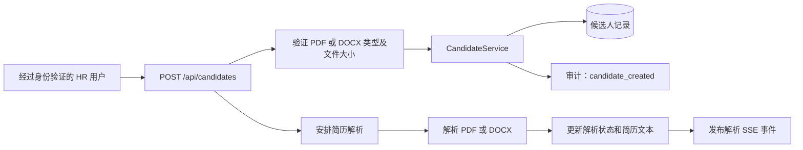

本页区分**已实现的候选人录入**与**提议中的招聘自动拉取**。当前应用通过经过身份验证的 API 接收 HR 提交的简历，并异步解析；代码库中没有已实现的外部招聘平台适配器或拉取任务子系统。单独的招聘自动拉取设计文档描述了未来方向，并明确将其标记为不在 2026 年第三季度的实施范围内。来源：[candidates.py](backend/app/api/candidates.py#L1-L38)、[招聘候选人自动拉取-方案.md](招聘候选人自动拉取-方案.md#L1-L7)

## 当前边界：手动录入已实现

已实现的候选人创建路径为 `POST /api/candidates`。它要求当前经过身份验证的用户，依据 PDF 或 DOCX 文件的魔数验证上传文件，限制文件大小为 50 MB，并将候选人创建委托给 `CandidateService`。候选人会关联到一个已有职位，并记录上传者。来源：[candidates.py](backend/app/api/candidates.py#L26-L38)、[candidates.py](backend/app/api/candidates.py#L58-L109)、[candidate_service.py](backend/app/services/candidate_service.py#L34-L85)

该服务会创建一个由 UUID 标识的候选人记录，并写入一条 `candidate_created` 审计事件。候选人记录目前包含职位、姓名、电子邮件、简历存储信息、解析状态以及上传者/时间戳；模型未定义来源平台、来源 URL、拉取时间或匹配分数字段。在评估集成工作量时，这些区别很重要：提议中的招聘来源元数据目前并不属于持久化候选人契约。来源：[candidate_service.py](backend/app/services/candidate_service.py#L61-L85)、[candidate.py](backend/app/models/candidate.py#L17-L53)

创建候选人后，API 会安排简历解析任务。解析任务会发布开始、完成或失败的 SSE 事件，并更新解析状态和已解析文本。因此，现有录入流程已经具备异步处理接口，但它专用于简历解析，并非通用的招聘拉取队列或适配器框架。来源：[candidates.py](backend/app/api/candidates.py#L112-L178)、[resume_parser_service.py](backend/app/services/resume_parser_service.py#L1-L13)

该图仅展示已实现的手动录入流程；它并不表示当前已连接任何外部招聘平台。来源：[candidates.py](backend/app/api/candidates.py#L58-L109)、[candidates.py](backend/app/api/candidates.py#L112-L178)、[candidate_service.py](backend/app/services/candidate_service.py#L34-L85)

## 提议的扩展：平台中立的招聘来源接入

规划文档提议通过适配器接口隔离特定平台的数据检索逻辑。其建议的适配器契约将搜索、候选人详情获取和健康检查分开，并返回平台原始数据结构。注册表将根据平台键选择适配器，使处理流水线逻辑依赖通用接口，而不是特定平台的分支。这是一项提议，并非当前 `backend/app` 中已有的代码。来源：[招聘候选人自动拉取-方案.md](招聘候选人自动拉取-方案.md#L79-L127)

提议中的处理流水线随后将数据检索与规范化、去重、评分和持久化分开。这种拆分有助于明确扩展边界：特定来源的解析保留在适配器中，而下游步骤可以处理规范化后的候选人数据。该计划描述了基于 LLM 的字段提取和职位匹配、基于身份的去重以及持久化；在检查过的应用服务中，并未实现此类招聘来源处理流水线。来源：[招聘候选人自动拉取-方案.md](招聘候选人自动拉取-方案.md#L47-L76)、[招聘候选人自动拉取-方案.md](招聘候选人自动拉取-方案.md#L129-L173)

这是提案中的概念流程，并非运行中组件的示意图。特别是，当前候选人 API 和模型都未公开来源溯源结构或招聘拉取任务生命周期。来源：[招聘候选人自动拉取-方案.md](招聘候选人自动拉取-方案.md#L47-L76)、[candidate.py](backend/app/models/candidate.py#L17-L53)、[router.py](backend/app/api/router.py#L1-L18)

## 集成接口与待定决策

**候选人创建目前与简历上传输入紧密耦合。** `CandidateService.create_candidate` 要求提供职位、姓名、电子邮件和简历类型，并接受简历字节或路径。对于不带简历创建候选人的招聘接入，或接收远程简历 URL 的接入，需要明确制定策略并选择适当的导入路径；仅调用当前方法并不能表示提案中的规范化档案记录。来源：[candidate_service.py](backend/app/services/candidate_service.py#L34-L85)、[candidate.py](backend/app/models/candidate.py#L17-L37)

**职位关联是必需的领域关系。** 候选人记录引用 `positions.id`，且如果职位已关联候选人，则拒绝删除该职位。因此，招聘拉取流程必须在持久化候选人之前定义搜索任务如何映射到职位。现有职位 API 和服务提供经过身份验证的职位管理功能，但在检查过的路由中不存在招聘拉取任务到职位的映射。来源：[candidate.py](backend/app/models/candidate.py#L20-L22)、[position_service.py](backend/app/services/position_service.py#L112-L146)、[positions.py](backend/app/api/positions.py#L22-L60)

**只有在导入流程提供受支持的内容后，才能复用简历解析。** 解析器处理 PDF 和 DOCX 字节或文件，而上传端点目前会在安排解析任务之前检查文件类型。未来的适配器不得假定个人档案页面或任意远程文档已是有效的解析器输入；必须先定义数据检索、内容验证和存储策略。来源：[candidates.py](backend/app/api/candidates.py#L58-L109)、[resume_parser_service.py](backend/app/services/resume_parser_service.py#L119-L177)

现有存储抽象也是一个可能的接口：`FileStorage` 规定了简历保存/读取操作，而 `LocalFileStorage` 会使用原子写入，将简历持久化到候选人专属路径下。它不提供远程抓取、来源元数据或保留策略；这些问题需要单独设计，而不能从存储接口中推断出来。来源：[file_storage.py](backend/app/services/file_storage.py#L24-L53)、[file_storage.py](backend/app/services/file_storage.py#L57-L96)

## 提案状态与扩展风险

招聘自动拉取设计文档明确将此功能标记为长期规划，并注明其不在声明的实施范围内。文档中的示例包括独立工作进程、拉取任务记录、候选人来源字段、适配器注册，以及从单平台 MVP 逐步演进到分布式队列和额外存储/可观测性能力的阶段。这些是该文档记录的设计选项，并非经核实的当前 FastAPI 应用特性。来源：[招聘候选人自动拉取-方案.md](招聘候选人自动拉取-方案.md#L1-L7)、[招聘候选人自动拉取-方案.md](招聘候选人自动拉取-方案.md#L15-L46)、[招聘候选人自动拉取-方案.md](招聘候选人自动拉取-方案.md#L205-L228)

实施之前，该计划本身要求重新评估法律和平台条款、个人数据处理与候选人授权、反机器人措施和平台变更风险、资源成本、数据质量、重试策略，以及产品转为多租户后的租户隔离。这些都是提案中明确列出的审查事项；应将其视为前置条件，而不是当前系统已解决的问题。来源：[招聘候选人自动拉取-方案.md](招聘候选人自动拉取-方案.md#L240-L286)

| 关注事项 | 当前已核实状态 | 需要作出的扩展决策 |
|---|---|---|
| 候选人来源信息 | `Candidate` 上没有来源平台或 URL 字段 | 定义来源字段和迁移策略 |
| 录入契约 | 经过身份验证的多部分 PDF/DOCX 上传 | 决定招聘来源档案和可选简历如何进入领域模型 |
| 职位映射 | 候选人必须关联 `position_id` | 将每个招聘拉取请求绑定到有效职位 |
| 后台工作 | 上传后会安排简历解析 | 单独设计任务归属、重试、状态和工作进程行为 |
| 审计 | 候选人创建会被审计 | 定义任务级和来源数据的审计要求 |
| 合规 | 审计模型将合规审计列为一种使用场景 | 明确授权、保留期限、访问控制和删除行为 |

来源：[candidate.py](backend/app/models/candidate.py#L17-L53)、[candidates.py](backend/app/api/candidates.py#L58-L109)、[candidate_service.py](backend/app/services/candidate_service.py#L61-L85)、[audit_log.py](backend/app/models/audit_log.py#L14-L31)、[招聘候选人自动拉取-方案.md](招聘候选人自动拉取-方案.md#L240-L286)

## 推荐阅读路径

若要了解当前候选人领域模型和经过身份验证的访问边界，请继续阅读[招聘领域模型与数据关系](7-recruitment-domain-model-and-data-relationships)和[身份验证、授权与候选人访问](9-authentication-authorization-and-candidate-access)。若要了解服务边界和后台工作的实现问题，请参阅[服务层、仓储与数据库会话](17-service-layer-repositories-and-database-sessions)和[后台调度与停滞面试恢复](20-background-scheduling-and-stalled-interview-recovery)。来源：[candidate.py](backend/app/models/candidate.py#L17-L53)、[candidates.py](backend/app/api/candidates.py#L26-L38)、[candidate_service.py](backend/app/services/candidate_service.py#L34-L85)
