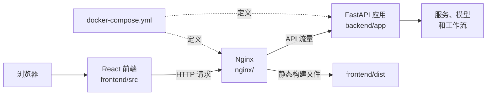

本页梳理代码库，并为加入项目的开发者提供实用的阅读路线。重点在于**该看哪里以及按什么顺序阅读**；子系统行为、配置和操作流程的详细内容请参阅链接的深入指南。**当前位置：** 开始使用 → 入门 → [代码库地图与推荐阅读路线](4-repository-map-and-recommended-reading-paths)。来源：[README.md](README.md#L62-L107)、[docs/README.md](docs/README.md#L82-L97)

## 代码库概览

代码库主要包含三个应用区域：位于 `backend/` 下的 **FastAPI 后端**、位于 `frontend/` 下的 **React 和 TypeScript 前端**，以及根目录和 `nginx/` 中的**部署配置**。根目录的 README 还将 `docs/` 描述为面向实现的参考资料，而 `docs/README.md` 则作为其导航索引。来源：[README.md](README.md#L62-L123)、[docs/README.md](docs/README.md#L1-L7)

```text
smart_interview_ai/
├── README.md                    # Project introduction and top-level map
├── .env.example                 # Environment-variable template
├── docker-compose.yml           # API and Nginx services
├── backend/
│   ├── app/
│   │   ├── api/                 # HTTP API
│   │   ├── core/                # Shared application infrastructure
│   │   ├── models/              # Data models and repositories
│   │   ├── schemas/             # Request/response schemas
│   │   ├── services/            # Business and AI services
│   │   ├── workflow/            # LangGraph workflow
│   │   ├── workers/             # Background scheduling
│   │   ├── prompts/             # Prompt templates
│   │   ├── templates/           # Report templates
│   │   ├── config.py
│   │   ├── database.py
│   │   ├── deps.py
│   │   └── main.py              # FastAPI entry point and lifespan
│   ├── tests/                   # Backend tests
│   ├── scripts/                 # Maintenance scripts
│   ├── storage/                 # Runtime file storage
│   └── pyproject.toml           # Python dependencies and tool settings
├── frontend/
│   ├── src/
│   │   ├── api/                 # API client modules
│   │   ├── components/          # Shared and domain UI
│   │   ├── contexts/            # Application contexts
│   │   ├── hooks/               # Reusable hooks
│   │   ├── pages/               # Route-level pages
│   │   ├── types/               # TypeScript types
│   │   ├── App.tsx
│   │   ├── main.tsx             # React mount point
│   │   └── routes.tsx           # Route configuration
│   └── package.json             # Scripts and JavaScript dependencies
├── nginx/                       # Reverse-proxy configuration and SSL notes
└── docs/                        # Documentation, diagrams, and sample resumes
```

此目录树仅用于导航，并不表示列出了所有嵌套模块。README 提供了更完整的代码库架构清单，已纳入版本控制的源代码则确认了后端入口点和前端挂载点。来源：[README.md](README.md#L71-L107)、[backend/app/main.py](backend/app/main.py#L129-L200)、[frontend/src/main.tsx](frontend/src/main.tsx#L1-L15)

## 主要区域如何连接

从整体上看，浏览器应用通过部署配置提供服务，并与 FastAPI API 通信。Compose 文件定义了一个 `api` 服务和一个 `nginx` 服务；Nginx 提供前端构建产物并代理请求，而前端入口点负责挂载 React 应用和路由器。后端入口点会创建 FastAPI 应用并注册 API 路由器。来源：[docker-compose.yml](docker-compose.yml#L9-L19)、[docker-compose.yml](docker-compose.yml#L49-L63)、[backend/app/main.py](backend/app/main.py#L129-L137)、[backend/app/main.py](backend/app/main.py#L189-L192)、[frontend/src/main.tsx](frontend/src/main.tsx#L1-L15)



该图概述了代码库中可见的边界，并非完整的运行时序列。有关组件职责和请求行为，请继续阅读[系统架构与组件边界](6-system-architecture-and-component-boundaries)和[API 契约、验证与错误处理](8-api-contracts-validation-and-error-handling)。来源：[docker-compose.yml](docker-compose.yml#L9-L19)、[docker-compose.yml](docker-compose.yml#L49-L63)、[backend/app/main.py](backend/app/main.py#L189-L200)、[frontend/src/main.tsx](frontend/src/main.tsx#L1-L15)

## 推荐阅读路线

### 新贡献者

先阅读[概览](1-overview)和[快速开始](2-quick-start)，然后阅读[招聘工作流与用户角色](3-recruitment-workflow-and-user-roles)，了解产品背景。通过本页熟悉代码库，然后在本地开展工作前阅读[本地配置与环境变量](5-local-configuration-and-environment-variables)。代码库现有的文档索引也将需求和架构资料安排在特定角色的实现参考资料之前。来源：[docs/README.md](docs/README.md#L82-L97)、[README.md](README.md#L131-L185)

### 后端开发者

从本地图中查看 `backend/app/main.py`，了解应用设置和路由注册的位置，然后从后端目录入手：`api/` 对应 HTTP 路由，`schemas/` 对应数据契约，`models/` 对应持久化抽象，`services/` 对应业务逻辑，`workflow/` 对应编排。项目的 Python 配置和测试位置分别在 `backend/pyproject.toml` 和 `backend/tests/`。接着阅读[服务层、存储库与数据库会话](17-service-layer-repositories-and-database-sessions)、[面试工作流状态与生命周期](10-interview-workflow-state-and-lifecycle)以及[后端测试策略与工作流测试替身](28-backend-test-strategy-and-workflow-test-doubles)。来源：[README.md](README.md#L78-L91)、[backend/app/main.py](backend/app/main.py#L189-L200)、[backend/pyproject.toml](backend/pyproject.toml#L85-L90)

### 前端开发者

从 `frontend/src/main.tsx` 开始，沿着其导入关系查看 `App.tsx` 和 `routes.tsx`。然后探索用于路由级 UI 的 `pages/`、用于可复用界面元素的 `components/`、用于面向 API 的代码的 `api/`，以及用于共享客户端行为的 `hooks/` 或 `contexts/`。package 脚本列出了可用的构建、lint 和类型检查入口。接着阅读[React 应用入口、路由与页面职责](22-react-application-entry-routing-and-page-responsibilities)、[API 客户端、身份验证状态与请求处理](23-api-client-authentication-state-and-request-handling)以及[前端类型检查、Lint 与生产构建](29-frontend-type-checking-linting-and-production-builds)。来源：[README.md](README.md#L93-L107)、[frontend/src/main.tsx](frontend/src/main.tsx#L1-L15)、[frontend/package.json](frontend/package.json#L6-L12)

### 部署与运维读者

阅读 Compose 文件，了解已声明的服务、挂载的存储、健康检查和前端构建挂载点。然后检查 `nginx/` 中的代理配置。有关运维细节，请参阅[Docker Compose、Nginx 与支持 SSE 的部署](30-docker-compose-nginx-and-sse-aware-deployment)和[持久化文件、数据库备份与运维安全](31-persistent-files-database-backups-and-operational-safety)；本页仅梳理相关位置。来源：[docker-compose.yml](docker-compose.yml#L9-L19)、[docker-compose.yml](docker-compose.yml#L37-L42)、[docker-compose.yml](docker-compose.yml#L49-L63)、[README.md](README.md#L109-L123)

## 文档导航

代码库文档索引介绍了从需求和架构，到 API、数据模型、实现状态、工作流、事件、部署和前端设计参考资料的阅读顺序。要查看目录当前的 wiki 路径，请使用本页的交叉引用：[系统架构与组件边界](6-system-architecture-and-component-boundaries)、[招聘领域模型与数据关系](7-recruitment-domain-model-and-data-relationships)，以及上文按角色划分的页面。来源：[docs/README.md](docs/README.md#L41-L55)、[docs/README.md](docs/README.md#L82-L117)

如需了解 AI 面试行为，请从[LangGraph 节点、中断与恢复语义](11-langgraph-nodes-interrupts-and-resume-semantics)继续阅读到[工作流依赖注入与检查点持久化](12-workflow-dependency-injection-and-checkpoint-persistence)，或沿着相关功能路径阅读：[简历解析与候选人数据准备](14-resume-parsing-and-candidate-data-preparation)、[语音录制、FFmpeg 与 Whisper 转录](15-speech-recording-ffmpeg-and-whisper-transcription)以及[评估报告与 PDF 渲染](16-evaluation-reports-and-pdf-rendering)。这些链接用于后续导航；本页不能替代那些子系统指南。来源：[README.md](README.md#L10-L17)、[README.md](README.md#L87-L91)、[docs/README.md](docs/README.md#L47-L55)

## 实用导览

有效的初步浏览方式是先确定每一层的入口点，然后追踪一个请求或功能如何经过前端 API 模块、后端路由、服务以及持久化或工作流边界。使用代码库地图选择起始文件；使用目录中的实现页面了解行为。README 列出了这些后端和前端模块组，而 `main.py` 和 `main.tsx` 提供了具体的应用入口点。来源：[README.md](README.md#L78-L107)、[backend/app/main.py](backend/app/main.py#L189-L200)、[frontend/src/main.tsx](frontend/src/main.tsx#L1-L15)
