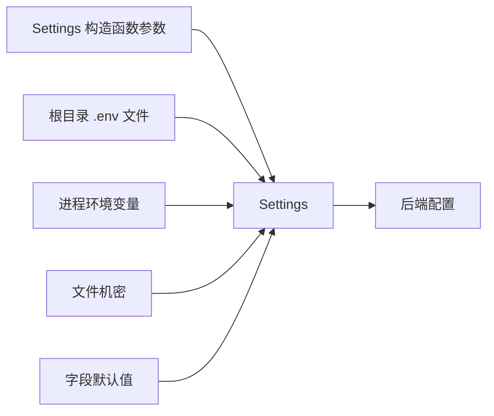

本页说明如何为本地开发配置后端，以及仓库的环境变量模板与运行时设置和 Docker Compose 之间的关系。重点介绍配置来源、支持的设置和实用的设置方法；不涉及部署架构或应用功能行为。来源：[.env.example](.env.example#L1-L44)、[config.py](backend/app/config.py#L1-L92)、[docker-compose.yml](docker-compose.yml#L1-L38)

## 配置流程

后端使用 Pydantic Settings 构造一个全局 `Settings` 实例。配置可以来自构造函数参数、根目录下的 `.env` 文件、进程环境变量或文件机密。配置的优先级为 **构造函数参数 → `.env` → 环境变量 → 文件机密 → 字段默认值**。这是有意设计的：对于同时在 `.env` 和进程环境中设置的值，`.env` 优先。相比之下，前端 Vite 配置直接在代码中设置开发服务器端口和 API 代理目标，而不读取这些后端设置。来源：[config.py](backend/app/config.py#L1-L20)、[config.py](backend/app/config.py#L64-L92)、[vite.config.ts](frontend/vite.config.ts#L1-L25)

该图展示的是可用的配置来源，而非它们具有相同的优先级：实际优先级依次为构造函数参数、`.env`、环境变量、文件机密，最后是默认值。`.env` 文件配置为 UTF-8 编码，设置名称区分大小写，无法识别的 `.env` 条目会被忽略。来源：[config.py](backend/app/config.py#L64-L92)

## 设置本地配置

1. 将 `.env.example` 复制为仓库根目录下的 `.env`，然后替换占位凭据并根据你的机器调整值。该模板提供了适用于本地开发的 LLM、SQLite 数据库、文件存储、身份验证、CORS、Whisper、日志记录和 API 端口默认值。来源：[README.md](README.md#L155-L176)、[.env.example](.env.example#L1-L44)

2. 在 `backend` 目录中，使用文档所述的开发命令启动后端。设置加载器指定使用 `env_file=".env"`；由于未指定其他路径，请确保从进程的工作目录可以找到 `.env` 文件。仓库文档中的启动流程会从 `backend` 运行后端，而示例文件位于仓库根目录；选择 `.env` 文件的放置位置或进程启动方式时，请考虑这一路径差异。来源：[README.md](README.md#L155-L176)、[config.py](backend/app/config.py#L64-L72)

3. 使用 Compose 时，准备好 `.env` 后，从仓库根目录运行 `docker compose up -d`。Compose 会从主机环境或其 `.env` 文件中插值选定的值，并将这些值传递给 API 容器；它还会明确设置容器的数据库和存储路径。来源：[README.md](README.md#L177-L190)、[docker-compose.yml](docker-compose.yml#L9-L38)

## 设置参考

此表区分了模板中记录的值和后端中另外声明的设置。下列默认值和可接受值均由 `Settings` 定义；加载模板时，模板值可能会覆盖对应的默认值。来源：[.env.example](.env.example#L1-L44)、[config.py](backend/app/config.py#L20-L63)

| 类别 | 设置 | 后端默认值 / 可接受值 | 备注 |
|---|---|---|---|
| 运行时 | `ENV` | `development`；`development`、`staging`、`production` | 由后端声明；未列于 `.env.example`。 |
| 运行时 | `LOG_LEVEL` | `INFO`；`DEBUG`、`INFO`、`WARNING`、`ERROR` | 还会在启动时配置应用日志记录。 |
| 运行时 | `API_PORT` | `8000` | 在模板和后端设置中均有声明。 |
| LLM | `LLM_PROVIDER` | `deepseek`；`deepseek`、`qwen`、`glm` | 提供商选择仅限于这些值。 |
| LLM | `OPENAI_API_KEY` | 占位字符串 | 为 LLM 调用提供有效的提供商密钥。 |
| LLM | `OPENAI_BASE_URL` | `https://api.deepseek.com/v1` | 与 OpenAI 兼容的 API 基础 URL。 |
| LLM | `LLM_MODEL` | `deepseek-chat` | 模型名称为字符串。 |
| LLM | `LLM_TEMPERATURE` | `0.1` | 数值设置。 |
| LLM | `LLM_TIMEOUT_SECONDS` | `60` | 后端设置；未列于模板中。 |
| LLM | `LLM_MAX_RETRIES` | `3` | 后端设置；未列于模板中。 |
| 数据库 | `DATABASE_URL` | `sqlite:///./interview.db` | 模板使用 `sqlite:///./backend/interview.db`；Compose 会在容器内将其覆盖为 `sqlite:///./interview.db`。 |
| 数据库 | `DB_ECHO` | `false` | 后端设置；未列于模板中。 |
| 存储 | `STORAGE_PATH` | `./storage` | 模板使用 `./backend/storage`；Compose 会将其覆盖为 `/app/storage`。 |
| 存储 | `MAX_FILE_SIZE_MB` | `50` | 后端设置；未列于模板中。 |
| 身份验证 | `JWT_SECRET_KEY` | 占位字符串 | 请替换为强随机密钥；模板建议至少使用 32 字节。 |
| 身份验证 | `JWT_ALGORITHM` | `HS256` | 模板与后端默认值一致。 |
| 身份验证 | `JWT_ACCESS_TOKEN_EXPIRE_HOURS` | `24` | 模板与后端默认值一致。 |
| 身份验证 | `JWT_REFRESH_TOKEN_EXPIRE_DAYS` | `7` | 模板与后端默认值一致。 |
| CORS | `CORS_ORIGINS` | `http://localhost:5173`、`http://localhost:8000`、`http://127.0.0.1:5173` | 解析为字符串列表。模板将该值表示为 JSON 风格的数组。 |
| 候选对象访问 | `CANDIDATE_TOKEN_LENGTH` | `32` | 模板与后端默认值一致。 |
| 语音 | `WHISPER_MODEL` | `base`；`tiny`、`base`、`small`、`medium`、`large`、`large-v3` | 模板中可选的 `large-v3` 选项受支持。 |
| 语音 | `WHISPER_DEVICE` | `auto`；`auto`、`cpu`、`cuda` | 模板记录了可用的设备选项。 |
| 语音 | `WHISPER_TIMEOUT_SECONDS` | `300` | 后端设置；未列于模板中。 |

来源：[.env.example](.env.example#L1-L44)、[config.py](backend/app/config.py#L20-L63)

## 传递给 Docker Compose 的值

Compose 不会将所有后端设置都传递给 API 容器。其 `environment` 部分会明确转发 LLM 提供商和密钥、基础 URL、模型、JWT 密钥和算法、日志级别、Whisper 模型和设备，以及 CORS 源。它会将 `DATABASE_URL` 和 `STORAGE_PATH` 设置为容器专用值。因此，除非通过其他机制提供其他后端设置，否则这些设置可能会使用代码中的默认值。来源：[docker-compose.yml](docker-compose.yml#L9-L38)、[config.py](backend/app/config.py#L20-L63)

Compose 会为 `LLM_PROVIDER`、`LLM_MODEL`、`JWT_ALGORITHM`、`LOG_LEVEL`、`WHISPER_MODEL`、`WHISPER_DEVICE` 和 `CORS_ORIGINS` 提供回退值。在 Compose 表达式中，它不会为 `OPENAI_API_KEY`、`OPENAI_BASE_URL` 或 `JWT_SECRET_KEY` 提供回退值。模板中的 `API_PORT` 不用于设置 API 容器发布的端口参数，该端口以 `8000:8000` 写入。来源：[docker-compose.yml](docker-compose.yml#L19-L38)、[.env.example](.env.example#L1-L44)

## 本地安全与故障排查

将真实凭据保存在 `.env` 中，而不是 `.env.example` 中：`.gitignore` 会排除 `.env`、`.env.local` 和 `.env.*.local`，而模板中包含的是占位值。分享配置前，请确认 API 密钥和 JWT 密钥没有被复制到已跟踪的文件中。来源：[.gitignore](.gitignore#L1-L8)、[.env.example](.env.example#L1-L3)

如果某项设置看起来没有生效，请先检查来源优先级：已加载的 `.env` 值会覆盖相同的进程环境变量，而通过构造函数传入的值会同时覆盖两者。接下来检查进程工作目录，因为后端使用相对路径 `.env`，即 `.env`。最后确认设置名称和类型：名称区分大小写，数值设置和受约束的设置会根据其声明类型进行验证，设置模型会忽略额外设置。来源：[config.py](backend/app/config.py#L64-L92)

要继续完成入门步骤，请阅读[系统架构与组件边界](6-system-architecture-and-component-boundaries)，了解配置的使用位置；然后参阅[Docker Compose、Nginx 与支持 SSE 的部署](30-docker-compose-nginx-and-sse-aware-deployment)，获取面向部署的指导。来源：[config.py](backend/app/config.py#L20-L63)、[docker-compose.yml](docker-compose.yml#L1-L8)
