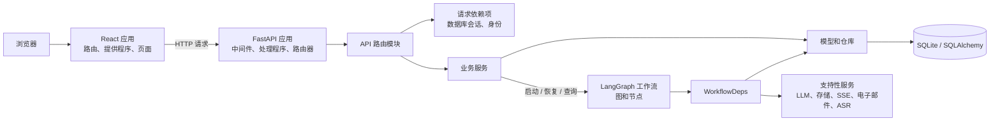
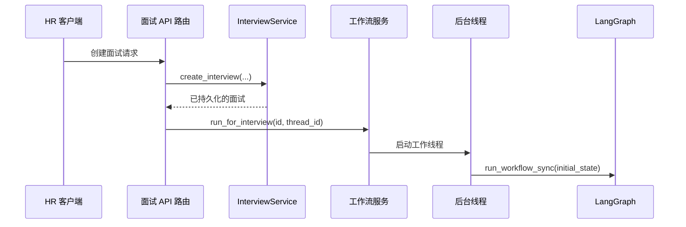

本页说明仓库如何在 React 客户端、FastAPI 应用、业务服务、持久化层和面试工作流之间划分职责。重点是**组件边界和运行时关系**，而非详细的 API 契约、数据关系、工作流节点语义或部署操作；这些主题在目录中的其他专门页面中介绍。架构依据来自应用入口、路由聚合、依赖项设置和工作流构建。来源：[main.py](backend/app/main.py#L129-L200)、[router.py](backend/app/api/router.py#L1-L18)、[main.tsx](frontend/src/main.tsx#L1-L15)

## 架构假设

系统采用**Web 客户端和 API 后端**的组织方式，并由独立的工作流子系统支持面试自动化。前端负责路由选择和用户界面组合；后端应用负责 HTTP 入口和请求级事项；服务负责协调业务操作；模型和仓库提供面向数据库的访问；LangGraph 工作流则单独组装，并显式提供其节点依赖项。这是代码中可见的逻辑分离，并不意味着每个模块都作为独立服务运行。来源：[routes.tsx](frontend/src/routes.tsx#L18-L44)、[main.py](backend/app/main.py#L129-L200)、[interview_service.py](backend/app/services/interview_service.py#L21-L29)、[graph.py](backend/app/workflow/graph.py#L31-L57)

该图展示了观察到的模块关系：API 路由会构造服务并使用请求依赖项，而工作流图会接收 `WorkflowDeps` 对象，该对象将面向数据库的仓库和支持性协作组件组合在一起。这并不意味着每个路由都会使用每个依赖项，也不意味着每个服务都会与每个集成组件通信。来源：[interviews.py](backend/app/api/interviews.py#L12-L29)、[deps.py](backend/app/deps.py#L21-L26)、[dependencies.py](backend/app/workflow/dependencies.py#L19-L56)、[graph.py](backend/app/workflow/graph.py#L31-L55)

## 前端边界：应用外壳和路由

前端从 `main.tsx` 启动，由 React 在路由器外部渲染 `App` 外壳。`App` 提供顶层错误边界、身份验证上下文和通知界面。路由定义集中在 `routes.tsx`：登录和候选人门户路由是公开的，而 HR 路由则嵌套在身份验证保护和共享应用布局之下。这些文件界定了前端的组合边界；它们并未定义后端的业务规则。来源：[main.tsx](frontend/src/main.tsx#L1-L15)、[App.tsx](frontend/src/App.tsx#L9-L24)、[routes.tsx](frontend/src/routes.tsx#L18-L44)

| 前端区域 | 已确认的职责 | 架构边界 |
|---|---|---|
| 应用入口 | 挂载 React 树，并提供应用外壳和路由器。 | 浏览器端启动和组合。 |
| 应用外壳 | 使用错误和身份验证提供程序以及全局 toaster 包装子组件。 | 应用级共享事项。 |
| 路由配置 | 将公开和受保护的路径映射到页面组件。 | 客户端导航和页面选择。 |

来源：[main.tsx](frontend/src/main.tsx#L9-L15)、[App.tsx](frontend/src/App.tsx#L15-L23)、[routes.tsx](frontend/src/routes.tsx#L18-L44)

## 后端边界：应用、路由和请求依赖项

`main.py` 是 FastAPI 应用边界。它负责配置应用和 CORS、注册异常处理程序、纳入聚合后的 API 路由器，并提供健康检查。其 lifespan 函数还会协调启动和关闭任务，包括数据库初始化、存储目录创建、可选的 Whisper 模型加载以及调度程序生命周期管理。这些属于应用生命周期职责，而非特定路由的业务逻辑。来源：[main.py](backend/app/main.py#L37-L126)、[main.py](backend/app/main.py#L129-L200)

`api/router.py` 是路由组合点：它汇集身份验证、职位、候选人、面试、候选人门户和事件路由器。各个路由模块定义 HTTP 操作，并将请求数据连接到服务调用。例如，面试路由将数据库会话和当前用户声明为 FastAPI 依赖项，然后为所请求的操作构造 `InterviewService`。来源：[router.py](backend/app/api/router.py#L6-L18)、[interviews.py](backend/app/api/interviews.py#L29-L51)

依赖项模块是请求边界适配器。其中，`get_db` 生成数据库会话，`get_current_user` 解析并检查 bearer-token 用户，`get_current_candidate` 根据令牌解析面试，而 SSE 依赖项则返回管理器实例。这些函数使路由可以使用共享请求上下文，而无需在每个路由处理程序中嵌入这些机制。来源：[deps.py](backend/app/deps.py#L21-L26)、[deps.py](backend/app/deps.py#L28-L68)、[deps.py](backend/app/deps.py#L84-L108)

## 服务和持久化边界

服务位于路由处理程序与面向持久化的模型/仓库之间。在面试示例中，路由会使用数据库会话和操作者标识符创建一个 `InterviewService`。该服务持有面试仓库和审计仓库，并在验证和创建面试时协调相关仓库。因此，服务是可见的多步骤业务操作位置，而路由仍负责 HTTP 输入和响应构造。来源：[interviews.py](backend/app/api/interviews.py#L62-L95)、[interview_service.py](backend/app/services/interview_service.py#L21-L29)、[interview_service.py](backend/app/services/interview_service.py#L73-L130)

数据库设置集中在 `database.py` 中：它定义 SQLAlchemy 基类、引擎、会话工厂、请求范围的会话生成器和表初始化。该模块在初始化期间导入仓库/模型，以便在元数据创建表之前注册映射实体。此数据库边界由请求依赖项以及其他显式创建会话的后端组件共用。来源：[database.py](backend/app/database.py#L19-L24)、[database.py](backend/app/database.py#L25-L73)、[database.py](backend/app/database.py#L76-L95)

## 工作流边界：单独组装的自动化

面试自动化由工作流子系统表示，而非并入 HTTP 路由层。面试创建端点在服务创建面试后会调用 `run_for_interview`；该函数会在后台线程上启动任务，准备初始状态，然后调用图。这是从路由到工作流的具体交接，而工作流服务负责异步启动边界。来源：[interviews.py](backend/app/api/interviews.py#L62-L95)、[workflow_service.py](backend/app/services/workflow_service.py#L79-L139)

`graph.py` 定义图的节点和边结构，并在构建图时接收 `WorkflowDeps`。依赖对象组合了会话、仓库、文件存储、SSE 管理器和提示渲染器。这种显式的依赖组装建立了可测试的边界：构建图时可以传入替代依赖项，而生产环境中的构建则可以从数据库会话组装依赖项。来源：[graph.py](backend/app/workflow/graph.py#L31-L57)、[graph.py](backend/app/workflow/graph.py#L81-L102)、[dependencies.py](backend/app/workflow/dependencies.py#L19-L56)

此序列仅涉及面试路由和工作流服务中可见的创建路径。路由还会尝试发送邀请电子邮件；此处省略该副作用，因为该图旨在展示工作流交接，而非请求中的每项操作。来源：[interviews.py](backend/app/api/interviews.py#L71-L87)、[workflow_service.py](backend/app/services/workflow_service.py#L81-L139)

## 跨组件交互

主要的边界交互包括**浏览器到 API**、**路由到服务**、**服务到持久化层**以及**应用到工作流**。API 应用集中处理 HTTP 级设置；路由模块将 HTTP 输入和依赖项适配为服务调用；服务通过仓库协调业务操作；工作流编排则通过自身的图和注入式依赖项运行。后端中还存在电子邮件、文件存储、LLM、ASR 和 SSE 等支持模块，但其内部契约不在本页讨论范围内。来源：[main.py](backend/app/main.py#L129-L200)、[interviews.py](backend/app/api/interviews.py#L62-L95)、[interview_service.py](backend/app/services/interview_service.py#L21-L29)、[dependencies.py](backend/app/workflow/dependencies.py#L19-L32)

| 边界 | 调用方 | 接收方 | 基于证据的职责 |
|---|---|---|---|
| 客户端 → API | React 应用 | FastAPI 路由 | 前端挂载路由器；后端注册 API 路由器。 |
| 路由 → 服务 | API 处理程序 | 业务服务 | 面试处理程序会实例化并调用 `InterviewService`。 |
| 服务 → 持久化层 | 业务服务 | 模型/仓库和会话 | 服务使用提供的会话调用仓库。 |
| 工作流启动 | 面试路由 | 工作流服务 | 创建面试会触发工作流启动器。 |
| 图 → 协作组件 | LangGraph 节点 | `WorkflowDeps` | 构建图时会将依赖项绑定到节点。 |

来源：[main.tsx](frontend/src/main.tsx#L9-L15)、[main.py](backend/app/main.py#L189-L200)、[interviews.py](backend/app/api/interviews.py#L71-L84)、[interview_service.py](backend/app/services/interview_service.py#L21-L29)、[graph.py](backend/app/workflow/graph.py#L42-L55)、[dependencies.py](backend/app/workflow/dependencies.py#L19-L32)

## 接下来阅读

若要了解领域实体及其关系，请继续阅读[招聘领域模型与数据关系](7-recruitment-domain-model-and-data-relationships)。若要了解工作流的生命周期和图执行详情，请继续阅读[面试工作流状态与生命周期](10-interview-workflow-state-and-lifecycle)和[LangGraph 节点、中断与恢复语义](11-langgraph-nodes-interrupts-and-resume-semantics)。若要了解前端特定职责，请参阅[React 应用入口、路由和页面职责](22-react-application-entry-routing-and-page-responsibilities)。来源：[routes.tsx](frontend/src/routes.tsx#L18-L44)、[graph.py](backend/app/workflow/graph.py#L42-L55)、[workflow_service.py](backend/app/services/workflow_service.py#L79-L88)
