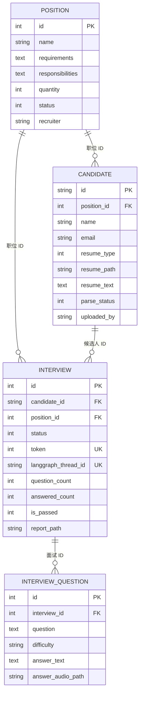

本页说明后端 ORM 模型所表示的招聘记录：**职位**、**候选人**、**面试**和**面试问题**，以及提供操作上下文的用户和审计记录。本页聚焦于实体边界、键和持久化关系，而非 API 行为、工作流执行或数据库操作。来源：[candidate.py](backend/app/models/candidate.py#L19-L46)、[position.py](backend/app/models/position.py#L15-L39)、[interview.py](backend/app/models/interview.py#L25-L75)、[interview_question.py](backend/app/models/interview_question.py#L18-L53)、[user.py](backend/app/models/user.py#L15-L28)、[audit_log.py](backend/app/models/audit_log.py#L25-L51)

## 用一张图了解领域模型

核心关系是**职位–候选人–面试链**：候选人引用职位，面试同时引用候选人和职位。面试拥有其问题记录。用户和审计日志属于相关的操作概念，但所检查的模型没有声明将它们与招聘记录相连的 ORM 关系。来源：[candidate.py](backend/app/models/candidate.py#L23-L24)、[interview.py](backend/app/models/interview.py#L31-L32)、[interview_question.py](backend/app/models/interview_question.py#L22-L23)、[user.py](backend/app/models/user.py#L15-L28)、[audit_log.py](backend/app/models/audit_log.py#L25-L51)

该图表示模型中体现的外键结构：一个职位可以被多个候选人和面试引用；一个候选人可以被多个面试引用；一个面试可以有多个问题。这些是对架构层级关系的解读；所示模型声明了外键，但没有为这些关联配置 SQLAlchemy `relationship()` 属性。来源：[candidate.py](backend/app/models/candidate.py#L23-L24)、[interview.py](backend/app/models/interview.py#L31-L32)、[interview_question.py](backend/app/models/interview_question.py#L22-L23)、[position.py](backend/app/models/position.py#L15-L39)

## 核心招聘实体

| 实体 | 标识符和关联 | 领域数据 | 持久化状态或进度 |
|---|---|---|---|
| **职位** | 整数主键 `id` | 名称、要求、职责、招聘人数、可选的招聘人员姓名 | `status`：0 未开始，1 进行中，2 已完成 |
| **候选人** | 字符串主键 `id`；`position_id` 引用 `positions.id` | 姓名、电子邮件、简历格式及内容/路径、提取的简历文本 | `parse_status`：0 待处理，1 解析中，2 成功，3 失败 |
| **面试** | 整数主键 `id`；外键指向候选人和职位 | 面试官、计划开始/结束时间戳、候选人令牌、工作流线程标识符、报告内容/路径 | `status`：0 未开始，1 问题已就绪，2 进行中，3 已完成，4 报告已生成 |
| **面试问题** | 整数主键 `id`；`interview_id` 引用 `interviews.id` | 问题文本、可选评分标准、难度、答案文本和音频内容/路径 | 是否有答案通过 `answered_at` 表示；没有单独的问题状态字段 |

上述代码记录在模型注释中。它们是由整数承载的字段，而非声明的枚举类型，因此使用方应将记录的值视为应用程序编码的约定，而不是数据库枚举约束。来源：[position.py](backend/app/models/position.py#L26-L28)、[candidate.py](backend/app/models/candidate.py#L34-L43)、[interview.py](backend/app/models/interview.py#L40-L43)、[interview_question.py](backend/app/models/interview_question.py#L40-L51)

### 职位和候选人

职位存储岗位定义和招聘上下文：名称、文本形式的要求和职责、招聘人数、状态以及可选的招聘人员标签。候选人存储身份和简历相关信息，其中包括必填的职位引用。候选人简历数据既支持旧版二进制字段，也支持文件路径，并包含提取的文本和解析元数据。来源：[position.py](backend/app/models/position.py#L15-L39)、[candidate.py](backend/app/models/candidate.py#L19-L46)

候选人模型注释将 `uploaded_by` 标识为 HR 用户 ID，但该字段是普通字符串列，并非指向 `users.id` 的已声明外键。同样，`Position.recruiter` 是一个可空字符串，描述为 HR 用户名。这些字段提供归属信息，但模型定义不会强制建立与用户表的引用关系。来源：[candidate.py](backend/app/models/candidate.py#L42-L46)、[position.py](backend/app/models/position.py#L32-L34)、[user.py](backend/app/models/user.py#L15-L28)

### 面试和问题

面试关联候选人和职位，并包含自身的生命周期数据、日程时间戳、进度计数器、可选的通过结果、语音朗读设置以及报告存储字段。面向候选人的唯一 `token` 和唯一 `langgraph_thread_id` 持久化在面试记录上。来源：[interview.py](backend/app/models/interview.py#L25-L75)

每个面试问题通过 `interview_id` 归属于一个面试。记录将生成的问题内容和可选评分指导，与候选人的答案文本、答案音频存储及答案时间戳结合起来。难度以字符串存储；模型注释列出了 `hard`、`medium` 和 `easy`，其中 `medium` 是模型默认值。来源：[interview_question.py](backend/app/models/interview_question.py#L18-L53)

面试还将部分从问题派生的信息作为摘要字段重复保存：`question_count`、`answered_count` 以及按难度统计的数量。这些值存储在 `Interview` 上，而单个问题及其答案时间戳存储在 `InterviewQuestion` 中。因此，模型同时表示详细的问题记录和面试级别的进度/摘要字段；仅凭这些声明无法确定它们之间存在自动同步规则。来源：[interview.py](backend/app/models/interview.py#L45-L50)、[interview_question.py](backend/app/models/interview_question.py#L18-L53)

## 支持记录：用户和审计日志

`User` 表示 HR/管理员账户，包含字符串 ID、唯一用户名和电子邮件、密码哈希、可选全名、激活/管理员标志以及账户时间戳。其模型没有定义与职位、候选人、面试或审计日志的关系。来源：[user.py](backend/app/models/user.py#L15-L28)

`AuditLog` 存储事件类型、可选的面试/候选人/用户标识符值、操作者身份和类型、JSON 元数据以及发生时间。这三个资源标识符列是可空的索引值，而不是该模型中已声明的外键。因此，该记录可以携带对招聘资源的引用，但 ORM 架构不会强制这些引用有效。来源：[audit_log.py](backend/app/models/audit_log.py#L25-L51)

## 开发者应保留的架构细节

不同实体的主键类型各不相同：职位、面试、问题和审计日志使用整数主键；候选人和用户使用字符串主键。外键列与被引用键的类型一致——`Candidate.position_id` 和 `Interview.position_id` 是整数，而 `Interview.candidate_id` 是字符串。来源：[position.py](backend/app/models/position.py#L17-L18)、[candidate.py](backend/app/models/candidate.py#L23-L24)、[interview.py](backend/app/models/interview.py#L29-L32)、[interview_question.py](backend/app/models/interview_question.py#L20-L23)、[user.py](backend/app/models/user.py#L17-L18)、[audit_log.py](backend/app/models/audit_log.py#L27-L29)

若干载荷同时具有二进制内容字段和文件路径字段：候选人简历、面试报告以及问题答案音频。模型注释将二进制列描述为旧版或兼容性存储，将路径列描述为较新的文件存储方式。读取或写入这些资源的代码应兼顾这两种表示，而不要假设每条记录都只采用其中一种。来源：[candidate.py](backend/app/models/candidate.py#L28-L31)、[interview.py](backend/app/models/interview.py#L59-L63)、[interview_question.py](backend/app/models/interview_question.py#L32-L36)

时间戳通常以整数 Unix 秒级时间戳存储。模型声明还在事件可能尚未发生时使用可空时间戳字段，包括面试结束时间、候选人解析时间和问题答案时间。来源：[position.py](backend/app/models/position.py#L35-L39)、[candidate.py](backend/app/models/candidate.py#L38-L46)、[interview.py](backend/app/models/interview.py#L34-L36)、[interview_question.py](backend/app/models/interview_question.py#L48-L53)

## 后续阅读

如需了解应用程序组件之间的边界，请继续阅读[系统架构与组件边界](6-system-architecture-and-component-boundaries)。如需了解端点级请求和响应结构，请参阅[API 契约、验证与错误处理](8-api-contracts-validation-and-error-handling)。如需了解面试生命周期语义，请继续阅读[面试工作流状态与生命周期](10-interview-workflow-state-and-lifecycle)。来源：[candidate.py](backend/app/models/candidate.py#L19-L46)、[interview.py](backend/app/models/interview.py#L40-L50)
