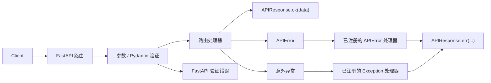

本页说明 FastAPI 后端如何定义请求和响应契约、应用验证，以及将应用错误转换为 HTTP 响应。重点在于 API 边界：路由声明、Pydantic 模型、共享响应封装和异常处理。身份验证机制以及更广泛的服务/数据架构在其他页面单独介绍：[身份验证、授权和候选人访问](9-authentication-authorization-and-candidate-access)和[服务层、存储库与数据库会话](17-service-layer-repositories-and-database-sessions)。来源：[main.py](backend/app/main.py#L1-L30)、[router.py](backend/app/api/router.py#L1-L18)

## 契约模型

API 边界有三项不同的职责：路由器声明路径和传输细节；Pydantic 模型描述 JSON 请求和响应的结构；共享封装和异常处理器规范化处理结果。应用会在 `/api` 下注册功能路由，而 `/healthz` 是单独的存活探测端点。来源：[router.py](backend/app/api/router.py#L1-L18)、[main.py](backend/app/main.py#L175-L249)

成功路径使用 `APIResponse[T]` 明确建模：成功时，`code` 为 `0`，`msg` 携带消息，`request_id` 默认生成，`data` 包含端点负载。`ok` 工厂会构造此封装。应用注册的处理器也会为 `APIError` 和未处理异常使用此封装，不过，所示处理器并未明确规范化由框架生成的请求验证错误。来源：[response.py](backend/app/schemas/response.py#L1-L39)、[main.py](backend/app/main.py#L137-L173)

| 契约元素 | 职责 | 可观察行为 |
|---|---|---|
| 路由器 | HTTP 方法、路径、查询/表单/文件输入、依赖项、响应模型 | 定义端点级传输契约 |
| Pydantic 请求模式 | JSON 请求体结构和字段类型 | FastAPI 会解析并验证已声明的请求体 |
| Pydantic 响应模式 | 响应负载结构 | 在路由边界由 `response_model` 和 `model_validate` 使用 |
| `APIResponse[T]` | 通用成功/错误封装 | 提供 `code`、`msg`、`request_id` 和 `data` |
| `APIError` | 应用定义的失败 | 将错误代码映射到 HTTP 状态，并由应用处理器序列化 |

来源：[response.py](backend/app/schemas/response.py#L13-L39)、[errors.py](backend/app/core/errors.py#L1-L55)、[positions.py](backend/app/api/positions.py#L20-L43)

## 请求和响应结构模式

JSON 请求体契约通过 Pydantic 模型声明。例如，创建职位接受 `PositionCreate` 请求体，而更新职位接受字段均为可选的 `PositionUpdate` 模型。响应封装在 `APIResponse[PositionOut]` 中；列表端点返回分页负载，其中包含 `items`、`total`、`page` 和 `page_size`。来源：[position.py](backend/app/schemas/position.py#L9-L48)、[positions.py](backend/app/api/positions.py#L46-L82)

| 端点模式 | 输入契约 | 输出契约 |
|---|---|---|
| 列出职位 | 查询参数：可选的状态、页码、每页数量 | `APIResponse[PositionListResponse]` |
| 创建职位 | JSON `PositionCreate` | `APIResponse[PositionOut]`，HTTP 201 |
| 更新职位 | JSON `PositionUpdate` | `APIResponse[PositionOut]` |
| 上传候选人 | 多部分表单字段和必需文件 | `APIResponse[CandidateCreateResponse]`，HTTP 201 |
| 提交候选人答案 | 多部分问题 ID 和必需音频文件 | `APIResponse[SubmitAnswerResponse]` |
| 下载面试报告 | 路径 ID；未声明响应模型 | 原始 PDF 响应，不使用 JSON 封装 |

这些端点结构不能互换：报告下载通过 `application/pdf` 返回二进制内容，而 JSON CRUD 路由声明了封装响应模型。来源：[positions.py](backend/app/api/positions.py#L26-L82)、[candidates.py](backend/app/api/candidates.py#L31-L57)、[candidate_portal.py](backend/app/api/candidate_portal.py#L105-L117)、[interviews.py](backend/app/api/interviews.py#L169-L189)

多部分端点会在 FastAPI 声明中直接表达传输层面的必需性和部分约束。候选人上传要求提供 `name`、`email`、`position_id` 和 `resume`；声明了最小字符串长度和正数职位 ID。随后，端点会检查文件魔数以确认文件为 PDF 或 DOCX，并拒绝超过 50 MiB 的内容。提交候选人答案时，`question_id` 和 `audio_answer` 均为必需项。来源：[candidates.py](backend/app/api/candidates.py#L31-L78)、[candidate_portal.py](backend/app/api/candidate_portal.py#L105-L117)

## API 边界的验证

FastAPI 参数声明为查询和表单输入提供基本约束。例如，职位列表会将 `status` 限定在 0–2，将 `page` 限定为至少 1，并将 `page_size` 限定在 1–100。面试列表也会将 `status` 限定在 0–4，并对分页值设定范围。这些声明使允许的范围在路由契约和 OpenAPI 元数据中清晰可见。来源：[positions.py](backend/app/api/positions.py#L26-L35)、[interviews.py](backend/app/api/interviews.py#L27-L43)

Pydantic 模式模型定义字段类型和可选性，但所示模式并未对每个业务值都应用字段级范围或字符串约束。例如，`PositionBase` 将 `quantity` 和 `status` 定义为整数，但未声明取值范围；`InterviewCreate` 将 `position_id`、`start_time` 和 `is_passed` 定义为可选值，但没有附加约束。不要推断模式具有未声明的更严格验证。来源：[position.py](backend/app/schemas/position.py#L9-L28)、[interview.py](backend/app/schemas/interview.py#L9-L24)

如果某项规则取决于文件内容或持久化状态，处理器内部也会执行验证。候选人上传会检查文件的前几个字节，而不是信任文件名或客户端提供的媒体类型；读取上传内容后还会执行 50 MiB 的大小限制。提交答案时，会验证问题是否存在且属于当前面试，然后在 `answered_at` 已设置时拒绝再次提交答案。来源：[candidates.py](backend/app/api/candidates.py#L53-L78)、[candidate_portal.py](backend/app/api/candidate_portal.py#L118-L139)

## 错误代码和 HTTP 映射

`ErrorCode` 将应用错误划分为若干数字范围：1001–1999 表示参数/验证错误，2001–2999 表示资源缺失，3001–3999 表示业务逻辑错误，4001–4999 表示身份验证或外部服务错误，5000 表示内部错误。`get_status_code` 将这些范围映射到 HTTP 状态码，并为身份验证、不支持的媒体类型、负载大小和选定的外部服务故障设置显式覆盖。来源：[errors.py](backend/app/core/errors.py#L1-L55)、[errors.py](backend/app/core/errors.py#L57-L91)

| 错误类别 / 示例 | 默认或显式 HTTP 状态码 | 示例用途 |
|---|---:|---|
| 参数错误（`PARAM_*`） | 400 | 请求输入无效 |
| 资源缺失（`*_NOT_FOUND`） | 404 | 问题或职位不存在 |
| 业务冲突（`INVALID_STATE_TRANSITION`） | 409 | 答案已提交 |
| 凭据无效 | 401 | 登录失败 |
| 禁止访问 / 用户已禁用 | 403 | 账户未激活 |
| 文件类型不受支持 | 415 | 简历不是 PDF/DOCX 格式 |
| 文件过大 | 413 | 上传文件超过配置的限制 |
| LLM / Whisper 故障 | 502 | 外部处理失败 |
| 内部错误 | 500 | 未处理的服务器故障 |

`APIError` 是 `HTTPException` 的子类。其构造函数会存储结构化的 `detail`，其中包含数字 `code`、`msg` 和 `data`；例如 `bad_request`、`not_found`、`conflict` 和 `unauthorized` 等工厂方法会选择常见的 HTTP 状态码。全局 `APIError` 处理器会读取这些字段，并使用该异常的 HTTP 状态码返回 `APIResponse.err` 响应体。来源：[errors.py](backend/app/core/errors.py#L93-L175)、[main.py](backend/app/main.py#L137-L158)

未处理异常会记录其类型、消息、请求路径和异常信息，然后以 HTTP 500 返回，错误代码为 `INTERNAL_ERROR`，通用消息为“服务器内部错误”。此处理器不会将异常消息放入响应体。来源：[main.py](backend/app/main.py#L161-L173)

## 调用方的契约注意事项

对于 JSON 端点，调用方应同时检查 HTTP 状态码和封装中的 `code`；文档规定的成功约定是 `code == 0`，有用的数据位于 `data` 下。应用的 `APIError` 处理器生成的错误响应使用相同封装，并包含由 `APIResponse` 生成的 `request_id`。来源：[response.py](backend/app/schemas/response.py#L13-L39)、[main.py](backend/app/main.py#L137-L158)

并非所有路由都会生成 JSON。面试报告端点返回 PDF 字节并设置 `Content-Disposition`；客户端必须将其作为文件下载处理，而不是解析 `APIResponse`。候选人面试创建端点会在标准成功封装中返回标识符、令牌和状态，而异步工作流行为不属于即时响应契约。来源：[interviews.py](backend/app/api/interviews.py#L169-L189)、[interviews.py](backend/app/api/interviews.py#L53-L87)、[interview.py](backend/app/schemas/interview.py#L46-L52)

## 验证和已知边界

API 集成测试通过 FastAPI 的 `TestClient` 调用应用，覆盖数据库依赖项，并针对登录场景断言 HTTP 状态码和封装字段。这是一种实用的契约测试模式：验证外部可观察到的状态码和响应体结构，而不是只直接调用路由函数。来源：[test_api.py](backend/tests/test_api.py#L1-L73)、[test_api.py](backend/tests/test_api.py#L139-L173)

所示应用为 `APIError` 和通用 `Exception` 注册了自定义处理器，但没有为 `RequestValidationError` 注册专用处理器。因此，本页不声称 FastAPI 自身生成的请求体格式错误或参数验证响应也使用 `APIResponse` 封装；在依赖对这类错误使用统一客户端解析器之前，请先验证实际行为。来源：[main.py](backend/app/main.py#L137-L173)、[response.py](backend/app/schemas/response.py#L13-L39)

关于相邻主题，可继续阅读[身份验证、授权和候选人访问](9-authentication-authorization-and-candidate-access)，了解访问机制；然后阅读[服务层、存储库与数据库会话](17-service-layer-repositories-and-database-sessions)，了解路由处理器会将哪些工作委托给服务。来源：[router.py](backend/app/api/router.py#L1-L18)
