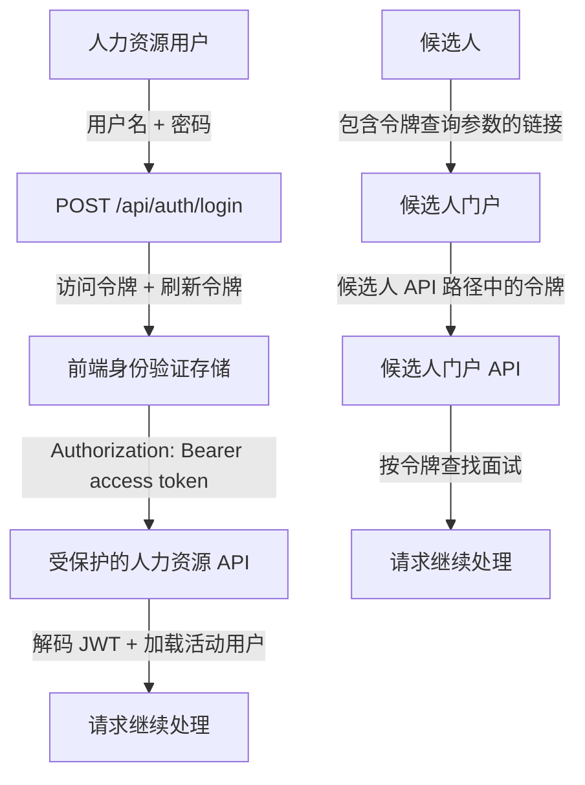

本页说明系统如何将人力资源身份验证与候选人访问分开、凭据在哪里验证，以及这些检查如何与前端连接。**人力资源端点使用基于用户的 JWT；候选人门户端点使用面试专属 URL 令牌。**代码实现了身份验证和活动账户检查，但未显示基于角色的授权执行：用户上存在 `is_admin` 字段，而检查过的路由依赖项只要求当前用户处于活动状态。来源：[security.py](backend/app/core/security.py#L1-L96) [deps.py](backend/app/deps.py#L22-L88) [user.py](backend/app/models/user.py#L14-L27)

## 两条访问路径

系统有两条不同的凭据路径。人力资源用户使用用户名和密码登录，然后在受保护的 API 请求中提供 bearer 访问令牌。候选人则通过包含唯一面试令牌的面试链接访问；候选人端点直接根据该令牌解析面试，不需要人力资源 JWT。

来源：[auth.py](backend/app/api/auth.py#L20-L152) [deps.py](backend/app/deps.py#L27-L88) [candidate_portal.py](backend/app/api/candidate_portal.py#L1-L23) [routes.tsx](frontend/src/routes.tsx#L16-L39)

## 人力资源身份验证：密码验证与 JWT

`POST /api/auth/login` 接受用户名和密码。它按用户名查找用户，并根据存储的密码哈希验证提交的密码。用户不存在和密码错误会返回相同的凭据无效响应，失败尝试会记录在审计日志中。已禁用的账户会被单独拒绝。成功时，处理程序会更新上次登录时间，记录成功的审计事件，并返回访问令牌和刷新令牌，以及用户信息。来源：[auth.py](backend/app/api/auth.py#L20-L107) [user.py](backend/app/models/user.py#L14-L27) [user.py](backend/app/models/user.py#L42-L76)

密码使用 Passlib bcrypt 上下文进行哈希和验证。JWT 将用户 ID 作为 `sub`，包含 `type` 声明，以及签发时间和到期时间戳。访问令牌和刷新令牌的有效期可配置；设置中的默认值分别为 24 小时和 7 天。`decode_token` 会验证配置的签名算法，并拒绝类型与调用方预期类型不符的令牌。来源：[security.py](backend/app/core/security.py#L19-L71) [config.py](backend/app/config.py#L35-L43)

## 人力资源路由的授权边界

`get_current_user` 依赖项是后端的人力资源身份验证关卡。它要求 `Authorization` 标头以 `Bearer ` 开头，将其余部分解码为访问令牌，读取主题，加载匹配的用户，并拒绝不存在或未处于活动状态的账户。声明此依赖项的路由会收到经过验证的 `User` 对象，并在检查过的候选人、职位、面试和事件端点中将其 ID 用作服务执行者。来源：[deps.py](backend/app/deps.py#L27-L65) [candidates.py](backend/app/api/candidates.py#L25-L44) [positions.py](backend/app/api/positions.py#L23-L44) [interviews.py](backend/app/api/interviews.py#L23-L53) [events.py](backend/app/api/events.py#L20-L34)

用户模型包含 `is_admin` 标志，但检查过的依赖项检查的是 `is_active`，而不是 `is_admin`；检查过的路由使用 `get_current_user`，且没有针对管理员的专门策略。因此，已验证的区别是已验证的活动用户与未经验证或未处于活动状态的用户，而不是已展示的管理员与标准用户权限系统。来源：[user.py](backend/app/models/user.py#L14-L27) [deps.py](backend/app/deps.py#L27-L65) [positions.py](backend/app/api/positions.py#L23-L44)

## 候选人访问：面试范围内的 URL 令牌

面试会存储一个唯一令牌。仓库在创建面试时会生成令牌，除非显式提供令牌；默认长度来自配置，生成器从 ASCII 字母和数字中使用 `secrets.choice` 选取字符。数据库列同时具有唯一约束和索引。面试创建端点会返回令牌，并将其作为 `token` 查询参数构建邀请 URL。来源：[security.py](backend/app/core/security.py#L74-L96) [config.py](backend/app/config.py#L49-L51) [interview.py](backend/app/models/interview.py#L52-L57) [interview.py](backend/app/models/interview.py#L118-L145) [interviews.py](backend/app/api/interviews.py#L62-L108)

候选人门户 API 路由会将该凭据放在 URL 路径中，例如 `/api/candidate/{token}/info`。`get_current_candidate` 会拒绝空令牌，查找令牌完全匹配的面试；如果没有匹配项，则返回未找到错误。它不会解码 JWT，也不要求人力资源用户。随后，门户处理程序会针对已解析的面试执行操作；提交答案时还会验证所请求的问题属于该面试，并且尚未回答。来源：[deps.py](backend/app/deps.py#L68-L88) [candidate_portal.py](backend/app/api/candidate_portal.py#L20-L24) [candidate_portal.py](backend/app/api/candidate_portal.py#L105-L136)

候选人令牌通过持有 URL 凭据来授予访问权限。在检查过的依赖项中，访问权限取决于令牌能否解析到某个面试；没有显示单独的候选人登录或额外的到期检查。请妥善处理该链接：避免不必要地暴露它，也不要将面试的工作流状态视为额外的身份验证边界。来源：[deps.py](backend/app/deps.py#L68-L88) [interview.py](backend/app/models/interview.py#L52-L57)

## 前端行为与请求生命周期

前端使用 `interview_auth` localStorage 键保存人力资源身份验证状态。`AuthContext` 会在启动时恢复已存储的用户，`AuthGuard` 会在恢复期间显示加载状态；对于未通过身份验证的访问者，它会将其重定向到 `/login`，并在重定向参数中保留当前路径名。路由器将 `/login` 和 `/candidate-portal` 保持为公开路由，同时将人力资源应用路由嵌套在 `AuthGuard` 下。来源：[auth.ts](frontend/src/lib/auth.ts#L1-L62) [AuthContext.tsx](frontend/src/contexts/AuthContext.tsx#L23-L68) [AuthGuard.tsx](frontend/src/components/AuthGuard.tsx#L16-L35) [routes.tsx](frontend/src/routes.tsx#L16-L39)

API 客户端会读取已存储的访问令牌，并将其作为 bearer 标头添加到请求中。收到 HTTP 401 响应时，如果存在刷新令牌，它会尝试刷新一次，存储返回的令牌状态，并重试原始请求。如果刷新失败，它会清除本地身份验证状态并导航到 `/login`。对 `/api/auth/` 的请求不会进入此刷新分支。存储模块明确指出，localStorage 在 XSS 场景下可能被窃取，并将 HttpOnly cookie 列为未来可能采用的替代方案；这是对当前实现所记录权衡的描述，并不表示已实现 cookie 流程。来源：[client.ts](frontend/src/api/client.ts#L33-L88) [auth.ts](frontend/src/lib/auth.ts#L1-L62)

候选人门户会从页面查询字符串中读取 `token`，并将其传递给候选人门户 API。其公开路由不依赖人力资源 `AuthGuard`；后端会通过面试查找依赖项，在每个候选人端点上验证令牌。来源：[CandidatePortalPage.tsx](frontend/src/pages/CandidatePortalPage.tsx#L25-L53) [routes.tsx](frontend/src/routes.tsx#L16-L21) [candidate_portal.py](backend/app/api/candidate_portal.py#L20-L24) [deps.py](backend/app/deps.py#L68-L88)

## 刷新与实现限制

`POST /api/auth/refresh` 会将提交的凭据专门解码为刷新令牌，获取其主题，并检查对应用户是否存在且处于活动状态。随后，它会签发新的访问令牌和新的刷新令牌。检查过的实现没有显示刷新令牌撤销机制，也没有显示存储在服务器端的轮换状态；展示的验证仅包括 JWT 签名、类型和到期时间检查，以及当前用户查找。来源：[auth.py](backend/app/api/auth.py#L110-L152) [security.py](backend/app/core/security.py#L49-L71)

前端路由保护是改善用户体验的防护措施，不能替代后端身份验证：受保护的 API 处理程序会独立声明 `get_current_user`。反过来，候选人访问是独立的凭链接 bearer 机制，不应与人力资源授权混淆。如需了解相邻的实现背景，请继续阅读[API 合约、验证与错误处理](8-api-contracts-validation-and-error-handling)和[API 客户端、身份验证状态与请求处理](23-api-client-authentication-state-and-request-handling)。来源：[AuthGuard.tsx](frontend/src/components/AuthGuard.tsx#L16-L35) [interviews.py](backend/app/api/interviews.py#L23-L53) [deps.py](backend/app/deps.py#L27-L88)
