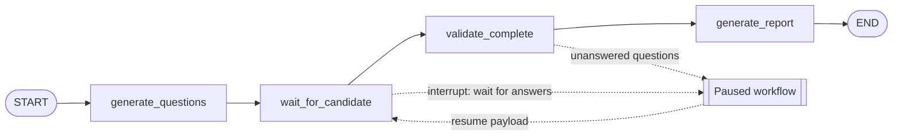
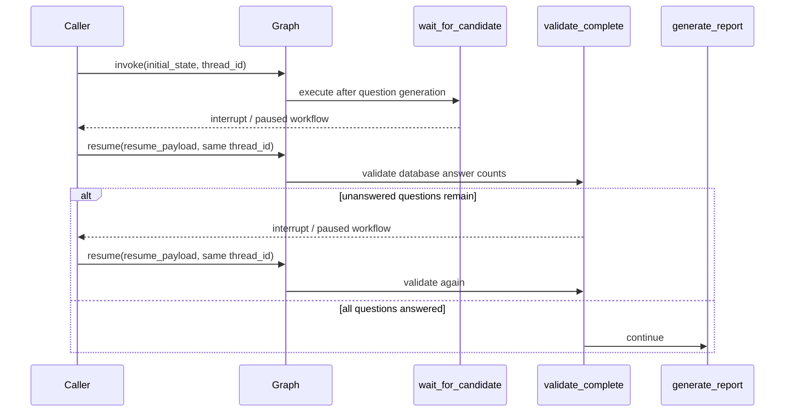

The interview workflow is a **checkpointed, interruptible state machine**: it generates questions, pauses while the candidate answers, verifies that answers are complete, and then generates a report. Its shared `InterviewState` carries workflow data between nodes; each node returns only the fields it updates. This page focuses on that state model and lifecycle, not on persistence internals, API behavior, or the implementation of individual LangGraph primitives.  
Sources: [state.py](backend/app/workflow/state.py#L25-L55) [graph.py](backend/app/workflow/graph.py#L42-L55)

## State model

`InterviewState` is a `TypedDict` declared with `total=False`, so fields are optional at the type level. The state is grouped by purpose: interview and participant identifiers; inputs for question generation; generated questions and difficulty counts; answer-progress fields; report outputs; and error details. Nested question and answer shapes are also declared as `TypedDict`s, but they are not required fields.  
Sources: [state.py](backend/app/workflow/state.py#L9-L23) [state.py](backend/app/workflow/state.py#L25-L55)

| State group | Fields | Role in the lifecycle |
|---|---|---|
| Identity | `interview_id`, `langgraph_thread_id`, `candidate_id`, `position_id` | Identifies the interview and its workflow thread. |
| Generation inputs | `resume_text`, `position_name`, `position_requirements`, `position_responsibilities` | Supplies candidate and role context for question generation. |
| Generated questions | `questions`, `question_count`, `difficulty_distribution` | Holds the generated question data and its summary. |
| Answer progress | `answered_count`, `pending_question_ids` | Represents progress before and after the candidate wait. |
| Report output | `report_id`, `report_path` | Provides optional report identifiers and location. |
| Error information | `error`, `error_node` | Records an error message and the node associated with it. |

Sources: [state.py](backend/app/workflow/state.py#L25-L55)

Optional fields make partial state valid, but they also mean consumers must not assume every lifecycle value is present at every point. For example, the wait node falls back to question IDs from `questions` if `pending_question_ids` is absent, while the report fields are optional outputs. The workflow tests explicitly verify that a state containing only `interview_id` is valid.  
Sources: [state.py](backend/app/workflow/state.py#L25-L55) [nodes.py](backend/app/workflow/nodes.py#L126-L144) [test_workflow.py](backend/tests/test_workflow.py#L34-L39)

## Lifecycle and state transitions

The graph has a linear sequence of four named nodes. The candidate-wait node introduces an interrupt, so the execution can pause between question generation and completion validation. Validation can itself interrupt again when the database reports unanswered questions.  
Sources: [graph.py](backend/app/workflow/graph.py#L42-L55) [nodes.py](backend/app/workflow/nodes.py#L124-L171)

Sources: [graph.py](backend/app/workflow/graph.py#L42-L55) [nodes.py](backend/app/workflow/nodes.py#L124-L171)

**Question generation** reads the interview, candidate, and position through injected dependencies. If required records are missing or the LLM call fails, it returns `error` and `error_node`; otherwise it creates questions, updates the interview summary, and returns generated question data, count, and difficulty distribution into workflow state. The function’s returned dictionary is the node’s state update.  
Sources: [nodes.py](backend/app/workflow/nodes.py#L22-L38) [nodes.py](backend/app/workflow/nodes.py#L55-L67) [nodes.py](backend/app/workflow/nodes.py#L69-L121)

**Candidate wait** derives its pending list from `pending_question_ids`, or falls back to the IDs in `questions`. It then interrupts with the interview ID, pending IDs, total count, and a message. When resumed, it returns `answered_count` from the resume payload (defaulting to zero) and clears `pending_question_ids`.  
Sources: [nodes.py](backend/app/workflow/nodes.py#L124-L144)

**Completion validation** queries the question repository for total and answered counts. If fewer questions are answered than exist, it fetches unanswered questions and interrupts with their IDs and a remaining-work message. Otherwise, it returns the database-derived `answered_count`. This makes the repository’s counts the validation basis rather than relying only on progress previously carried in state.  
Sources: [nodes.py](backend/app/workflow/nodes.py#L147-L171)

**Report generation** follows successful validation in the graph sequence. It reads the interview and related candidate, position, and questions; the state schema reserves `report_id` and `report_path` for report outputs.  
Sources: [graph.py](backend/app/workflow/graph.py#L51-L55) [nodes.py](backend/app/workflow/nodes.py#L174-L200) [state.py](backend/app/workflow/state.py#L49-L55)

## Thread identity, resume, and state inspection

Workflow invocation and resumption are keyed by LangGraph’s configurable `thread_id`. `run_workflow_sync` compiles the graph with a checkpointer and invokes it using the supplied thread ID; `resume_workflow` invokes the compiled graph with `Command(resume=resume_payload)` and the same thread ID. `get_workflow_state` uses that thread ID to retrieve a state snapshot. The `langgraph_thread_id` field also exists in `InterviewState`, but the shown invocation code configures the thread through `configurable.thread_id`.  
Sources: [graph.py](backend/app/workflow/graph.py#L81-L117) [state.py](backend/app/workflow/state.py#L28-L32)

Sources: [graph.py](backend/app/workflow/graph.py#L81-L117) [nodes.py](backend/app/workflow/nodes.py#L126-L171) [graph.py](backend/app/workflow/graph.py#L51-L55)

## Failure and correctness boundaries

The state schema provides `error` and `error_node` fields, and question generation uses them for missing interview/candidate/position records and LLM exceptions. The graph definition shown uses unconditional edges between nodes; it does not define conditional routing based on those error fields. Therefore, callers and adjacent workflow integration code should not infer from the state shape alone that an error automatically terminates or redirects execution.  
Sources: [state.py](backend/app/workflow/state.py#L53-L55) [nodes.py](backend/app/workflow/nodes.py#L30-L38) [nodes.py](backend/app/workflow/nodes.py#L55-L67) [graph.py](backend/app/workflow/graph.py#L51-L55)

The wait node’s resume payload supplies a progress count, but completion is independently checked against repository counts. This distinction is important: `answered_count` in state reflects a node result, while the completeness gate uses actual total and answered question counts before the report node can run.  
Sources: [nodes.py](backend/app/workflow/nodes.py#L134-L144) [nodes.py](backend/app/workflow/nodes.py#L149-L171)

## Verification in tests

The workflow tests verify that `InterviewState` accepts partial field sets, that the graph compiles with injected mock dependencies, and that all four workflow nodes are present. A separate checkpointer test starts execution with an in-memory saver and confirms that the thread’s state snapshot retains the supplied interview ID after reaching the candidate-wait interrupt. The full end-to-end pipeline test is explicitly skipped pending fuller database mocking, so these tests establish structural and checkpoint behavior rather than full lifecycle completion.  
Sources: [test_workflow.py](backend/tests/test_workflow.py#L18-L39) [test_workflow.py](backend/tests/test_workflow.py#L43-L64) [test_workflow.py](backend/tests/test_workflow.py#L76-L125) [test_workflow.py](backend/tests/test_workflow.py#L141-L149)

## Continue reading

For the node-level interrupt and resume mechanics, continue to [LangGraph Nodes, Interrupts, and Resume Semantics](11-langgraph-nodes-interrupts-and-resume-semantics). For how workflow dependencies are constructed and checkpoint persistence is configured, see [Workflow Dependency Injection and Checkpoint Persistence](12-workflow-dependency-injection-and-checkpoint-persistence).