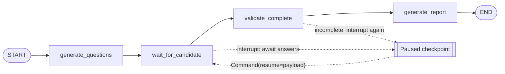
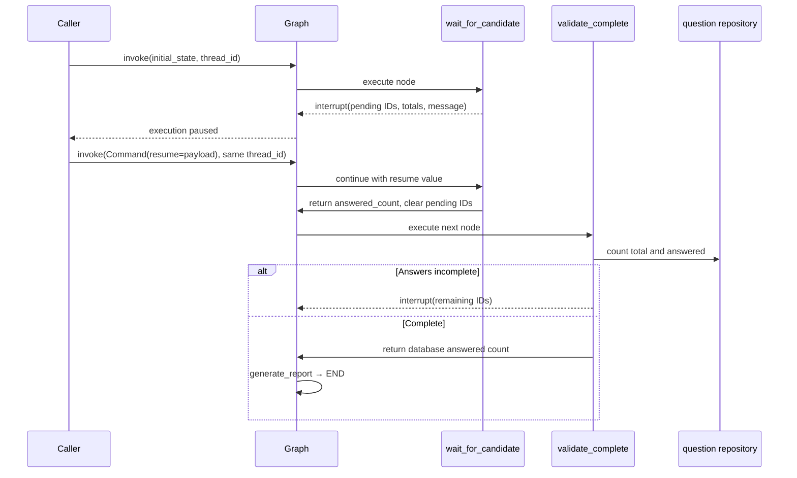

This page explains how the interview workflow is assembled as a LangGraph `StateGraph`, what each node contributes to shared state, and how candidate-response interrupts are resumed. Its scope is the graph’s execution semantics—not dependency construction or checkpoint storage internals, which are covered in [Workflow Dependency Injection and Checkpoint Persistence](12-workflow-dependency-injection-and-checkpoint-persistence).

**Architectural hypothesis:** the workflow is a linear four-node graph, with candidate response modeled as a durable pause rather than a long-running node. Resuming supplies a value to the suspended interrupt; a later database-backed validation node provides a second guard before report generation. The graph wiring and node bodies confirm this pattern.  
Sources: [graph.py](backend/app/workflow/graph.py#L31-L57) [nodes.py](backend/app/workflow/nodes.py#L124-L171)

## Graph topology and state flow

The graph registers four nodes on `InterviewState` and connects them in a fixed sequence: question generation → candidate wait → completion validation → report generation. There are no conditional edges in this graph definition. A node returns a partial state update; the state schema is a `TypedDict` with `total=False`, so fields may be absent until populated by execution.  
Sources: [graph.py](backend/app/workflow/graph.py#L42-L57) [state.py](backend/app/workflow/state.py#L25-L55)

The diagram distinguishes ordinary graph edges from interrupt/resume behavior. An interrupt pauses execution at the current node; resumption continues that node’s execution with the supplied resume value, after which the normal outgoing edge leads to validation. If validation detects unanswered questions, it can suspend again before the graph advances to report generation.  
Sources: [graph.py](backend/app/workflow/graph.py#L50-L55) [nodes.py](backend/app/workflow/nodes.py#L126-L171)

## Node responsibilities and state updates

| Node | Main work | State returned |
|---|---|---|
| `generate_questions` | Loads interview-related records, renders a prompt, calls the structured LLM service, persists questions and audit data, and publishes progress events. Missing interview/candidate/position data or an LLM exception returns an `error` and `error_node` update. | `questions`, `question_count`, and `difficulty_distribution` on success |
| `wait_for_candidate` | Derives pending IDs from `pending_question_ids`, falling back to IDs in `questions`, then suspends with an interrupt payload. | After resume: `answered_count` from the payload (default `0`) and an empty pending-ID list |
| `validate_complete` | Counts total and answered questions through the repository. If answers are incomplete, obtains unanswered questions and interrupts again; otherwise returns the database-derived answered count. | On incomplete resume: `answered_count` and empty pending IDs; on complete: `answered_count` |
| `generate_report` | Loads interview data and answers, calls the evaluation LLM, renders and stores the PDF, updates the interview, and records an audit event. An LLM exception returns an error update. | `report_id` and `report_path` on success |

The table describes node return values, which are partial updates rather than a replacement schema. In particular, error returns do not themselves define an alternate edge: the graph still has the same linear wiring, so callers and surrounding workflow handling must account for the returned error fields.  
Sources: [nodes.py](backend/app/workflow/nodes.py#L24-L121) [nodes.py](backend/app/workflow/nodes.py#L126-L171) [nodes.py](backend/app/workflow/nodes.py#L176-L274) [graph.py](backend/app/workflow/graph.py#L50-L55)

The declared state includes workflow identifiers, question data, answer progress, report metadata, and error metadata. It also defines fields such as `langgraph_thread_id`, but the graph invocation code uses `thread_id` in LangGraph’s configurable runtime configuration; these are distinct concepts in the shown implementation.  
Sources: [state.py](backend/app/workflow/state.py#L25-L55) [graph.py](backend/app/workflow/graph.py#L81-L110)

## Interrupt and resume semantics

`wait_for_candidate_node` calls `interrupt()` with an application-level payload containing the interview ID, pending question IDs, total count, and a human-readable message. It then expects the resume value to behave like a mapping, reading `answered_count` with a default of zero. The node clears `pending_question_ids` in its returned update after resumption.  
Sources: [nodes.py](backend/app/workflow/nodes.py#L126-L144)

`validate_complete_node` does not trust the resumed count as proof that every answer is persisted. It queries total and answered counts from the question repository. If `answered < total`, it fetches unanswered questions and raises another interrupt with the remaining IDs; otherwise, it returns the database count. This makes repository state the completion criterion at this stage, while the resume payload supplies progress data to the suspended node.  
Sources: [nodes.py](backend/app/workflow/nodes.py#L149-L171)

The public resume helper constructs `Command(resume=resume_payload)` and invokes the compiled graph using the supplied `thread_id`. The same thread identifier is used to select the corresponding graph execution state. The payload contract is not schema-validated in this helper; its expected `answered_count` field is inferred from the node’s mapping access.  
Sources: [graph.py](backend/app/workflow/graph.py#L105-L110) [nodes.py](backend/app/workflow/nodes.py#L134-L144)

This sequence is grounded in the invocation helper, the two interrupt sites, and the fixed graph edges. The code shown establishes the resume call shape, but does not define an API-level validation contract for resume payloads or show the caller that produces them.  
Sources: [graph.py](backend/app/workflow/graph.py#L105-L110) [graph.py](backend/app/workflow/graph.py#L50-L55) [nodes.py](backend/app/workflow/nodes.py#L126-L171)

## Execution and observability implications

`run_workflow_sync` builds a graph and invokes it with an initial state and a configurable thread ID. `get_workflow_state` queries a graph snapshot for that thread, while `resume_workflow` uses the compiled singleton graph to resume. These are separate entry points: initial execution accepts optional dependencies, whereas the resume helper obtains the singleton graph internally.  
Sources: [graph.py](backend/app/workflow/graph.py#L81-L117)

Tests verify graph compilation and the presence of all four nodes. A checkpointer test starts a graph with an in-memory saver and checks that a state snapshot exists after execution reaches the candidate-wait portion; the test does not exercise a successful resume or the full pipeline. The end-to-end workflow test is explicitly skipped pending complete database mocks, so those behaviors are not established by that test suite.  
Sources: [test_workflow.py](backend/tests/test_workflow.py#L41-L64) [test_workflow.py](backend/tests/test_workflow.py#L76-L125) [test_workflow.py](backend/tests/test_workflow.py#L141-L149)

For the adjacent implementation details, continue with [Workflow Dependency Injection and Checkpoint Persistence](12-workflow-dependency-injection-and-checkpoint-persistence).