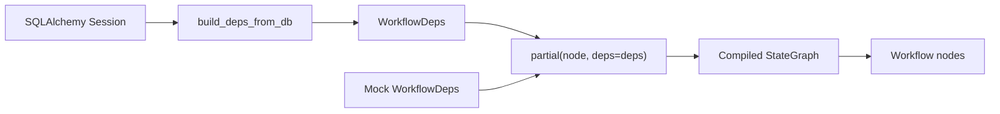
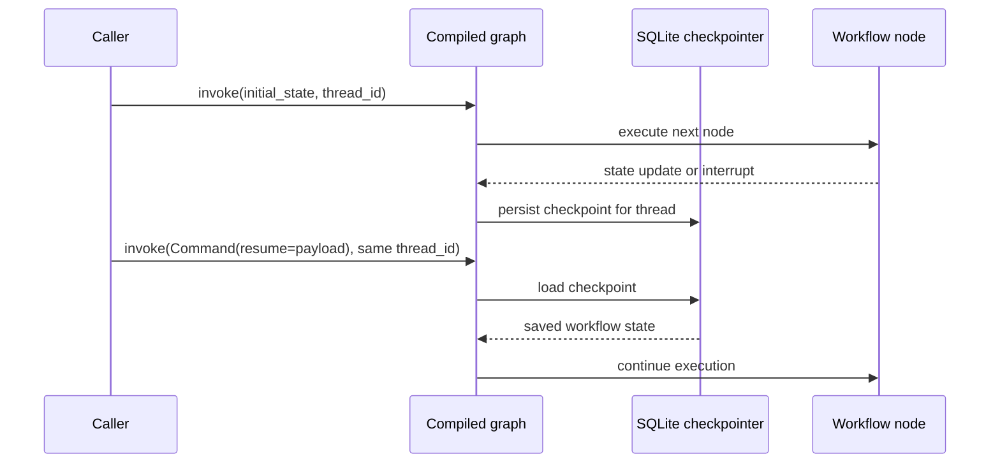

This page explains how workflow nodes receive runtime dependencies and how LangGraph execution state is persisted across pauses and resumes. The key architectural distinction is that **workflow dependencies provide access to live application services**, while **the checkpointer stores workflow state by thread**; the two mechanisms are complementary, not interchangeable. Sources: [dependencies.py](backend/app/workflow/dependencies.py#L19-L56) [checkpointer.py](backend/app/workflow/checkpointer.py#L17-L48) [graph.py](backend/app/workflow/graph.py#L31-L69)

## Dependency injection: bind services at graph construction

`WorkflowDeps` is a dataclass that groups the SQLAlchemy session, repositories, file storage, SSE manager, and prompt renderer. Production code can construct the bundle with `build_deps_from_db(db)`, which creates repository instances around the supplied session and obtains the shared storage and SSE services. The node code receives this bundle explicitly rather than importing a session factory or reaching into those services directly. Sources: [dependencies.py](backend/app/workflow/dependencies.py#L19-L56)

The graph builder binds the same `deps` object to each node using `functools.partial`. This makes the dependency boundary visible at assembly time: nodes operate on workflow state plus the injected bundle, while the graph builder defines the node sequence. Tests can supply a mock `WorkflowDeps` and compile the graph without constructing real repositories or a database session. Sources: [graph.py](backend/app/workflow/graph.py#L31-L57) [test_workflow.py](backend/tests/test_workflow.py#L43-L64) [test_workflow.py](backend/tests/test_workflow.py#L152-L180)

The diagram shows two construction paths converging at node binding: production dependencies are assembled from a database session, while tests may substitute mocks. This is dependency injection through graph assembly, not a separate container or automatic runtime resolver. Sources: [dependencies.py](backend/app/workflow/dependencies.py#L40-L56) [graph.py](backend/app/workflow/graph.py#L31-L48) [test_workflow.py](backend/tests/test_workflow.py#L152-L164)

## Session ownership and lifecycle implications

`WorkflowDeps.close()` closes its attached database session. The normal FastAPI `get_db()` dependency also creates a session and closes it when the request dependency finishes. These are separate lifecycle mechanisms in the code: callers that build workflow dependencies are responsible for choosing an appropriate session lifetime and cleanup path. The singleton graph path caches `_cached_deps`; `reset_compiled_graph()` closes those cached dependencies when resetting that singleton. Sources: [dependencies.py](backend/app/workflow/dependencies.py#L34-L38) [database.py](backend/app/database.py#L66-L74) [graph.py](backend/app/workflow/graph.py#L26-L29) [graph.py](backend/app/workflow/graph.py#L72-L79)

`run_workflow_sync()` creates a session and dependency bundle when no `deps` argument is supplied, then builds and compiles a graph for that invocation. In the shown implementation, this path does not call `deps.close()` before returning. By contrast, `get_compiled_graph()` retains its dependency bundle in `_cached_deps` until `reset_compiled_graph()` is called. These ownership differences matter when integrating workflow execution with request or worker lifecycles. Sources: [graph.py](backend/app/workflow/graph.py#L60-L79) [graph.py](backend/app/workflow/graph.py#L81-L103)

## Checkpoint persistence: state keyed by thread

The checkpointer module offers two access patterns. `get_checkpointer()` is a context manager around `SqliteSaver.from_conn_string(...)`; `get_checkpointer_sync()` lazily creates and caches a `SqliteSaver` backed by a direct SQLite connection. The synchronous path opens the connection with `check_same_thread=False`, with an inline comment identifying background-thread use as the reason. Both paths resolve the checkpoint database to `backend/workflow_checkpoints.db`, separate from the business database. Sources: [checkpointer.py](backend/app/workflow/checkpointer.py#L17-L48)

The compiled graph receives the synchronous saver through `builder.compile(checkpointer=...)`. Invocation and state-query configuration use `{"configurable": {"thread_id": thread_id}}`, so the thread identifier is the key passed to LangGraph for checkpointed execution and lookup. `resume_workflow()` invokes the compiled graph with `Command(resume=resume_payload)` under that same thread configuration; `get_workflow_state()` queries the state for the thread. Sources: [graph.py](backend/app/workflow/graph.py#L60-L69) [graph.py](backend/app/workflow/graph.py#L99-L117)

The sequence illustrates the persistence boundary: graph execution supplies the thread identifier, while the saver is attached at compilation and retains checkpoints. The workflow’s pause-and-resume behavior is implemented by LangGraph interrupts in nodes; the persistence layer enables later access to state for the thread. Sources: [graph.py](backend/app/workflow/graph.py#L99-L117) [nodes.py](backend/app/workflow/nodes.py#L124-L144) [checkpointer.py](backend/app/workflow/checkpointer.py#L36-L48)

## Dependency and persistence responsibilities

| Concern | Mechanism | What it provides | What it does not establish |
|---|---|---|---|
| Runtime services | `WorkflowDeps` | Session, repositories, storage, SSE manager, and prompt renderer available to nodes | Durable workflow state |
| Node binding | `partial(..., deps=deps)` | Explicit dependency binding when graph nodes are registered | Automatic session lifecycle management |
| Workflow persistence | `SqliteSaver` | Checkpoints stored in the workflow checkpoint database | Business-record persistence or repository transactions |
| Execution identity | `thread_id` in `configurable` | Thread key passed to invoke, resume, and state lookup | Dependency bundle selection |

These boundaries are visible in the implementation: repositories and service objects live in `WorkflowDeps`, while the saver is supplied as a separate argument to graph compilation. Node code also explicitly commits business changes through the injected database session, which is distinct from LangGraph’s checkpoint writes. Sources: [dependencies.py](backend/app/workflow/dependencies.py#L19-L29) [graph.py](backend/app/workflow/graph.py#L99-L117) [nodes.py](backend/app/workflow/nodes.py#L69-L121) [checkpointer.py](backend/app/workflow/checkpointer.py#L36-L48)

## Operational and testing characteristics

The synchronous checkpointer is a module-level singleton. `reset_checkpointer()` attempts to call `__exit__` on the cached saver and then clears the reference; `reset_compiled_graph()` independently clears the compiled graph and closes cached dependencies. These are separate reset functions, so tests or lifecycle code that need to reset both graph dependencies and checkpoint access must account for both module-level states. Sources: [checkpointer.py](backend/app/workflow/checkpointer.py#L51-L59) [graph.py](backend/app/workflow/graph.py#L72-L79)

Workflow tests verify that a mock dependency bundle is sufficient to build and compile the graph, and that an `InMemorySaver` can be supplied to a test graph to inspect state after an interrupt. A separate test checks the SQLite checkpointer accessor’s singleton identity. The test suite therefore demonstrates graph wiring and checkpoint access patterns, but marks a full end-to-end workflow test as skipped pending comprehensive database mocks. Sources: [test_workflow.py](backend/tests/test_workflow.py#L66-L124) [test_workflow.py](backend/tests/test_workflow.py#L141-L159)

## Next steps

For the execution lifecycle and interrupt semantics that interact with checkpointed state, continue to [LangGraph Nodes, Interrupts, and Resume Semantics](11-langgraph-nodes-interrupts-and-resume-semantics). For the distinction between workflow checkpoint storage and business data persistence, see [SQLite WAL, Business Data, and Workflow Checkpoints](18-sqlite-wal-business-data-and-workflow-checkpoints). Sources: [graph.py](backend/app/workflow/graph.py#L99-L117) [checkpointer.py](backend/app/workflow/checkpointer.py#L26-L48)