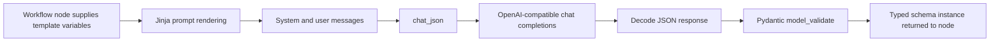

This page explains how the backend configures an OpenAI-compatible LLM client, renders versioned prompt templates, and validates model responses into typed Pydantic objects. It covers the implementation boundary from configuration through workflow-node invocation; it does not describe the broader interview lifecycle or report rendering. Sources: [config.py](backend/app/config.py#L24-L31) [llm_service.py](backend/app/services/llm_service.py#L31-L45) [workflow_service.py](backend/app/services/workflow_service.py#L22-L57)

## Provider configuration and client construction

The settings expose a provider label, API key, base URL, model name, temperature, timeout, and retry count. The configured provider label is restricted to `deepseek`, `qwen`, or `glm`, but the client itself is constructed with the OpenAI SDK and the configured base URL. In other words, the implementation’s provider compatibility mechanism is the OpenAI-compatible endpoint configuration—not a separate SDK adapter selected by `LLM_PROVIDER`. Sources: [config.py](backend/app/config.py#L24-L31) [llm_service.py](backend/app/services/llm_service.py#L31-L45)

| Setting | Role in the implementation |
|---|---|
| `LLM_PROVIDER` | Provider identifier; allowed values are `deepseek`, `qwen`, and `glm`. |
| `OPENAI_API_KEY` | Credential passed to the SDK client. The placeholder default activates the mock branch in `chat_json`. |
| `OPENAI_BASE_URL` | Endpoint passed to the OpenAI SDK client. |
| `LLM_MODEL` | Default model used when a call does not pass a model explicitly. |
| `LLM_TEMPERATURE` | Default sampling temperature used when not overridden per call. |
| `LLM_TIMEOUT_SECONDS` | SDK client request timeout. |
| `LLM_MAX_RETRIES` | Default number of attempts used by the service retry helper. |

Sources: [config.py](backend/app/config.py#L24-L31) [llm_service.py](backend/app/services/llm_service.py#L35-L45) [llm_service.py](backend/app/services/llm_service.py#L113-L116)

The example environment file sets DeepSeek as the example provider and supplies its compatible endpoint and model. To use another supported provider, the relevant provider identifier, API key, base URL, and model must be configured consistently with that provider’s OpenAI-compatible API. The code shown does not contain provider-specific request transformations. Sources: [.env.example](.env.example#L1-L7) [config.py](backend/app/config.py#L24-L31) [llm_service.py](backend/app/services/llm_service.py#L35-L45)

## Request path: template to validated response

The workflow nodes own the task-specific input preparation: they render a prompt, construct system/user chat messages, and call `chat_json` with a Pydantic schema. The shared LLM service owns API-client reuse, request defaults, retries, JSON decoding, and schema validation. The resulting schema instance is then available to the calling node as typed data. Sources: [nodes.py](backend/app/workflow/nodes.py#L46-L67) [llm_service.py](backend/app/services/llm_service.py#L158-L224)

The diagram follows the actual question-generation path: the node passes candidate and position data to the renderer, packages the returned strings as chat messages, and requests a `QuestionList`. `chat_json` calls the chat completions endpoint with JSON response mode, parses the returned text, and validates the decoded object against the requested schema. Sources: [nodes.py](backend/app/workflow/nodes.py#L46-L64) [llm_service.py](backend/app/services/llm_service.py#L185-L224)

## Prompt templates and rendering conventions

Prompts reside in `backend/app/prompts` and use `.v1.j2` filenames to identify their task and version. The workflow service renders template text with Jinja variables and returns a dictionary containing `system` and `user`. Its split convention is conditional: if a template contains the literal `# system`, text before that marker becomes the system content and the rendered portion after it becomes user content; without the marker, system content is empty and the entire rendered template becomes user content. Sources: [workflow_service.py](backend/app/services/workflow_service.py#L22-L57) [question_generation.v1.j2](backend/app/prompts/question_generation.v1.j2#L1-L21)

The question-generation template consumes position name, requirements, responsibilities, and resume text. It instructs the model to produce exactly ten questions with a specified difficulty distribution and fields for question text, scoring standard, and difficulty. The report-evaluation template instead formats candidate/interviewer context and a sequence of question, scoring-standard, and answer records, then specifies the desired evaluation fields. These instructions shape model behavior; the Pydantic schema is the runtime structural check. Sources: [question_generation.v1.j2](backend/app/prompts/question_generation.v1.j2#L13-L44) [report_evaluation.v1.j2](backend/app/prompts/report_evaluation.v1.j2#L6-L53)

## Structured outputs: JSON mode plus Pydantic validation

`chat_json` requests `response_format={"type": "json_object"}`, then parses the response text using `json.loads`. If parsing fails, it attempts to extract a fenced JSON block before raising the decoding error. On successful parsing, it calls `schema.model_validate(data)`; a validation failure is logged and re-raised. JSON mode therefore asks the provider for JSON, while the Pydantic model enforces the application’s field and value constraints. Sources: [llm_service.py](backend/app/services/llm_service.py#L190-L224) [llm_service.py](backend/app/services/llm_service.py#L227-L237)

| Schema | Key constraints and normalization |
|---|---|
| `QuestionItem` | `question` has a minimum length of 5; `score_standard` has a minimum length of 3; `difficulty` is `hard`, `medium`, or `easy`. |
| `QuestionList` | Requires exactly 10 `QuestionItem` values. |
| `QuestionEvaluation` | Requires an integer score from 0 through 10, alongside question, answer, standard, and comments. |
| `ReportEvaluation` | Requires technical, communication, and overall scores from 0 through 100; comments must be at least 10 characters. Score values supplied as floats or numeric strings are rounded and coerced to integers before validation. |

Sources: [schemas/llm.py](backend/app/schemas/llm.py#L13-L27) [schemas/llm.py](backend/app/schemas/llm.py#L31-L38) [schemas/llm.py](backend/app/schemas/llm.py#L41-L74)

`ReportEvaluation.recommendation` has a default string, and its validator derives a recommendation from `overall_score` when the received value is empty or equals that default: 80 or above maps to “recommended,” 60 or above to “consider,” and lower values to “not recommended.” This is schema-side fallback behavior, not a provider guarantee. Sources: [schemas/llm.py](backend/app/schemas/llm.py#L55-L87)

## Retry behavior and mock mode

The service retries rate limits, timeouts, and API errors with HTTP 5xx status codes. The wait interval is exponential (`2 ** attempt` seconds); other API errors, including non-429 4xx errors, are raised immediately. The OpenAI client’s built-in retries are disabled, leaving retry policy to this service helper. Sources: [llm_service.py](backend/app/services/llm_service.py#L35-L45) [llm_service.py](backend/app/services/llm_service.py#L48-L91)

When `OPENAI_API_KEY` equals the literal placeholder `sk-placeholder-replace-me`, `chat_json` takes a mock path and returns mock data for `QuestionList`. The mock generator raises `ValueError` for other schema types, so the shown mock implementation does not provide a corresponding report-evaluation mock. This branch applies to `chat_json`; the plain-text `chat` function follows the API-call path. Sources: [config.py](backend/app/config.py#L24-L31) [llm_service.py](backend/app/services/llm_service.py#L131-L155) [llm_service.py](backend/app/services/llm_service.py#L158-L185)

## Integration boundary

Workflow nodes import `chat_json` lazily and pass the schema class explicitly. For question generation, `generate_questions_node` supplies rendered messages and `QuestionList`; after a successful return it consumes the typed `questions` entries. The report node uses the same pattern for report evaluation, keeping prompt content and schema expectations task-specific while reusing the service’s transport and validation behavior. Sources: [nodes.py](backend/app/workflow/nodes.py#L46-L67) [nodes.py](backend/app/workflow/nodes.py#L174-L200) [schemas/llm.py](backend/app/schemas/llm.py#L24-L26) [schemas/llm.py](backend/app/schemas/llm.py#L55-L74)

A practical maintenance rule follows from this division: update the prompt when task instructions or input framing change; update the Pydantic schema when the accepted output contract changes; and verify both together because a prompt can request fields or constraints that runtime validation does not enforce, or validation can reject outputs the prompt permits. Sources: [question_generation.v1.j2](backend/app/prompts/question_generation.v1.j2#L23-L44) [report_evaluation.v1.j2](backend/app/prompts/report_evaluation.v1.j2#L28-L53) [schemas/llm.py](backend/app/schemas/llm.py#L13-L87)

## Suggested next reading

For workflow-level execution context, continue to [LangGraph Nodes, Interrupts, and Resume Semantics](11-langgraph-nodes-interrupts-and-resume-semantics). For how resume text is prepared before downstream processing, see [Resume Parsing and Candidate Data Preparation](14-resume-parsing-and-candidate-data-preparation). Sources: [nodes.py](backend/app/workflow/nodes.py#L22-L67) [workflow_service.py](backend/app/services/workflow_service.py#L32-L57)