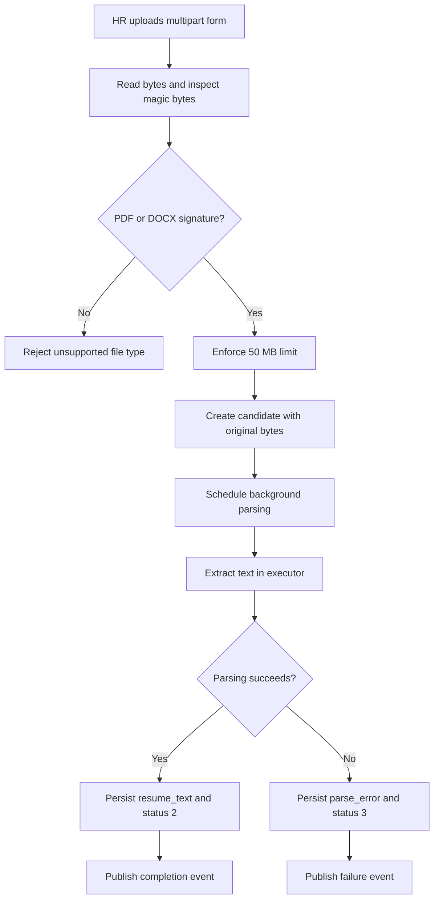

This page explains how an uploaded PDF or DOCX becomes stored candidate data and extracted resume text. The implementation separates **upload and candidate creation** from **background text extraction**: the API stores the original bytes and returns promptly, while a scheduled task parses the document and records the result. The scope here is resume ingestion, parser behavior, and the resulting candidate fields—not interview workflow or downstream evaluation. Sources: [candidates.py](backend/app/api/candidates.py#L58-L114), [resume_parser_service.py](backend/app/services/resume_parser_service.py#L30-L58), [candidate.py](backend/app/models/candidate.py#L28-L42)

## Architectural model

The key boundary is between **original-file retention** and **derived-text preparation**. The original upload is used for parsing and retry; the extracted plain text and parse status are stored separately on the candidate record. The parser does not populate candidate name or email from the document: those are supplied as form fields and validated by the candidate service. Sources: [candidates.py](backend/app/api/candidates.py#L58-L107), [candidate_service.py](backend/app/services/candidate_service.py#L55-L105), [candidate.py](backend/app/models/candidate.py#L28-L42)

The flow shows the upload and parse path implemented by the candidate API. The diagram’s success and failure branches represent the status updates and SSE events emitted by the background task. Sources: [candidates.py](backend/app/api/candidates.py#L68-L114), [candidates.py](backend/app/api/candidates.py#L140-L200)

## Upload validation and candidate creation

`POST /api/candidates` accepts `name`, `email`, `position_id`, and a resume file as multipart form data. It reads the first eight bytes to identify PDF (`%PDF-`) or DOCX (ZIP signature `PK\x03\x04`), then reads the remainder. Unsupported signatures and files over 50 MiB are rejected before candidate creation. This is signature-based identification; the code shown does not use the filename extension to select the upload type. Sources: [candidates.py](backend/app/api/candidates.py#L31-L34), [candidates.py](backend/app/api/candidates.py#L58-L88)

| Input or condition | Implementation behavior |
|---|---|
| PDF magic bytes | Stores `resume_type = 0` |
| DOCX ZIP signature | Stores `resume_type = 1` |
| Any other signature | Returns an unsupported-file-type API error |
| File larger than 50 MiB | Returns a file-too-large API error |
| Blank name or malformed email | Candidate service rejects the request |
| Unknown position | Candidate service returns not found |

Sources: [candidates.py](backend/app/api/candidates.py#L68-L88), [candidate_service.py](backend/app/services/candidate_service.py#L65-L80)

After validation, the endpoint creates the candidate with the uploaded bytes in `resume_content`, then schedules parsing and returns a candidate ID with the human-readable status `"parsing"`. The service records an audit event for candidate creation. The repository initializes the persisted numeric `parse_status` to `1` (parsing). Sources: [candidates.py](backend/app/api/candidates.py#L90-L114), [candidate_service.py](backend/app/services/candidate_service.py#L82-L105), [candidate.py](backend/app/models/candidate.py#L102-L131)

## Parser behavior and output

The byte-based parser functions handle uploads without first writing them to disk. PDF parsing uses PyPDF2, rejects encrypted files, extracts text page by page, and joins the page text with newlines. Individual page extraction exceptions are logged and skipped; if the resulting document has no extractable text, parsing raises `SCANNED_PDF`. The implementation does not perform OCR. Sources: [resume_parser_service.py](backend/app/services/resume_parser_service.py#L153-L184)

DOCX parsing uses `python-docx`. It collects non-empty paragraph text and then non-empty cells from document tables, joining the collected parts with newlines. A document with no extracted text raises `EMPTY_DOCX`. Sources: [resume_parser_service.py](backend/app/services/resume_parser_service.py#L187-L211)

Both parser families raise `ResumeParseError` with a code and message for recognized failures, including missing dependencies, encrypted PDFs, empty/scanned documents, and general parse failures. The path-based `parse_resume` function additionally checks that the path exists and accepts only `"pdf"` or `"docx"`; the upload route shown uses the byte-based functions instead. Sources: [resume_parser_service.py](backend/app/services/resume_parser_service.py#L18-L25), [resume_parser_service.py](backend/app/services/resume_parser_service.py#L30-L58), [resume_parser_service.py](backend/app/services/resume_parser_service.py#L61-L97), [resume_parser_service.py](backend/app/services/resume_parser_service.py#L99-L127)

## Background parsing and candidate state

The API schedules an asynchronous task. It publishes `resume_parse_started`, runs the synchronous parser through the event loop’s executor, and writes the outcome through a separate database session. Success stores extracted text with status `2`; a parser-specific or unexpected exception stores status `3` and an error string. The task then publishes either `resume_parse_complete` or `resume_parse_failed`, including the candidate ID and trigger; the completion event also includes text length and parser type. Sources: [candidates.py](backend/app/api/candidates.py#L117-L171), [candidates.py](backend/app/api/candidates.py#L173-L200), [candidates.py](backend/app/api/candidates.py#L202-L244)

| `parse_status` | Meaning in schema | API/task behavior |
|---:|---|---|
| `0` | Pending | Resume-text endpoint treats it as still parsing |
| `1` | Parsing | Set when the repository creates the candidate; also used when retrying |
| `2` | Success | Extracted text is persisted and completion is published |
| `3` | Failure | Parse error is persisted and failure is published |

The candidate model stores `resume_type`, the original bytes or a path, extracted `resume_text`, `parse_status`, `parse_error`, `is_scanned_document`, and `parsed_at`. In the upload flow described here, parser success and failure update status, text, and error as applicable; the shown parser-task update does not set `is_scanned_document`. The response schema exposes that field, but its presence should not be read as evidence that this parsing path classifies scanned documents beyond reporting the `SCANNED_PDF` parse error. Sources: [candidate.py](backend/app/models/candidate.py#L28-L42), [candidate.py](backend/app/models/candidate.py#L150-L170), [candidate.py](backend/app/schemas/candidate.py#L12-L25)

## Reading results and retrying

`GET /api/candidates/{candidate_id}/resume-text` returns a conflict while `parse_status` is `0` or `1`. After processing, its response includes status, parse error, extracted text, scanned-document flag, parse timestamp, and resume type. Candidate list/detail output includes parse status and error, but not the resume text field. Sources: [candidates.py](backend/app/api/candidates.py#L247-L257), [candidates.py](backend/app/api/candidates.py#L284-L316), [candidate.py](backend/app/schemas/candidate.py#L12-L25), [candidate.py](backend/app/schemas/candidate.py#L41-L51)

`POST /api/candidates/{candidate_id}/reparse` reuses `resume_content`; it does not accept a new upload. It rejects candidates without stored bytes and candidates currently marked as parsing. Otherwise, it sets status back to `1`, clears the prior text and error, records a retry audit event, and schedules parsing with trigger `"reparse"`. Sources: [candidates.py](backend/app/api/candidates.py#L319-L380)

## Verification in tests

Parser tests cover invalid and empty PDF/DOCX input, unsupported path-based parser types, missing paths, real DOCX paragraphs, DOCX tables, and parsing a DOCX from a file path. The PDF test using a blank page expects a parse error because no text is extractable; it allows either `SCANNED_PDF` or `PARSE_FAILED`. Sources: [test_resume_parser.py](backend/tests/test_resume_parser.py#L17-L79), [test_resume_parser.py](backend/tests/test_resume_parser.py#L82-L107), [test_resume_parser.py](backend/tests/test_resume_parser.py#L109-L156)

## Next steps

For the surrounding lifecycle and state semantics, continue with [Interview Workflow State and Lifecycle](10-interview-workflow-state-and-lifecycle). For the parser’s LLM-related context, see [LLM Providers, Prompt Templates, and Structured Outputs](13-llm-providers-prompt-templates-and-structured-outputs); this page documents deterministic PDF/DOCX text extraction and does not describe LLM extraction. Sources: [resume_parser_service.py](backend/app/services/resume_parser_service.py#L30-L58), [resume_parser_service.py](backend/app/services/resume_parser_service.py#L153-L211)