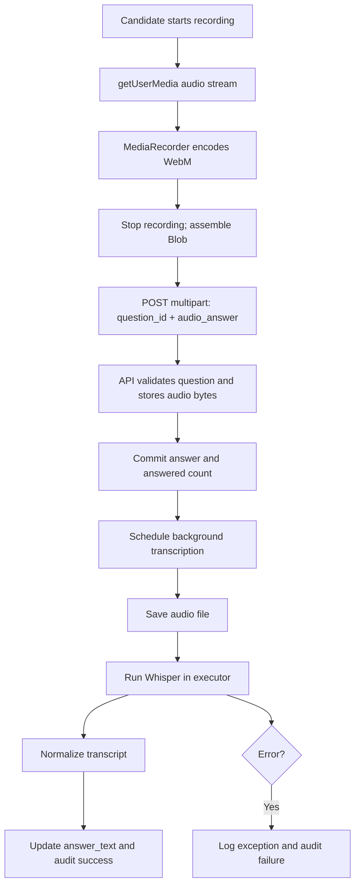

This page traces one answer from browser microphone capture through multipart upload, durable audio storage, and asynchronous speech-to-text processing. The implementation uses the browser’s `MediaRecorder` API to produce WebM audio, then runs a locally loaded Whisper-compatible model in a background executor. **The HTTP answer submission does not wait for transcription to finish.** Sources: [VoiceRecorder.tsx](frontend/src/components/VoiceRecorder.tsx#L1-L12), [candidate_portal.py](backend/app/api/candidate_portal.py#L108-L120), [candidate_portal.py](backend/app/api/candidate_portal.py#L156-L206)

## End-to-end flow

The browser captures audio as a `Blob` and uploads it with the question ID. The API stores the received bytes in the question record and commits the answer before scheduling the transcription task. The task then saves a file copy, calls the synchronous ASR function in an executor, and writes the resulting text back to the answer record. Sources: [VoiceRecorder.tsx](frontend/src/components/VoiceRecorder.tsx#L63-L101), [candidatePortal.ts](frontend/src/api/candidatePortal.ts#L49-L62), [candidate_portal.py](backend/app/api/candidate_portal.py#L137-L154), [candidate_portal.py](backend/app/api/candidate_portal.py#L197-L216)

The response can include the next question while transcription continues. The API checks whether all questions have been answered and may resume the interview workflow at that point; this answer-submission flow is distinct from waiting for the transcript to complete. Sources: [candidate_portal.py](backend/app/api/candidate_portal.py#L258-L307)

## Browser recording and upload

`VoiceRecorder` requests microphone access with `navigator.mediaDevices.getUserMedia({ audio: true })`. It prefers `audio/webm;codecs=opus` when supported and otherwise requests `audio/webm`. Non-empty `dataavailable` chunks are collected; when recording stops, they are assembled into a `Blob`, passed to `onComplete`, and the microphone tracks are stopped. Unmount cleanup also stops any active tracks and clears the timer. Sources: [VoiceRecorder.tsx](frontend/src/components/VoiceRecorder.tsx#L29-L61), [VoiceRecorder.tsx](frontend/src/components/VoiceRecorder.tsx#L63-L113)

The API client places the question ID and audio blob into `FormData`, using the filename `answer.webm`, and posts it to `/api/candidate/{token}/answers`. On the server, FastAPI receives `question_id` as a form field and `audio_answer` as an uploaded file. Before saving, the handler verifies that the question exists, belongs to the current interview, and has not already been answered. Sources: [candidatePortal.ts](frontend/src/api/candidatePortal.ts#L49-L62), [candidate_portal.py](backend/app/api/candidate_portal.py#L108-L135)

| Stage | Implementation detail | Operational implication |
|---|---|---|
| Capture | Browser `MediaRecorder`; WebM/Opus preferred | Recording requires microphone access through the browser. |
| Upload | Multipart form with `question_id` and `audio_answer` | The client supplies the `answer.webm` filename. |
| Initial persistence | Audio bytes assigned to `question.answer_audio`; answer timestamp and interview progress updated | The answer is committed before the background ASR task starts. |
| File persistence for ASR | Background task calls `storage.save_audio(interview_id, question_id, audio_data)` | Transcription reads the saved audio path. |
| Transcript persistence | ASR output is written with `update_answer(..., answer_text=text)` | Text becomes available after background processing succeeds. |

Sources: [VoiceRecorder.tsx](frontend/src/components/VoiceRecorder.tsx#L72-L92), [candidatePortal.ts](frontend/src/api/candidatePortal.ts#L52-L60), [candidate_portal.py](backend/app/api/candidate_portal.py#L137-L154), [candidate_portal.py](backend/app/api/candidate_portal.py#L197-L216)

## FFmpeg and audio decoding

The application runs `ensure_ffmpeg_in_path()` during startup before attempting to load the ASR model. The helper first checks whether `ffmpeg` is already discoverable. If not, it searches configured Windows WinGet package locations and common installation directories, then prepends a discovered directory to `PATH`. If no candidate is found, it logs a warning; startup still proceeds to model loading. Sources: [main.py](backend/app/main.py#L85-L101), [ffmpeg.py](backend/app/core/ffmpeg.py#L37-L87)

This matters because the FFmpeg helper documents Whisper’s use of a subprocess to decode audio formats such as WebM. A missing executable can therefore prevent WebM transcription even when the application and model are otherwise running. The code’s startup warning explicitly identifies FFmpeg as necessary for WebM recordings. Sources: [ffmpeg.py](backend/app/core/ffmpeg.py#L1-L10), [main.py](backend/app/main.py#L88-L95)

## Model lifecycle and transcription behavior

At application startup, the lifespan handler attempts to load the ASR model in an executor. Model-load failure is caught and logged rather than treated as a reason to abort startup. The ASR service also supports lazy loading when `transcribe()` is called without an initialized model; if that attempt still leaves no model available, it raises `RuntimeError`. On shutdown, the lifespan handler calls `release_whisper_model()`. Sources: [main.py](backend/app/main.py#L85-L101), [main.py](backend/app/main.py#L114-L125), [asr_service.py](backend/app/services/asr_service.py#L254-L305), [asr_service.py](backend/app/services/asr_service.py#L316-L344)

The service selects a device from `WHISPER_DEVICE`: `cuda` uses CUDA when available, `cpu` forces CPU, and `auto` prefers CUDA when available. It selects `float16` for CUDA and `int8` for CPU, then constructs a `faster_whisper.WhisperModel` using the configured model name. The default model is `base`, and the configured device defaults to `auto`. Sources: [asr_service.py](backend/app/services/asr_service.py#L240-L250), [asr_service.py](backend/app/services/asr_service.py#L254-L292), [config.py](backend/app/config.py#L57-L60)

`transcribe()` defaults to Chinese (`zh`) and a Chinese initial prompt containing domain terminology. It requests beam size 5 and VAD filtering, joins segment text, applies the terminology-fix dictionary, then attempts Traditional-to-Simplified conversion through OpenCC. OpenCC is optional at runtime: if loading or conversion fails, the service logs a warning and returns the text without that conversion. Sources: [asr_service.py](backend/app/services/asr_service.py#L32-L42), [asr_service.py](backend/app/services/asr_service.py#L197-L234), [asr_service.py](backend/app/services/asr_service.py#L316-L367)

| Configuration or option | Default / behavior | Evidence |
|---|---|---|
| `WHISPER_MODEL` | `base`; allowed values include `tiny`, `small`, `medium`, and `large-v3` | [config.py](backend/app/config.py#L57-L60) |
| `WHISPER_DEVICE` | `auto`; device selection prefers CUDA when available | [config.py](backend/app/config.py#L57-L60), [asr_service.py](backend/app/services/asr_service.py#L240-L250) |
| Compute type | `float16` on CUDA; `int8` on CPU | [asr_service.py](backend/app/services/asr_service.py#L261-L270) |
| Language | `zh` by default in the transcription function | [asr_service.py](backend/app/services/asr_service.py#L316-L329) |
| Decode options | Beam size 5 and VAD filtering enabled | [asr_service.py](backend/app/services/asr_service.py#L345-L357) |
| Transcript cleanup | Term replacements followed by optional OpenCC `t2s` conversion | [asr_service.py](backend/app/services/asr_service.py#L197-L234), [asr_service.py](backend/app/services/asr_service.py#L359-L367) |

Sources: [config.py](backend/app/config.py#L57-L60), [asr_service.py](backend/app/services/asr_service.py#L240-L270), [asr_service.py](backend/app/services/asr_service.py#L316-L367)

## Background execution and failure visibility

The answer handler commits the audio and answer state before creating the transcription task. The task saves the audio file, runs the synchronous `transcribe()` call through the main event loop’s default executor, and opens a separate database session to update `answer_text`. This keeps model inference off the request’s direct execution path. Sources: [candidate_portal.py](backend/app/api/candidate_portal.py#L137-L154), [candidate_portal.py](backend/app/api/candidate_portal.py#L197-L216)

On success, the task writes an `answer_transcribed` audit event with the question ID, audio path, and transcript length. On failure, it logs the exception and writes `answer_transcribe_failed`, including the error and a truncated traceback. The task also has a completion callback that logs an uncaught exception if one escapes the task’s own error handling. Sources: [candidate_portal.py](backend/app/api/candidate_portal.py#L180-L195), [candidate_portal.py](backend/app/api/candidate_portal.py#L218-L256)

## Troubleshooting by failure point

| Symptom | Verify | Code-supported interpretation |
|---|---|---|
| Microphone cannot start | Browser microphone permission and `getUserMedia` availability | The component displays an error and a permission-related toast when capture setup fails. |
| WebM audio does not transcribe | Whether FFmpeg is discoverable or found by the startup probe | The startup path warns when FFmpeg is missing; the helper describes its role in decoding WebM. |
| Model is unavailable | Model-load logs and configured device/model | Startup load errors are logged; transcription retries lazy loading and raises if the model remains unavailable. |
| Answer exists but transcript is absent | `answer_transcribe_failed` audit event and server logs | Transcription is asynchronous, and failures are recorded separately from answer submission. |
| Transcript text differs from raw recognition | Terminology replacements and OpenCC availability | The service applies explicit replacements before optional Traditional-to-Simplified conversion. |

Sources: [VoiceRecorder.tsx](frontend/src/components/VoiceRecorder.tsx#L63-L105), [ffmpeg.py](backend/app/core/ffmpeg.py#L37-L87), [main.py](backend/app/main.py#L85-L101), [asr_service.py](backend/app/services/asr_service.py#L316-L367), [candidate_portal.py](backend/app/api/candidate_portal.py#L218-L247)

## Dependencies and implementation boundary

The backend dependency manifest declares `openai-whisper` and `torch` under speech recognition dependencies. The ASR service, however, imports `faster_whisper.WhisperModel` when loading its model. This is a verifiable difference between the declared speech-recognition dependencies and the runtime import path; consult the project’s dependency and deployment setup before assuming that installing the declared packages alone provides the imported module. Sources: [pyproject.toml](backend/pyproject.toml#L35-L38), [asr_service.py](backend/app/services/asr_service.py#L277-L285)

For the candidate-facing recording component and its surrounding interaction, continue with [Candidate Portal, Audio Capture, and Interview Experience](25-candidate-portal-audio-capture-and-interview-experience). For broader model and prompt configuration, see [LLM Providers, Prompt Templates, and Structured Outputs](13-llm-providers-prompt-templates-and-structured-outputs). Sources: [VoiceRecorder.tsx](frontend/src/components/VoiceRecorder.tsx#L1-L12), [asr_service.py](backend/app/services/asr_service.py#L32-L42)