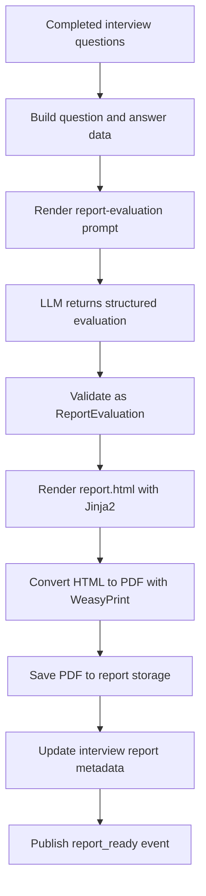

This page explains how a completed interview becomes a structured evaluation and a downloadable PDF. Its scope is the report-generation path, the renderer and template, and the report’s file-based delivery; it does not cover the broader interview workflow or general file-storage operations.

## Report-generation path

The report is produced in two stages: the workflow asks the LLM for a schema-validated evaluation, then renders that result into PDF bytes and saves them. The sequence below shows the boundary between evaluation data and presentation. Sources: [nodes.py](backend/app/workflow/nodes.py#L164-L257), [llm.py](backend/app/schemas/llm.py#L26-L87), [report_renderer.py](backend/app/services/report_renderer.py#L84-L156), [file_storage.py](backend/app/services/file_storage.py#L117-L125)

`generate_report_node` loads the interview, candidate, position, and its questions. It constructs question-and-answer inputs, renders `report_evaluation.v1.j2`, and calls `chat_json` with `ReportEvaluation` as the schema. If the LLM call raises an exception, the node returns an error result rather than proceeding to PDF rendering. Sources: [nodes.py](backend/app/workflow/nodes.py#L164-L224), [report_evaluation.v1.j2](backend/app/prompts/report_evaluation.v1.j2#L1-L54)

The schema constrains question scores to integers from 0 through 10 and the three summary scores to integers from 0 through 100. Summary-score validators coerce float or numeric-string values to integers before validation. Recommendation is free text; when omitted or equal to the schema’s fallback placeholder, it is derived from the overall score thresholds: 80 or above, 60–79, and below 60. Sources: [llm.py](backend/app/schemas/llm.py#L26-L87)

## Evaluation data and report content

The evaluation prompt requests per-question scores and comments, technical, communication, and overall scores, an overall comment, and a recommendation. It also states that the question score range is 0–10 and that short or irrelevant answers should receive zero; these are prompt instructions, while the schema enforces data shape and score ranges. Sources: [report_evaluation.v1.j2](backend/app/prompts/report_evaluation.v1.j2#L10-L54), [llm.py](backend/app/schemas/llm.py#L26-L87)

The PDF template presents interview date, candidate and position details, interviewer, question count, summary scores, recommendation, overall comments, and a per-question section containing the prompt, scoring standard, answer, score, and comments. In the workflow, `is_passed` is set to 1 when `overall_score >= 60`, otherwise 0; this is a separate workflow decision from the recommendation text displayed in the report. Sources: [report.html](backend/app/templates/report.html#L106-L180), [nodes.py](backend/app/workflow/nodes.py#L226-L257)

| Data or behavior | Implementation |
|---|---|
| Summary scores | Technical, communication, and overall scores; displayed on a 0–100 scale. |
| Per-question score | Schema range is 0–10; renderer multiplies it by 10 when selecting a display color class. |
| Summary-score color | High at 80+, middle at 60–79, low below 60. |
| Recommendation color | Text containing “推荐” maps to positive; containing “考虑” maps to neutral; other text maps to negative. |
| Question count | Explicit count when provided; otherwise falls back to the number of question evaluations. |

Sources: [report_renderer.py](backend/app/services/report_renderer.py#L24-L81), [report.html](backend/app/templates/report.html#L129-L180), [llm.py](backend/app/schemas/llm.py#L26-L87)

## Renderer and PDF layout

`render_report_pdf` accepts candidate name, position, interviewer, an evaluation object, and an optional question count. It supports both Pydantic-like evaluations with `model_dump()` and dictionary evaluations, prepares template fields and CSS classes, renders `report.html` through a module-level Jinja2 environment, and passes the resulting HTML to WeasyPrint. Jinja autoescaping is enabled for HTML and XML templates. Sources: [report_renderer.py](backend/app/services/report_renderer.py#L17-L22), [report_renderer.py](backend/app/services/report_renderer.py#L84-L129)

The template defines A4 pages with 2 cm margins and applies print-oriented styling to report sections, score tables, recommendation banners, and question blocks. Each question block uses `page-break-inside: avoid` to reduce splitting a block across pages. WeasyPrint is imported inside the conversion function; if it is unavailable, the import error is logged and re-raised. Sources: [report.html](backend/app/templates/report.html#L1-L105), [report.html](backend/app/templates/report.html#L147-L180), [report_renderer.py](backend/app/services/report_renderer.py#L132-L141)

The renderer is synchronous. The module also provides `render_report_pdf_async`, which submits the synchronous render function to the default executor obtained through `get_main_loop`; the workflow node currently calls the synchronous function directly. This distinction matters when choosing a call site: the async wrapper exists, but the shown node does not use it. Sources: [report_renderer.py](backend/app/services/report_renderer.py#L132-L156), [nodes.py](backend/app/workflow/nodes.py#L226-L235)

## Persistence and download behavior

After rendering, the workflow saves the PDF through `file_storage.save_report`, stores the returned path on the interview, publishes a `report_ready` event with the report download URL, records a report-generated audit entry, and commits the database transaction. The local storage implementation uses the path `reports/{interview_id}.pdf` beneath its configured root and writes through a temporary file followed by `os.replace`. Sources: [nodes.py](backend/app/workflow/nodes.py#L226-L257), [file_storage.py](backend/app/services/file_storage.py#L44-L56), [file_storage.py](backend/app/services/file_storage.py#L66-L93), [file_storage.py](backend/app/services/file_storage.py#L117-L125)

`InterviewService.download_report` only serves reports when interview status is at least 4. It first reads `report_path` if it points to an existing file, then falls back to the legacy `report_content` BLOB, and otherwise raises a report-not-found error. Successful downloads use the filename `interview_report_{id}.pdf`. Sources: [interview_service.py](backend/app/services/interview_service.py#L198-L228)

## Verification and implementation notes

Renderer tests check score and recommendation class selection, PDF output bytes and the `%PDF-` signature, dictionary compatibility, and rendering with no question evaluations. Tests skip the PDF assertions when WeasyPrint is unavailable or its system dependencies cannot be loaded. Sources: [test_report_renderer.py](backend/tests/test_report_renderer.py#L49-L135)

A practical maintenance boundary is to keep evaluation semantics in the prompt and schema, while keeping visual layout and formatting transformations in the renderer and HTML template. When changing score ranges, recommendation labels, or displayed fields, check both the schema/prompt contract and the rendering path so that validated evaluation data still maps correctly to the report. Sources: [report_evaluation.v1.j2](backend/app/prompts/report_evaluation.v1.j2#L10-L54), [llm.py](backend/app/schemas/llm.py#L26-L87), [report_renderer.py](backend/app/services/report_renderer.py#L24-L129), [report.html](backend/app/templates/report.html#L106-L180)

## Next steps

For the upstream context of how the report node fits into interview execution, continue with [LangGraph Nodes, Interrupts, and Resume Semantics](11-langgraph-nodes-interrupts-and-resume-semantics). For the adjacent persistence design, see [Persistent Files, Database Backups, and Operational Safety](31-persistent-files-database-backups-and-operational-safety). Sources: [nodes.py](backend/app/workflow/nodes.py#L164-L257), [file_storage.py](backend/app/services/file_storage.py#L44-L56), [interview_service.py](backend/app/services/interview_service.py#L198-L228)