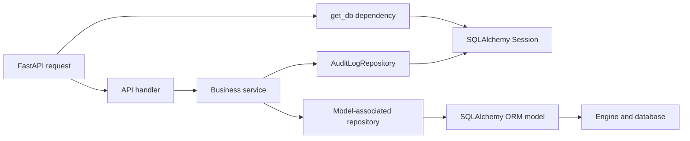

This page traces how backend business operations reach SQLAlchemy and how database sessions are created and shared. The central pattern is **request-scoped session injection**: API handlers construct a service with a `Session`; the service applies business rules and delegates persistence to model-associated repositories. The code does not use a uniform transaction boundary: some repositories commit individual writes, while some service operations coordinate multiple changes and commit them together. Sources: [database.py](backend/app/database.py#L1-L95), [deps.py](backend/app/deps.py#L1-L40), [candidate_service.py](backend/app/services/candidate_service.py#L20-L31), [candidate.py](backend/app/models/candidate.py#L67-L78)

## Responsibility boundaries

The API layer receives dependencies and translates HTTP input into service calls. Services perform domain-level validation, lookups, auditing, and multi-entity coordination. Repositories live alongside SQLAlchemy models in `app/models`; they encapsulate queries and persistence operations using the `Session` supplied by their caller. Sources: [candidates.py](backend/app/api/candidates.py#L20-L43), [candidate_service.py](backend/app/services/candidate_service.py#L20-L31), [candidate.py](backend/app/models/candidate.py#L67-L78), [position.py](backend/app/models/position.py#L48-L57)

The diagram shows the common dependency path, not a strict abstraction barrier: services can also mutate ORM entities directly, and API code can create additional sessions for background work. Sources: [deps.py](backend/app/deps.py#L17-L22), [candidates.py](backend/app/api/candidates.py#L31-L43), [interview_service.py](backend/app/services/interview_service.py#L126-L151), [candidates.py](backend/app/api/candidates.py#L102-L110)

## Session lifecycle and engine setup

`database.py` creates a module-level engine and a `SessionLocal` factory. The factory disables autoflush and autocommit and sets `expire_on_commit=False`. `get_db()` creates one session, yields it to its consumer, and closes it in a `finally` block. `deps.get_db()` delegates to this generator, allowing FastAPI endpoints to request a session through dependency injection. Sources: [database.py](backend/app/database.py#L44-L67), [deps.py](backend/app/deps.py#L17-L22)

For SQLite URLs, the engine is created with `check_same_thread=False`. A connection listener configures WAL journal mode, enables foreign keys, and sets `busy_timeout=5000`. The engine also enables `pool_pre_ping`; `init_db()` imports the models before calling `Base.metadata.create_all()`. These are database configuration and table-creation behaviors, not per-request transaction controls. Sources: [database.py](backend/app/database.py#L25-L42), [database.py](backend/app/database.py#L70-L95)

| Concern | Implementation |
|---|---|
| Engine ownership | Module-level `engine`, constructed by `_create_engine()` |
| Session factory | `SessionLocal`, bound to the engine |
| Request session | `get_db()` yields one session and closes it afterward |
| SQLite connection options | `check_same_thread=False`; connection PRAGMAs for WAL, foreign keys, and busy timeout |
| Schema initialization | Imports model classes, then calls `Base.metadata.create_all()` |

Sources: [database.py](backend/app/database.py#L25-L95)

## Services: business rules and orchestration

Services receive a `Session` in their constructor and pass it to repositories. For example, `CandidateService` initializes candidate and audit repositories; `PositionService` initializes position and audit repositories. Their methods combine persistence with checks such as input validation, related-entity existence, audit creation, and deletion policy. Sources: [candidate_service.py](backend/app/services/candidate_service.py#L20-L31), [position_service.py](backend/app/services/position_service.py#L17-L25)

`CandidateService.create_candidate()` validates required fields and resume type, verifies the position exists, creates the candidate, and records an audit event. `PositionService.delete_position()` checks for associated candidates and interviews before deleting. `InterviewService.update_interview()` validates status changes, updates the loaded ORM object directly, commits, refreshes it, and then writes an audit record. This last example illustrates that repository use is a pattern, not an enforced rule: services also perform direct session operations. Sources: [candidate_service.py](backend/app/services/candidate_service.py#L51-L103), [position_service.py](backend/app/services/position_service.py#L112-L154), [interview_service.py](backend/app/services/interview_service.py#L126-L160)

## Repositories: queries and persistence

Repositories are lightweight classes initialized with a SQLAlchemy `Session`. They expose entity-oriented methods such as `get`, `list_all`, `create`, `update`, and `delete`, using ORM queries and mapped model instances. For instance, `PositionRepository.list_all()` applies an optional status filter, orders by descending ID, and then applies offset and limit. Sources: [position.py](backend/app/models/position.py#L48-L71), [candidate.py](backend/app/models/candidate.py#L67-L105), [interview.py](backend/app/models/interview.py#L102-L139)

Repository transaction behavior varies. `PositionRepository.create()` commits and refreshes; `CandidateRepository.create()` does the same. In contrast, `CandidateRepository.delete()` stages deletion without committing, explicitly leaving commit responsibility to the service. `AuditLogRepository.create()` commits its audit row. Callers therefore cannot assume that a service method’s operations share one atomic commit merely because they use the same session. Sources: [position.py](backend/app/models/position.py#L73-L102), [candidate.py](backend/app/models/candidate.py#L107-L142), [candidate.py](backend/app/models/candidate.py#L169-L177), [audit_log.py](backend/app/models/audit_log.py#L64-L98)

## Commit boundaries and coordination

The clearest coordinated transaction is `CandidateService.delete_candidate()`: it removes interview questions and interviews, deletes the candidate through the session, creates an audit entry, and then commits the session. However, `AuditLogRepository.create()` itself commits. Since the audit repository is called before the service’s final `db.commit()`, the operation is not implemented as a single explicit commit boundary across all those steps. Similarly, several create/update repository methods commit before their service records an audit event. Sources: [candidate_service.py](backend/app/services/candidate_service.py#L103-L153), [audit_log.py](backend/app/models/audit_log.py#L64-L98), [position.py](backend/app/models/position.py#L73-L129)

This mixed policy matters when changing persistence code: adding a repository call can introduce an earlier commit into an operation that otherwise appears coordinated. Review each invoked method’s commit behavior when assessing atomicity or error handling; the code shown does not define a shared unit-of-work abstraction. Sources: [candidate_service.py](backend/app/services/candidate_service.py#L103-L153), [candidate.py](backend/app/models/candidate.py#L107-L142), [audit_log.py](backend/app/models/audit_log.py#L64-L98)

## Background work and separate sessions

The request-scoped session is not reused by the candidate parsing background path. The API schedules parsing, and its helper imports `SessionLocal`; the status-update helper is called after parsing succeeds or fails. This establishes a separate-session mechanism for background persistence rather than retaining the request’s `db` session across the asynchronous task. Sources: [candidates.py](backend/app/api/candidates.py#L82-L110), [database.py](backend/app/database.py#L44-L67)

Authentication dependencies also use the injected session to query repositories: `get_current_user()` resolves a user through `UserRepository`, while `get_current_candidate()` resolves an interview by token through `InterviewRepository`. This keeps database access in dependencies on the same request-provided session model used by handlers. Sources: [deps.py](backend/app/deps.py#L25-L68)

## Practical reading guide

When following a database-backed feature, start at its API handler to identify the injected `Session` and service construction; inspect the service for validation, cross-entity coordination, and audit behavior; then inspect each repository method for query shape and whether it commits. Finish at `database.py` to understand session cleanup and engine configuration. Sources: [candidates.py](backend/app/api/candidates.py#L31-L43), [candidate_service.py](backend/app/services/candidate_service.py#L20-L31), [candidate.py](backend/app/models/candidate.py#L67-L78), [database.py](backend/app/database.py#L25-L67)

For adjacent topics, continue with [SQLite WAL, Business Data, and Workflow Checkpoints](18-sqlite-wal-business-data-and-workflow-checkpoints) for persistence distinctions, or [Backend Test Strategy and Workflow Test Doubles](28-backend-test-strategy-and-workflow-test-doubles) for test coverage and database test setup. Sources: [database.py](backend/app/database.py#L25-L42)