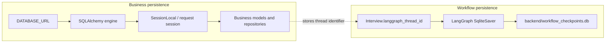
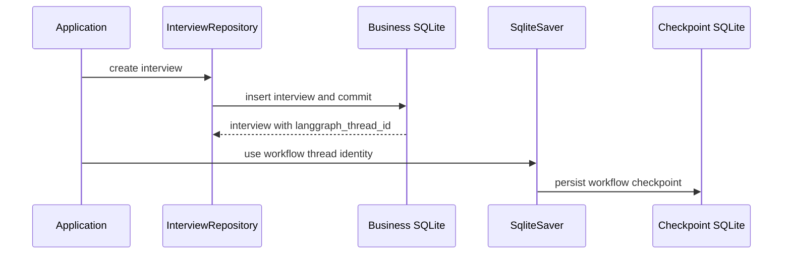

This page explains how the backend uses SQLite for two distinct kinds of persistence: SQLAlchemy-managed recruitment data and LangGraph workflow checkpoints. The distinction matters operationally: the stores have separate configuration paths, lifecycles, and purposes. [18 — SQLite WAL, Business Data, and Workflow Checkpoints](18-sqlite-wal-business-data-and-workflow-checkpoints) is the current page in the catalog. Sources: [database.py](backend/app/database.py#L1-L95), [checkpointer.py](backend/app/workflow/checkpointer.py#L1-L59)

## Two stores, two responsibilities

The **business database** stores application entities such as interviews and is configured through `DATABASE_URL`. The **checkpoint database** stores LangGraph execution state and is located at `backend/workflow_checkpoints.db` by the checkpointer implementation. The workflow’s `langgraph_thread_id` field links an interview record to the workflow thread; it is an identifier, not a copy of checkpoint state. Sources: [config.py](backend/app/config.py#L29-L35), [database.py](backend/app/database.py#L23-L49), [checkpointer.py](backend/app/workflow/checkpointer.py#L22-L48), [interview.py](backend/app/models/interview.py#L18-L27), [interview.py](backend/app/models/interview.py#L57-L66)

The diagram separates the identifier relationship from the persistence mechanisms: SQLAlchemy manages the interview row, while LangGraph’s `SqliteSaver` manages checkpoints. Sources: [database.py](backend/app/database.py#L23-L49), [checkpointer.py](backend/app/workflow/checkpointer.py#L22-L48), [interview.py](backend/app/models/interview.py#L57-L66)

## Business database: engine, sessions, and WAL

For SQLite URLs, the SQLAlchemy engine is created with `check_same_thread=False`. A connection event applies `PRAGMA journal_mode=WAL`, enables foreign keys, and configures `PRAGMA busy_timeout=5000`. The code comment describes WAL as allowing concurrent reads without blocking writes; `busy_timeout` sets the connection’s lock-wait period to five seconds. These settings are installed on business-database connections created by this engine. Sources: [database.py](backend/app/database.py#L23-L49)

`SessionLocal` is a session factory bound to that engine. `get_db()` creates one session for a FastAPI dependency invocation and closes it in a `finally` block. `init_db()` imports the model classes, ensures the SQLite file’s parent directory exists, and calls `Base.metadata.create_all`; it creates missing tables, rather than expressing a migration history. Sources: [database.py](backend/app/database.py#L52-L95)

The default configured business URL is `sqlite:///./interview.db`. Its relative location depends on the process working directory; deployments can supply a different `DATABASE_URL`. The checkpointer path, by contrast, is derived from the checkpointer module’s location, so changing the business URL does not, in this code, relocate the checkpoint database. Sources: [config.py](backend/app/config.py#L29-L35), [checkpointer.py](backend/app/workflow/checkpointer.py#L22-L28)

| Concern | Business database | Workflow checkpoint store |
|---|---|---|
| Main purpose | Recruitment entities and application data | LangGraph checkpoint persistence |
| Access layer | SQLAlchemy engine, sessions, models, repositories | LangGraph `SqliteSaver` |
| Location/configuration | `DATABASE_URL`; default `sqlite:///./interview.db` | `backend/workflow_checkpoints.db` |
| SQLite options shown in code | WAL, foreign keys, 5-second busy timeout, cross-thread connection option | Direct `sqlite3.connect(..., check_same_thread=False)` in synchronous getter |
| Interview association | Stores `langgraph_thread_id` on the interview | Uses workflow thread identity for checkpoint association |

Sources: [config.py](backend/app/config.py#L29-L35), [database.py](backend/app/database.py#L23-L49), [database.py](backend/app/database.py#L52-L68), [checkpointer.py](backend/app/workflow/checkpointer.py#L22-L48), [interview.py](backend/app/models/interview.py#L57-L66)

## Business records and workflow identity

The `Interview` model contains the business status, timing, question-progress, result, and report fields. It also has a unique `langgraph_thread_id`, populated by a UUID-generating default. The repository’s `create()` method creates the interview with status `0`, commits it, and refreshes the instance; its docstring identifies automatic token and workflow-thread generation. The model therefore provides the business-side handle used to associate an interview with workflow persistence, while the checkpoint content is held separately. Sources: [interview.py](backend/app/models/interview.py#L18-L27), [interview.py](backend/app/models/interview.py#L33-L66), [interview.py](backend/app/models/interview.py#L117-L154)

The sequence illustrates the two persistence paths without implying that the interview insert and checkpoint write form one cross-database transaction. The inspected implementation uses separate database mechanisms; it does not show a shared transaction spanning both stores. Sources: [interview.py](backend/app/models/interview.py#L117-L154), [checkpointer.py](backend/app/workflow/checkpointer.py#L31-L48)

## Checkpointer lifecycle and concurrency boundary

`get_checkpointer()` is a context manager that opens a `SqliteSaver` through `SqliteSaver.from_conn_string()` for the checkpoint file. `get_checkpointer_sync()` instead maintains a module-level singleton: on first use it opens a direct SQLite connection with `check_same_thread=False`, wraps it in `SqliteSaver`, and returns it for reuse. `reset_checkpointer()` attempts to exit the current saver and clears the singleton, with its docstring identifying testing as the use case. Sources: [checkpointer.py](backend/app/workflow/checkpointer.py#L15-L59)

The checkpointer module describes SQLite as the MVP persistence choice and mentions `PostgresSaver` as a possible production option for multi-replica deployment. This is a stated future direction, not evidence that PostgreSQL support is currently configured. The checkpointer code shown also does not apply the business engine’s WAL, foreign-key, or busy-timeout pragmas to its direct SQLite connection; do not assume those business-engine settings apply to the checkpoint store. Sources: [checkpointer.py](backend/app/workflow/checkpointer.py#L1-L10), [checkpointer.py](backend/app/workflow/checkpointer.py#L31-L48), [database.py](backend/app/database.py#L23-L49)

## Operational implications

Treat the files as separate persistence assets when configuring backups, restoring state, or moving an installation: the business database is selected through `DATABASE_URL`, while the checkpoint location is constructed independently. A backup procedure intended to preserve both recruitment records and resumable workflow state needs to account for both stores. This is a consequence of the separate paths and implementations; the cited code does not define a coordinated backup or restore routine. Sources: [config.py](backend/app/config.py#L29-L35), [checkpointer.py](backend/app/workflow/checkpointer.py#L22-L48)

The application startup calls `init_db()` for business tables and logs a warning if that initialization raises an exception. This initializes the SQLAlchemy-managed store; the checkpointer is managed separately by its factory and singleton functions. Avoid interpreting successful business-table initialization as verification that checkpoint persistence is available. Sources: [main.py](backend/app/main.py#L35-L67), [database.py](backend/app/database.py#L72-L95), [checkpointer.py](backend/app/workflow/checkpointer.py#L15-L48)

## Continue reading

For the broader session, repository, and service boundaries, continue with [Service Layer, Repositories, and Database Sessions](17-service-layer-repositories-and-database-sessions). For workflow persistence wiring and injection, see [Workflow Dependency Injection and Checkpoint Persistence](12-workflow-dependency-injection-and-checkpoint-persistence). For backup and operational procedures, see [Persistent Files, Database Backups, and Operational Safety](31-persistent-files-database-backups-and-operational-safety). Sources: [database.py](backend/app/database.py#L52-L68), [checkpointer.py](backend/app/workflow/checkpointer.py#L15-L48)