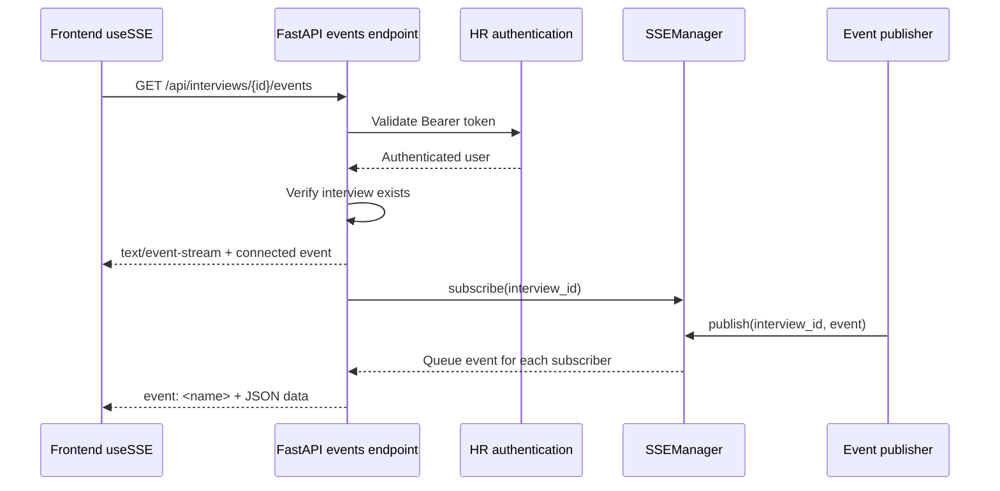
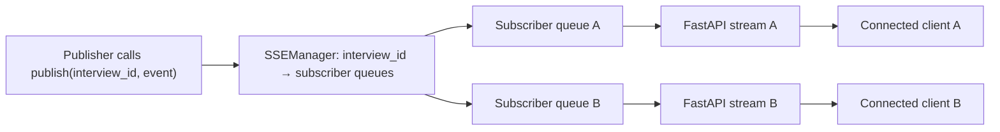

This page explains how the backend streams interview-scoped events to connected clients, how the frontend consumes them, and which deployment settings preserve the stream. The implementation is an in-memory asynchronous pub/sub path: it provides live delivery to active subscribers, not durable event history. Sources: [events.py](backend/app/api/events.py#L26-L63) [sse_manager.py](backend/app/services/sse_manager.py#L26-L92)

## End-to-end flow

The SSE endpoint validates the requested interview and requires an authenticated HR user. It then emits a connection event and streams events received from the manager’s per-interview subscriber queues. The browser uses `EventSource` to connect and dispatches named events to registered handlers. Sources: [events.py](backend/app/api/events.py#L26-L47) [useSSE.ts](frontend/src/hooks/useSSE.ts#L53-L114) [deps.py](backend/app/deps.py#L27-L68)

Sources: [events.py](backend/app/api/events.py#L26-L47) [sse_manager.py](backend/app/services/sse_manager.py#L33-L71) [deps.py](backend/app/deps.py#L27-L68)

## Endpoint and wire format

The endpoint is `GET /api/interviews/{interview_id}/events`. It sets `text/event-stream`, disables caching, requests a persistent connection, and sends `X-Accel-Buffering: no` for Nginx. Each event is encoded as an SSE `event:` field followed by a JSON `data:` field and a blank line. The first event is `connected`; its payload includes the interview ID and a timestamp derived from the running event loop. Sources: [events.py](backend/app/api/events.py#L23-L63)

| Element | Implementation |
|---|---|
| Route | `GET /api/interviews/{interview_id}/events` |
| Access control | `get_current_user` validates the Bearer access token |
| Interview check | `InterviewService.get_interview(interview_id)` confirms that the interview exists |
| Content type | `text/event-stream` |
| Initial event | `connected` |
| Event framing | `event: <name>\ndata: <JSON>\n\n` |
| Proxy hint | `X-Accel-Buffering: no` |

Sources: [events.py](backend/app/api/events.py#L23-L63) [deps.py](backend/app/deps.py#L27-L68)

**Authentication integration detail:** the backend route depends on a Bearer token in the `Authorization` header. The shown frontend hook constructs `new EventSource(url, { withCredentials: false })` and does not set an `Authorization` header. Native `EventSource` does not expose a general custom-header option, so this hook, by itself, does not demonstrate how the required Bearer token reaches this endpoint. Check the application’s actual URL/auth integration before relying on this connection path; do not assume the hook’s `withCredentials` option supplies a Bearer token. Sources: [events.py](backend/app/api/events.py#L26-L32) [deps.py](backend/app/deps.py#L27-L45) [useSSE.ts](frontend/src/hooks/useSSE.ts#L61-L69)

## In-memory publish/subscribe

`SSEManager` stores a set of `asyncio.Queue` objects for each interview ID. A subscriber registers a queue and waits for events; `publish` serializes the supplied payload to JSON-compatible data, wraps it with an event name, and enqueues it for each current subscriber. The structure is process-local and the endpoint does not read from a persistent event log, so a client connecting after an event was published does not receive that past event. Sources: [sse_manager.py](backend/app/services/sse_manager.py#L26-L71) [events.py](backend/app/api/events.py#L37-L47)

Sources: [sse_manager.py](backend/app/services/sse_manager.py#L29-L71) [events.py](backend/app/api/events.py#L37-L47)

Each subscriber queue has a maximum size of 100. If it is full, `publish` drops the new event rather than blocking the publisher; despite a nearby comment referring to dropping the oldest item, the implementation does not remove an existing queue item. `close_session` attempts to enqueue a `None` sentinel to terminate subscribers, but silently skips it when a queue is full. These behaviors make the stream best suited to live notifications where consumers can recover current state elsewhere, not as a lossless event transport. Sources: [sse_manager.py](backend/app/services/sse_manager.py#L33-L50) [sse_manager.py](backend/app/services/sse_manager.py#L52-L80)

## Event names and frontend dispatch

The hook’s `knownEvents` list determines which named SSE messages it listens for. For each listed event, it parses the JSON payload, calls handlers registered with `on(eventName, handler)`, also calls wildcard handlers registered as `"*"`, and appends the event to local state. A parse failure is ignored. The hook exposes `connected`, accumulated `events`, and `on`; calling `on` returns an unsubscribe function. Sources: [useSSE.ts](frontend/src/hooks/useSSE.ts#L15-L50) [useSSE.ts](frontend/src/hooks/useSSE.ts#L86-L110) [useSSE.ts](frontend/src/hooks/useSSE.ts#L127-L127)

The TypeScript event definitions describe a broader union of interview and processing events, including connection, status, resume parsing, question generation, transcription, report, and failure events. They are documentation/types in the frontend; the hook’s explicit listener list is the runtime allowlist for dispatch in this implementation. A union member absent from `knownEvents` will not be handled by this hook unless the listener list is updated. Sources: [events.ts](frontend/src/types/events.ts#L16-L160) [useSSE.ts](frontend/src/hooks/useSSE.ts#L86-L110)

| Concern | Current behavior |
|---|---|
| Named event delivery | Explicit listeners are installed for names in `knownEvents` |
| Handler registration | `on(name, handler)` adds a handler and returns an unsubscribe function |
| Wildcard registration | `"*"` handlers receive `{ event, data }` |
| Parse errors | Silently ignored |
| Event history | Appended to hook state; no trimming is shown |
| Reconnection | On error, marks disconnected and schedules a new connection after 3 seconds |

Sources: [useSSE.ts](frontend/src/hooks/useSSE.ts#L27-L50) [useSSE.ts](frontend/src/hooks/useSSE.ts#L71-L84) [useSSE.ts](frontend/src/hooks/useSSE.ts#L101-L109)

## Connection lifecycle and delivery limits

The endpoint catches `asyncio.CancelledError` when the client disconnects. The async generator’s `finally` block removes its queue from the interview’s subscriber set. The endpoint comments describe heartbeat handling, but no heartbeat frame is yielded in the shown generator; the comment says client-side disconnect detection handles reconnection. The frontend hook closes the active `EventSource` on cleanup and schedules its own reconnect after three seconds on an error. Sources: [events.py](backend/app/api/events.py#L37-L53) [sse_manager.py](backend/app/services/sse_manager.py#L41-L50) [useSSE.ts](frontend/src/hooks/useSSE.ts#L75-L84) [useSSE.ts](frontend/src/hooks/useSSE.ts#L116-L124)

The stream is not a durable queue: subscribers receive only events published while their queues are registered, and queue overflow can drop new events. The implementation also does not show event IDs or replay cursors. Therefore, reconnecting restores a live subscription but does not, by itself, replay missed progress. Sources: [sse_manager.py](backend/app/services/sse_manager.py#L33-L71) [events.py](backend/app/api/events.py#L43-L47) [useSSE.ts](frontend/src/hooks/useSSE.ts#L75-L84)

## Reverse-proxy requirements

The Nginx configuration has a dedicated location for interview event URLs. It disables response buffering and caching, sets one-hour proxy read and send timeouts, uses HTTP/1.1, and clears the `Connection` header for upstream keep-alive. These settings complement the response’s `X-Accel-Buffering: no` header and prevent the proxy from treating the stream like a short ordinary API response. Sources: [nginx.conf](nginx/nginx.conf#L57-L70) [events.py](backend/app/api/events.py#L55-L63)

| Layer | SSE-relevant setting | Purpose |
|---|---|---|
| FastAPI response | `Cache-Control: no-cache` | Avoid caching the stream |
| FastAPI response | `X-Accel-Buffering: no` | Tell Nginx not to buffer this response |
| Nginx SSE location | `proxy_buffering off` and `proxy_cache off` | Forward events without proxy buffering or caching |
| Nginx SSE location | `proxy_read_timeout 1h`, `proxy_send_timeout 1h` | Allow a long-lived upstream stream |
| Nginx SSE location | HTTP/1.1 and `Connection ""` | Configure upstream connection handling |

Sources: [events.py](backend/app/api/events.py#L55-L63) [nginx.conf](nginx/nginx.conf#L57-L70)

## Practical implications

When adding an event, keep the backend payload’s `event` value aligned with the frontend listener name and the corresponding TypeScript union member. Confirm that any intended event is present in the hook’s `knownEvents` list; otherwise, the hook will not dispatch it. For important state transitions, treat SSE as a notification channel and retrieve authoritative state through the application’s normal data path rather than depending on replay or lossless delivery. Sources: [sse_manager.py](backend/app/services/sse_manager.py#L52-L71) [useSSE.ts](frontend/src/hooks/useSSE.ts#L86-L110) [events.ts](frontend/src/types/events.ts#L141-L160)

For related implementation context, continue with [SSE Subscription and Typed Event Handling](26-sse-subscription-and-typed-event-handling) for frontend consumption, and [Docker Compose, Nginx, and SSE-Aware Deployment](30-docker-compose-nginx-and-sse-aware-deployment) for deployment behavior. Sources: [useSSE.ts](frontend/src/hooks/useSSE.ts#L20-L127) [nginx.conf](nginx/nginx.conf#L57-L70)