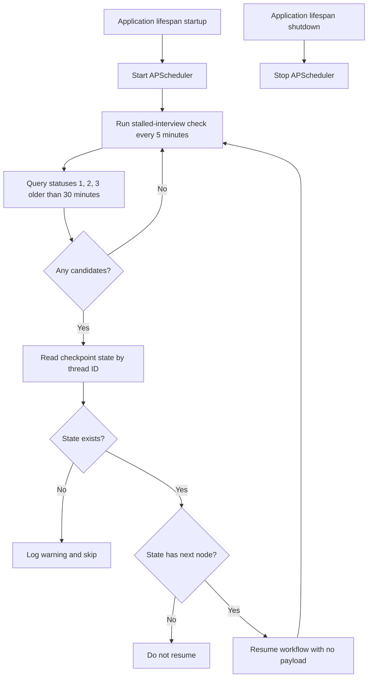

This page explains the backend’s scheduled recovery mechanism: how the application starts and stops its scheduler, which interviews qualify as stalled, and how recovery attempts to continue a workflow from its LangGraph checkpoint. It covers only scheduling and stalled-interview recovery; workflow internals and checkpoint storage are covered in [LangGraph Nodes, Interrupts, and Resume Semantics](11-langgraph-nodes-interrupts-and-resume-semantics) and [Workflow Dependency Injection and Checkpoint Persistence](12-workflow-dependency-injection-and-checkpoint-persistence). Sources: [scheduler.py](backend/app/workers/scheduler.py#L1-L10)

## The recovery model

The scheduler is a **periodic recovery trigger**, not a separate workflow engine. It selects interviews in active statuses whose `updated_at` timestamp is older than the configured age threshold, looks up each interview’s workflow state using its thread ID, and asks the graph to resume if the state indicates there is a next node. Sources: [scheduler.py](backend/app/workers/scheduler.py#L26-L63) [interview.py](backend/app/models/interview.py#L121-L132)



The diagram shows the implemented control flow. A missing checkpoint and a state with no pending next node are both non-resume outcomes; the scheduler does not create a replacement checkpoint or alter the interview’s status itself. Sources: [scheduler.py](backend/app/workers/scheduler.py#L38-L71)

## Lifecycle and cadence

FastAPI’s lifespan starts the scheduler after database initialization, storage setup, and the Whisper-model loading attempt. Startup errors are caught and logged as `scheduler_start_skipped`, allowing application startup to continue. On shutdown, the lifespan calls `stop_scheduler()` and logs a warning if stopping fails. Sources: [main.py](backend/app/main.py#L37-L40) [main.py](backend/app/main.py#L103-L120)

The scheduler is held in a module-level singleton. `start_scheduler()` returns immediately if that singleton is already set; otherwise it creates an `AsyncIOScheduler`, registers the `check_stuck_interviews` job with a five-minute cron interval, and starts it. Shutdown uses `wait=False`, catches shutdown exceptions, and clears the singleton reference. Sources: [scheduler.py](backend/app/workers/scheduler.py#L22-L24) [scheduler.py](backend/app/workers/scheduler.py#L74-L107)

| Concern | Implemented behavior |
|---|---|
| Scheduler type | APScheduler `AsyncIOScheduler` |
| Job cadence | Every five minutes (`CronTrigger(minute="*/5")`) |
| Startup hook | FastAPI lifespan |
| Shutdown behavior | Scheduler shutdown with `wait=False` |
| Duplicate start guard | Return if the module-level scheduler already exists |
| Startup failure | Logged; does not propagate from the lifespan startup block |

Sources: [scheduler.py](backend/app/workers/scheduler.py#L74-L107) [main.py](backend/app/main.py#L103-L120)

## Candidate selection

A record qualifies for inspection when its status is **1, 2, or 3** and its `updated_at` value is earlier than the current UTC time minus 30 minutes. The repository computes the cutoff as a Unix timestamp and applies it as a database filter. The model documents statuses 1–3 as questions ready, interview in progress, and interview completed; status 4 (report generated) is outside the scheduler’s query. Sources: [scheduler.py](backend/app/workers/scheduler.py#L26-L41) [interview.py](backend/app/models/interview.py#L40-L42) [interview.py](backend/app/models/interview.py#L121-L132)

The threshold uses the interview’s **last-update timestamp**, not its creation or start time. Status changes update `updated_at`, and question generation also updates it. Therefore, “stalled” here means “an interview in one of the queried statuses has not been updated for at least 30 minutes”; it is not an independent liveness signal from the workflow runtime. Sources: [interview.py](backend/app/models/interview.py#L73-L79) [interview.py](backend/app/models/interview.py#L160-L195)

## Recovery decision and execution

For each selected interview, the job reads `langgraph_thread_id` and calls `get_workflow_state(thread_id)`. If no state snapshot is returned, it logs `stuck_interview_no_checkpoint` and moves on. If a snapshot exists, the scheduler only attempts recovery when `state_snapshot.next` is truthy; it logs the pending node and calls `resume_workflow(thread_id, None)`. Per-interview exceptions are caught and logged as `stuck_interview_resume_failed`, so a failure for one candidate does not exit the loop. Sources: [scheduler.py](backend/app/workers/scheduler.py#L44-L69)

The `None` payload is deliberate in this recovery path: the scheduler does not supply candidate-answer data. The graph’s resume entry point invokes the graph with a LangGraph `Command(resume=resume_payload)` and the interview’s thread ID. The scheduler’s decision is based on the checkpoint’s `next` field; it does not itself inspect individual workflow nodes or determine which business operation should run next. Sources: [scheduler.py](backend/app/workers/scheduler.py#L55-L63) [graph.py](backend/app/workflow/graph.py#L105-L117)

```mermaid
sequenceDiagram
    participant Job as APScheduler job
    participant Repo as InterviewRepository
    participant Check as Workflow state lookup
    participant Graph as Workflow resume
    Job->>Repo: list_by_status([1, 2, 3], older_than_minutes=30)
    Repo-->>Job: stale interview records
    loop Each interview
        Job->>Check: get_workflow_state(thread_id)
        alt No checkpoint
            Check-->>Job: None
            Job->>Job: Log warning; skip
        else State has next node
            Check-->>Job: snapshot with next
            Job->>Graph: resume_workflow(thread_id, None)
        else No next node
            Check-->>Job: snapshot without next
            Job->>Job: Skip resume
        end
    end
```

Sources: [scheduler.py](backend/app/workers/scheduler.py#L38-L71) [graph.py](backend/app/workflow/graph.py#L105-L117)

## Operational interpretation

| Observed condition | Scheduler behavior | Evidence to inspect |
|---|---|---|
| No stale interviews | Returns from the job without per-interview processing | Query result handling |
| Stale interview has no checkpoint | Logs a warning and skips it | `stuck_interview_no_checkpoint` |
| Checkpoint has no next node | Does not call resume | `state_snapshot.next` condition |
| Resume raises an exception | Logs the interview ID and exception; continues processing | `stuck_interview_resume_failed` |
| Scheduler startup raises | Application lifespan logs a warning and continues startup | `scheduler_start_skipped` |

Sources: [scheduler.py](backend/app/workers/scheduler.py#L40-L69) [main.py](backend/app/main.py#L103-L108)

The scheduler’s code does not explicitly change an interview’s status after a resume attempt, retry a failed resume immediately, or report a recovery result through a dedicated API. A later scheduled run can inspect records again if they still match the status-and-age query. These are boundaries of this implementation, not guarantees about how the resumed workflow may subsequently update business data. Sources: [scheduler.py](backend/app/workers/scheduler.py#L38-L71) [interview.py](backend/app/models/interview.py#L121-L132)

For the adjacent implementation details, continue to [LangGraph Nodes, Interrupts, and Resume Semantics](11-langgraph-nodes-interrupts-and-resume-semantics) for graph execution behavior, or [SQLite WAL, Business Data, and Workflow Checkpoints](18-sqlite-wal-business-data-and-workflow-checkpoints) for persistence context. Sources: [scheduler.py](backend/app/workers/scheduler.py#L48-L63)