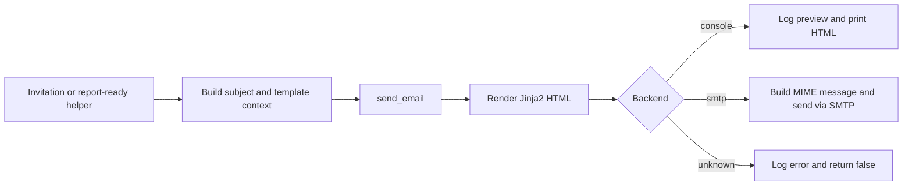

This page explains the backend’s email templates and delivery path: how callers provide notification data, how the service renders HTML, and how delivery backends report success or failure. The implementation exposes invitation and report-ready helper functions, but the default backend currently logs and prints email content rather than sending it to an SMTP server. Sources: [email_service.py](backend/app/services/email_service.py#L1-L35)

## Delivery architecture

The service separates **notification construction**, **template rendering**, and **transport**. Convenience functions build a subject and template context; `send_email` renders the named HTML template, then delegates to either the console or SMTP sender. The default backend is console, so SMTP is not selected automatically by current configuration. Sources: [email_service.py](backend/app/services/email_service.py#L38-L93)

## Templates and notification data

The templates are HTML files loaded from `backend/app/templates/email`. Jinja2 is configured with HTML/XML autoescaping, so interpolated values in these HTML templates are escaped during rendering. `interview_invite.html` uses candidate name, position, interview time, and interview URL to present the invitation and a link to start the interview. Sources: [email_service.py](backend/app/services/email_service.py#L32-L45), [interview_invite.html](backend/app/templates/email/interview_invite.html#L1-L45)

`report_ready.html` displays the position, overall score, recommendation, and report link. Its recommendation styling depends on `is_passed`; the helper maps that boolean to the Chinese recommendation text “推荐录用” or “暂未通过”. Sources: [report_ready.html](backend/app/templates/email/report_ready.html#L1-L45), [email_service.py](backend/app/services/email_service.py#L161-L194)

| Notification | Helper inputs | Template context assembled by helper |
|---|---|---|
| Interview invitation | Recipient email, candidate name, position name, interview URL, optional interview time | `candidate_name`, `position_name`, `interview_url`, `interview_time`; missing time becomes “请尽快登录查看” |
| Report ready | Recipient email, candidate name, position name, score, report URL, optional pass status | `candidate_name`, `position_name`, `overall_score`, `report_url`, `is_passed`, `recommendation` |

Sources: [email_service.py](backend/app/services/email_service.py#L148-L194)

## Backend behavior and limitations

`send_email` accepts an optional backend override. If omitted, `_get_default_backend()` returns `"console"` unconditionally. The console implementation logs the recipient, subject, rendered HTML length, and preview, then prints up to the first 500 characters of the HTML to standard output; it returns `True`. Consequently, a successful return under the default backend means the message was emitted to logs/stdout—not delivered to a mailbox. Sources: [email_service.py](backend/app/services/email_service.py#L48-L112)

The SMTP implementation builds an HTML MIME message, connects using STARTTLS, optionally authenticates when a username is present, and calls `send_message`. Its host, port, username, password, and sender address are read directly from environment variables, with defaults of `localhost`, `587`, empty credentials, and `noreply@interview-system.local`. Exceptions are logged and converted to `False`; an unknown backend also logs an error and returns `False`. Sources: [email_service.py](backend/app/services/email_service.py#L115-L145)

SMTP settings are not declared in the application’s Pydantic `Settings` model, and the default-backend selector does not inspect them. The code documents asynchronous delivery, retries, and a dead-letter queue as possible enhancements, but the service shown here performs a synchronous send and contains no retry or queue implementation. Sources: [config.py](backend/app/config.py#L1-L92), [email_service.py](backend/app/services/email_service.py#L1-L13), [email_service.py](backend/app/services/email_service.py#L48-L93)

## Verification

The email tests verify console-mode success and logging, template variable rendering, unknown-backend failure, and both passed and not-passed report notifications. They exercise the default helper path, which resolves to console mode; they do not establish that SMTP delivery works against a live mail server. Sources: [test_email.py](backend/tests/test_email.py#L1-L112), [email_service.py](backend/app/services/email_service.py#L88-L93)

## Next steps

For the surrounding backend context, continue with [Background Scheduling and Stalled Interview Recovery](20-background-scheduling-and-stalled-interview-recovery) or [Service Layer, Repositories, and Database Sessions](17-service-layer-repositories-and-database-sessions). Sources: [email_service.py](backend/app/services/email_service.py#L1-L13)