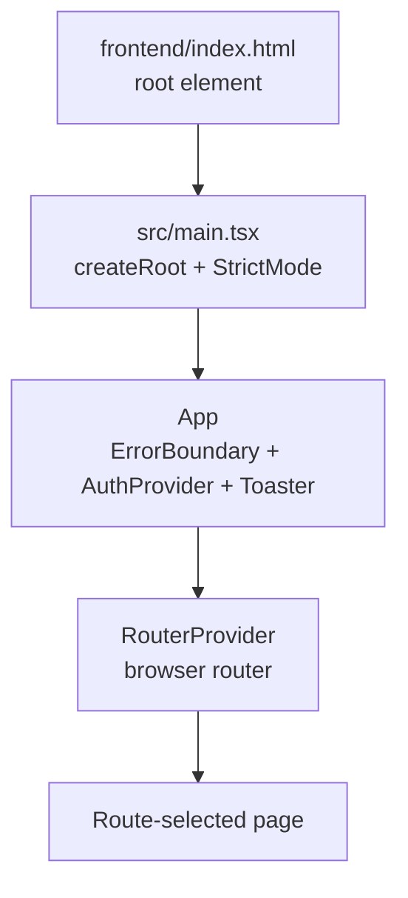
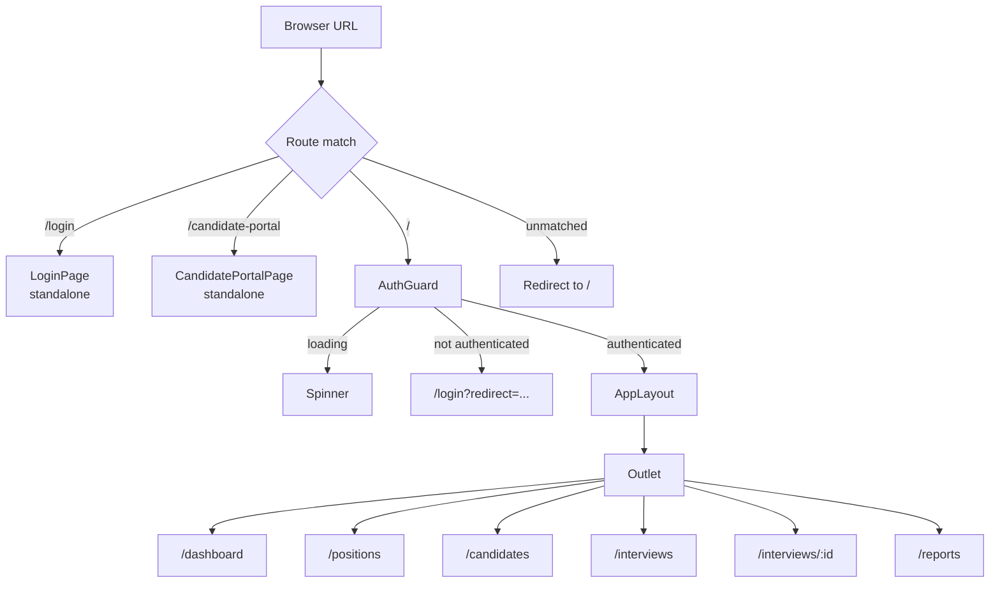

**This page explains how the React frontend starts, how URL paths select screens, and what each page is responsible for.** The central pattern is a single application entry that installs global providers and a browser router. Routes then separate the public candidate and login experiences from the authenticated HR workspace. Sources: [main.tsx](frontend/src/main.tsx#L1-L15), [App.tsx](frontend/src/App.tsx#L1-L24), [routes.tsx](frontend/src/routes.tsx#L1-L44)

## 1. Where the application starts

The HTML shell provides a `root` element and loads `/src/main.tsx` as a JavaScript module. `main.tsx` finds that element, creates the React root, and renders the app inside `StrictMode`. It imports the global stylesheet and supplies both the shared `App` wrapper and the router provider. In practical terms, this is the frontend’s startup chain: HTML → React entry → global wrappers → routed screen. Sources: [index.html](frontend/index.html#L1-L17), [main.tsx](frontend/src/main.tsx#L1-L15)

`App` does not choose pages; it wraps whatever its children are. It places an `ErrorBoundary` outside `AuthProvider`, then renders the children and a global Sonner notification toaster. This gives routes access to shared authentication state and makes notifications available across screens, while the error boundary provides a top-level place to catch rendering errors. Sources: [App.tsx](frontend/src/App.tsx#L1-L24)

The diagram follows the actual rendering composition: the router provider is a child of `App`, and the selected page is determined by the router configuration. `StrictMode` is a React development wrapper; it does not define the application’s URL structure. Sources: [main.tsx](frontend/src/main.tsx#L1-L15), [App.tsx](frontend/src/App.tsx#L12-L24), [routes.tsx](frontend/src/routes.tsx#L8-L17)

## 2. How routing divides the application

`routes.tsx` uses `createBrowserRouter` to define the application’s URL map. The two standalone public routes are `/login` and `/candidate-portal`. The HR routes are nested under `/`; that parent renders `AuthGuard` around `AppLayout`, and its children render inside the layout’s `Outlet`. The root index redirects to `/dashboard`, while the wildcard route redirects unmatched paths to `/`. Sources: [routes.tsx](frontend/src/routes.tsx#L8-L44), [AppLayout.tsx](frontend/src/components/AppLayout.tsx#L14-L22)

`AuthGuard` checks the shared authentication state. While authentication is loading, it displays a centered spinner. If the user is not authenticated, it redirects to `/login` and URL-encodes the requested pathname in a `redirect` query parameter; otherwise, it renders the protected layout. `LoginPage` reads that parameter and navigates there after a successful login, defaulting to `/dashboard` when the parameter is absent. Sources: [AuthGuard.tsx](frontend/src/components/AuthGuard.tsx#L11-L35), [LoginPage.tsx](frontend/src/pages/LoginPage.tsx#L20-L57)

The candidate portal is deliberately outside the HR layout and guard in the route configuration. It reads a `token` query parameter and uses it to load the interview experience; a missing token leads to an error state. This is separate from the `/interviews/:id` HR detail route, which is protected as part of the HR route group. Sources: [routes.tsx](frontend/src/routes.tsx#L18-L44), [CandidatePortalPage.tsx](frontend/src/pages/CandidatePortalPage.tsx#L23-L59)

## 3. What the shared HR layout contributes

`AppLayout` provides the persistent shell for protected HR screens: a sidebar with navigation links, a user-information area, and a main region containing `Outlet`. The navigation links correspond to dashboard, positions, candidates, interviews, and reports. The nested interview detail route is registered but is not a separate item in the sidebar navigation. Sources: [AppLayout.tsx](frontend/src/components/AppLayout.tsx#L14-L22), [AppLayout.tsx](frontend/src/components/AppLayout.tsx#L39-L109), [routes.tsx](frontend/src/routes.tsx#L25-L36)

The layout also handles logout: it calls the authentication context’s `logout`, displays a success toast, and navigates to `/login` with replacement history. Page components therefore focus on their own screen content, while the layout owns shared HR navigation and surrounding structure. Sources: [AppLayout.tsx](frontend/src/components/AppLayout.tsx#L24-L37), [AppLayout.tsx](frontend/src/components/AppLayout.tsx#L67-L78)

## 4. Page responsibilities at a glance

| Route | Page | Responsibility |
|---|---|---|
| `/login` | `LoginPage` | Collects credentials, submits the login request, updates authentication state, and returns to the requested redirect or dashboard. |
| `/candidate-portal` | `CandidatePortalPage` | Uses the URL token to load the candidate interview view and render its loading, error, not-started, in-progress, and completed states. |
| `/dashboard` | `DashboardPage` | Presents KPI cards and a table of recent interviews; its cards navigate to related HR sections. |
| `/positions` | `PositionsPage` | Lists positions and provides create, edit, and delete interactions. |
| `/candidates` | `CandidatesPage` | Lists candidates, loads positions for association, and offers resume upload, detail, download, and deletion interactions. |
| `/interviews` | `InterviewsPage` | Lists interviews and provides interview creation, candidate-link copying, and report-download actions. |
| `/interviews/:id` | `InterviewDetailPage` | Loads one interview with related candidate and position information, displays progress, subscribes to progress events, and exposes report/link actions. |
| `/reports` | `ReportsPage` | Lists completed interviews as reports and provides report downloads. |

These are page-level responsibilities: the route configuration selects the page, while each page component implements its own view and interactions. The table does not describe the details of API request handling, form-validation patterns, audio capture, or event transport; those topics are covered by the dedicated frontend pages in the catalog. Sources: [routes.tsx](frontend/src/routes.tsx#L18-L44), [LoginPage.tsx](frontend/src/pages/LoginPage.tsx#L20-L57), [CandidatePortalPage.tsx](frontend/src/pages/CandidatePortalPage.tsx#L23-L59), [DashboardPage.tsx](frontend/src/pages/DashboardPage.tsx#L20-L60), [PositionsPage.tsx](frontend/src/pages/PositionsPage.tsx#L27-L86), [CandidatesPage.tsx](frontend/src/pages/CandidatesPage.tsx#L25-L101), [InterviewsPage.tsx](frontend/src/pages/InterviewsPage.tsx#L28-L100), [InterviewDetailPage.tsx](frontend/src/pages/InterviewDetailPage.tsx#L30-L91), [ReportsPage.tsx](frontend/src/pages/ReportsPage.tsx#L13-L47)

## 5. A useful way to trace a screen

When learning this frontend, follow a route from the outside inward: find its path in `routes.tsx`, check whether it is nested under `AuthGuard` and `AppLayout`, then open the referenced page component to understand that screen’s responsibility. For example, `/interviews/:id` is a protected child route rendered through the HR layout, and `InterviewDetailPage` reads the `id` parameter to load the matching interview. Sources: [routes.tsx](frontend/src/routes.tsx#L25-L36), [AppLayout.tsx](frontend/src/components/AppLayout.tsx#L86-L109), [InterviewDetailPage.tsx](frontend/src/pages/InterviewDetailPage.tsx#L30-L61)

## Next steps

To understand how pages communicate with backend endpoints and share authentication behavior, continue with [API Client, Authentication State, and Request Handling](23-api-client-authentication-state-and-request-handling). For page-level data fetching, forms, and client validation, see [TanStack Query, Forms, and Client-Side Validation](24-tanstack-query-forms-and-client-side-validation). Sources: [routes.tsx](frontend/src/routes.tsx#L8-L17)